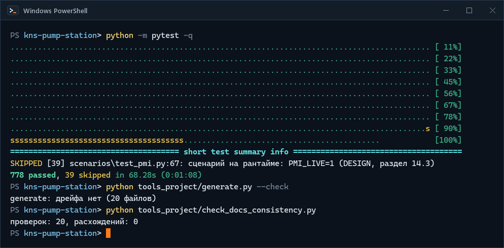
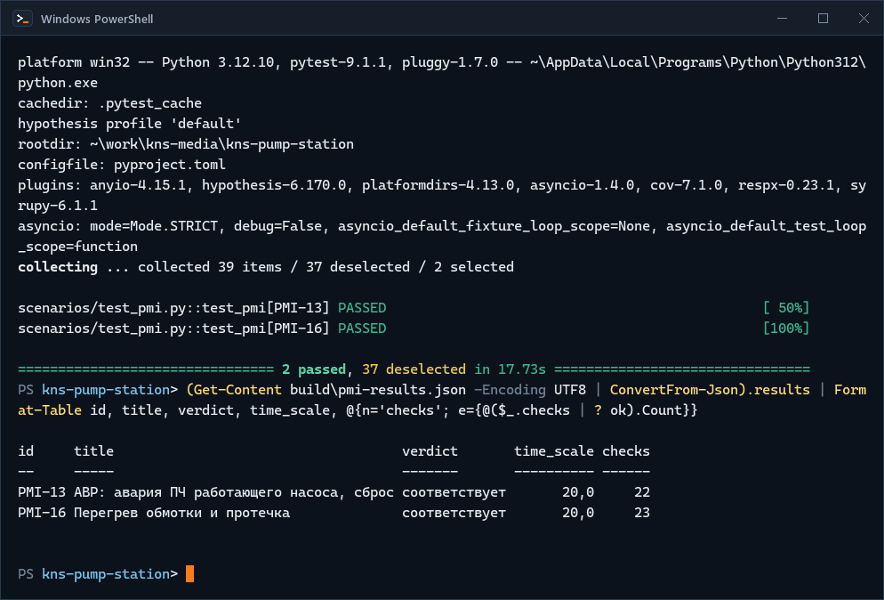
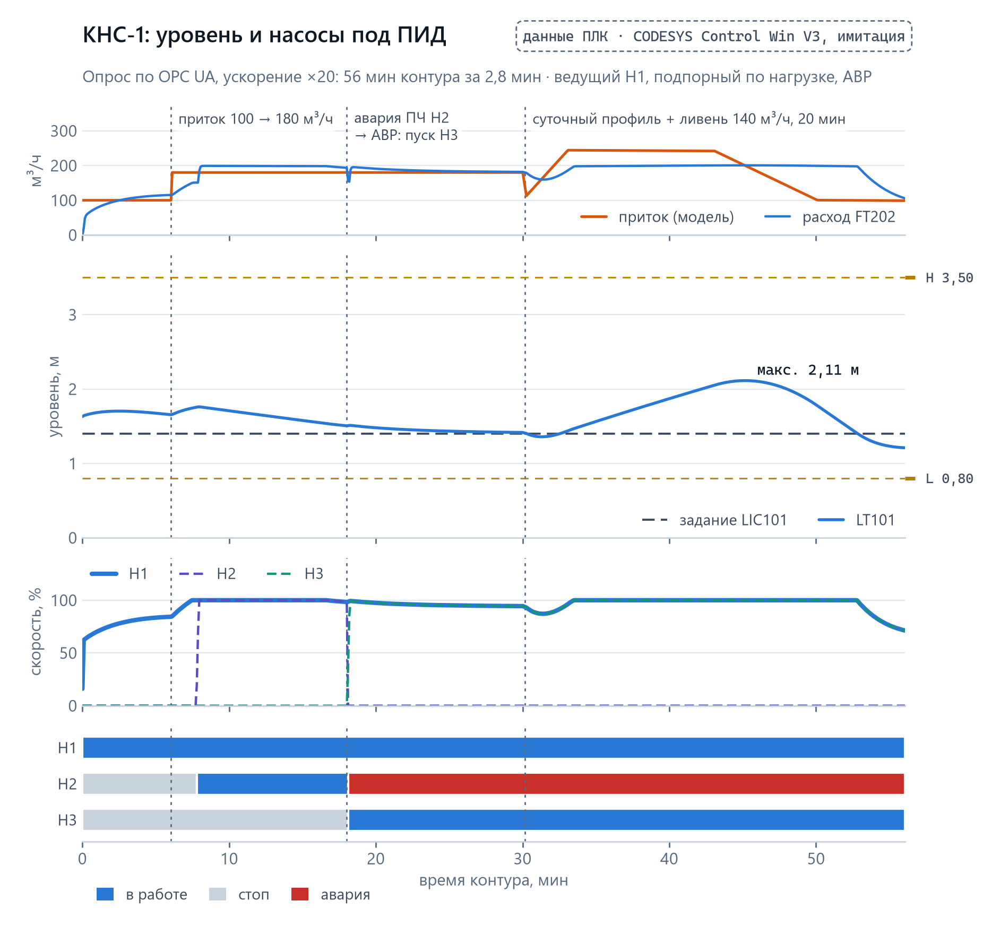
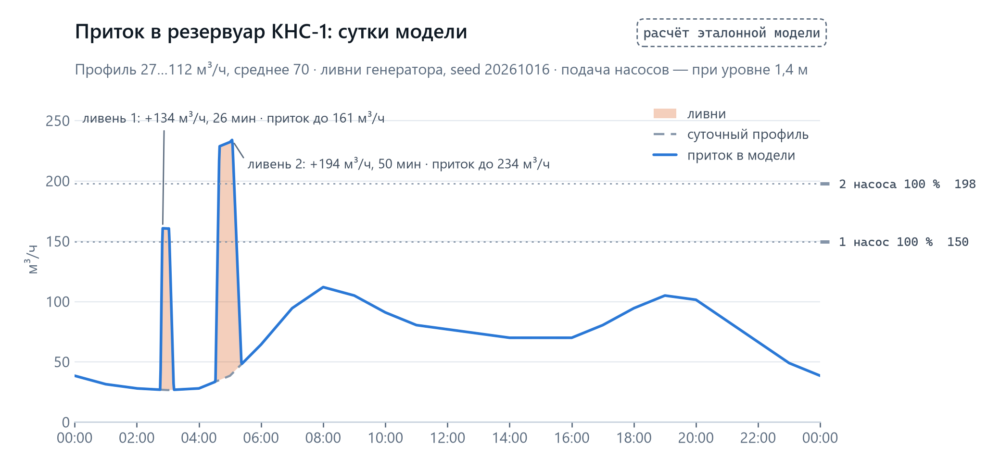
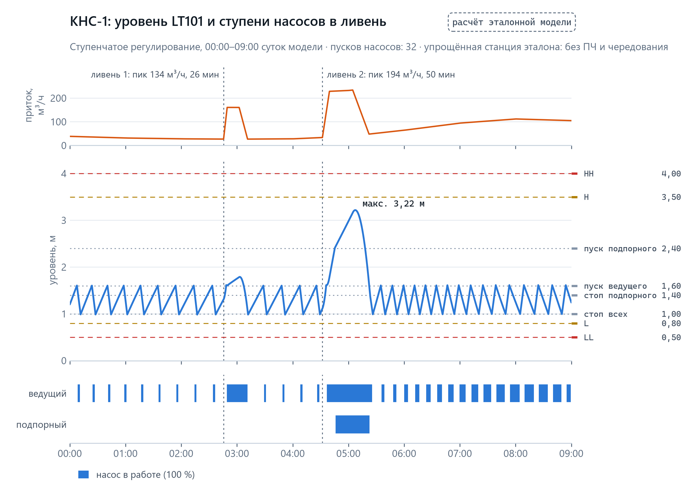
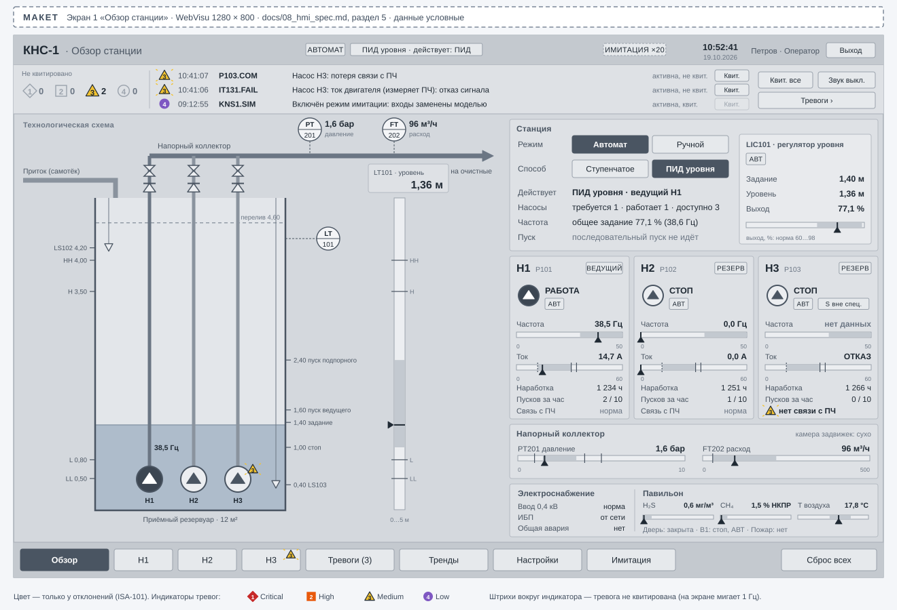
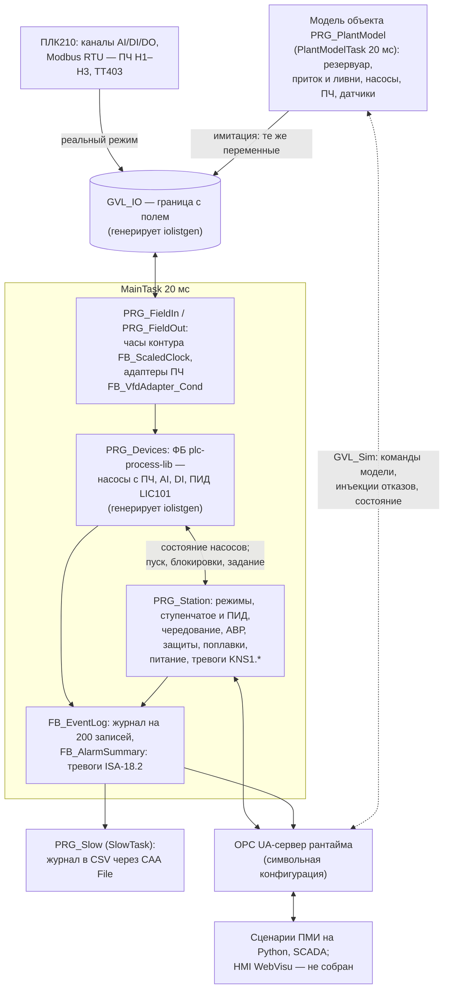
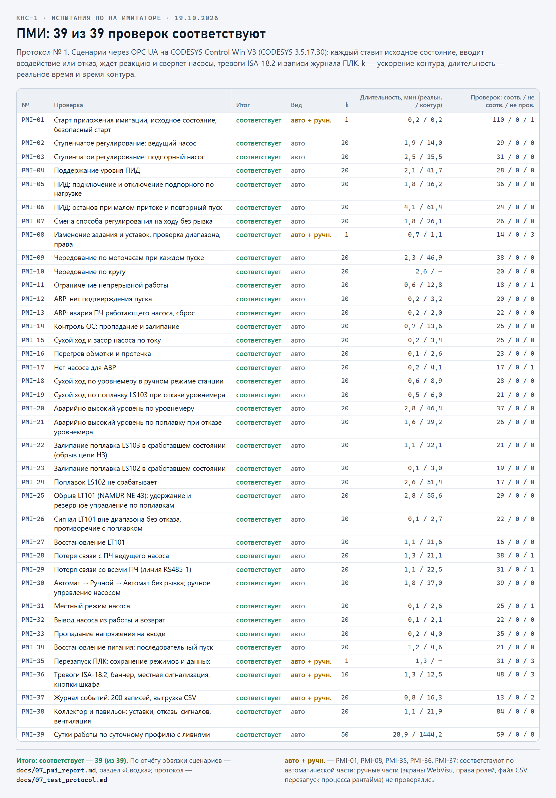

<p align="center">
  <picture>
    <source media="(prefers-color-scheme: dark)" srcset="docs/media/banner-dark.svg">
    <source media="(prefers-color-scheme: light)" srcset="docs/media/banner-light.svg">
    
  </picture>
</p>

<p align="center">
  <a href="https://github.com/kr0nsch/kns-pump-station/actions/workflows/ci.yml"></a> <a href="LICENSE"></a>
     
  <a href="#тесты-и-качество"></a> <a href="docs/07_test_protocol.md"></a>
</p>

<p align="center"><a href="#что-это-и-зачем">Что это</a> · <a href="#как-это-выглядит">Как выглядит</a> · <a href="#быстрый-старт">Быстрый старт</a> · <a href="#как-использовать-в-своём-проекте">На свой объект</a> · <a href="#как-устроено">Как устроено</a> · <a href="#документация">Документация</a> · <a href="#summary-en">Summary (EN)</a></p>

**Канализационная насосная станция на три насоса с ПЧ для CODESYS V3.5 — полный цикл инженера АСУ ТП
на одном объекте: ТЗ, перечень сигналов, алгоритмы, код ST, тревоги, модель объекта и программа
испытаний с автоматическими сценариями.** Логику станции обычно впервые видят в работе на пусконаладке.
Здесь её испытывают без железа: модель резервуара, насосов, ПЧ и сети с инъекцией отказов подменяет
входы ПЛК в CODESYS Control Win, а 39 проверок ПМИ выполняют сценарии на Python через OPC UA: на имитаторе
все 39 соответствуют (протокол № 1). Для инженеров АСУ ТП водоканалов и техлидов интеграторов. Объект КНС-1
вымышленный.

## Что это и зачем

КНС-1 — приёмный резервуар 12 м², три погружных насоса (два рабочих, один резервный) с ПЧ по Modbus
RTU и напорный коллектор. Контроллер — ОВЕН ПЛК210 (в проекте), испытания — на программном ПЛК
CODESYS Control Win V3. КИП: уровнемер LT101 4–20 мА, поплавки LS102 «аварийно высокий» и LS103
«сухой ход», давление PT201 и расход FT202 в коллекторе, напряжение на вводе ES301, переключатели
«местное/дистанционное» насосов. Всё — в одном перечне сигналов [docs/03_io_list.csv](docs/03_io_list.csv):
58 сигналов, 29 устройств.

| Функция | Как | Документ |
|---|---|---|
| Режимы | автомат, ручной с HMI, местный по насосу; переходы без рывков | [04_algorithms.md](docs/04_algorithms.md), раздел 3 |
| Регулирование (параметр) | ступенчатое по уровням 1,60 / 2,40 / 1,40 / 1,00 м или ПИД LIC101 частотой ведущего насоса с подключением подпорного по нагрузке | 04, разделы 6, 7 |
| Чередование | по моточасам при каждом пуске, ограничение непрерывной работы 4 ч с перекрытием | 04, раздел 8 |
| АВР | нет подтверждения пуска, авария ПЧ, пропадание ОС, сухой ход насоса, перегрев → пуск резервного и тревога | 04, раздел 9 |
| Защиты | сухой ход (LS103 или LL 0,5 м) — стоп всех; аварийный уровень (LS102 или HH 4,0 м) — все исправные на 100 % | 04, раздел 10 |
| Деградированный режим | отказ LT101 по NAMUR NE 43 — управление по поплавкам; без связи с ПЧ — ступенчатое | 04, разделы 11, 12 |
| Питание | останов без отказа, последовательный пуск: 10 с после восстановления, шаг 15 с | 04, раздел 13 |
| Тревоги и журнал | 75 тревог устройств и 13 станции по ISA-18.2, кольцевой журнал на 200 записей, выгрузка в CSV | [05_alarm_list.csv](docs/05_alarm_list.csv), 04, разделы 15, 16 |
| Модель объекта | баланс резервуара, суточный приток и ливни по seed, насосы по законам подобия, модель ПЧ, ускорение времени до ×50, инъекции отказов насосов, ПЧ, связи, датчиков, поплавков, питания | [DESIGN.md](docs/DESIGN.md), разделы 3.3, 11 |
| Испытания | 39 проверок ПМИ, у каждой — файл сценария; протокол № 1 на имитаторе: 39 из 39 соответствуют | [06_PMI.md](docs/06_PMI.md), [07_test_protocol.md](docs/07_test_protocol.md) |

**Что даёт:**

- Пример проекта станции «как сдают заказчику»: сокращённое ТЗ по ГОСТ 34.602-2020, функциональная
  схема с позициями по ГОСТ 21.208-2013, перечень сигналов, алгоритмы с диаграммами состояний,
  перечень тревог с действиями оператора, ПМИ и протокол испытаний. Документы сверяет между собой скрипт
  в CI: теги, уставки, коды и тексты тревог, пути переменных.
- Испытания без шкафа и объекта. Модель пишет те же переменные `GVL_IO`, что драйверы ПЛК, поэтому
  логика в имитации и на объекте одна. Отказы — насоса, ПЧ, датчика, поплавка, связи, питания — включает
  запись одной переменной, а сутки работы станции при ускорении ×20 проходят за 72 минуты.
- Проверки ПМИ повторяются одной командой: сценарий ставит исходное состояние, вводит отказ, ждёт
  реакцию и сверяет состояние насосов, тревоги ISA-18.2 и записи журнала по моментам ПЛК. Приёмка ПМИ
  на имитаторе нашла три дефекта логики, которых не ловили юнит-тесты; их закрыли новыми тестами (до
  исправления они падали) и повторным прогоном ([протокол](docs/07_test_protocol.md#6-замечания), замечания 1–3).
- Слой устройств не пишется руками: экземпляры ФБ plc-process-lib, команды HMI, энергонезависимые
  уставки, карты Modbus и импорт SCADA генерирует iolistgen из перечня сигналов.
- ФБ станции, полевой слой, журнал и модель тестируются по отдельности: 333 юнит-теста coUnit прошли
  в CODESYS Control Win.

**Для кого.** Инженеры АСУ ТП водоканалов, теплосетей и насосных станций, техлиды интеграторов — как
образец структуры проекта станции и стенда испытаний на модели; разработчики, которые переносят
подход на свой объект ([как](#как-использовать-в-своём-проекте)).

**Чем не является.** Это не готовый проект для конкретной КНС: объект, оборудование и карта регистров
ПЧ условные, на ПЛК210 и реальных ПЧ ничего не проверялось. Защиты — демонстрация логики управления, а
не система ПАЗ: на объекте защиту насосов в местном режиме и аварийное отключение выполняют аппаратно.
Графика HMI WebVisu ещё не собрана: есть спецификация по ISA-101 и макеты шести экранов.

<details>
<summary>Термины: КНС, ПЧ, АВР, ПМИ, ISA-18.2, NE 43, NE 107, LKG, coUnit, Control Win, OPC UA</summary>

| Термин | Что это |
|---|---|
| КНС | канализационная насосная станция: принимает стоки в резервуар и перекачивает их в напорный коллектор |
| ПЧ | преобразователь частоты насоса; здесь — пуск проводом, задание и диагностика по Modbus RTU |
| ведущий, подпорный, резервный | роли насосов: ведущий включается первым, подпорный — при нехватке подачи, резервный — при отказе |
| АВР | автоматический ввод резерва: пуск резервного насоса при отказе работающего |
| ПМИ | программа и методика испытаний; здесь — испытания ПО на модели объекта |
| ISA-18.2 | стандарт управления тревогами: состояния ActiveUnack, ActiveAck, RtnUnack, отложенные, подавленные |
| NE 43 | NAMUR NE 43 — контроль достоверности сигнала 4–20 мА (обрыв, выход за диапазон) |
| NE 107 | NAMUR NE 107 — статусы диагностики устройства: отказ, проверка, вне спецификации, ТО |
| LKG | last known good: станция работает по последней корректной копии уставок, неверная запись не применяется |
| coUnit (CfUnit) | фреймворк юнит-тестов для CODESYS (MIT), версия 1.2.0.0 |
| CODESYS Control Win V3 | программный ПЛК CODESYS для Windows; без лицензии работает 2 ч |
| OPC UA | протокол обмена; сервер встроен в рантайм CODESYS, через него сценарии читают и пишут переменные |

</details>

## Как это выглядит

**Проверки без CODESYS** — тесты инструментов и обвязки сценариев, сверка сгенерированного слоя с
перечнем сигналов и сверка документов между собой:

<p align="center">
  
</p>
<p align="center"><sub>Реальный прогон в чистом клоне, Windows 11, PowerShell, коммит 9479c06; снято term2gif.py, ожидание pytest (75 с) сокращено</sub></p>

**Станция в имитации и сценарии ПМИ** — один скрипт собирает проект из `src/`, выгружает символы OPC UA,
запускает рантайм, загружает приложение и проверяет вход по OPC UA; затем две проверки ПМИ на
работающем приложении и итог по отчёту обвязки:

<p align="center">
  
</p>
<p align="center"><sub>Реальный прогон в чистом клоне, CODESYS 3.5.17.30 / Control Win V3, Windows 11, коммит f750cea, 20.10.2026; снято term2gif.py, ожидания сокращены (<code>sim.py start</code> — 89 с, сценарии — 18 с), перед сценариями экран очищен</sub></p>

**Станция на рантайме под ПИД** — данные ПЛК по OPC UA, пока модель получает команды из
[USAGE.md, раздел 3](docs/USAGE.md#3-приток-ливни-и-отказы-по-opc-ua): приток 100 → 180 м³/ч — через 30 с
насыщения ПИД к ведущему Н1 подключается подпорный Н2; авария ПЧ Н2 — АВР пускает Н3; ливень сверх
подачи двух насосов поднимает уровень, после ливня он возвращается к заданию 1,40 м:

<p align="center">
  <picture>
    <source media="(prefers-color-scheme: dark)" srcset="docs/media/chart-station-trend-dark.png">
    <source media="(prefers-color-scheme: light)" srcset="docs/media/chart-station-trend-light.png">
    
  </picture>
</p>
<p align="center"><sub>Данные ПЛК, не расчёт: CODESYS Control Win V3, приложение имитации (модель объекта вместо полевых сигналов), опрос по OPC UA каждые 0,25 с (≈ 5 с контура), 20.10.2026</sub></p>

**Приток в модели объекта** — суточный профиль и ливни генератора; сутки 0 с seed по умолчанию —
те же, что в проверке PMI-39 «Суточный режим с ливнями». Подача насосов показывает, когда одному
насосу не справиться:

<p align="center">
  <picture>
    <source media="(prefers-color-scheme: dark)" srcset="docs/media/chart-ref-inflow-day-dark.png">
    <source media="(prefers-color-scheme: light)" srcset="docs/media/chart-ref-inflow-day-light.png">
    
  </picture>
</p>
<p align="center"><sub>Расчёт эталонной модели <code>tools_project/plant_reference.py</code> (те же уравнения, что в <code>PRG_PlantModel</code>), не данные ПЛК</sub></p>

**Уровень и ступени насосов в ливень** — ступенчатое регулирование на тех же сутках: ведущий насос
держит уровень между 1,00 и 1,60 м, во втором ливне приток выше подачи одного насоса, на 2,40 м
включается подпорный, уровень доходит до 3,22 м и не достигает H 3,5 м:

<p align="center">
  <picture>
    <source media="(prefers-color-scheme: dark)" srcset="docs/media/chart-ref-level-staging-dark.png">
    <source media="(prefers-color-scheme: light)" srcset="docs/media/chart-ref-level-staging-light.png">
    
  </picture>
</p>
<p align="center"><sub>Расчёт эталонной модели: упрощённая ступенчатая станция эталона (насосы сразу на 100 %, без ПЧ, чередования и задержек насосов) — оценка для документов, а не прогон <code>PRG_Station</code></sub></p>

**Экраны HMI** — макеты из спецификации по ISA-101: серый фон, цвет только для отклонений, баннер
тревог. Графику WebVisu по ним собирают в IDE:

<p align="center">
  
</p>
<p align="center"><sub>Макет экрана HMI, не снимок WebVisu — <a href="docs/08_hmi_spec.md">docs/08_hmi_spec.md</a>, раздел 5; ещё пять экранов — в <a href="docs/hmi/">docs/hmi/</a></sub></p>

<details>
<summary><b>Как выглядит сценарий ПМИ</b> — PMI-13 «АВР: авария ПЧ работающего насоса, сброс»</summary>

Файл [scenarios/pmi/PMI-13.toml](scenarios/pmi/PMI-13.toml) (фрагмент): исходное состояние, авария ПЧ
Н2, ожидание тревоги и запуска резервного, проверки по журналу ПЛК. Времена — во времени контура: при
ускорении ×20 исполнитель делит таймауты на 20.

```toml
id = "PMI-13"
title = "АВР: авария ПЧ работающего насоса, сброс"
time_scale = 20.0

[setup]
method = "Stepped"
level_m = 1.7
inflow_m3h = 100.0
run_hours_s = [360000, 180000, 1080000]   # шаг 1: наработка Н2 — 50 ч, ведущий Н2

[[step]]
note = "шаг 2: авария ПЧ Н2"
write = { "GVL_Sim.stFaultInj.axVfdFault[2]" = true }
mark = "t_fault"

[[step]]
note = "шаг 2: через 0,2 с P102.EXT, Н2 в отказе, код аварии ПЧ 11"
wait_alarm = { code = "P102.EXT", state = "ActiveUnack" }
timeout_s = 10
expect = [
  "GVL_Devices.fbP102.stSts.eState = E_MotorState.Fault",
  "GVL_IO.uiP102_FCODE = 11",                             # SIM_VFD_FCODE_EXT — на фейсплейте
]

[[step]]
note = "шаг 2: запрос резервного в том же цикле станции, KNS1.ATS; резервный (Н1, 100 ч) в работе"
wait_alarm = { code = "KNS1.ATS", state = "ActiveUnack" }
timeout_s = 10
expect_event = { event = "KNS1.E6", value = 1, since = "t_fault" }
```

Схема файла и ключи шагов — [DESIGN.md](docs/DESIGN.md), раздел 14.3.

</details>

## Быстрый старт

### Без CODESYS: проверки и эталонная модель

Нужны Python 3.11+ (в CI — 3.12) и git. CODESYS и ПЛК не нужны. Проверено на Windows 11; CI выполняет
те же pytest, ruff и mypy на Linux.

1. Клонировать проект рядом с генератором iolistgen и библиотекой plc-process-lib: с ними сверяются
   сгенерированный слой и снимок контракта библиотеки (без них часть тестов пропускается).

   ```bash
   git clone https://github.com/kr0nsch/kns-pump-station.git
   git clone --branch v0.2.0 https://github.com/kr0nsch/iolistgen.git
   git clone --branch v1.0.0 https://github.com/kr0nsch/plc-process-lib.git
   cd kns-pump-station
   ```

2. Установить зависимости проекта и генератора (ruff, mypy, pytest, hypothesis, asyncua; pydantic,
   Jinja2, openpyxl для iolistgen). На Linux команда может называться `python3`; чтобы не ставить пакеты
   в системный Python, создайте окружение `python -m venv .venv`.

   ```bash
   python -m pip install -r requirements-dev.txt -r ../iolistgen/requirements-dev.txt
   ```

3. Прогнать тесты инструментов, обвязки сценариев (на имитаторе OPC UA-сервера), эталонной модели и
   сверки документов:

   ```bash
   python -m pytest
   ```

   Увидите: `798 passed, 39 skipped` примерно за 75 с. Пропущены 39 сценариев ПМИ: им нужен рантайм
   CODESYS (`PMI_LIVE=1`, ниже).

4. Сверить сгенерированный слой устройств с перечнем сигналов и документы между собой (то же
   проверяют тесты CI):

   ```bash
   python tools_project/generate.py --check
   python tools_project/check_docs_consistency.py
   ```

   Увидите: `generate: дрейфа нет (20 файлов)` и `проверок: 20, расхождений: 0`. Список проверок —
   `python tools_project/check_docs_consistency.py --list`.

5. Посмотреть эталонные значения модели — их же проверяют тесты ST модели в CODESYS:

   ```bash
   python tools_project/plant_reference.py
   ```

   Увидите строки `сценарий.ключ = значение`, например `pmi39.day0_stepped.max_level_m = 3.217449` —
   максимум уровня за сутки PMI-39 на графике выше.

### С CODESYS: станция в имитации

Шаги этого раздела требуют CODESYS и рантайма на Windows; права администратора не нужны.

| Что нужно | Версия | Где взять |
|---|---|---|
| Windows | проверено на Windows 11 | — |
| CODESYS с CODESYS Control Win V3 | 3.5.17.30 (V3.5 SP17 Patch 3) | [MANUAL_STEPS.md, раздел 1](docs/MANUAL_STEPS.md#1-установка-codesys-351730) |
| coUnit | 1.2.0.0 | [MANUAL_STEPS.md, раздел 2](docs/MANUAL_STEPS.md#2-counit-cfunit-1200) |
| Python | 3.11+, пакеты из `requirements-dev.txt` (asyncua — клиент OPC UA сценариев) | шаг 2 выше |
| plc-process-lib | 1.0.0.0, тег `v1.0.0` | клон рядом (шаг 1 выше) |

1. **CODESYS.** Один раз подготовить рантайм — CODESYS Control Win V3 в пользовательском процессе
   ([MANUAL_STEPS.md, раздел 4](docs/MANUAL_STEPS.md#4-рантайм-codesys-control-win-v3-без-прав-администратора)),
   и проверить библиотеки:

   ```bat
   python tools\codesys\cds.py runtime init
   python tools\codesys\cds.py deps --check
   ```

   Если plc-process-lib 1.0.0.0 нет в репозитории библиотек CODESYS, `cds.py deps` соберёт и
   установит её из `../plc-process-lib`.

2. **CODESYS.** Юнит-тесты логики, слоя устройств, журнала и модели в программном ПЛК:

   ```bat
   python tools\codesys\cds.py test
   ```

   Увидите (прогон 19.10.2026, коммит 8bf535e): сборка — 0 ошибок, 0 предупреждений; 333 теста из
   333 в 29 наборах; итоги — `build/test-results.json`, отчёт — `python tools\codesys\cds.py report`.

3. **CODESYS.** Запустить приложение имитации — один скрипт делает импорт, символьную конфигурацию
   OPC UA, запуск рантайма, сертификаты OPC UA, загрузку и «Старт»:

   ```bat
   python tools_project\codesys\sim.py start --need-min 60
   ```

   В конце скрипт проверяет вход по OPC UA (`opc.tcp://localhost:4840`); приложение остаётся в работе,
   модель считает объект; после первой загрузки станция — в «Ручном».

4. **Управлять моделью и смотреть реакцию** — записью переменных `GVL_Sim` по OPC UA (или в окне
   наблюдения CODESYS после входа в приложение). Например, ускорить контур, задать приток 180 м³/ч и
   аварию ПЧ насоса Н1:

   ```text
   GVL_Sim.stSimCfg.rTimeScale            := 20.0
   GVL_Sim.stSimCmd.xInflowOverride       := TRUE
   GVL_Sim.stSimCmd.rInflowOverride_m3h   := 180.0
   GVL_Sim.stFaultInj.axVfdFault[1]       := TRUE
   ```

   Тревоги — в `GVL_Log.stAlarmView`, записи журнала — курсором `GVL_Log.stEventFeed`, выгрузка журнала
   в CSV — импульс `GVL_Station.stStationCmd.xExportLog`. Готовый фрагмент на Python с теми же
   записями, чтением тревог и журнала — [USAGE.md, раздел 3](docs/USAGE.md#3-приток-ливни-и-отказы-по-opc-ua).

5. **CODESYS.** Прогнать сценарии ПМИ на работающем приложении (cmd):

   ```bat
   set PMI_LIVE=1
   python -m pytest scenarios\test_pmi.py -m plc -k "PMI-13"
   ```

   Без `-k` выполняются все 39 сценариев — около 1,7 ч реального времени; серию делят на части с
   перезапуском рантайма (демо-режим — 2 ч). Отчёт исполнителя — `build/pmi-results.md` и `.json`:
   по каждой проверке итог «соответствует», «не соответствует» или «не проверялось», измеренные
   задержки и несработавшие сверки.

6. **Сравнить с протоколом.** Протокол испытаний № 1 от 19.10.2026 —
   [docs/07_test_protocol.md](docs/07_test_protocol.md): все 39 проверок соответствуют, у пяти — по
   автоматической части; его заполняли по такому же отчёту исполнителя, проверки по шагам —
   [07_pmi_report.md](docs/07_pmi_report.md). Для своих испытаний документ служит бланком. Остановить
   рантайм после серии — `python tools_project\codesys\sim.py stop`.

Подробно — сценарий демонстрации, таблицы команд модели и инъекций, чтение отчёта —
[docs/USAGE.md](docs/USAGE.md); установка и ручные шаги в IDE —
[MANUAL_STEPS.md, раздел 9](docs/MANUAL_STEPS.md#9-кнс-1-генерация-persistent-variables-символы-opc-ua-сценарии).

## Как использовать в своём проекте

**Сценарий — форк под свою насосную станцию.** Общая логика станции (`src/POUs/Station`), журнал,
модель и обвязка сценариев остаются; меняются перечень сигналов, адаптер ПЧ, уставки и параметры
модели. Порядок работы:

1. **Перечень сигналов.** Свои теги, диапазоны, уставки HH/H/L/LL, каналы модулей и регистры Modbus —
   в `docs/03_io_list.csv` (формат iolistgen, [docs/03_io_list.md](docs/03_io_list.md)).
2. **Генерация:** `python tools_project/generate.py` перестраивает `GVL_IO`, `GVL_Devices`, `GVL_Hmi`,
   `GVL_Persist`, `PRG_Devices`, карты Modbus, импорт SCADA (`scada/`) и `docs/alarms.csv`.
3. **Сверка документов:** `python tools_project/check_docs_consistency.py` показывает, где 04, 05 и ПМИ
   разошлись с новым перечнем, со строкой и ожидаемым значением.
4. **ПЧ своей модели:** вместо `FB_VfdAdapter_Cond` (условная карта: слово управления, задание
   0,01 Гц, слово состояния) — свой адаптер с теми же выходами `Decode` и `Encode`; регистры — в
   колонках `mb_*` перечня ([USAGE.md, раздел 6.2](docs/USAGE.md#62-адаптер-пч-под-реальную-модель)).
5. **Уставки станции и LIC101** — умолчания `ST_StationCfg` и таблица [04_algorithms.md](docs/04_algorithms.md),
   раздел 18.2; на работающем ПЛК их меняют в `GVL_Persist.stStationCfg`, станция проверяет диапазон и
   порядок отметок и не применяет неверную запись.
6. **Модель под свой резервуар и насосы** (`ST_SimCfg`: площадь, профиль притока, характеристика
   насоса и сети) — и прогон ПМИ на ней до выезда на объект.

**Пример: уставка HH уровнемера 4,0 → 3,9 м.** В строке `LT101` перечня колонка `sp_hh` меняется с
`4` на `3,9`. `generate.py` печатает `файлов: 17, изменено: 17` (SHA-256 перечня — в заголовке каждого
файла), по существу меняются 7 файлов:

| Файл | Что изменилось |
|---|---|
| `docs/03_io_list.csv` | сама правка |
| `src/GVLs/Generated/GVL_CfgProject.gvl.st`, `GVL_Persist.pvl.st` | `rSetpoint_eu := 4.0` → `3.9` у предела HH LT101 |
| `docs/alarms.csv`, `scada/scada_alarms.csv`, `scada/scada_tags.csv`, `docs/03_io_list.md` | уставка тревоги `LT101.HH` (1010, High) и тега для SCADA |

После этого сверка документов находит 8 расхождений — то, что инженер должен поправить руками:

```text
05_alarm_list.csv: [C03] LT101.HH.setpoint: 4, генератор — 3.9
04_algorithms.md:32: [C06] отметка 4,00: ожидается одно из [3.9]
04_algorithms.md:805: [C06] LT101: HH = 4,0, в перечне 3,9
05_alarm_list.csv: [C07] KNS1.EHL: уставка «LS102 (4.2) или LT101 ≥ 4.0», ожидаются числа [4.2, 3.9]
…
проверок: 20, расхождений: 8
```

Энергонезависимые уставки уже работающего ПЛК новое начальное значение не меняет: их возвращает к
уставкам проекта команда `GVL_Hmi.xApplyProjectCfg`. Полный разбор, адаптер ПЧ, сборка для ПЛК210 —
[docs/USAGE.md, раздел 6](docs/USAGE.md#6-перенос-на-реальный-объект).

## Как устроено



- **`GVL_IO` — единственная граница с полем.** В реальном режиме её пишут каналы ПЛК и мастер Modbus,
  в имитации — модель; логика одна в обоих режимах. Имитация включается только в сборке с
  `GVL_Const.SIM_ALLOWED = TRUE` и фиксируется при старте.
- **Время — общими часами `FB_ScaledClock`.** Ускорение `GVL_Sim.stSimCfg.rTimeScale` действует на весь
  контур: модель, таймеры устройств и станции, ПИД, тревоги, журнал. Поэтому сценарий проверяет
  выдержки «во времени контура» при любом ускорении.
- **Логика станции тестируется без устройств:** ФБ станции видят насосы через `PL.I_MotorVfd`, время —
  через `PL.I_TimeSource`, журнал — через `I_StationEventSink`; в тестах их заменяют подменные объекты.
- **Сценарий = пункт ПМИ:** исполнитель TOML на Python пишет и читает переменные по OPC UA, интервалы
  между событиями ПЛК берёт из меток журнала, а не из часов ПК.

| Каталог | Что внутри | Кто пишет |
|---|---|---|
| `src/POUs/Station/`, `src/DUTs/Station/`, `src/GVLs/Station/` | логика станции: ФБ алгоритмов 04, ядро цикла `FB_StationCore`, `PRG_Station` | вручную |
| `src/POUs/Model/`, `src/POUs/Time/`, `src/*/Sim/` | модель объекта, часы контура `FB_ScaledClock`, команды и инъекции `GVL_Sim` | вручную |
| `src/POUs/Field/` | полевой слой: `PRG_FieldIn`, `PRG_FieldOut`, адаптер ПЧ `FB_VfdAdapter_Cond` | вручную |
| `src/POUs/Log/`, `src/*/Log/` | журнал, сводка тревог, аудит режимов, CSV (`PRG_Slow`) | вручную |
| `src/*/Generated/` | `GVL_IO`, `GVL_Devices`, `GVL_Hmi`, `GVL_Persist`, `PRG_Devices`, список устройств | `tools_project/generate.py` (iolistgen) |
| `tests/POUs/` | 333 юнит-теста coUnit: станция, полевой слой и журнал, модель; подменные насосы и журнал | вручную |
| `scenarios/pmi/` | 39 сценариев ПМИ `PMI-NN.toml` | вручную |
| `scenarios/kns_scenarios/`, `scenarios/test_*.py` | исполнитель сценариев, клиент OPC UA, журнал и тревоги, отчёт; тесты на имитаторе OPC UA-сервера | вручную |
| `tools_project/` | генерация слоя устройств, сверка документов, эталонная модель, таблица перечислений; `codesys/` — `sim.py`, символы OPC UA, сертификаты, Persistent Variables | вручную |
| `tools/` | инструменты из [plc-repo-template](https://github.com/kr0nsch/plc-repo-template): `cds.py`, сборка, линтер ST, обёртки iec_checker и RuSTy | шаблон |
| `docs/`, `scada/` | документы 01–08, проект ПО, отчёты; импорт тегов и тревог для SCADA | вручную и генератор |

Слои, задачи и решения — [docs/ARCHITECTURE.md](docs/ARCHITECTURE.md); интерфейсы ФБ, типы, модель и
сценарии — [docs/DESIGN.md](docs/DESIGN.md).

## Тесты и качество

| Что проверяется | Сколько | Где |
|---|---:|---|
| ФБ станции и ядро цикла: режимы, ступенчатое и ПИД, роли и чередование, АВР, защиты и поплавки, питание, тревоги, уставки LKG | 192 теста | coUnit, `tests/POUs/Station/` |
| адаптер ПЧ, подхват работающего насоса при старте ПЛК, журнал, CSV через CAA File, сводка тревог | 59 тестов | coUnit, `tests/POUs/Field/`, `tests/POUs/Log/` |
| модель: часы с ускорением, приток и ливни, резервуар, рабочая точка насосов против эталона `plant_reference.py`, модель ПЧ | 82 теста | coUnit, `tests/POUs/Model/` |
| программа испытаний на модели объекта: 39 сценариев через OPC UA на работающем приложении | 39 из 39 соответствуют | CODESYS Control Win V3, [протокол № 1](docs/07_test_protocol.md) |
| инструменты, обвязка сценариев на имитаторе OPC UA-сервера, файлы сценариев, символы, эталонная модель, сверка документов | 798 пройдено, 39 пропущено | pytest |
| сгенерированный слой совпадает с перечнем; документы 01–08 согласованы | 20 файлов; 20 проверок | `generate.py --check`, `check_docs_consistency.py` |
| линтер и статанализ ST | 0 необоснованных находок | `st_lint`, iec_checker 0.4, RuSTy 1.0.6 — [STATIC_ANALYSIS.md](docs/STATIC_ANALYSIS.md) |

Что где выполнялось:

- **CODESYS 3.5.17.30, CODESYS Control Win V3**, Windows 11, 19.10.2026, после правок по ревью кода
  (коммит 8bf535e): сборка и полная компиляция без ошибок и предупреждений (85 объектов `src/`, 121 вместе
  с `tests/`), 333 теста coUnit из 333 в 29 наборах, roundtrip — экспорт совпал побайтно (1023 файла)
  ([TEST_REPORT.md](docs/TEST_REPORT.md)).
- **Сценарии ПМИ** — 19.10.2026 на CODESYS Control Win V3 через OPC UA: все 39 проверок соответствуют, у
  пяти (PMI-01, PMI-08, PMI-35, PMI-36, PMI-37) — по автоматической части; ручные части (экраны WebVisu,
  права ролей, файл CSV, перезапуск процесса рантайма) не выполнялись. Приёмка нашла три дефекта логики:
  сводка тревог не видела тревоги станции с 9-й по 13-ю, последовательный пуск после восстановления питания
  завершался раньше времени, тревоги станции мелькали после снятия подавления. Их исправили, тесты coUnit на
  них до исправления падали; после правок по ревью кода девять затронутых проверок прогнаны повторно.
  Протокол № 1 — [07_test_protocol.md](docs/07_test_protocol.md), проверки сценариев по шагам и измеренные
  значения — [07_pmi_report.md](docs/07_pmi_report.md); сводка — на снимке ниже.
- **pytest**: 798 пройдено, 39 пропущено — чистый клон с соседними iolistgen v0.2.0 и plc-process-lib
  v1.0.0, коммит 9479c06, Windows 11, 19.10.2026 (первый GIF в разделе «Как это выглядит»).
- **ПЛК210, ПЧ и модули ввода-вывода** — не проверялось.
- **CI GitHub Actions** (Linux) — всё, что не требует CODESYS: ruff, mypy, pytest, сборка ST, линтер,
  iec_checker; необязательное задание — iec_checker nightly.

**Сводка испытаний ПМИ** — таблица «Сводка» отчёта обвязки по всем 39 проверкам: итог, вид, ускорение,
длительность и число сверок сценария:

<p align="center">
  <picture>
    <source media="(prefers-color-scheme: dark)" srcset="docs/media/shot-pmi-protocol-dark.png">
    <source media="(prefers-color-scheme: light)" srcset="docs/media/shot-pmi-protocol-light.png">
    
  </picture>
</p>
<p align="center"><sub>Таблица из <a href="docs/07_pmi_report.md#сводка">docs/07_pmi_report.md</a> как есть (без колонки «Начало»), отрисована в браузере</sub></p>

Чувствительность тестов проверена мутациями: в логике станции 26 мутаций — все пойманы после
усиления тестов; в слое устройств, журнале и обвязке сценариев 66 мутантов, пойманы 64, два
оставшихся разобраны (TEST_REPORT, раздел о мутационном тестировании).

Проверки Python перед коммитом:

```bash
python -m ruff check .
python -m ruff format --check .
python -m mypy
python -m pytest
```

## Документация

| Документ | На какой вопрос отвечает |
|---|---|
| [docs/USAGE.md](docs/USAGE.md) | как запустить станцию в имитации, менять приток, вводить отказы, смотреть тревоги и журнал, прогнать ПМИ и перенести проект на свой объект |
| [docs/01_TZ.md](docs/01_TZ.md) | что должна делать система: сокращённое ТЗ по ГОСТ 34.602-2020, функции Ф1–Ф15 |
| [docs/02_functional_diagram.md](docs/02_functional_diagram.md) | какие приборы где стоят: функциональная схема (Mermaid), позиции по ГОСТ 21.208-2013 |
| [docs/03_io_list.csv](docs/03_io_list.csv), [03_io_list.md](docs/03_io_list.md) | какие сигналы у ПЛК: 58 сигналов, 29 устройств, уставки, условная карта регистров ПЧ |
| [docs/04_algorithms.md](docs/04_algorithms.md) | как работает станция: режимы, регулирование, АВР, защиты, диаграммы состояний, уставки |
| [docs/05_alarm_list.csv](docs/05_alarm_list.csv) | какие тревоги есть: код, текст, приоритет, уставка, задержка, действие оператора |
| [docs/06_PMI.md](docs/06_PMI.md) | как испытывают ПО на модели: 39 проверок, исходное состояние, средства имитации |
| [docs/07_test_protocol.md](docs/07_test_protocol.md), [07_pmi_report.md](docs/07_pmi_report.md) | чем закончились испытания ПМИ на имитаторе: протокол № 1 (39 из 39), замечания, проверки сценариев по шагам |
| [docs/08_hmi_spec.md](docs/08_hmi_spec.md), [docs/hmi/](docs/hmi/) | как выглядят экраны: спецификация HMI по ISA-101, привязки, макеты шести экранов |
| [docs/ARCHITECTURE.md](docs/ARCHITECTURE.md) | как связаны слои, задачи, имитация, обмен и испытания; решения и риски |
| [docs/DESIGN.md](docs/DESIGN.md) | как именно устроены ФБ, типы, модель, символы и сценарии: проект ПО |
| [docs/modbus_map.md](docs/modbus_map.md) | какие регистры у ПЧ и датчика TT403 (сгенерировано) |
| [docs/TEST_REPORT.md](docs/TEST_REPORT.md) | что прогнано в CODESYS и без него, с какими итогами |
| [docs/STATIC_ANALYSIS.md](docs/STATIC_ANALYSIS.md) | какие находки статанализа обоснованы и почему |
| [docs/ASSUMPTIONS.md](docs/ASSUMPTIONS.md) | какие допущения приняты и что ещё сверить |
| [docs/MANUAL_STEPS.md](docs/MANUAL_STEPS.md) | как установить CODESYS, coUnit и рантайм, собрать проект, работать в IDE; генерация, символы OPC UA, сценарии |
| [tools/README.md](tools/README.md) | справочник по `cds.py`, сборке, линтеру, обёрткам iec_checker и RuSTy |
| [docs/LAYOUT.md](docs/LAYOUT.md), [CONTRIBUTING.md](CONTRIBUTING.md) | как разложены исходники ST в git и какие правила кода |
| [CHANGELOG.md](CHANGELOG.md) | что менялось по этапам |
| [docs/media/](docs/media/) | баннеры, GIF, графики и снимки этого README |

## Ограничения и планы

- **Объект и оборудование вымышленные.** Карта регистров ПЧ условная, это не карта реального
  производителя; параметры насосов, резервуара и притока — условные.
- **На железе не проверялось.** Сборки для ПЛК210 (файл-наложение `targets/plc210`, дерево устройств,
  Modbus, диагностика слейвов) ещё нет; дерево устройств ПЛК210 и Modbus настраивают вручную в IDE.
  Наличие CAA File в таргете ПЛК210 и версию таргет-файла — сверить при переносе.
- **HMI.** Графику WebVisu по спецификации собирают вручную в IDE; пока есть только макеты экранов.
  Поэтому ручные части ПМИ (экраны, права ролей, баннер тревог) не проверялись.
- **Модель упрощённая:** законы подобия и квадратичная характеристика сети, без гидроудара, инерции
  потока и рассогласования скорости ПЧ; тревоги, которые модель не воспроизводит, на имитаторе не
  проверяются ([06_PMI.md](docs/06_PMI.md), раздел 4).
- **Рантайм — пользовательский процесс Windows**, не реального времени: допуски сценариев учитывают
  смещение цикла задачи (06, раздел 5.3). Без лицензии Control Win работает 2 ч, поэтому полную серию
  ПМИ делят на части.
- **Дальше:** интеграционные тесты замкнутого контура в coUnit, графика WebVisu и запись видео
  демонстрации, сборка для ПЛК210, расшифровка CSV журнала в русские тексты; открытые вопросы —
  [ARCHITECTURE.md](docs/ARCHITECTURE.md), раздел 16, и [ASSUMPTIONS.md](docs/ASSUMPTIONS.md).

## Связанные проекты

Флагман портфолио АСУ ТП (таблица ниже) собран из других его проектов. Устройства — ФБ библиотеки
[plc-process-lib](https://github.com/kr0nsch/plc-process-lib) 1.0 (`PL.FB_MotorVfd`, `PL.FB_AnalogInput`,
`PL.FB_PID`, `PL.FB_Alarm`); их экземпляры, команды HMI, уставки и карты Modbus генерирует
[iolistgen](https://github.com/kr0nsch/iolistgen) 0.2.0 по перечню сигналов. Раскладка ST в git и
инструменты `tools/` — из шаблона [plc-repo-template](https://github.com/kr0nsch/plc-repo-template);
общий CI для таких репозиториев — [plc-ci-toolkit](https://github.com/kr0nsch/plc-ci-toolkit), здесь
пока свой `ci.yml`. Перенос этой станции на отечественную Astra.IDE —
[kns-port-domestic](https://github.com/kr0nsch/kns-port-domestic). Перенос проекта с Siemens на CODESYS показывает
[s7-to-codesys](https://github.com/kr0nsch/s7-to-codesys), логику ПАЗ с матрицей причин и следствий —
[sis-interlock-demo](https://github.com/kr0nsch/sis-interlock-demo).

## Summary (EN)

KNS-1 is the flagship of a PLC portfolio: a fictional sewage lift station with a 12 m² wet well, three
submersible pumps (two duty, one standby) on VFDs over Modbus RTU, and a common discharge header,
written in IEC 61131-3 Structured Text for CODESYS V3.5. It covers stepped and PID level control, pump
rotation, automatic standby transfer, dry-run and high-level protections, level-transmitter fallback to
floats, power-restore sequencing, ISA-18.2 alarms and a 200-entry event log with CSV export. A plant
model with fault injection and a scaled clock replaces the field I/O in CODESYS Control Win, and all
39 acceptance-test checks are scripted in Python over OPC UA. On 19 Oct 2026 all 39 passed against the
simulated plant (five on their automated part only; test protocol No. 1), after the run had exposed three
logic defects that were fixed. 333 coUnit tests pass in CODESYS 3.5.17.30 / Control Win V3; documents are
cross-checked in CI. The HMI exists only as an ISA-101 spec with screen mockups; nothing was run on PLC
hardware. Docs are in Russian.

## Лицензия

[MIT](LICENSE) © 2026 kr0nsch

---

<p align="center"><b>Портфолио АСУ ТП</b></p>
<table>
<tr><td width="33%"><a href="https://github.com/kr0nsch/plc-repo-template">01 · plc-repo-template</a><br><sub>ST в git, сборка проекта скриптом, CI</sub></td><td width="33%"><a href="https://github.com/kr0nsch/plc-process-lib">02 · plc-process-lib</a><br><sub>ФБ: AI, двигатель, ПЧ, задвижка, ПИД, тревоги</sub></td><td width="33%"><a href="https://github.com/kr0nsch/kns-pump-station"><b>03 · kns-pump-station</b></a><br><sub>флагман: КНС, три насоса с ПЧ, модель, ПМИ</sub></td></tr>
<tr><td width="33%"><a href="https://github.com/kr0nsch/kns-port-domestic">04 · kns-port-domestic</a><br><sub>перенос на Astra.IDE / MasterSCADA 4D</sub></td><td width="33%"><span data-repo="plc-iiot-stack">05 · plc-iiot-stack</span> <sub>(готовится)</sub><br><sub>OPC UA / MQTT → InfluxDB → Grafana</sub></td><td width="33%"><a href="https://github.com/kr0nsch/iolistgen">06 · iolistgen</a><br><sub>перечень сигналов → ST, карты Modbus, SCADA</sub></td></tr>
<tr><td width="33%"><a href="https://github.com/kr0nsch/plc-ci-toolkit">07 · plc-ci-toolkit</a><br><sub>линтеры, сборка CODESYS, тесты, JUnit</sub></td><td width="33%"><a href="https://github.com/kr0nsch/s7-to-codesys">08 · s7-to-codesys</a><br><sub>конвертер SCL → ST с отчётом о переносе</sub></td><td width="33%"><a href="https://github.com/kr0nsch/sis-interlock-demo">09 · sis-interlock-demo</a><br><sub>ПАЗ: MooN, матрица причин и следствий</sub></td></tr>
</table>
