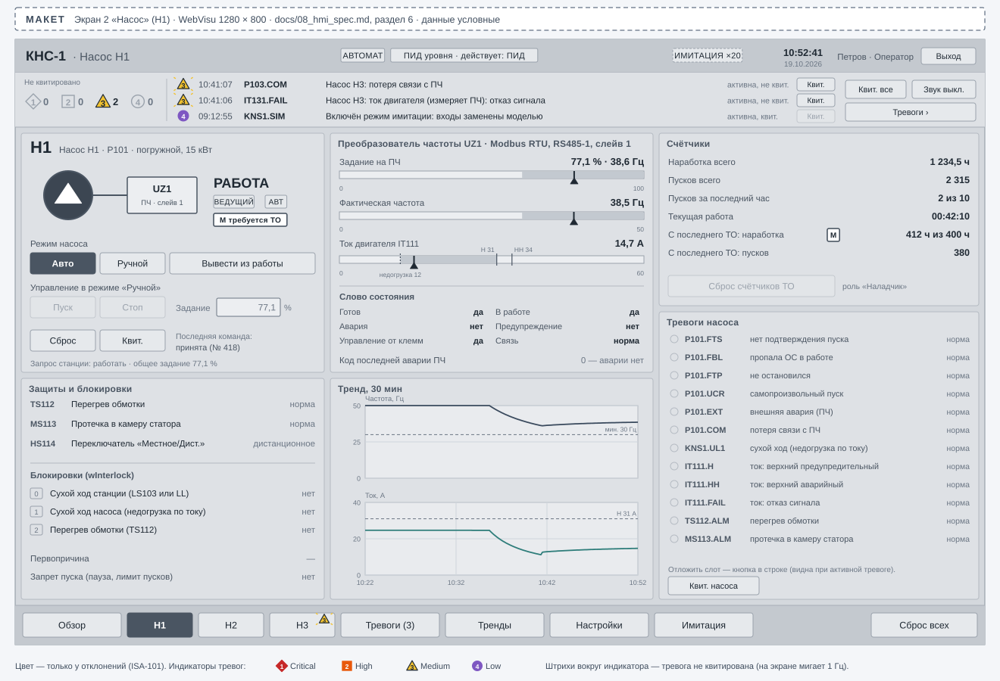
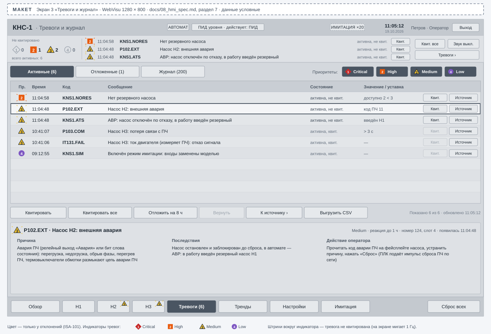
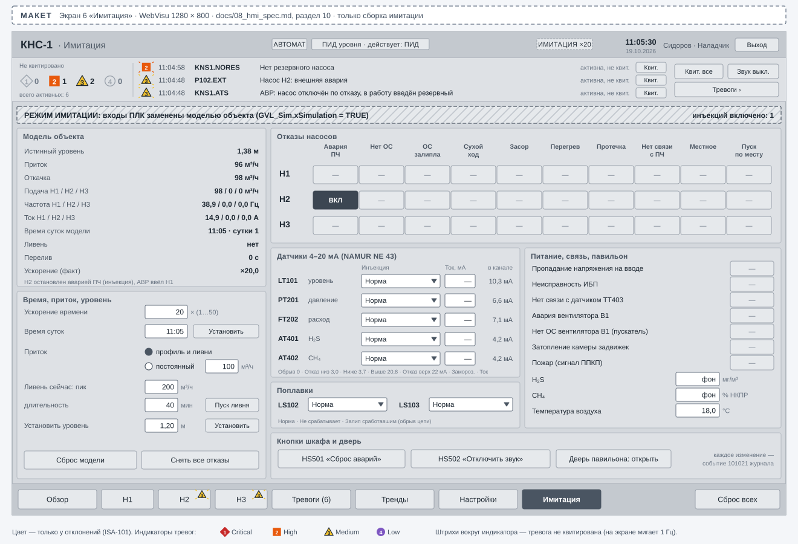
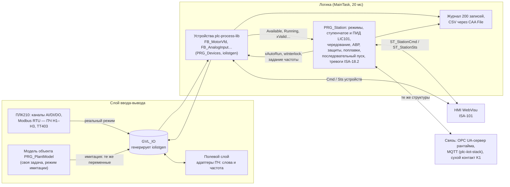

> **[Видео демонстрации](#демонстрация)** — _плейсхолдер: ссылка появится после записи 5-минутного прогона
> имитации (утренний пик, ливень, авария ПЧ и АВР, отказ уровнемера, восстановление питания)._

# kns-pump-station — КНС на три насоса с ПЧ

[](https://github.com/<GITHUB_USER>/kns-pump-station/actions/workflows/ci.yml)

Флагманский проект портфолио АСУ ТП: канализационная насосная станция КНС-1 (объект вымышленный) —
приёмный резервуар, три погружных насоса (два рабочих, один резервный) с ПЧ по Modbus RTU, напорный
коллектор. Полный цикл инженера: технология → алгоритм → код ST для CODESYS V3.5 (ОВЕН ПЛК210) →
HMI → испытания на модели объекта → документы. Логика проверяется без железа: в CODESYS Control Win
входы ПЛК подменяет модель резервуара, насосов и сети с инъекцией отказов.

> **Статус: приёмка ПМИ на имитаторе.** Логика станции, слой устройств из перечня сигналов, журнал событий и
> модель объекта собраны в одно приложение CODESYS: компиляция без ошибок и предупреждений, 333 юнит-теста
> coUnit проходят в CODESYS Control Win V3 ([docs/TEST_REPORT.md](docs/TEST_REPORT.md)). Все 39 проверок
> программы испытаний выполнены сценариями на рантайме через OPC UA и соответствуют по автоматической части;
> испытания нашли и закрыли три дефекта логики, ревью кода — ещё несколько; затронутые проверки прогнаны повторно
> (протокол № 1 — [docs/07_test_protocol.md](docs/07_test_protocol.md)).
> HMI WebVisu и интеграционные тесты замкнутого контура — следующие этапы ([docs/DESIGN.md](docs/DESIGN.md),
> раздел 15).

## Демонстрация

> _Плейсхолдер: GIF работы имитации в WebVisu и снимки экранов появятся после сборки HMI в IDE.
> Ниже — **макеты** экранов из спецификации HMI, а не снимки WebVisu._

<p align="center">
  
</p>
<p align="center"><sub>Макет экрана HMI · mockup — <a href="docs/08_hmi_spec.md">docs/08_hmi_spec.md</a>, раздел 5</sub></p>

| Насос | Тревоги и журнал | Имитация |
|---|---|---|
|  |  |  |
| <sub>макет · mockup</sub> | <sub>макет · mockup</sub> | <sub>макет · mockup</sub> |

## Архитектура



- **Один перечень сигналов** [docs/03_io_list.csv](docs/03_io_list.csv) (теги по ГОСТ 21.208, уставки,
  задержки, карта Modbus) — источник генерации `GVL_IO`, экземпляров устройств, команд HMI,
  энергонезависимых уставок, карт Modbus и импорта SCADA (генератор iolistgen).
- **`GVL_IO` — единственная граница с полем:** в реальном режиме её пишут каналы ПЛК и мастер Modbus,
  в имитации — модель; логика одинакова в обоих режимах (решение D-01). Имитация включается только на
  CODESYS Control Win и фиксируется при старте.
- **Логика станции тестируема без устройств:** ФБ станции видят насосы через `PL.I_MotorVfd`, время —
  через `PL.I_TimeSource`, события — через интерфейс журнала; ускорение времени (до ×50) действует на
  весь контур.
- Слои, задачи, решения D-01…D-14 — [docs/ARCHITECTURE.md](docs/ARCHITECTURE.md); интерфейсы ФБ, типы,
  тесты и разделение работ — [docs/DESIGN.md](docs/DESIGN.md).

## Что делает станция

| Функция | Как | Документ |
|---|---|---|
| Режимы | автомат, ручной с HMI, местный по насосу; переходы без рывков | [04](docs/04_algorithms.md), раздел 3 |
| Регулирование (параметр) | ступенчатое по уровням 1,60 / 2,40 / 1,40 / 1,00 м или ПИД LIC101 частотой ведущего насоса с подключением подпорного по нагрузке | 04, разделы 6, 7 |
| Чередование | по моточасам при каждом пуске, ограничение непрерывной работы 4 ч с перекрытием | 04, раздел 8 |
| АВР | нет ОС, авария ПЧ, пропадание ОС, сухой ход насоса, перегрев → пуск резервного и тревога | 04, раздел 9 |
| Защиты | сухой ход (LS103 или LL 0,5 м) — стоп всех; аварийный уровень (LS102 или HH 4,0 м) — все исправные на 100 % | 04, раздел 10 |
| Деградированный режим | отказ LT101 по NAMUR NE 43 — управление по поплавкам; без связи с ПЧ — ступенчатое | 04, разделы 11, 12 |
| Питание | останов без отказа, последовательный пуск: 3 с + 10 с, шаг 15 с | 04, раздел 13 |
| Тревоги и журнал | 75 тревог устройств и 13 станции по ISA-18.2, кольцевой журнал 200 записей, выгрузка CSV | [05](docs/05_alarm_list.csv), 04, разделы 15, 16 |

> **Дисклеймер.** Защиты КНС-1 — демонстрация логики управления, а не система ПАЗ. На реальном
> объекте защита насосов в местном режиме и аварийное отключение выполняются аппаратно.

## Быстрый старт

### Что работает сейчас (без CODESYS)

Нужен Python 3.11+ (в CI — 3.12).

```bash
python -m pip install -r requirements-dev.txt
python tools_project/check_docs_consistency.py   # сверка документов 01–08: теги, уставки, тексты тревог
python -m pytest                                 # то же в pytest и тесты инструментов шаблона
python -m ruff check . && python -m mypy
```

### Как запустить имитацию и сценарий ПМИ

Нужны Windows, CODESYS V3.5 SP17 Patch 3 (3.5.17.30) и Python 3.11+; права администратора не нужны.

```bash
python tools/codesys/cds.py deps                          # plc-process-lib 1.0 из соседнего репозитория
python tools/codesys/cds.py test                          # юнит-тесты coUnit в CODESYS Control Win V3
python tools_project/codesys/sim.py start --need-min 60   # имитация: импорт, символы OPC UA, рантайм,
                                                          # сертификаты OPC UA, загрузка и «Старт»
PMI_LIVE=1 python -m pytest scenarios/test_pmi.py -m plc -k PMI-13   # сценарий ПМИ «АВР при аварии ПЧ»
python tools_project/codesys/sim.py stop                  # остановить рантайм
```

Сертификат OPC UA-сервера и доверие клиенту сценариев `sim.py` готовит сам (файлы хранилища рантайма). Без
лицензии CODESYS Control Win работает 2 часа — `sim.py start --need-min` перезапускает рантайм перед частью
серии.
Графику WebVisu собирают в IDE по [docs/08_hmi_spec.md](docs/08_hmi_spec.md) — ручные шаги в
[docs/MANUAL_STEPS.md](docs/MANUAL_STEPS.md) (план — [docs/DESIGN.md](docs/DESIGN.md), раздел 16).

## Тесты и проверки

| Проверка | Где | Что |
|---|---|---|
| Сверка документов (`tools_project/check_docs_consistency.py`, 20 проверок) | CI, pytest | позиции из перечня, коды, номера и тексты тревог (05 ↔ вывод iolistgen), уставки 04 ↔ перечень ↔ DESIGN, пути переменных HMI и ПМИ ↔ DESIGN, генератор и контракт plc-process-lib, события журнала, номера ПМИ ↔ протокол, разложение алгоритмов на ФБ |
| ruff, mypy, pytest | CI | инструменты на Python (`tools/`, `tools_project/`) |
| `st_lint --strict`, iec_checker, RuSTy | CI | статанализ ST: находки исправлены или обоснованы ([STATIC_ANALYSIS.md](docs/STATIC_ANALYSIS.md)) |
| coUnit 1.2.0.0 | CODESYS Control Win V3: `cds.py test` | 333 юнит-теста: ФБ станции и ядро цикла, слой устройств и журнал, модель объекта; интеграционные тесты замкнутого контура — план (DESIGN, раздел 14) |
| Сценарии ПМИ | `sim.py start`, затем `PMI_LIVE=1 pytest scenarios/test_pmi.py` (OPC UA) | 39 проверок [06_PMI.md](docs/06_PMI.md) на модели: протокол № 1 — [07](docs/07_test_protocol.md), отчёт обвязки — [07_pmi_report.md](docs/07_pmi_report.md) |

## Документация

| Документ | Содержание |
|---|---|
| [01_TZ.md](docs/01_TZ.md) | сокращённое ТЗ по ГОСТ 34.602-2020 |
| [02_functional_diagram.md](docs/02_functional_diagram.md) | функциональная схема (Mermaid), позиции приборов по ГОСТ 21.208-2013 |
| [03_io_list.csv](docs/03_io_list.csv), [03_io_list.md](docs/03_io_list.md) | перечень сигналов в формате iolistgen: 58 сигналов, 29 устройств, условная карта регистров ПЧ |
| [04_algorithms.md](docs/04_algorithms.md) | алгоритмы, диаграммы состояний, уставки |
| [05_alarm_list.csv](docs/05_alarm_list.csv) | перечень тревог: код, текст, приоритет, уставка, задержка, действие оператора ([alarms.csv](docs/alarms.csv) — вывод генератора) |
| [06_PMI.md](docs/06_PMI.md) | программа и методика испытаний на имитаторе: 39 проверок |
| [07_test_protocol.md](docs/07_test_protocol.md), [07_pmi_report.md](docs/07_pmi_report.md) | протокол испытаний на имитаторе № 1 (19.10.2026) и отчёт обвязки сценариев |
| [08_hmi_spec.md](docs/08_hmi_spec.md), [hmi/](docs/hmi/) | спецификация HMI по ISA-101 и макеты шести экранов |
| [ARCHITECTURE.md](docs/ARCHITECTURE.md), [DESIGN.md](docs/DESIGN.md) | архитектура и проект ПО: слои, задачи, ФБ, типы, тесты, разделение работ |
| [ASSUMPTIONS.md](docs/ASSUMPTIONS.md) | допущения и проектные решения |
| [MANUAL_STEPS.md](docs/MANUAL_STEPS.md), [LAYOUT.md](docs/LAYOUT.md), [tools/README.md](tools/README.md) | ручные шаги в IDE, раскладка исходников, инструменты шаблона |

## Ограничения и дальнейшие шаги

- HMI WebVisu и интеграционные тесты замкнутого контура — следующие этапы ([docs/DESIGN.md](docs/DESIGN.md),
  раздел 15); ручные части ПМИ (экраны, права ролей, файл CSV, перезапуск процесса рантайма) не проверялись.
  Открытые вопросы и запросы в другие проекты — DESIGN, раздел 17, и [docs/ASSUMPTIONS.md](docs/ASSUMPTIONS.md)
  (статусы «проверить», «открыт»).
- Карта регистров ПЧ — условная, это не карта реального производителя; объект, заказчик и параметры
  оборудования вымышленные.
- Графику WebVisu, дерево устройств ПЛК210 и Modbus настраивают вручную в IDE.
- Наличие CAA File в таргете ПЛК210, версия таргет-файла и функции определения таргета — сверить при
  переносе на контроллер.

## Summary (EN)

KNS-1 is the flagship of a PLC portfolio: a fictional sewage lift station with a wet well, three
submersible pumps (two duty, one standby) driven by VFDs over Modbus RTU, and a common discharge header.
The project covers the full cycle — process, algorithms, CODESYS V3.5 Structured Text for an OWEN PLC210,
an ISA-101 WebVisu HMI, a plant model with fault injection for testing in CODESYS Control Win, and
GOST-style documents (requirements, functional diagram, I/O list, algorithms, ISA-18.2 alarm list,
39-check test procedure, HMI spec). The application builds without errors or warnings, 333 coUnit tests
pass on CODESYS Control Win V3, and all 39 test-procedure checks run live as scenarios over OPC UA against
the simulated plant (automated parts pass, test protocol No. 1); a Python checker in CI keeps tags,
setpoints and alarm texts consistent across all documents. Docs are in Russian.

## Лицензия

[MIT](LICENSE) © 2026 <ИМЯ ФАМИЛИЯ>
