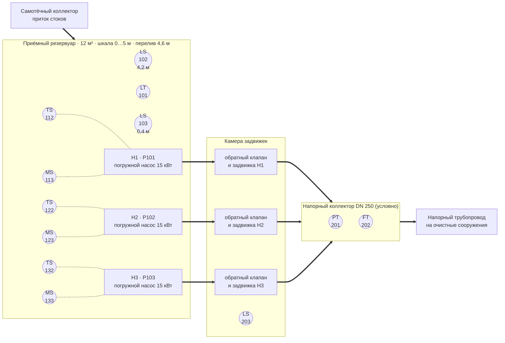
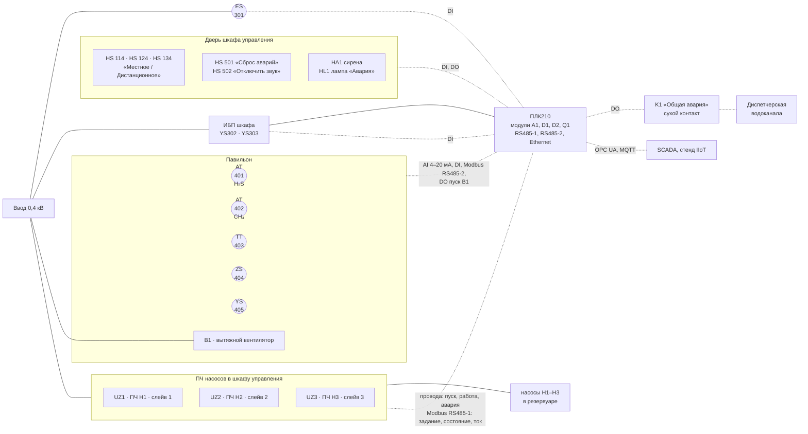
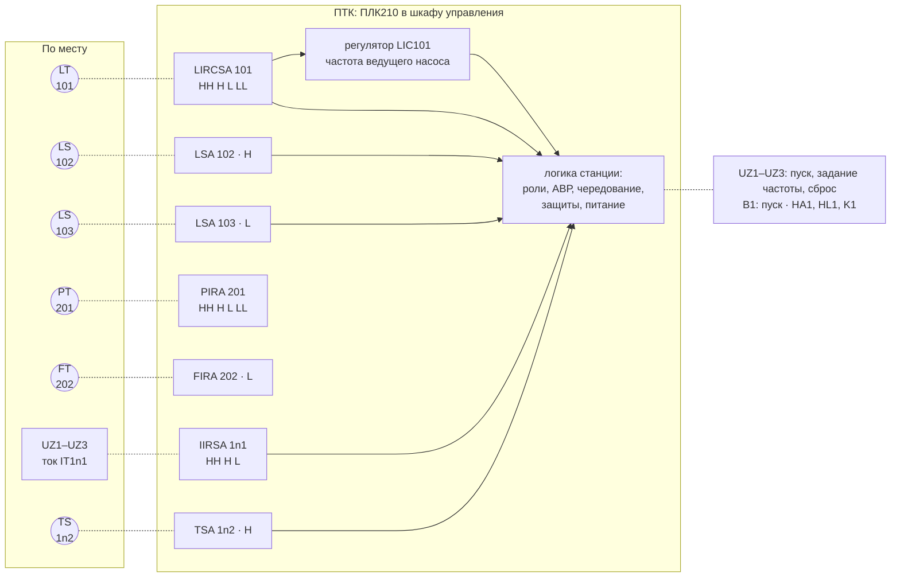

# КНС-1. Функциональная схема автоматизации

| | |
|---|---|
| Документ | `docs/02_functional_diagram.md`, версия 0.1 |
| Позиции и сигналы | перечень сигналов [03_io_list.csv](03_io_list.csv) (таблица — [03_io_list.md](03_io_list.md)) |
| Обозначения | буквенные коды приборов по ГОСТ 21.208-2013; ПЧ, сирена, лампа, реле — по ГОСТ 2.710-81 |
| Алгоритмы | [04_algorithms.md](04_algorithms.md) |
| HMI | мнемосхема экрана «Обзор станции» повторяет схему 1 — [08_hmi_spec.md](08_hmi_spec.md), раздел 5 |

Схема в Mermaid — упрощённое представление функциональной схемы для репозитория: состав
оборудования, позиции приборов и связи. Графика ГОСТ 21.208 (окружность прибора с разделительной
чертой для щитовых приборов, поле ПТК внизу листа) в Mermaid не воспроизводится; при выпуске
рабочей документации схему выполняют в САПР по ГОСТ 21.208-2013 и ГОСТ 21.408.

Условности на схемах ниже:

| Изображение | Что означает |
|---|---|
| `((LT 101))` окружность | прибор по месту: буквенный код сверху, номер позиции снизу |
| прямоугольник с кодом функции | функция ПТК (ПЛК в шкафу управления), например `LIRCSA 101` |
| толстая линия `==>` | трубопровод стоков |
| пунктир `-.-` | сигнальная связь (4–20 мА, дискретный сигнал, Modbus RTU) |
| тонкая сплошная `---` | силовое питание |

## 1. Технологическая часть и приборы по месту

ПЧ насосов, электроснабжение, переключатели «Местное/Дистанционное» и павильон — на схеме 2.

## 2. Шкаф управления, ПЧ, электроснабжение и павильон

## 3. Функции ПТК

Функции, которые выполняет ПЛК, с буквенными кодами по ГОСТ 21.208-2013. Пределы H, L, HH, LL
нанесены справа от кода (п. 5.11.7 стандарта). В теге ПЛК буквы функций A, S и пределы опущены:
тег — собственные функции полевого прибора (`LT101`, `LS102`), правило перечня сигналов.

## 4. Экспликация приборов и сигналов

Функции: И — измерение и показание, Р — регистрация (журнал, тренды, верхний уровень),
С — сигнализация (тревога), Б — блокировка или автоматическое переключение, Рег — регулирование.
Каналы и адреса — из перечня сигналов; модули A1, D1, D2, Q1 условные.

| Позиция | Параметр, прибор | Код на схеме (ПТК) | Функции | Сигнал, канал |
|---|---|---|---|---|
| `LT101` | уровень в приёмном резервуаре, 0…5 м | LT · LIRCSA HH H L LL | И, Р, Рег (LIC101), С HH/H/L/LL, Б: LL — сухой ход, HH — пуск всех насосов | AI 4–20 мА, A1.1 |
| `LS102` | поплавок «аварийно высокий уровень», 4,2 м | LS · LSA H | С, Б: пуск всех насосов; резервное управление — пуск | DI, D1.1, НЗ-контакт |
| `LS103` | поплавок «сухой ход», 0,4 м | LS · LSA L | С, Б: останов всех насосов; резервное управление — останов | DI, D1.2, НЗ-контакт, отказ = срабатывание |
| `PT201` | давление в напорном коллекторе, 0…10 бар | PT · PIRA HH H L LL | И, Р, С | AI 4–20 мА, A1.2 |
| `FT202` | расход в напорном коллекторе, 0…500 м³/ч | FT · FIRA L | И, Р, С | AI 4–20 мА, A1.3 |
| `LS203` | затопление камеры задвижек | LS · LSA H | С | DI, D1.3 |
| `IT111`, `IT121`, `IT131` | ток двигателя Н1, Н2, Н3, 0…60 А (измеряет ПЧ) | IIRSA HH H L | И, Р, С HH/H, Б: L — недогрузка (сухой ход насоса) | Modbus RTU, RS485-1, слейвы 1/2/3, FC3 рег. 102 |
| `TS112`, `TS122`, `TS132` | перегрев обмотки Н1, Н2, Н3 (термовыключатели, реле защиты насоса) | TS · TSA H | С, Б: запрет пуска | DI, D2.4 / D2.9 / D2.14 |
| `MS113`, `MS123`, `MS133` | протечка в камеру статора Н1, Н2, Н3 (датчик влажности; буква M расшифрована: влажность) | MS · MSA H | С | DI, D2.5 / D2.10 / D2.15 |
| `HS114`, `HS124`, `HS134` | переключатель «Местное/Дистанционное» Н1, Н2, Н3 | HS | режим `Local` насоса | DI, D2.3 / D2.8 / D2.13 |
| `ES301` | напряжение на вводе в норме (реле контроля фаз) | ES · ESA L | С, Б: останов насосов без отказа, последовательный пуск | DI, D1.4 |
| `YS302` | ИБП: работа от батарей | YS · YSA | С | DI, D1.5 |
| `YS303` | ИБП: неисправность или разряд батарей | YS · YSA | С | DI, D1.6 |
| `AT401` | концентрация H₂S в павильоне, 0…40 мг/м³ | AT (H₂S) · AIRSA H HH | И, Р, С, Б: H — пуск В1 | AI 4–20 мА, A1.4 |
| `AT402` | концентрация CH₄ в павильоне, 0…100 % НКПР | AT (CH₄) · AIRSA H HH | И, Р, С, Б: H — пуск В1 | AI 4–20 мА, A1.5 |
| `TT403` | температура воздуха в павильоне, −40…60 °C | TT · TIRSA H L | И, Р, С, Б: H — пуск В1 | Modbus RTU, RS485-2, слейв 10, FC4 рег. 0, REAL |
| `ZS404` | дверь павильона открыта | ZS · ZSA | С, Б: пуск В1 | DI, D1.7 |
| `YS405` | пожар (прибор пожарной сигнализации) | YS · YSA | С, Б: стоп В1 | DI, D1.8 |
| `HS501` | кнопка «Сброс аварий» | HS | общий сброс | DI, D1.9 |
| `HS502` | кнопка «Отключить звук» | HS | выключение HA1 | DI, D1.10 |
| `LIC101` | регулятор уровня (функция ПТК, в перечне сигналов нет) | входит в LIRCSA 101 | Рег: частота ведущего насоса | — |

Оборудование и выходы:

| Позиция | Что | Сигналы ПЛК |
|---|---|---|
| `P101`…`P103` (Н1–Н3), `UZ1`…`UZ3` | погружные насосы с ПЧ | DO «Работа» `P10n_RUN` (Q1.1–Q1.3); DI «ПЧ в работе» `P10n_RFB`, «Авария ПЧ» `P10n_FLT` (D2); Modbus RS485-1: слово управления `P10n_CTW` (FC16 рег. 0), задание частоты `P10n_FREF` (рег. 1), слово состояния `P10n_STW` (FC3 рег. 100), частота `P10n_FACT` (101), ток (102), код аварии `P10n_FCODE` (103) |
| `V1` (В1) | вытяжной вентилятор павильона | DO `V1_RUN` (Q1.4); DI `V1_RFB` (D1.11), `V1_FLT` (D1.12) |
| `HA1` | сирена на шкафу | DO, Q1.5 |
| `HL1` | лампа «Авария» на двери шкафа | DO, Q1.6 |
| `K1` | реле «Общая авария», сухой контакт в диспетчерскую; под напряжением в норме | DO, Q1.7 |

Карта регистров ПЧ условная: это не карта реального производителя (README примера КНС генератора
iolistgen, раздел «Условная карта регистров ПЧ»).

## 5. Сверить со стандартом

- Порядок букв функциональных признаков (`LIRCSA`, `PIRA`, `IIRSA`) принят по практике «И, Р, С
  (регулирование), S, A»; в ГОСТ 21.208-2013 он задан рисунком 1 (п. 5.10) — сверить с официальным
  изданием.
- Буква S — «включение, отключение, переключение, блокировка» (п. 5.11.4), A — сигнализация, пределы
  H/L/HH/LL — справа от обозначения (п. 5.11.7).
- `IT1n1`: буква T относится к первичному бесшкальному прибору с передачей сигнала (п. 5.11.5); ток
  измеряет ПЧ — на чертеже показать как функцию ПЧ.
- `MS1n3`: M — резервная буква, значение («влажность») расшифровывается на схеме (п. 5.14).
- `HA1`, `HL1`, `K1`, `UZ1`–`UZ3` — обозначения элементов электрических схем по ГОСТ 2.710-81, а не
  приборов схемы автоматизации.
