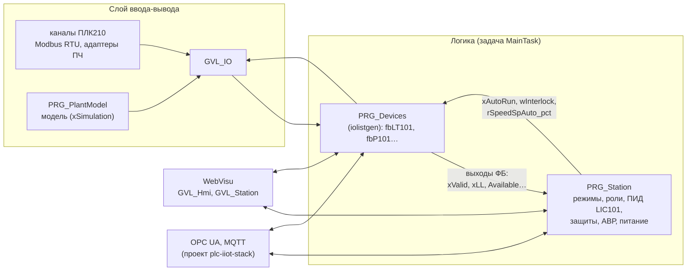
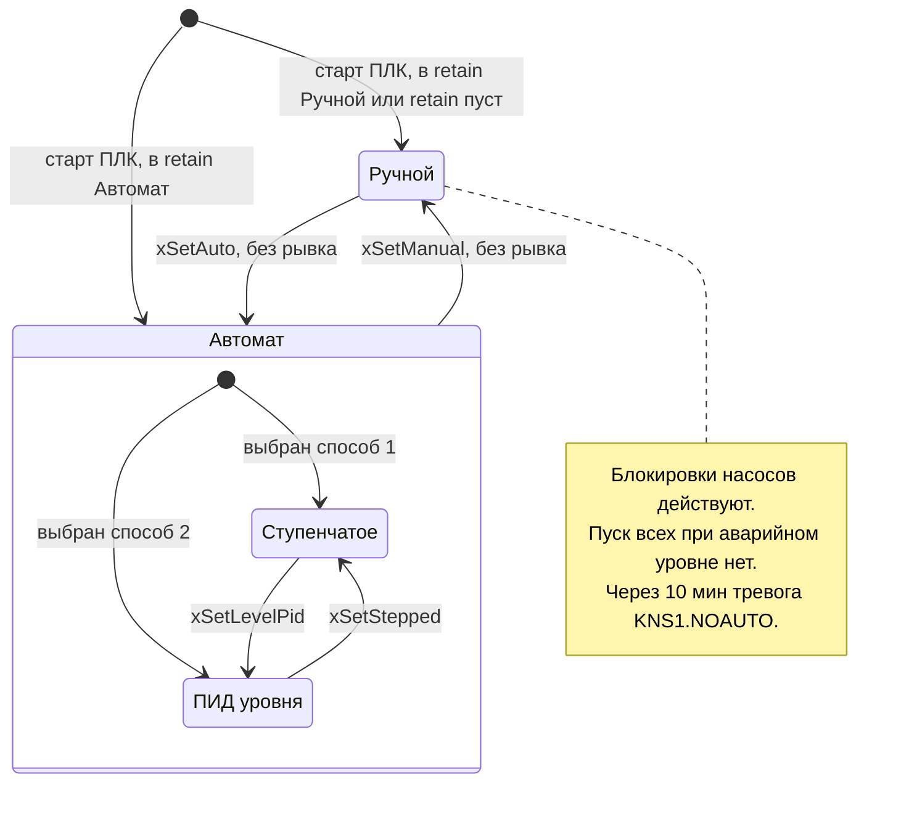
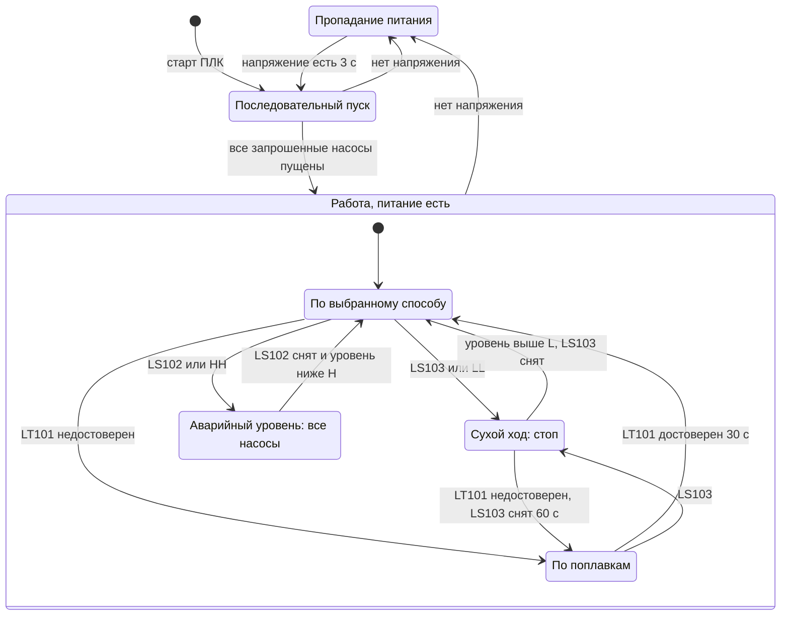
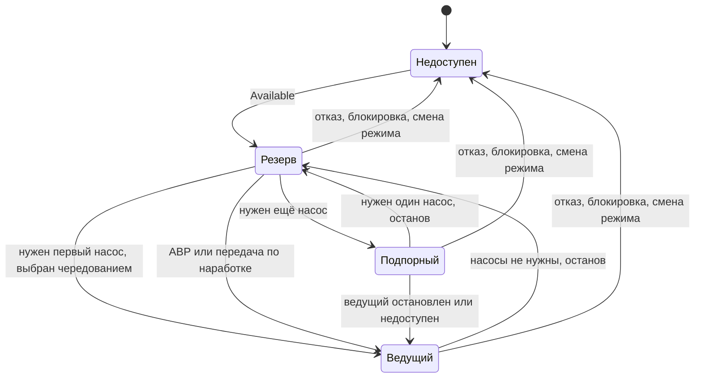
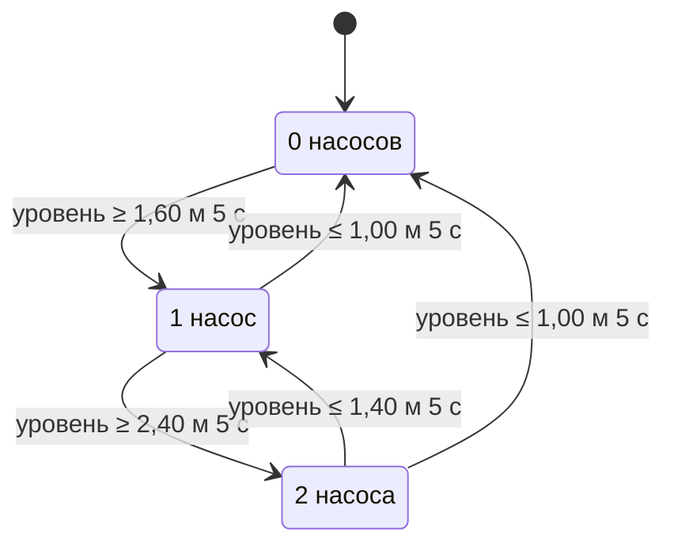
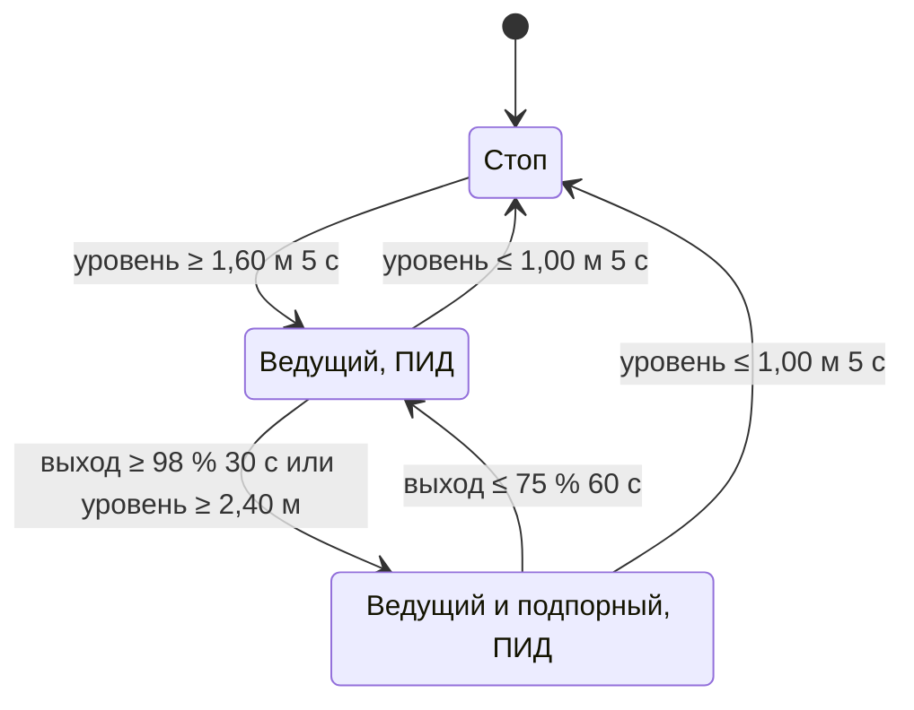
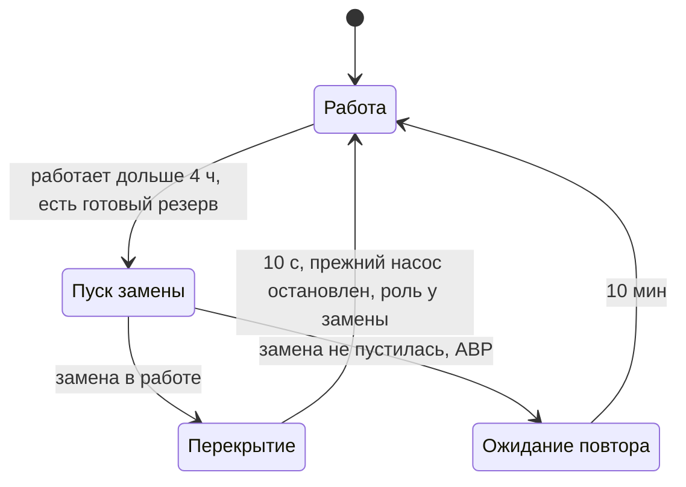
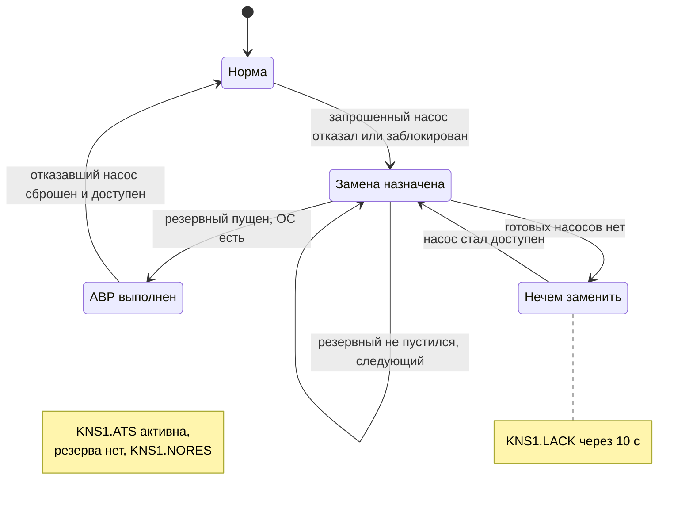
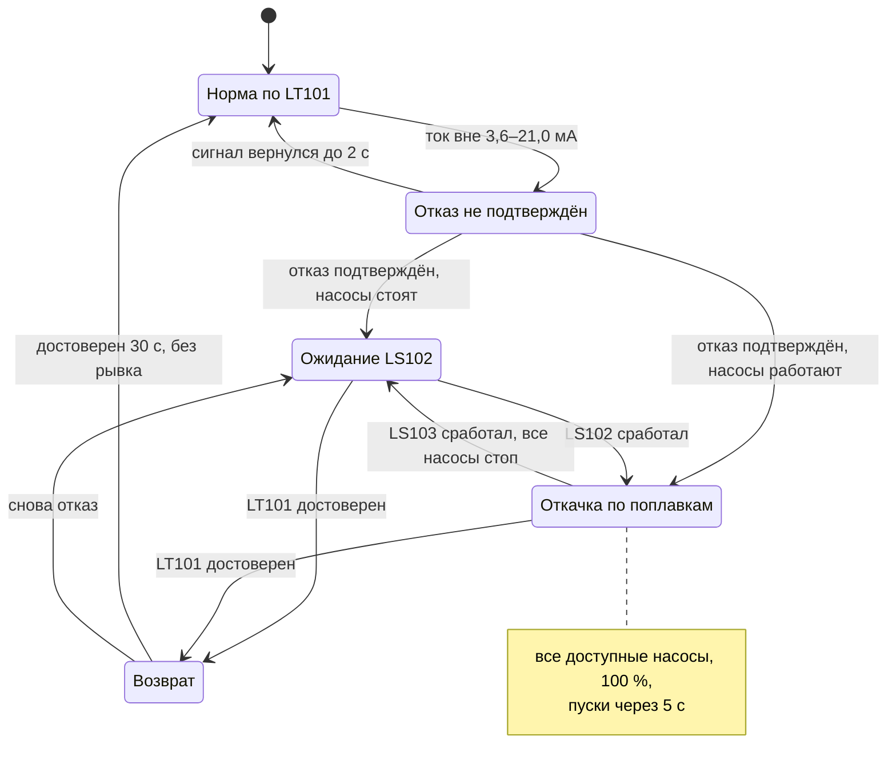
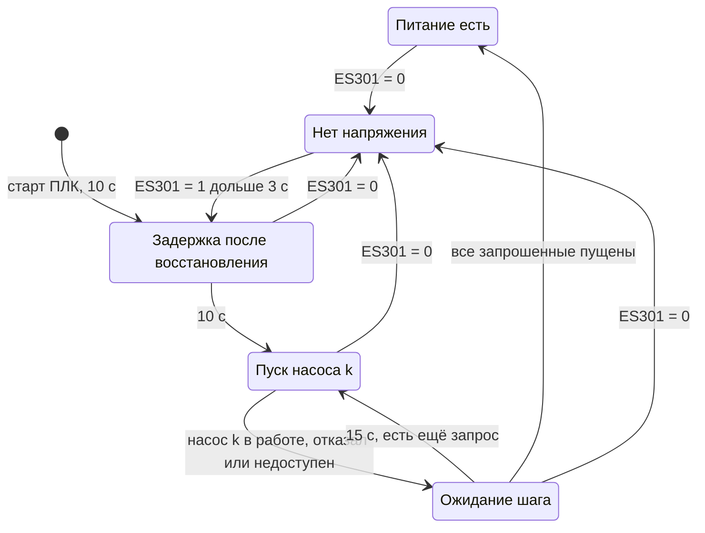

# КНС-1. Алгоритмы управления

| | |
|---|---|
| Документ | `docs/04_algorithms.md`, версия 0.5 |
| Основание | [01_TZ.md](01_TZ.md), раздел 4.2 (функции); перечень сигналов [03_io_list.csv](03_io_list.csv) |
| Связанные | функциональная схема [02_functional_diagram.md](02_functional_diagram.md), тревоги [05_alarm_list.csv](05_alarm_list.csv), испытания [06_PMI.md](06_PMI.md), HMI [08_hmi_spec.md](08_hmi_spec.md) |
| Библиотека | plc-process-lib 1.0 (пространство имён `PL`), контракт `docs/API.md` библиотеки, разделы 1, 2, 13, 14, 17, 21.1 |
| Статус | проект: логика описана до реализации. Программы, ФБ и структуры станции закреплены архитектурой ПО — [ARCHITECTURE.md](ARCHITECTURE.md), [DESIGN.md](DESIGN.md); сводка — раздел 19. Версия 0.3: согласование с DESIGN v0.3 (вход ПИД `xPvValid`, команды `xRevertCfg`, `udiShelveId`, `udiUnshelveId`, вопросы 9 и 10 раздела 20 закрыты). Версия 0.4 (правки по ревью кода, DESIGN v0.6): выход LT101 за диапазон — по решению AI-13 библиотеки (разделы 10.5, 11, бита 15 `wState` нет), подавление `KNS1.EHL` и `KNS1.DRY` — только в «Автомате» (раздел 15), `KNS1.STEP` подавлена и при последовательном пуске, загрузка ПЧ после восстановления питания — не потеря связи для ПИД (разделы 7.4, 12), `IT1n1.FAIL` при пропадании напряжения (раздел 13.1). Версия 0.5 (дефект после протокола ПМИ № 1, DESIGN v0.7): ведущий выбыл при действующем ПИД — выход регулятора держится (разделы 7.3, 9.1) |

> **Дисклеймер.** Защиты в этом документе (сухой ход, аварийный уровень, блокировки насосов) —
> демонстрация логики управления, а не система ПАЗ. На реальном объекте защита насосов от сухого
> хода в местном режиме и аварийное отключение выполняются аппаратно в схеме управления (раздел 10.7).

Обозначения: Н1, Н2, Н3 — насосы `P101`, `P102`, `P103`; индекс насоса *i* = 1…3. Значения уставок
даны по умолчанию; полный перечень — раздел 18. «Доступен» — свойство `I_Device.Available`
библиотеки: насос в `Auto`, без отказа, без действующей блокировки, есть напряжение (контракт 13.8).
«Готов к пуску» — `I_Motor.ReadyToStart`: доступен, стоит, нет паузы `tMinStop` и лимита пусков.

## 1. Отметки уровня

Уровень отсчитывается от дна приёмного резервуара (площадь зеркала 12 м², [01_TZ.md](01_TZ.md),
раздел 3). Отметки уровнемера (HH/H/L/LL) и поплавков заданы перечнем сигналов, остальные — уставки
станции.

| Отметка, м | Что | Источник |
|---:|---|---|
| 5,00 | верх шкалы LT101 | 03_io_list, `LT101` |
| 4,60 | аварийный перелив (условно) | 01_TZ, раздел 3 |
| 4,40 | контроль «поплавок LS102 не сработал» (`rLdev102Off_m`) | станция |
| 4,20 | поплавок «аварийно высокий уровень» LS102 | 03_io_list, `LS102` |
| 4,00 | HH — аварийный режим: работают все исправные насосы | 03_io_list, `LT101` |
| 3,50 | H — предупреждение; ниже — «LS102 сработал ложно» (`rLdev102On_m`) | 03_io_list, `LT101` |
| 2,40 | пуск подпорного насоса (ступенчатое; резерв для ПИД) | станция |
| 1,60 | пуск ведущего насоса | станция |
| 1,40 | задание ПИД `rLevelSp_m`; останов подпорного (ступенчатое) | станция |
| 1,00 | останов всех насосов | станция |
| 0,80 | L — предупреждение; выше — «LS103 сработал ложно» (`rLdev103On_m`); выше — снятие защиты «сухой ход» | 03_io_list, `LT101` |
| 0,50 | LL — защита «сухой ход» по уровнемеру | 03_io_list, `LT101` |
| 0,40 | поплавок «сухой ход» LS103 | 03_io_list, `LS103` |
| 0,20 | контроль «поплавок LS103 не сработал» (`rLdev103Off_m`) | станция |

Порядок `0,4 < 0,5 < 0,8 < 1,0 < 1,4 < 1,6 < 2,4 < 3,5 < 4,0 < 4,2` проверяет логика станции при записи
уставок (раздел 18.3): уставка, нарушающая порядок, отклоняется.

## 2. Структура логики



Порядок в цикле задачи логики `MainTask` (20 мс; контракт библиотеки, раздел 1; [ARCHITECTURE.md](ARCHITECTURE.md), раздел 9):

1. `PRG_FieldIn`: каналы и Modbus (или модель в режиме имитации) → `GVL_IO`; адаптеры ПЧ разбирают
   слова состояния.
2. `PRG_DeviceList`: ссылки `I_Device` на все устройства (общий сброс, квитирование, сводка тревог).
3. `PRG_Station`: читает выходы устройств предыдущего цикла и команды HMI, считает режимы, роли,
   ПИД `LIC101`, защиты; пишет входы автоматики `xAutoRun`, `wInterlock`, `rSpeedSpAuto_pct`.
4. `PRG_Devices` (генерирует iolistgen): вызовы всех устройств с сигналами перечня.
5. `PRG_FieldOut`: `GVL_IO` → каналы и Modbus (адаптеры ПЧ собирают слова управления).

Станция видит выходы устройств с задержкой в один цикл (20–50 мс). Для алгоритмов с задержками в
секунды это допустимо. Импульсы `stCmd` (например, `xReset` насоса) станция читает до вызова
`PRG_Devices`, то есть до того, как устройство их сбросит.

## 3. Режимы станции

### 3.1 Режимы станции и устройств

| Режим станции (`eMode`) | Кто управляет насосами | Защиты станции | Пуск всех при аварийном уровне | АВР |
|---|---|---|---|---|
| **Автомат** (`Auto`) | логика станции: насосы в `Auto` по запросам `xAutoRun` | да | да | да |
| **Ручной** (`Manual`) | оператор с HMI: пуск, стоп и частота каждого насоса (`GVL_Hmi.stP10nCmd`) | да (блокировки `wInterlock` действуют и в `Manual`) | нет: тревога `KNS1.EHL` | нет |

Режим каждого насоса — режим устройства `FB_MotorVfd` (контракт 2.2):

| Режим насоса | Как включается | Станция в «Автомате» |
|---|---|---|
| `Auto` | станция при переходе в «Автомат»; оператор на фейсплейте | насос участвует в ролях, АВР и чередовании |
| `Manual` | станция при переходе в «Ручной»; оператор на фейсплейте | насос исключён из ролей; если работает — учитывается в откачке |
| `Local` | переключатель `HS1n4` на шкафу в положении «Местное» | ПЛК выходами не управляет; работающий насос учитывается в откачке, резервом не считается |
| `OutOfService` | оператор (насос должен стоять) | исключён; `KNS1.NORES` |

Насос в `Manual`, `Local` или `OutOfService` при станции в «Автомате» — сторонний. Его работа
(`Running`) уменьшает число насосов, которые станция должна запустить сама.

### 3.2 Переходы без рывков

| Переход | Что делает станция | Что гарантирует библиотека |
|---|---|---|
| Ручной → Автомат (`stStationCmd.xSetAuto`) | до запроса режима: `axPumpRun[i] := Running(i)`; общая частота `rSpeedSp_pct :=` задание ведущего; роли — по работающим насосам (ведущий — работающий с меньшей наработкой); ПИД — один цикл в слежении. Затем `RequestMode(Auto)` всем насосам в `Manual` и `Local` (у `Local` меняется запомненный дистанционный режим), кроме `OutOfService` | `Manual → Auto`: дальше по `xAutoRun` (13.4). Работающий насос продолжает работать, частота меняется рампой 5 %/с |
| Автомат → Ручной (`xSetManual`) | `RequestMode(Manual)` всем насосам в `Auto` и `Local`; ПИД — в слежении | `Auto → Manual`: ручная защёлка `:= xRunCmd`, задание `stCmd.rSpeedSp_pct` уже следило за текущим (13.4, 14.3) |
| Ступенчатое ↔ ПИД (`xSetStepped`, `xSetLevelPid`) | требуемое число насосов инициализируется числом работающих; при переходе в ПИД выход начинает с задания ведущего (слежение `xTrack`) | `FB_PID`: предустановка интегратора `I := u − P − D` при снятии слежения (17.5) |
| Насос: `Local` → дистанционный | — | возврат в запомненный режим (`stRetain.eRemoteMode`), ручная защёлка `:=` ОС (13.4) |
| Старт ПЛК | режим станции и способ регулирования — из `stStationRetain`; работающие насосы подхватываются (раздел 13.3) | подхват работающего двигателя без `UncommandedRun` (13.7) |



Выбранный способ регулирования хранится в `stStationRetain.eMethod` и не меняется при смене режима
станции. Какой способ действует сейчас, определяет раздел 4.

## 4. Действующее управление

В «Автомате» насосами управляет одно из состояний ниже (поле `stStationSts.eControlAct`).
Старшинство сверху вниз: верхнее состояние вытесняет нижние.

| № | `eControlAct` | Условие | Что делает станция |
|---:|---|---|---|
| 1 | `PowerLost` | `fbES301.xValue = FALSE` | запросы сняты (насосы и так остановлены ФБ без отказа), подавлены `LACK`, `NORES`, `ATS` |
| 2 | `Restart` | питание восстановлено, идёт последовательный пуск | разрешает запросы по одному насосу (раздел 13); требуемое число — по состоянию под ним (строки 3–5, иначе ступенчатое) |
| 3 | `DryRunStop` | защита «сухой ход» (раздел 10.1) | `wInterlock.0` всем насосам, запросы сняты |
| 4 | `Float` | LT101 недостоверен (раздел 11) | пуск всех доступных по LS102, останов по LS103 |
| 5 | `Emergency` | аварийно высокий уровень при достоверном LT101 (раздел 10.2) | все доступные насосы, 100 % |
| 6 | `LevelPid` | выбран ПИД и ПИД готов (раздел 7.4) | ПИД LIC101 и подключение по нагрузке |
| 7 | `Stepped` | выбрано ступенчатое или ПИД не готов | уровни пуска и останова |
| — | `Manual` | станция в «Ручном» | запросов нет, только блокировки |



## 5. Роли насосов: ведущий, подпорный, резервный

### 5.1 Определения

| Роль (`E_PumpRole`) | Значение | Смысл |
|---|---:|---|
| `None` | 0 | насос недоступен автоматике (отказ, блокировка, `Manual`, `Local`, `OutOfService`, нет напряжения) |
| `Lead` | 1 | ведущий: запускается первым; в режиме ПИД его частоту регулирует LIC101 |
| `Assist` | 2 | подпорный: подключается при нехватке производительности ведущего |
| `Standby` | 3 | резервный: доступен, не запрошен |

Станция в каждом цикле считает (через `aitfPump[i] : PL.I_MotorVfd`):

- `uiPumpsAvailable` — число доступных насосов;
- `uiPumpsRunning` — число работающих (`Running`, в любом режиме);
- сторонние работающие — `Running` и режим не `Auto`;
- `uiPumpsRequired` — требуемое число по действующему управлению (разделы 6, 7, 10, 11), не больше
  `uiDutyMax` (по умолчанию 2: «два рабочих + один резервный»). В аварийном режиме — 3.

Число запросов станции: `MAX(0, uiPumpsRequired − сторонние работающие)`. Запросы получают насосы с
ролями `Lead` и `Assist` (`axPumpRun[i] := TRUE`).

### 5.2 Выбор насоса

Роли насосов, которые уже работают по запросу, сохраняются. Недостающая роль назначается в порядке:

1. насосы, готовые к пуску (`ReadyToStart`), затем доступные, но в паузе (`tMinStop`, лимит пусков:
   запрос подождёт, контракт 13.5);
2. внутри группы — по режиму чередования `eRotation` (раздел 8);
3. в режиме ПИД ведущим назначается только насос со связью с ПЧ (нет бита `MOT_WRN_COMM_LOSS` в
   `stSts.stCommon.wWarning`); если среди работающих такого нет — раздел 12. Замена ведущего при
   передаче роли (раздел 8.2) — тоже только насос со связью.

Снятие роли, когда требуется меньше насосов:

- режим `RunHours`: останавливается насос с **большей** наработкой (`RunSeconds`), оставшийся
  становится ведущим. Смена ведущего между двумя работающими насосами — без пуска и останова: оба
  получают одно задание частоты;
- режимы `Cyclic` и `Fixed`: останавливается подпорный;
- в режиме ПИД насос со связью с ПЧ снимается последним (п. 3): оставшимся должен быть насос, которым
  ПИД может управлять.

Если требуется несколько пусков сразу (аварийный режим, режим по поплавкам), запросы выдаются по
одному с интервалом `tStagger` (5 с): гидроудар и пусковые токи не складываются.



## 6. Ступенчатое регулирование

Насосы включаются и отключаются по уровням с гистерезисом; частота — постоянная `rStepSpeed_pct`
(100 %, 50 Гц). Уровень — `fbLT101.rValue_eu` при `xValid`. Пересечение уровня подтверждается
выдержкой `tLvlConfirm` (5 с): волна в резервуаре не даёт ложных пусков.

| Требуемое число | Включить, если уровень ≥ | Отключить, если уровень ≤ |
|---:|---|---|
| 1 (ведущий) | `rLvlStartLead_m` = 1,60 м | `rLvlStop_m` = 1,00 м |
| 2 (ведущий + подпорный) | `rLvlStartAssist_m` = 2,40 м | `rLvlStopAssist_m` = 1,40 м |



Объём между пуском и остановом ведущего — 0,6 м × 12 м² = 7,2 м³. При притоке, равном половине
подачи насоса (75 м³/ч), цикл «наполнение + откачка» ≈ 12 мин, ≈ 5 пусков в час на станцию, которые
чередование распределяет между тремя насосами; предел ФБ — 10 пусков в час на насос.

## 7. Поддержание уровня (ПИД)

### 7.1 Регулятор LIC101

Регулятор — `PL.FB_PID` в логике станции (тег `LIC101`, в перечне сигналов его нет: физических
сигналов у него нет). Прямое действие: уровень растёт — частота растёт.

```st
// PRG_Station, шаг 10 цикла (DESIGN.md, раздел 7): ПИД уровня LIC101 (контракт plc-process-lib 17.3).
// Задание — внешнее, из последней корректной копии уставок станции: stCmd в GVL не энергонезависим (FB_PID.md).
// fbPidCtl (FB_LevelControlPid) отдаёт rTrack_pct = SpeedRef ведущего насоса (0 — ведущего нет);
// ведущий выбыл при действующем ПИД — прежний выход LIC101 (раздел 7.3).
GVL_Station.fbLIC101(
    rPv_eu      := GVL_Devices.fbLT101.rValue_eu,
    xPvValid    := fbProt.xLevelUsable,                          // xValid и LT101 не исключён по противоречию (раздел 10.5)
    xSpExt      := TRUE,
    rSpExt_eu   := GVL_Station.stCfgLkg.rLevelSp_m,
    xTrack      := fbPidCtl.xTrack,                              // = NOT xPidControls: слежение за ведущим
    rTrack_pct  := fbPidCtl.rTrack_pct,
    rOutAct_pct := fbPidCtl.rTrack_pct,                          // обратный расчёт по фактическому заданию ПЧ
    itfTime     := GVL_Time.fbClockMain,
    stCmd       := GVL_Station.stLIC101Cmd,
    stCfg       := GVL_Persist.stLIC101Cfg,                      // eAction := Direct, xUseOutAct := TRUE
    stRetain    := GVL_Persist.stLIC101Retain);
```

`xPidControls = (eControlAct = LevelPid) AND ведущий.SpeedAutoActive AND связь с ПЧ ведущего есть`. Общее задание частоты
`GVL_Station.rSpeedSp_pct := fbLIC101.rOut_pct` получают все работающие насосы станции
(`fbP10n.rSpeedSpAuto_pct`). Минимальную частоту (60 %, 30 Гц) и рампу (5 %/с) ограничивает
`FB_MotorVfd`; насыщение на минимальной частоте ПИД видит через `rOutAct_pct` (контракт 17.4).

Параметры LIC101 — раздел 18.2. Исходная настройка рассчитана на модели объекта как для
интегрирующего объекта (метод лямбда-настройки, λ = 300 с): чувствительность подачи к частоте
≈ 2,3 м³/ч на 1 %, 1 % шкалы уровня = 0,6 м³, отсюда `Kp ≈ 6`, `Ti ≈ 600 с`. Уточняется на модели
(проверка PMI-04) и при наладке.

### 7.2 Пуск, останов, подключение по нагрузке

| Событие | Условие | Действие |
|---|---|---|
| пуск ведущего | насосы стоят, уровень ≥ `rLvlStartLead_m` (1,60 м) 5 с | 1 насос; ПИД стартует с задания ведущего (60 %) |
| подключение подпорного | `fbLIC101.rOut_pct` ≥ `rAssistOn_pct` (98 %) дольше `tAssistOn` (30 с) **или** уровень ≥ `rLvlStartAssist_m` (2,40 м) 5 с | 2 насоса; общее задание частоты |
| отключение подпорного | `fbLIC101.rOut_pct` ≤ `rAssistOff_pct` (75 %) дольше `tAssistOff` (60 с) и уровень < 2,40 м | 1 насос (раздел 5.2: останавливается насос с большей наработкой) |
| останов всех | уровень ≤ `rLvlStop_m` (1,00 м) 5 с | 0 насосов; ПИД — в слежении |

Пороги согласованы с характеристикой насосов (01_TZ, раздел 3): один насос на 100 % подаёт
≈ 150 м³/ч; два насоса на 75 % — ≈ 120 м³/ч, и один насос покрывает эту подачу на ≈ 87 %. Поэтому
после отключения подпорного ведущий не уходит в насыщение сразу: зазор 98 % / 75 % с задержками
30/60 с исключает «качели». При малом притоке ведущий на минимальной частоте (≈ 41 м³/ч на 1,4 м) откачивает
больше притока, уровень опускается до 1,00 м — останов, затем новый пуск на 1,60 м.



### 7.3 Слежение ПИД

ПИД в слежении (`xTrack = TRUE`, выход = задание ведущего), когда он не управляет: насосы стоят,
станция в «Ручном», действует ступенчатое управление, аварийный режим, режим по поплавкам,
последовательный пуск. Возврат в регулирование — без рывка (контракт 17.5).

Если ведущий выбыл при действующем ПИД (авария ПЧ, блокировка станции — недогрузка или перегрев, смена режима:
насос недоступен), роль в том же цикле получает работающий подпорный (разделы 5.2, 9), а остальные насосы
работают с прежним заданием частоты. Задание выбывшего ПЧ (0) — не задание станции: ПИД на этот цикл держит
свой выход и дальше регулирует через нового ведущего с того же значения. Без этого выход падал до нуля, насосы
уходили на минимальную частоту, а подпорный отключался по «выход ≤ 75 %» (дефект после протокола ПМИ № 1,
07, замечание 17). При работе одного насоса замена пускается из останова, и ПИД, как при любом пуске
(раздел 7.2), следит за её заданием с минимальной частоты. Передача роли по ограничению непрерывной работы
(раздел 8.2) выход не меняет: роль переходит к уже работающей замене.

### 7.4 Готовность ПИД

ПИД готов, если `fbLIC101.Mode = Auto`, `fbLT101.xValid = TRUE` и среди работающих насосов есть насос
со связью с ПЧ (или, когда насосы стоят, такой насос есть среди доступных: пауза после останова и лимит
пусков готовность не снимают). Если выбран ПИД, а
готовности нет, действует ступенчатое управление и тревога `KNS1.STEP` (Low, задержка появления 10 с:
переходные циклы при старте ПЛК, восстановлении питания и входе в «Автомат», когда насосы ещё не в
`Auto`, тревогу не вызывают; отсчёт — заново после снятия подавления, раздел 15). Пока нет напряжения и
идёт последовательный пуск (раздел 13), ПЧ без питания или загружаются: связи с ними нет, но это не потеря
связи (VFD-12 библиотеки) — выдержка 30 с возврата к ПИД (раздел 12) не перезапускается, и ПИД готов, как
только связь появилась. Последовательный пуск сам идёт по ступенчатому автомату, поэтому `KNS1.STEP` на это
время подавлена. Тревога ПИД
`LIC101.PVF` выключена (приоритет `None`): отказ уровнемера уже сообщают `LT101.FAIL` и `KNS1.FLOAT`
(рационализация ISA-18.2, раздел 15).

## 8. Чередование и ограничение непрерывной работы

### 8.1 Режим чередования `eRotation`

| Значение | Режим | Выбор при каждом пуске |
|---|---|---|
| `RunHours` (по умолчанию) | по моточасам | насос с наименьшей наработкой `RunSeconds`; при равенстве — меньше пусков `Starts`, затем меньший номер |
| `Cyclic` | по кругу | следующий по номеру после последнего ведущего, в том числе ставшего ведущим без пуска (передача роли, АВР) (`stStationRetain.uiNextLead`, энергонезависим) |
| `Fixed` | без чередования | Н1, Н2, Н3 по порядку |

Чередование выполняется при каждом пуске: каждый раз, когда станции нужен новый насос, выбирается
насос по правилу. Резервный насос не простаивает: при `RunHours` в работу регулярно попадает насос
с наименьшей наработкой. Моточасы и пуски хранятся в `GVL_Persist.stP10nRetain` и переживают
перезагрузку и загрузку программы (контракт 18).

### 8.2 Ограничение непрерывной работы

Если работающий по запросу насос работает без остановки дольше `tMaxContRun` (4 ч;
`I_Motor.CurrentRunSeconds`), а есть готовый к пуску резервный (для ведущего в режиме ПИД — со связью с
ПЧ, раздел 5.2), станция передаёт роль с
перекрытием: сначала пускает резервный, после его подтверждения и выдержки `tOverlap` (10 с) снимает
запрос с длительно работавшего. Подача не прерывается. Если резервного нет или его пуск не удался
(АВР обработает отказ), длительно работавший продолжает работать, повтор — через 10 мин. Передача не
выполняется в аварийном режиме, по поплавкам и при последовательном пуске. `tMaxContRun = 0` —
ограничение выключено.



## 9. АВР насосов

### 9.1 Причины и реакция

Станция проверяет в каждом цикле насосы с ролями `Lead` и `Assist`. Если такой насос стал
недоступен, роль сразу передаётся следующему по правилам раздела 5.2.

| Причина недоступности | Как видит станция | Время обнаружения | Тревога станции |
|---|---|---|---|
| нет подтверждения пуска | `Fault`, `wFault` бит `MOT_FLT_FAIL_TO_START` | `tFbStart` = 10 с | `KNS1.ATS` |
| авария ПЧ (провод или слово состояния) | `Fault`, `MOT_FLT_EXT_FAULT` | 0,2 с (`tExtFaultFilter`) | `KNS1.ATS` |
| пропадание ОС в работе | `Fault`, `MOT_FLT_FEEDBACK_LOST` | 0,5 с | `KNS1.ATS` |
| сухой ход насоса (недогрузка по току) | блокировка станции `wInterlock.1` (раздел 10.3) | 15 с | `KNS1.ATS`, `KNS1.ULn` |
| перегрев обмотки TS1n2 | блокировка станции `wInterlock.2` (TS1n2 без задержки), затем авария ПЧ (аппаратно) | 1 цикл | `KNS1.ATS` |
| перевод в `Manual`, `Local`, `OutOfService` | `Mode ≠ Auto` | 1 цикл | — (действие оператора, событие в журнале) |
| нет напряжения | `xPowerOk = FALSE` | 1 цикл | — (`ES301.ALM`, раздел 13) |
| сухой ход станции | `wInterlock.0` | 1 цикл | — (`KNS1.DRY`, раздел 10.1) |

Отказавший насос теряет запрос (`axPumpRun[i] := FALSE`): после сброса отказа он становится
резервным, а не запускается сам. В режиме ПИД выход LIC101 при выбытии ведущего не меняется (раздел 7.3). Тревога `KNS1.ATS` активна, пока хотя бы один насос, снятый АВР, не
стал снова доступен. Если заменить нечем, через 10 с появляется `KNS1.LACK` (High), а `KNS1.NORES`
подавляется.

Потеря связи с ПЧ насос не отключает (`xCommLossIsFault = FALSE`, перечень сигналов): пуск и стоп
идут по проводам. Поэтому потеря связи — не причина АВР (раздел 12).



### 9.2 Сброс

- Отказы насоса: «Сброс» на фейсплейте (`GVL_Hmi.stP10nCmd.stCommon.xReset`), кнопка `HS501` на
  двери шкафа или «Сбросить все» на HMI (`stStationCmd.xResetAll`). ФБ подаёт импульс сброса ПЧ
  (`xQReset` → бит 2 слова управления) и снимает отказ, если причина ушла за `tResetWindow` (3 с).
- Блокировка «сухой ход насоса» снимается тем же сбросом (станция видит импульс до `PRG_Devices`).
- `HS501` и `xResetAll` вызывают `Reset()` всех устройств и квитируют тревоги станции.

## 10. Защиты

### 10.1 Сухой ход станции

```text
xDryFloat := fbLS103.xValue AND NOT xLs103Masked          // НЗ-контакт: обрыв цепи = срабатывание (eFailValue = ForceTrue)
xDryLt    := fbLT101.xValid AND fbLT101.xLL                // LL 0,5 м, задержка 3 с
Взвод:  xDryFloat OR xDryLt
Снятие: NOT xDryFloat AND NOT xDryLt AND
        ( (fbLT101.xValid AND NOT fbLT101.xL)              // уровень выше L 0,8 м
          OR (NOT fbLT101.xValid AND LS103 снят дольше tDryRelease = 60 с) )
Действие: wInterlock.0 := TRUE всем насосам; запросы сняты; тревога KNS1.DRY
```

Блокировка действует в «Автомате» и «Ручном» (контракт 13.3). В `Local` ПЛК насос остановить не
может — раздел 10.7. После снятия защиты насосы запускаются по обычной логике (уровень пуска 1,60 м).

### 10.2 Аварийно высокий уровень

```text
xEhlFloat := fbLS102.xValue AND NOT xLs102Masked           // НЗ-контакт, задержка 2 с
xEhlLt    := fbLT101.xValid AND fbLT101.xHH                 // HH 4,0 м, задержка 3 с
Взвод:  xEhlFloat OR xEhlLt
Снятие: NOT xEhlFloat AND NOT xEhlLt AND (NOT fbLT101.xValid OR NOT fbLT101.xH)   // ниже H 3,5 м
Действие (только «Автомат»): uiPumpsRequired := 3 (все доступные), частота 100 %, пуски через tStagger;
         ПИД в слежении; тревога KNS1.EHL (Critical)
```

После снятия станция возвращается к выбранному способу без рывка: лишние насосы останавливаются по
обычным правилам с их задержками. В «Ручном» насосы не запускаются, тревога `KNS1.EHL` есть. При
недостоверном LT101 срабатывание LS102 в «Автомате» обрабатывает режим по поплавкам (раздел 11) с тем
же действием, а тревога `KNS1.EHL` подавлена; в «Ручном» насосы не запускаются и тревога `KNS1.EHL` есть.

Если одновременно действуют сухой ход и аварийный уровень, сигналы противоречат друг другу: один из
датчиков неисправен. Приоритет у сухого хода (блокировка), противоречие разрешает контроль
согласования (раздел 10.5).

### 10.3 Сухой ход насоса (недогрузка по току)

Насос работает, но не перекачивает (воздух, засор всаса, обрыв вала): ток двигателя мал при высокой
частоте. Первичная защита — функция недогрузки ПЧ (авария ПЧ → АВР); ПЛК дублирует её по току,
который читает по Modbus:

```text
Условие: Running(i) AND SpeedAct(i) ≥ rUnderloadSpeed_pct (80 %) AND fbIT1n1.xValid
         AND fbIT1n1.rValue_eu < rUnderload_A (12 А) дольше tUnderload (15 с)
Действие: axUnderload[i] := TRUE (фиксируется до сброса насоса), wInterlock.1 насоса i;
          тревога KNS1.ULi (Medium); в «Автомате» — АВР
```

Порог 12 А — около 43 % номинального тока условного насоса 15 кВт (≈ 28 А); на реальном объекте
порог и зависимость от частоты задаются по характеристике насоса (сверить с паспортом).
`rUnderload_A = 0` — контроль выключен.

### 10.4 Перегрев обмотки

Термовыключатели обмотки (`TS1n2`) размыкают цепь аварии ПЧ — останов аппаратный (авария ПЧ,
`MOT_FLT_EXT_FAULT`). Станция дополнительно держит `wInterlock.2 := fbTS1n2.xValue`: пока обмотка не
остыла, пуск запрещён, сброс отказа не даст пуска. Протечка в камеру статора (`MS1n3`) — только
тревога (Medium): насос продолжает работать.

### 10.5 Согласование поплавков и уровнемера

Поплавки — независимые датчики для защит и для резервного управления. Залипание поплавка в
сработавшем состоянии не должно останавливать станцию (LS103) или гонять все насосы (LS102), пока
уровнемер исправен. Проверка действует только при `fbLT101.xValid`:

| Противоречие | Условие | Выдержка | Реакция |
|---|---|---:|---|
| LS102 сработал ложно | `fbLS102.xValue` и уровень < `rLdev102On_m` (3,50 м) | 30 с | `xLs102Masked := TRUE`, `KNS1.LDEV` |
| LS102 не сработал | NOT `fbLS102.xValue` и уровень > `rLdev102Off_m` (4,40 м) | 30 с | `KNS1.LDEV` (аварийный режим держит LT101) |
| LS103 сработал ложно | `fbLS103.xValue` и уровень > `rLdev103On_m` (0,80 м) | 30 с | `xLs103Masked := TRUE`, `KNS1.LDEV` |
| LS103 не сработал | NOT `fbLS103.xValue` и уровень < `rLdev103Off_m` (0,20 м) | 30 с | `KNS1.LDEV` (защиту держит LT101) |

- Кому доверять, решает статус уровнемера по NE 43. Если LT101 в норме (3,8…20,5 мА, NE 107 Good),
  виноватым считается поплавок: сработавший ложно поплавок исключается (маска). Если LT101 вне
  диапазона (3,6…3,8 или 20,5…21,0 мА, тревога `LT101.OOR`, NE 107 «вне спецификации»), то после
  подтверждения (`tFailDelay` = 2 с) библиотека сама считает значение непригодным для управления
  (`xValid = FALSE`, решение AI-13 plc-process-lib 1.0.0): станция сразу переходит на поплавки
  (раздел 11), противоречия с недостоверным уровнемером не считаются. Так уровнемер, который «уплыл» к
  краю шкалы и показывает LL при полном резервуаре, не держит насосы заблокированными сухим ходом.
  Отдельного исключения уровнемера по противоречию (прежний бит 15 `wState`) нет: с библиотекой 1.0.0
  оно не могло бы наступить.
- Маска поплавка снимается сама, когда поплавок вернулся в исходное состояние, и сразу, когда LT101
  стал недостоверен: без уровнемера поплавки — единственный источник, им доверяют.
- Ложный LS103 останавливает насосы на 30 с — выдержку проверки. Это сознательный выбор: защита
  срабатывает сразу, исключение защитного сигнала — только после подтверждения.
- Оператор может дополнительно подменить значение поплавка с HMI (режим `Manual` устройства DI,
  `xSubstValue`); подмена ограничена `tSubstMax` = 8 ч и видна как NE 107 «функциональная проверка».

### 10.6 Карта блокировок насосов `wInterlock`

| Бит | Константа (предложение) | Причина | Фиксация | Источник |
|---:|---|---|---|---|
| 0 | `KNS_ILK_DRY_RUN` | сухой ход станции: LS103 или LT101 LL | нет (снятие — раздел 10.1) | станция |
| 1 | `KNS_ILK_UNDERLOAD` | сухой ход насоса по току | да, до сброса насоса | станция |
| 2 | `KNS_ILK_OVERHEAT` | перегрев обмотки TS1n2 | нет (пока сигнал активен) | станция |
| 3…15 | — | резерв, 0 | — | — |

`wInterlockMask` насосов — `16#FFFF` (по умолчанию библиотеки). Первопричина — `stSts.uiFirstOut`,
текст на HMI — из списка `TL_Reason` (`P10n.ILK.<бит>`). Разрешения `wPermit` станция не использует
(все биты 1); готовность ПЧ ФБ учитывает сам (`xVfdReady`).

### 10.7 Аппаратные защиты (требование к шкафу)

ПЛК не управляет насосом в местном режиме (контракт 13.3, допущение A-04 библиотеки). Поэтому
поплавок LS103 через промежуточное реле разрывает цепь «Пуск» ПЧ всех насосов и в местном режиме, а
термовыключатели обмотки — цепь аварии ПЧ. Схема шкафа — вне этого проекта (ручной шаг,
[01_TZ.md](01_TZ.md), раздел 4.4.4).

## 11. Резервное управление по поплавкам (отказ LT101)

Уровнемер считается недостоверным, когда `fbLT101.xValid = FALSE`: подтверждённый отказ по NAMUR NE 43
(ток ≤ 3,6 или ≥ 21,0 мА, отказ канала, NaN — выдержка `tFailDelay` = 2 с), вывод из работы; а также
подтверждённый за `tFailDelay` выход за диапазон (3,6…3,8 или 20,5…21,0 мА, решение AI-13, раздел 10.5).
Пока отказ не подтверждён, ФБ держит последнее хорошее значение: обрыв не даёт мгновенного ложного
LL (контракт 11.3, п. 6).

С двумя поплавками («аварийно высокий» 4,2 м и «сухой ход» 0,4 м) управление такое: пуск по LS102,
откачка всеми доступными насосами на 100 %, останов по LS103 (защита сухого хода). Цикл широкий
(3,8 м × 12 м² = 45,6 м³): при притоке 70 м³/ч наполнение ≈ 40 мин, откачка ≈ 20 мин, около одного
пуска в час. Тревоги `KNS1.EHL` и `KNS1.DRY` в этом режиме подавлены по условию
(`SuppressedByDesign`): срабатывание поплавков — штатные точки управления, оператора уже известили
`LT101.FAIL` и `KNS1.FLOAT`. Управление по поплавкам действует только в «Автомате» (раздел 4): в
«Ручном» при недостоверном LT101 насосы автоматика не пускает, и `KNS1.EHL`, `KNS1.DRY` не подавляются.



Работающие насосы при входе в режим продолжают работать до LS103: станция не останавливает откачку
из-за отказа датчика. При возврате (`tLtRecover` = 30 с достоверного сигнала) требуемое число
насосов инициализируется числом работающих, дальше — по выбранному способу.

## 12. Потеря связи с ПЧ

Схема управления насосом (перечень сигналов, контракт 14.4): пуск и стоп, ОС «в работе» и авария
ПЧ — проводами, по Modbus — задание частоты и диагностика. Параметры: `xFbFromComm = FALSE`,
`xCommLossIsFault = FALSE`, `tCommLoss` = 3 с. Сторожевой таймер связи в ПЧ: если запросов нет
дольше 5 с, ПЧ переходит на предустановленную частоту 50 Гц, пуск и стоп — по-прежнему проводами
(ручной шаг, `docs/MANUAL_STEPS.md`). Вариант «продолжать с последним заданием» не выбран: у
стоявшего насоса последнее задание — 0 % (`FB_MotorVfd` без команды работы передаёт
`rSpeedRef_pct = 0`, FB_MotorVfd.md), и пущенный проводом насос работал бы на минимальной
частоте ПЧ и почти не подавал бы. Модель ПЧ в режиме имитации повторяет это поведение: через 5 с
без запросов — 50 Гц (требование к модели `FB_VfdSim`, [DESIGN.md](DESIGN.md), раздел 11.2).

| Ситуация | Насос | Станция |
|---|---|---|
| нет связи с ПЧ стоящего насоса | пускается и останавливается проводами; частота — 50 Гц (сторожевой таймер ПЧ) | не назначает его ведущим в режиме ПИД |
| нет связи с ПЧ ведущего, ПИД | через 5 с переходит на 50 Гц | ведущим становится работающий насос со связью (смена без пуска); если такого нет — ступенчатое управление, `KNS1.STEP` |
| нет связи со всеми ПЧ (линия RS485-1) | пуск и стоп проводами | ступенчатое управление по уровням, `KNS1.STEP`; ток насосов не контролируется (`IT1n1.FAIL`), контроль недогрузки не действует |
| связь восстановлена | задание снова передаётся | через 30 с без потерь — возврат к ПИД без рывка (связь, появившаяся после загрузки ПЧ при восстановлении питания, — сразу, раздел 7.4) |

Тревоги `P10n.COM` (Medium) формирует ФБ насоса. Пока ПИД в слежении, интегратор не накапливается
против «замершей» частоты (рекомендация FB_MotorVfd.md, раздел «Наладка»).

## 13. Питание

### 13.1 Пропадание напряжения

`xPowerOk` насосов — `fbES301.xValue` (реле контроля фаз, колонка `link_power` перечня). При
пропадании ФБ останавливает насосы без отказа, снимает ручные запросы и запрещает пуск
(`MOT_WRN_POWER_LOST`). ПЛК, связь и HMI работают от ИБП шкафа (`YS302`, `YS303`). Станция:

- `eControlAct := PowerLost`, тревога `ES301.ALM` (High) — от устройства;
- подавлены `KNS1.LACK`, `KNS1.NORES`, `KNS1.ATS` (`SuppressedByDesign`): насосы стоят не из-за отказа;
- событие «пропадание напряжения» в журнале;
- `IT111.FAIL`, `IT121.FAIL`, `IT131.FAIL` (Medium) — следствие: ПЧ без питания не отвечают по Modbus, ток
  не читается (через `tFailDelay` = 2 с после пропадания; снимаются после загрузки ПЧ). Отказ сигнала
  библиотека 1.0 подавить не позволяет (слот `Failure` `FB_AnalogInput` не подавляется), а выдавать
  устаревший ток за достоверный нельзя; тревоги связи `P10n.COM` при этом нет (VFD-12).

### 13.2 Восстановление: последовательный пуск



- Восстановление подтверждает задержка входа `ES301` (3 с, перечень сигналов), затем
  `tPwrRestart` = 10 с.
- Запросы разрешаются по одному насосу в порядке ролей: ведущий, подпорный, остальные (аварийный
  режим и откачка по поплавкам — все доступные насосы на 100 %, сухой ход — ни одного). Следующий —
  через `tSeqStep` = 15 с после подтверждения пуска предыдущего (или после его отказа и АВР).
- Пауза `tMinStop` = 30 с от момента пропадания (ФБ, защита от обратного вращения погружного
  насоса столбом воды) действует независимо: первый пуск — не раньше 30 с после пропадания.
- Остаток до следующего пуска — `stStationSts.uiSeqRemain_s` (на HMI).

### 13.3 Старт ПЛК

После старта приложения (в том числе после разряда ИБП) станция выполняет ту же
последовательность с задержкой `tPlcStart` = 10 с. Работающий по ОС насос подхватывается: в первом
цикле станция ставит `axPumpRun[i] := GVL_IO.xP10n_RFB` до первого вызова устройства, ФБ в `Auto`
переходит в `Running` без `UncommandedRun` (контракт 13.7). Режим станции, способ регулирования,
уставки, режимы насосов, моточасы и пуски — из энергонезависимых данных.

## 14. Местная сигнализация и кнопки шкафа

| Выход / кнопка | Поведение |
|---|---|
| `HA1` сирена | включается при новой неквитированной тревоге приоритета High или Critical; выключается кнопкой `HS502`, командой HMI «Звук» (`stStationCmd.xSilence`) или квитированием; новая тревога включает снова |
| `HL1` лампа «Авария» | мигает 1 Гц, пока есть неквитированные тревоги Medium и выше; горит, пока есть активные квитированные; иначе погашена |
| `K1` реле «Общая авария» | **под напряжением в норме**; обесточивается при активной тревоге High или Critical, при остановке приложения и при пропадании питания шкафа (принцип «отказ — сигнал»). Диспетчерская видит размыкание контакта |
| `HS501` «Сброс аварий» | по фронту: `Reset()` всех устройств, сброс фиксаций станции (`axUnderload`), квитирование всех тревог |
| `HS502` «Отключить звук» | по фронту: выключить `HA1` |

## 15. Тревоги станции

Тревоги станции — экземпляры `PL.FB_Alarm` внутри `FB_StationAlarms` (`GVL_Station.fbAlarms`,
источник `PL.I_AlarmSource` для сводки тревог), номера `100000 + slot` (контракт 20.5), коды
`KNS1.<SUFFIX>`. Полный перечень с причинами и действиями — [05_alarm_list.csv](05_alarm_list.csv).

| Slot | Код | Приоритет | Условие | Подавление по условию (`xSuppress`) |
|---:|---|---|---|---|
| 1 | `KNS1.EHL` | Critical | аварийный уровень (раздел 10.2) | режим по поплавкам в «Автомате» |
| 2 | `KNS1.DRY` | High | защита «сухой ход» (раздел 10.1) | режим по поплавкам в «Автомате» |
| 3 | `KNS1.LACK` | High | требуется больше насосов, чем доступно и работает стороннее, дольше 10 с | нет напряжения; станция в «Ручном» |
| 4 | `KNS1.NORES` | High | в «Автомате» доступно меньше `MIN(uiDutyMax, 2) + 1` насосов дольше 10 с | активна `LACK`; нет напряжения; станция в «Ручном»; сухой ход станции (насосы заблокированы защитой, дубль `DRY`) |
| 5 | `KNS1.ATS` | Medium | есть насос, снятый АВР и ещё не доступный | нет напряжения |
| 6 | `KNS1.FLOAT` | Medium | действует управление по поплавкам | — |
| 7 | `KNS1.LDEV` | Medium | любое противоречие раздела 10.5 дольше 30 с | — |
| 8 | `KNS1.STEP` | Low | выбран ПИД, ПИД не готов дольше 10 с | действует аварийный режим, поплавки, сухой ход, нет напряжения, последовательный пуск |
| 9 | `KNS1.NOAUTO` | Low | станция в «Ручном» дольше 600 с | — |
| 10–12 | `KNS1.UL1`…`UL3` | Medium | фиксация «сухой ход насоса» (раздел 10.3) | — |
| 13 | `KNS1.SIM` | Low | `GVL_Sim.xSimulation = TRUE` | — |

Рационализация (ISA-18.2):

- **Нет дублей.** Тревоги станции сообщают о действии автоматики и о том, что делать оператору;
  измерения уже сообщают тревоги устройств. Тревога ПИД `LIC101.PVF` выключена (дубль `LT101.FAIL`).
- **Приоритет — по последствиям и времени реакции**: Critical — риск перелива (минуты), High —
  станция без резерва или без откачки, Medium — работа на резерве, деградированный режим, Low —
  требуется действие в течение смены.
- **Подавление по условию** вместо ручного отключения: при пропадании напряжения не появляются
  «нет резерва» и «недостаточно насосов», в режиме по поплавкам («Автомат») — тревоги, которые в нём
  штатны. Пока тревога подавлена, задержка её появления не копится: после снятия подавления она
  отсчитывается заново, и условие, которое держится ещё цикл-другой (станция видит устройства циклом
  позже), тревоги не даёт.
  Тревоги поплавков `LS102.ALM` и `LS103.ALM` библиотека 1.0 подавить по условию не позволяет (у
  `FB_DigitalInput` нет входа подавления) — раздел 20, вопрос 4.
- **Отложить (shelve)** оператор может любую тревогу на срок до `tShelveMax` (8 ч), кроме Critical:
  для `KNS1.EHL` `tShelveMax = T#0S`.

## 16. Журнал событий

Приёмник событий тревог — журнал `FB_EventLog IMPLEMENTS PL.I_AlarmSink, I_StationEventSink`
(`GVL_Log.fbEventLog`, [DESIGN.md](DESIGN.md), раздел 9.1), кольцевой буфер на 200 записей в ОЗУ. Его
ссылка присваивается `PL.GVL_Lib.itfAlarmSink` **каждый цикл** до вызова тревог станции и устройств
(контракт 5.3). Запись: время UTC (`SysTimeRtcHighResGet`, мс) и монотонная отметка, номер, приоритет,
прежнее и новое состояние, причина, значение. При переполнении затирается самая старая запись;
счётчик затёртых записей (`stStationSts.udiLogOverwritten`) виден на HMI.

События станции (не тревоги) пишутся в тот же журнал методом `I_StationEventSink.LogEvent` с
номерами `101000 + код` и приоритетом `None`:

| Номер | Событие | Значение `rValue` |
|---:|---|---|
| 101001 | режим станции «Автомат» | — |
| 101002 | режим станции «Ручной» | — |
| 101003 | способ регулирования: ступенчатое | — |
| 101004 | способ регулирования: ПИД уровня | — |
| 101005 | смена ведущего насоса | номер насоса |
| 101006 | АВР: введён насос | номер насоса |
| 101007 | передача роли по ограничению непрерывной работы | номер нового насоса |
| 101008 | пропадание напряжения | — |
| 101009 | начало последовательного пуска | — |
| 101010 | последовательный пуск завершён | число пущенных |
| 101011 | поплавок исключён из логики | 102 или 103 |
| 101012 | поплавок возвращён в логику | 102 или 103 |
| 101013 | переход на управление по поплавкам | — |
| 101014 | возврат к управлению по LT101 | — |
| 101015 | старт приложения ПЛК | — |
| 101016 | общий сброс (`HS501` или HMI) | 1 — кнопка, 2 — HMI |
| 101017 | изменение уставки станции | номер параметра (раздел 18.3) |
| 101018 | смена режима устройства | `dev_no · 10 + режим` (`E_DeviceMode`) |
| 101019 | журнал выгружен в CSV | число строк |
| 101020 | ошибка выгрузки журнала | код ошибки CAA File |
| 101021 | изменена инъекция отказа (имитация) | номер поля инъекции |
| 101022 | квитировать все (`stStationCmd.xAckAll`) | — |
| 101023 | звук отключён (`HS502` или HMI) | 1 — кнопка, 2 — HMI |

События 101018…101023 добавлены архитектурой ПО ([DESIGN.md](DESIGN.md), раздел 3.2, `E_StationEvent`).

Выгрузка журнала в CSV — через библиотеку CAA File по команде `stStationCmd.xExportLog`: снимок
буфера делает `MainTask`, файл пишет `SlowTask` ([ARCHITECTURE.md](ARCHITECTURE.md), раздел 7).
На CODESYS Control Win V3 библиотека работает (проверено зондом Z1 архитектуры); наличие CAA File в
таргете ПЛК210 и каталог файлов — сверить с РЭ ОВЕН (ручной шаг). Файл — ASCII (номер, время UTC,
код `P101.FTS`, приоритет, состояния, значение); русские тексты подставляет инструмент хоста
`tools_project/eventlog_decode.py` по [05_alarm_list.csv](05_alarm_list.csv) и таблице выше: кириллица
в `STRING` CODESYS 3.5.17 невозможна, перекодировка `WSTRING` → UTF-8 в ПЛК не нужна.

## 17. Вентиляция павильона (В1)

| Условие | В1 |
|---|---|
| `AT401.xH` (H₂S ≥ 5 мг/м³) или `AT402.xH` (CH₄ ≥ 10 % НКПР) | работает |
| дверь открыта (`ZS404`) | работает: проветривание перед входом и при работе персонала |
| температура выше H (`TT403.xH`, 35 °C) | работает |
| все условия сняты | работает ещё `tV1Overrun` (10 мин), затем стоп |
| пожар (`YS405`) | стоп: `fbV1.wInterlock.0` (блокировка действует в `Auto` и `Manual`) |

В1 — `PL.FB_Motor` в режиме `Auto` (`fbV1.xAutoRun`). Пороги газа условные (01_TZ, раздел 4.4.4).

## 18. Уставки и параметры

Источник: «перечень» — [03_io_list.csv](03_io_list.csv) (`GVL_Persist.st<TAG>Cfg`, генерирует
iolistgen); «станция» — `ST_StationCfg`; «LIC101» — `PL.ST_PidCfg` регулятора.

### 18.1 Уставки устройств (из перечня сигналов)

| Параметр | Значение | Ед. | Диапазон | Источник |
|---|---:|---|---|---|
| LT101: шкала | 0…5 | м | — | перечень |
| LT101: HH / H / L / LL | 4,0 / 3,5 / 0,8 / 0,5 | м | внутри шкалы, LL < L < H < HH | перечень |
| LT101: гистерезис уставок | 0,05 | м | — | перечень (`params`) |
| LT101: задержка уставок | 3 | с | — | перечень |
| LT101: фильтр / подтверждение отказа NE 43 | 2 / 2 | с | — | перечень / умолчание ФБ |
| LS102: отметка, задержка | 4,2 / 2 | м / с | — | перечень |
| LS103: отметка, задержка | 0,4 / 1 | м / с | — | перечень |
| PT201: шкала; HH / H / L / LL | 0…10; 5,0 / 4,0 / 1,0 / 0,5 | бар | — | перечень |
| PT201: гистерезис уставок L и LL; задержка | 0,1; 5 | бар; с | — | перечень |
| FT202: шкала; L; гистерезис; задержка | 0…500; 30; 5; 30 | м³/ч; с | — | перечень |
| IT1n1: шкала; HH / H; задержка | 0…60; 34 / 31; 10 | А; с | — | перечень |
| ES301: задержка подтверждения напряжения | 3 | с | — | перечень |
| P10n: ожидание ОС пуска / останова | 10 / 15 | с | — | перечень (`tFbStart`, `tFbStop`) |
| P10n: пауза перед повторным пуском | 30 | с | — | перечень (`tMinStop`) |
| P10n: пусков в час, не больше | 10 | 1/ч | ≤ 30 | перечень (сверить с паспортом насоса) |
| P10n: мин. частота | 60 (30 Гц) | % | 0…100 | перечень (сверить с паспортом насоса) |
| P10n: рампа задания вверх / вниз | 5 / 5 | %/с | — | перечень |
| P10n: фильтр потери связи | 3 | с | — | умолчание ФБ (`tCommLoss`) |
| AT401: H / HH | 5 / 10 | мг/м³ | условно | перечень |
| AT402: H / HH | 10 / 20 | % НКПР | условно | перечень |
| TT403: L / H; задержка | 5 / 35; 60 | °C; с | — | перечень |

### 18.2 Параметры станции и регулятора

| № | Параметр | Обозначение | Значение | Ед. | Диапазон | Источник |
|---:|---|---|---:|---|---|---|
| 1 | способ регулирования | `stStationRetain.eMethod` | `Stepped` | — | `Stepped`, `LevelPid` | станция (retain) |
| 2 | уровень останова всех насосов | `rLvlStop_m` | 1,00 | м | 0,90…2,00 | станция |
| 3 | уровень пуска ведущего | `rLvlStartLead_m` | 1,60 | м | `rLvlStop_m` + 0,3…3,00 | станция |
| 4 | уровень останова подпорного (ступенчатое) | `rLvlStopAssist_m` | 1,40 | м | `rLvlStop_m`…`rLvlStartAssist_m` − 0,3 | станция |
| 5 | уровень пуска подпорного | `rLvlStartAssist_m` | 2,40 | м | `rLvlStartLead_m` + 0,3…3,30 | станция |
| 6 | подтверждение уровня пуска и останова | `tLvlConfirm` | 5 | с | 0…60 | станция |
| 7 | частота в ступенчатом режиме | `rStepSpeed_pct` | 100 | % | 60…100 | станция |
| 8 | задание уровня (ПИД) | `rLevelSp_m` | 1,40 | м | 1,20…2,20 (`rSpMin_eu`…`rSpMax_eu`) | станция |
| 9 | подключение подпорного: выход ПИД | `rAssistOn_pct` | 98 | % | 80…100 | станция |
| 10 | подключение подпорного: выдержка | `tAssistOn` | 30 | с | 5…300 | станция |
| 11 | отключение подпорного: выход ПИД | `rAssistOff_pct` | 75 | % | 60…`rAssistOn_pct` − 10 | станция |
| 12 | отключение подпорного: выдержка | `tAssistOff` | 60 | с | 10…600 | станция |
| 13 | насосов в работе в обычном режиме, не больше | `uiDutyMax` | 2 | шт. | 1…3 | станция |
| 14 | режим чередования | `eRotation` | `RunHours` | — | `Fixed`, `Cyclic`, `RunHours` | станция |
| 15 | ограничение непрерывной работы | `tMaxContRun` | 4 | ч | 0 (выкл.), 10 мин…24 ч | станция |
| 16 | перекрытие при передаче роли | `tOverlap` | 10 | с | 0…60 | станция |
| 17 | интервал пусков при нескольких запросах | `tStagger` | 5 | с | 0…30 | станция |
| 18 | задержка пуска после восстановления питания | `tPwrRestart` | 10 | с | 0…120 | станция |
| 19 | шаг последовательного пуска | `tSeqStep` | 15 | с | 5…120 | станция |
| 20 | задержка пуска после старта ПЛК | `tPlcStart` | 10 | с | 0…120 | станция |
| 21 | снятие защиты «сухой ход» без LT101 | `tDryRelease` | 60 | с | 10…600 | станция |
| 22 | LS102 сработал ложно, если уровень ниже | `rLdev102On_m` | 3,50 | м | 2,50…4,10 | станция |
| 23 | LS102 не сработал, если уровень выше | `rLdev102Off_m` | 4,40 | м | 4,25…4,90 | станция |
| 24 | LS103 сработал ложно, если уровень выше | `rLdev103On_m` | 0,80 | м | 0,50…1,50 | станция |
| 25 | LS103 не сработал, если уровень ниже | `rLdev103Off_m` | 0,20 | м | 0,05…0,35 | станция |
| 26 | выдержка контроля согласования | `tLdev` | 30 | с | 10…300 | станция |
| 27 | возврат к LT101 после восстановления | `tLtRecover` | 30 | с | 0…300 | станция |
| 28 | недогрузка: порог тока | `rUnderload_A` | 12,0 | А | 0 (выкл.)…30 | станция (сверить с паспортом насоса) |
| 29 | недогрузка: частота не ниже | `rUnderloadSpeed_pct` | 80 | % | 60…100 | станция |
| 30 | недогрузка: выдержка | `tUnderload` | 15 | с | 5…120 | станция |
| 31 | выбег вентиляции В1 | `tV1Overrun` | 10 | мин | 0…60 | станция |
| 32 | LIC101: действие | `eAction` | `Direct` | — | — | LIC101 |
| 33 | LIC101: коэффициент | `rKp` | 6,0 | %/% | > 0 | LIC101 (уточнить на модели) |
| 34 | LIC101: время интегрирования | `rTi_s` | 600 | с | ≥ 0 | LIC101 (уточнить на модели) |
| 35 | LIC101: время дифференцирования | `rTd_s` | 0 | с | ≥ 0 | LIC101 |
| 36 | LIC101: диапазон PV | `rPvMin_eu`, `rPvMax_eu` | 0…5 | м | = шкала LT101 | LIC101 |
| 37 | LIC101: пределы задания | `rSpMin_eu`, `rSpMax_eu` | 1,20…2,20 | м | — | LIC101 |
| 38 | LIC101: пределы выхода | `rOutMin_pct`, `rOutMax_pct` | 0…100 | % | — | LIC101 (мин. частоту держит ПЧ) |
| 39 | LIC101: обратный расчёт по фактическому заданию | `xUseOutAct` | TRUE | — | — | LIC101 |
| 40 | LIC101: период расчёта | `tSample` | 0,5 | с | < `tDtMax` (2 с) | LIC101 |
| 41 | LIC101: реакция на негодную PV | `ePvFailAction` | `Hold` | — | — | LIC101 (станция переходит на поплавки) |
| 42 | LIC101: выход при `SafeOut` | `rSafeOut_pct` | 100 | % | в пределах выхода | LIC101 |
| 43 | LIC101: тревога `PVF` | `astAlarm[0].ePriority` | `None` | — | — | LIC101 (дубль `LT101.FAIL`) |

Задержки и приоритеты тревог станции — [05_alarm_list.csv](05_alarm_list.csv).

### 18.3 Изменение уставок

- Уставки станции и LIC101 энергонезависимы (Persistent Variables: `GVL_Persist.stStationCfg`,
  `GVL_Persist.stLIC101Cfg`, раздел 19) и меняются с экрана «Настройки» под ролью «Наладчик»
  ([08_hmi_spec.md](08_hmi_spec.md), раздел 9).
- Логика станции проверяет уставки в каждом цикле (`F_StationCfgCheck`): диапазон, порядок отметок
  раздела 1, `rAssistOff_pct ≤ rAssistOn_pct − 10`. Неверная уставка не применяется, станция работает
  по последней корректной копии `GVL_Station.stCfgLkg` (принцип LKG библиотеки, контракт 2.3); биты
  ошибок — в `stStationSts.wCfgErr` (группы `STN_CFG_*`, [DESIGN.md](DESIGN.md), раздел 2).
- Каждое принятое изменение — событие 101017 журнала.
- Неверное значение остаётся в `GVL_Persist.stStationCfg`, пока его не перепишут; команда
  `stStationCmd.xRevertCfg` возвращает записанные уставки к действующей копии `GVL_Station.stCfgLkg`.
- «Применить уставки проекта» (`GVL_Hmi.xApplyProjectCfg`) возвращает уставки устройств, станции и
  LIC101 к значениям по умолчанию этого раздела.

## 19. Данные станции

Архитектура ПО закрепила имена и состав данных станции ([ARCHITECTURE.md](ARCHITECTURE.md),
разделы 6 и 10; типы и поля — [DESIGN.md](DESIGN.md), разделы 3 и 4). Здесь — сводка, нужная для
чтения алгоритмов. Структуры обмена — по правилу библиотеки: команды и состояния отдельными
структурами, в состоянии только 16- и 32-битные поля (контракт 4.6).

### 19.1 Где лежат данные

| Данные | Путь | Тип | Кто пишет |
|---|---|---|---|
| команды станции (HMI, OPC UA, MQTT) | `GVL_Station.stStationCmd` | `ST_StationCmd` | клиенты; импульсы сбрасывает `PRG_Station` |
| состояние станции | `GVL_Station.stStationSts` | `ST_StationSts` (72 байта) | `PRG_Station` |
| регулятор уровня | `GVL_Station.fbLIC101`, команды `GVL_Station.stLIC101Cmd` | `PL.FB_PID`, `PL.ST_PidCmd` | `PRG_Station`; команды — клиенты |
| тревоги станции | `GVL_Station.fbAlarms` | `FB_StationAlarms` (13 `PL.FB_Alarm`, индекс = slot) | `PRG_Station` |
| запросы и блокировки насосам (копии для HMI) | `GVL_Station.axPumpRun`, `awPumpInterlock`, `rSpeedSp_pct` | `ARRAY[1..3] OF BOOL`, `ARRAY[1..3] OF WORD`, `REAL` | `PRG_Station` |
| последняя корректная копия уставок | `GVL_Station.stCfgLkg` | `ST_StationCfg` | `PRG_Station` |
| уставки станции | `GVL_Persist.stStationCfg` | `ST_StationCfg`: раздел 18.2, № 2–31, и `astAlarm[1..13]` | наладчик (HMI) |
| режим, способ, следующий ведущий | `GVL_Persist.stStationRetain` | `ST_StationRetain` (`eMode`, `eMethod`, `uiNextLead`) | `PRG_Station` |
| уставки и режим LIC101 | `GVL_Persist.stLIC101Cfg`, `stLIC101Retain` | `PL.ST_PidCfg`, `PL.ST_DeviceRetain` | наладчик, ФБ |
| журнал, страница журнала, список активных тревог | `GVL_Log.fbEventLog`, `stEventView`, `stAlarmView` | `FB_EventLog`, `ST_EventView`, `ST_AlarmView` | журнал, `FB_AlarmSummary` |
| курсор журнала для внешних клиентов (сценарии ПМИ, SCADA) | `GVL_Log.stEventFeed` | `ST_EventFeed` | журнал; номер «с какой записи» — клиент |
| время контура | `GVL_Time.lrMainNow_s` | `LREAL`, с | `PRG_FieldIn` |
| имитация | `GVL_Sim.stFaultInj`, `stSimCmd`, `stSimCfg`, `stSimSts` | раздел 19.4 | HMI «Имитация», сценарии ПМИ; модель |

Блок станции в `GVL_Persist` вставляет перекрытый шаблон генератора iolistgen (решение D-03
архитектуры): в приложении CODESYS 3.5.17 может быть только один список Persistent Variables.

### 19.2 `ST_StationCmd`

| Поле | Тип | Вид | Действие |
|---|---|---|---|
| `xSetAuto` | `BOOL` | импульс | станция в «Автомат» |
| `xSetManual` | `BOOL` | импульс | станция в «Ручной» (старше `xSetAuto`) |
| `xSetStepped` | `BOOL` | импульс | способ: ступенчатое (старше `xSetLevelPid`) |
| `xSetLevelPid` | `BOOL` | импульс | способ: ПИД уровня |
| `xAckAll` | `BOOL` | импульс | квитировать все тревоги станции, LIC101 и устройств |
| `xResetAll` | `BOOL` | импульс | общий сброс (как `HS501`) |
| `xSilence` | `BOOL` | импульс | выключить сирену (как `HS502`) |
| `xExportLog` | `BOOL` | импульс | выгрузить журнал в CSV (раздел 16) |
| `xRevertCfg` | `BOOL` | импульс | вернуть записанные уставки станции к действующей копии (раздел 18.3) |
| `wAckReq`, `wShelveReq`, `wUnshelveReq` | `WORD` | маска, бит slot − 1 | квитировать, отложить, вернуть тревоги станции |
| `udiAckId` | `UDINT` | значение | квитировать тревогу по номеру (строка таблицы тревог HMI); 0 — нет |
| `udiShelveId`, `udiUnshelveId` | `UDINT` | значение | отложить на `tShelveMax` или вернуть тревогу любого источника по номеру; 0 — нет |

Импульсы обрабатывает и сбрасывает `PRG_Station` в том же цикле; результат — `eCmdResult` и
`uiCmdSeq` состояния (как у устройств, контракт 2.1): так шлюз MQTT проекта plc-iiot-stack одинаково
подтверждает команды устройствам и станции.

### 19.3 `ST_StationSts`

| Поле | Тип | Смысл |
|---|---|---|
| `eMode` | `E_StationMode` (`INT`: 1 `Auto`, 2 `Manual`) | режим станции |
| `eMethod` | `E_ControlMethod` (`INT`: 1 `Stepped`, 2 `LevelPid`) | выбранный способ |
| `eControlAct` | `E_ControlAct` (`INT`: 0 `Manual`, 1 `Stepped`, 2 `LevelPid`, 3 `Float`, 4 `Emergency`, 5 `DryRunStop`, 6 `PowerLost`, 7 `Restart`) | действующее управление (раздел 4) |
| `eNe107` | `PL.E_Ne107Status` | сводный статус: F — `LACK`; S — `FLOAT`, `STEP`, `LDEV`, `NORES`; C — «Ручной», имитация или ошибка уставок; M — ТО насоса |
| `wState` | `WORD` | биты `STN_ST_*`: 0 сухой ход, 1 аварийный уровень, 2 по поплавкам, 3 ступенчатое вместо ПИД, 4 нет напряжения, 5 последовательный пуск, 6 АВР, 7 нет резерва, 8 недостаточно насосов, 9 LS102 исключён, 10 LS103 исключён, 11 имитация, 12 сирена, 13 общая авария (K1 обесточено), 14 есть неквитированные тревоги; бит 15 — резерв |
| `wCfgErr` | `WORD` | ошибки уставок станции (раздел 18.3) |
| `aeRole` | `ARRAY[1..3] OF E_PumpRole` (`INT`) | роли насосов (раздел 5) |
| `uiPumpsRequired`, `uiPumpsRunning`, `uiPumpsAvailable` | `UINT` | раздел 5.1 |
| `uiLeadPump` | `UINT` | номер ведущего, 0 — нет |
| `uiSeqRemain_s` | `UINT` | до следующего пуска в последовательности, с |
| `eCmdResult`, `uiCmdSeq` | `PL.E_CmdResult`, `UINT` | результат и счётчик команд станции |
| `wAlmActive`, `wAlmUnack`, `wAlmShelved` | `WORD` | бит (slot − 1): тревоги станции активны / не квитированы / отложены или подавлены |
| `ePrioUnack` | `PL.E_AlarmPriority` | высший приоритет неквитированных тревог **всех** источников (баннер HMI) |
| `auiUnack` | `ARRAY[1..4] OF UINT` | число неквитированных тревог по приоритетам Low…Critical |
| `eLogExport` | `E_LogExportState` | состояние выгрузки журнала в CSV |
| `rLevel_m` | `REAL` | уровень, по которому работает станция (LT101) |
| `rLevelSp_m` | `REAL` | действующее задание уровня |
| `rSpeedSp_pct` | `REAL` | общее задание частоты насосам |
| `udiEventSeq`, `udiLogOverwritten` | `UDINT` | номер последней записи журнала, число затёртых записей |

### 19.4 `GVL_Sim` (режим имитации)

Имитация включается только в сборке для CODESYS Control Win; признак `GVL_Sim.xSimulation`
фиксируется при старте приложения и с HMI не меняется (решение D-02 архитектуры). Инъекции отказов
для испытаний на модели — `GVL_Sim.stFaultInj : ST_FaultInjection` (авария ПЧ, нет ОС, залипание
ОС, сухой ход и засор насоса, перегрев, протечка, потеря связи с ПЧ, местный режим и пуск по месту,
отказы аналоговых датчиков по NE 43, залипание поплавков, пропадание напряжения, ИБП, потеря связи
с TT403, вентилятор, затопление, пожар, газы); команды модели — `GVL_Sim.stSimCmd` (уровень, приток,
ливень, кнопки шкафа, дверь); ускорение времени всего контура — `GVL_Sim.stSimCfg.rTimeScale`
(1…50). Таблица полей с тем, что видит ПЛК, — [06_PMI.md](06_PMI.md), раздел 3.

## 20. Открытые вопросы

Вопросы 1–8 первой версии документа архитектура ПО закрыла ([ARCHITECTURE.md](ARCHITECTURE.md),
раздел 18); здесь — итог и то, что осталось открытым.

| № | Вопрос | Решение или статус |
|---:|---|---|
| 1 | Энергонезависимые данные станции | `GVL_Persist` (блок станции через шаблон генератора, D-03) |
| 2 | LIC101 вне перечня сигналов | в коде станции (D-04), номер тревоги 100100; тип устройства `Pid` в iolistgen — запрос в проект 07 |
| 3 | Общий сброс и квитирование всех устройств | `GVL_DeviceList.aitfDevice` (генерирует скрипт проекта, D-11) |
| 4 | Подавление тревог поплавков в режиме по поплавкам | **открыт**: вход `xSuppressAlarm` у `FB_DigitalInput` — запрос в библиотеку 1.1 (риск R-04 архитектуры); до тех пор `LS102.ALM`/`LS103.ALM` повторяются каждый цикл откачки |
| 5 | Список активных тревог для WebVisu | `FB_AlarmSummary` → `GVL_Log.stAlarmView` (50 строк), квитирование по номеру `udiAckId` |
| 6 | Журнал в CSV и кириллица | CAA File работает на Control Win (Z1); CSV — ASCII, тексты — на хосте (D-08); **ПЛК210 — сверить** |
| 7 | События станции в журнале | `I_StationEventSink.LogEvent`, номер `101000 + код` |
| 8 | Тексты причин блокировок `TL_Reason` | биты `KNS_ILK_*` и тексты — [DESIGN.md](DESIGN.md), раздел 2 |
| 9 | Поведение ПЧ при потере связи | **закрыт**: архитектура приведена к разделу 12 — сторожевой таймер ПЧ 5 с → предустановленные 50 Гц, модель `FB_VfdSim` так же ([ARCHITECTURE.md](ARCHITECTURE.md), решение D-13; [DESIGN.md](DESIGN.md), разделы 8.2, 11.2, 16); ожидаемые результаты PMI-28 и PMI-29 — по этому поведению |
| 10 | Нет ОС вентилятора В1 в инъекциях | **закрыт**: инъекция `GVL_Sim.stFaultInj.xFanNoFeedback` ([DESIGN.md](DESIGN.md), раздел 3.3); `V1.FTS` и `V1.FBL` проверяются в PMI-38 |
