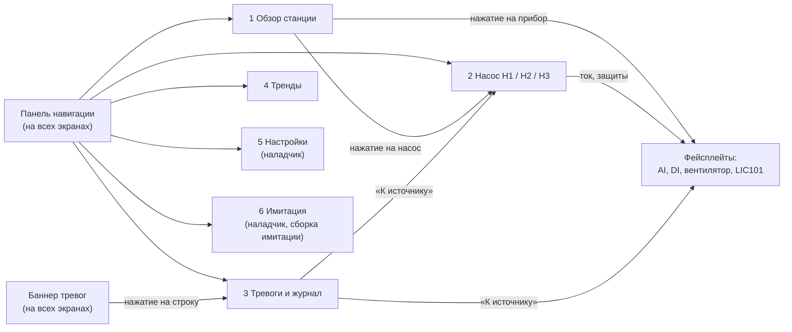
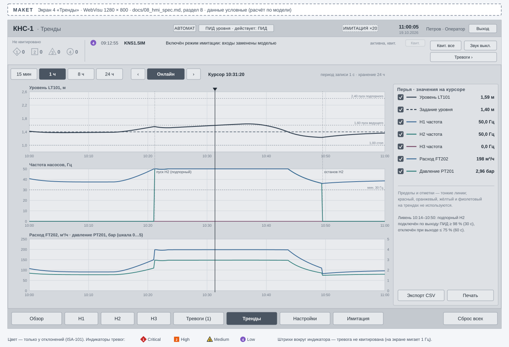
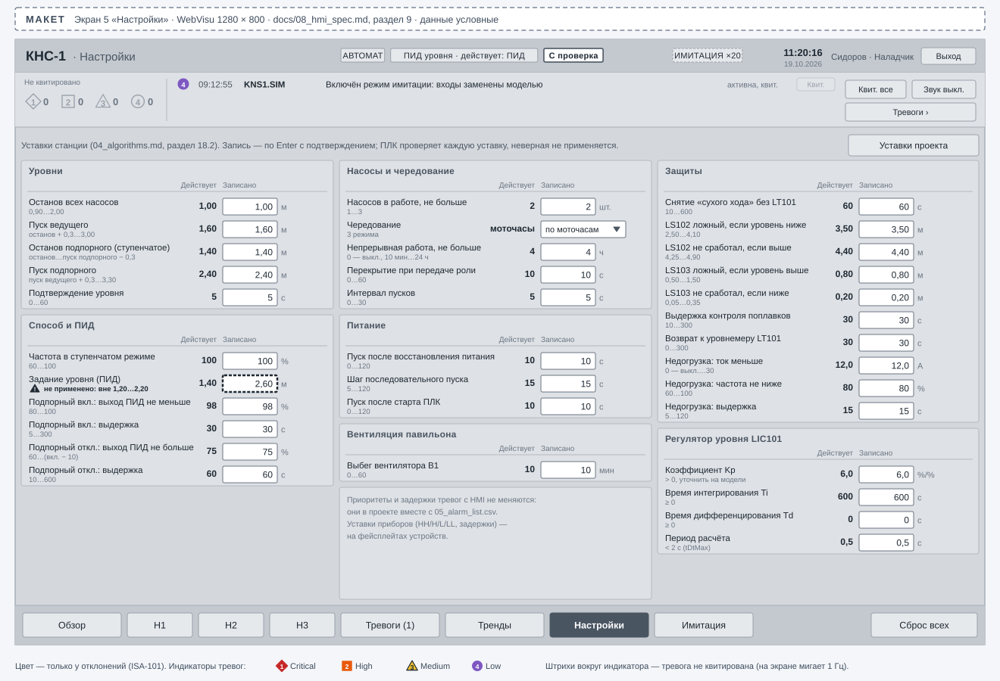

# КНС-1. Спецификация HMI

| | |
|---|---|
| Документ | `docs/08_hmi_spec.md`, версия 0.2 |
| Платформа | CODESYS WebVisu 3.5.17 (задача `VISU_TASK`, 200 мс), браузер или панель на двери шкафа; размер клиента 1280 × 800 |
| Основание | [01_TZ.md](01_TZ.md), функция Ф12 и раздел 4.4.5; алгоритмы — [04_algorithms.md](04_algorithms.md); тревоги — [05_alarm_list.csv](05_alarm_list.csv); перечень сигналов — [03_io_list.csv](03_io_list.csv) |
| Данные | структуры команд и состояний — [ARCHITECTURE.md](ARCHITECTURE.md), раздел 6; типы — [DESIGN.md](DESIGN.md), разделы 3 и 4; устройства — контракт plc-process-lib 1.0 (`PL.ST_<Dev>Sts`, `PL.ST_<Dev>Cmd`) |
| Макеты | `docs/hmi/*.svg` — **макеты**, нарисованные по этой спецификации, а не снимки WebVisu. Данные на макетах условные |

Графику WebVisu инженер собирает в IDE по этому документу (ручной шаг, раздел 13). Здесь — список
экранов, макет каждого экрана, элементы и их привязки к переменным ПЛК, правила оформления и
поведение баннера тревог.

## 1. Исходные данные и правила привязки

- HMI читает и пишет только структуры обмена: состояние — `...stSts` (чтение), команды —
  `...Cmd` (запись), уставки — `GVL_Persist...Cfg` (запись под ролью «Наладчик»). Входы ФБ и
  переменные `GVL_IO` HMI не пишет; читает `GVL_IO` только там, где у сигнала нет ФБ (сирена, лампа,
  реле `K1`, код аварии ПЧ, биты слова состояния ПЧ).
- Команды — импульсы: элемент «Кнопка» с действием «Нажать/отпустить» ставит `TRUE`, сбрасывает
  получатель (`PRG_Station` или устройство). Результат команды — `eCmdResult` и `uiCmdSeq` в
  состоянии: при отказе (`Rejected…`) фейсплейт показывает текст причины из списка `TL_CmdResult`.
- Русские тексты — только текстовые списки визуализации (`STRING` CODESYS 3.5.17 — Windows-1252,
  кириллицы в нём нет). Списки `TL_Alarm` (тексты тревог по номеру), `TL_Event` (события станции),
  `TL_Reason` (причины блокировок) готовит `tools_project/gen_textlists.py` из `05_alarm_list.csv`,
  таблицы событий [04_algorithms.md](04_algorithms.md), раздел 16, и битов `KNS_ILK_*`.
- Сокращения в таблицах привязок: `Sts` — `GVL_Station.stStationSts`, `Cmd` —
  `GVL_Station.stStationCmd`, `Lkg` — `GVL_Station.stCfgLkg`, `Pcfg` — `GVL_Persist.stStationCfg`,
  `fb<TAG>` — `GVL_Devices.fb<TAG>`, `Hmi` — `GVL_Hmi`, `Log` — `GVL_Log`, `Sim` — `GVL_Sim`.
  Индекс насоса *n* = 1…3 (Н1…Н3, `P101`…`P103`).

## 2. Принципы high-performance HMI (ISA-101)

Оформление — по принципам ANSI/ISA-101.01 (high-performance HMI) и управлению тревогами ANSI/ISA-18.2
(формулировки — сверить с текстами стандартов):

| Принцип | Как выполнено |
|---|---|
| Нейтральный серый фон, низкий контраст «нормы» | фон экрана `#D4D8DD`, панели `#DEE1E5`, оборудование и трубы — оттенки серого; никаких градиентов, теней и 3D |
| Цвет — только для отклонений | красный, оранжевый, жёлтый и фиолетовый зарезервированы за тревогами четырёх приоритетов и нигде больше не используются; «работает» и «стоит» — заливкой и текстом, не зелёным и красным |
| Тревога — фигура + цвет + цифра + текст | индикатор приоритета (таблица ниже) читается и без цветового зрения, рядом — код и текст тревоги |
| Мигание — только неквитированное | неквитированная тревога мигает 1 Гц; после квитирования индикатор горит постоянно; ничто другое не мигает |
| Аналоговые индикаторы с нормальным диапазоном | вместо голых чисел — шкала с полосой нормы, отметками уставок и указателем (раздел 4.5): отклонение видно до тревоги |
| Иерархия экранов | уровень 1 — обзор станции (ситуационная осведомлённость), уровень 2–3 — насос и фейсплейты, уровень 4 — диагностика и имитация; тревоги и тренды — вспомогательные экраны (раздел 3) |
| Тексты и единицы | всё по-русски, у каждого числа — единицы; теги ГОСТ 21.208 (`LT101`) — мелким шрифтом рядом с названием |
| Действия оператора — явные | команды, меняющие режим или останавливающие оборудование, — с подтверждением; недоступные по роли элементы скрыты или неактивны |

### 2.1 Палитра

| Токен | Цвет | Где |
|---|---|---|
| фон экрана | `#D4D8DD` | основная область всех экранов |
| панель | `#DEE1E5`, рамка `#B4BAC2` | группы элементов, фейсплейты |
| шапка и панель навигации | `#C4C9CF` | верх и низ экрана |
| текст основной / вторичный / приглушённый | `#1F2933` / `#4A5562` / `#6B7684` | подписи, значения, единицы |
| оборудование: контур | `#4A5562` | насосы, резервуар, арматура |
| оборудование: работает | заливка `#3C4652`, текст белый | насос, вентилятор в работе |
| оборудование: стоит | заливка `#ECEEF1` | насос, вентилятор остановлен |
| труба, стоки в резервуаре | `#8A939E`; жидкость `#AEBCCB` | приглушённый сине-серый — единственный «процессный» оттенок |
| шкала индикатора, полоса нормы | `#ECEEF1`, норма `#C3C9D0` | аналоговые индикаторы |
| поле ввода | `#FFFFFF`, рамка `#6B7684` | уставки, задания |
| кнопка / выбранная кнопка | `#E6E9EC` / `#4A5562` с белым текстом | команды, вкладки, навигация |

### 2.2 Индикаторы приоритета тревог

| Приоритет (`PL.E_AlarmPriority`) | Индикатор | Цвет | Время реакции (05) | Сирена `HA1`, «Общая авария» `K1` |
|---|---|---|---|---|
| Critical (4) | ромб с цифрой 1 | красный `#C62828`, белая цифра | немедленно, до 5 мин | да |
| High (3) | квадрат с цифрой 2 | оранжевый `#E8590C`, белая цифра | до 15 мин | да |
| Medium (2) | треугольник с цифрой 3 | жёлтый `#F2C230`, тёмная цифра | до 1 ч | нет (лампа `HL1` мигает) |
| Low (1) | круг с цифрой 4 | фиолетовый `#7E57C2`, белая цифра | в течение смены | нет |

Состояния тревоги на индикаторе: `ActiveUnack` — залитая фигура, мигает; `ActiveAck` — залитая,
не мигает; `RtnUnack` — контур фигуры, мигает; `Shelved` — серая фигура с часами (только в списке
«Отложенные»); `SuppressedByDesign` и `OutOfService` в баннере и на мнемосхеме не показываются, в
списке тревог — серым текстом.

### 2.3 Обозначения состояний оборудования

| Что | Обозначение |
|---|---|
| насос работает / стоит | тёмная / светлая заливка символа, текст «РАБОТА» / «СТОП» |
| пуск, останов (ждём ОС) | светлая заливка, контур пунктиром, текст «ПУСК…» / «ОСТАНОВ…» |
| отказ насоса | светлая заливка, индикатор приоритета тревоги отказа, текст «ОТКАЗ» и код (`P101.EXT`) |
| режим устройства | метка: «АВТ», «РУЧ», «МЕСТ», «ВЫВЕДЕН» (не-«АВТ» при станции в «Автомате» — метка с белой заливкой и толстой рамкой) |
| роль насоса | метка: «ВЕДУЩИЙ», «ПОДПОРНЫЙ», «РЕЗЕРВ», «—» (недоступен) |
| статус NE 107 | метка с буквой: «F отказ», «S вне спец.», «C проверка», «M ТО»; норма — без метки |
| блокировка | замок и текст первопричины из `TL_Reason` |
| поплавок | «сработал» — тёмный треугольник на отметке; исключён из логики — перечёркнут, текст «исключён» |

## 3. Состав экранов и навигация

| № | Экран | Визуализация | Уровень ISA-101 | Назначение | Макет | Кто видит |
|---:|---|---|---:|---|---|---|
| 1 | Обзор станции | `VIS_Overview` | 1 | состояние станции одним взглядом: резервуар, насосы, коллектор, питание, павильон, режим и способ, команды станции | [hmi/01_overview.svg](hmi/01_overview.svg) | все роли |
| 2 | Насос (Н1, Н2, Н3) | `VIS_Pump` с параметром «номер насоса» | 2–3 | подробное состояние насоса и ПЧ, команды, счётчики, блокировки, тревоги насоса | [hmi/02_pump.svg](hmi/02_pump.svg) | все роли; команды — оператор и наладчик |
| 3 | Тревоги и журнал | `VIS_Alarms` | вспомогательный | список активных и отложенных тревог, квитирование, журнал событий, выгрузка CSV | [hmi/03_alarms.svg](hmi/03_alarms.svg) | все роли |
| 4 | Тренды | `VIS_Trends` | вспомогательный | уровень, задание, частоты насосов, расход, давление за 15 мин … 24 ч | [hmi/04_trends.svg](hmi/04_trends.svg) | все роли |
| 5 | Настройки | `VIS_Settings` | 4 | уставки станции и регулятора LIC101, уставки проекта | [hmi/05_settings.svg](hmi/05_settings.svg) | изменение — наладчик |
| 6 | Имитация | `VIS_Sim` | 4 | модель объекта, ускорение времени, инъекция отказов (только сборка имитации) | [hmi/06_simulation.svg](hmi/06_simulation.svg) | наладчик |

Фейсплейты (всплывающие окна, уровень 3): `VIS_FP_AI` (аналоговый вход), `VIS_FP_DI` (дискретный
вход), `VIS_FP_Motor` (вентилятор В1), `VIS_FP_Pid` (регулятор LIC101) — открываются нажатием на
прибор или его индикатор.

Правила навигации:

- Панель навигации внизу и баннер тревог вверху — на всех экранах (рамка `VIS_Frame` с
  переключением визуализации в средней части). Текущий экран выделен заливкой кнопки.
- Не больше двух нажатий до любого насоса или прибора: «Обзор» → насос или прибор.
- Кнопки «Н1», «Н2», «Н3» несут мини-индикатор приоритета неквитированной тревоги насоса
  (`fbP10n.stSts.stCommon.ePrioUnack`): аварию насоса видно с любого экрана.
- Кнопка «Имитация» видна только при `Sim.xSimulation = TRUE` и роли «Наладчик».
- Из строки тревоги «К источнику» открывает экран насоса или фейсплейт устройства по
  `Log.stAlarmView.astRow[i].uiSource` (индекс устройства в `GVL_DeviceList`).

## 4. Общие элементы экранов

### 4.1 Шапка

| Элемент | Привязка | Поведение |
|---|---|---|
| название станции и экрана | константа, имя экрана | «КНС-1 · Обзор станции» |
| режим станции | `Sts.eMode` | «АВТОМАТ» / «РУЧНОЙ» (метка «РУЧНОЙ» — с белой заливкой и толстой рамкой) |
| способ и действующее управление | `Sts.eMethod`, `Sts.eControlAct` | «ПИД уровня · действует: ПИД»; при `eControlAct` ≠ выбранному способу (`Float`, `Emergency`, `DryRunStop`, `PowerLost`, `Restart`, `Stepped` вместо ПИД) — текст действующего управления с рамкой |
| сводный статус станции | `Sts.eNe107` | метка NE 107 (раздел 2.3) |
| имитация | `Sim.xSimulation`, `Sim.stSimCfg.rTimeScale` | метка «ИМИТАЦИЯ ×20» в пунктирной рамке; на объекте не появляется |
| дата и время | системное время клиента WebVisu | ЧЧ:ММ:СС, ДД.ММ.ГГГГ |
| пользователь и роль | пользователь WebVisu | «Иванов · Оператор»; кнопка «Вход/выход» |

### 4.2 Баннер тревог

Баннер под шапкой на всех экранах показывает до трёх самых важных тревог и счётчики.

| Элемент | Привязка | Поведение |
|---|---|---|
| счётчики неквитированных по приоритетам | `Sts.auiUnack[4]` (Critical), `[3]` (High), `[2]` (Medium), `[1]` (Low) | индикатор приоритета и число; при 0 — серый контур и «0» |
| строки 1–3 | `Log.stAlarmView.astRow[1..3]`: `udiId`, `ePriority`, `eState`, `uliSinceUtc_ms` | индикатор приоритета и состояния (раздел 2.2), время, код (`TL_AlarmCode`), текст (`TL_Alarm` по `udiId`), состояние текстом |
| «всего активных: N» | `Log.stAlarmView.uiActiveTotal` | под счётчиками, если активных тревог больше трёх |
| «Квит.» в строке | запись `Cmd.udiAckId := astRow[i].udiId` | квитирует одну тревогу; роль «Оператор» и выше |
| «Квит. все» | `Cmd.xAckAll` | с подтверждением; роль «Оператор» и выше |
| «Звук выкл.» | `Cmd.xSilence` | выключает сирену `HA1` (как кнопка `HS502`); новая тревога High/Critical включает снова |
| «Тревоги ›» | — | переход на экран 3 |
| нажатие на строку | переход на экран 3 с выделенной строкой | — |

Поведение баннера:

1. Порядок строк задаёт `FB_AlarmSummary` ([DESIGN.md](DESIGN.md), раздел 9.3): сначала
   неквитированные, затем по приоритету (Critical → Low), затем новые выше. HMI порядок не меняет.
2. В баннер попадают состояния `ActiveUnack`, `ActiveAck`, `RtnUnack`. Отложенные (`Shelved`),
   подавленные по условию (`SuppressedByDesign`) и выведенные (`OutOfService`) — только на экране 3.
3. Неквитированная строка мигает индикатором (1 Гц), а не всей строкой: текст остаётся читаемым.
4. Список обновляется раз в 500 мс (`ALM_VIEW_PERIOD`); если `Log.stAlarmView.udiRevision` не меняется
   дольше 5 с, баннер показывает «нет данных тревог» с серым контуром — признак остановки логики.
5. Нет активных тревог — одна строка «Активных тревог нет» приглушённым текстом, счётчики серые.
6. Звук на клиенте WebVisu не используется: звуковой сигнал — сирена `HA1` на шкафу
   ([04_algorithms.md](04_algorithms.md), раздел 14). Отключение звука не квитирует тревоги.

### 4.3 Панель навигации

Кнопки: «Обзор», «Н1», «Н2», «Н3», «Тревоги», «Тренды», «Настройки», «Имитация». Действие — смена
визуализации в рамке; у «Тревоги» — число активных `Log.stAlarmView.uiActiveTotal`. Справа — «Сброс
всех» (`Cmd.xResetAll`, как кнопка `HS501`; с подтверждением, роль «Оператор» и выше).

### 4.4 Фейсплейты устройств

Один фейсплейт на тип устройства библиотеки, параметр — ссылка на экземпляр (интерфейс
визуализации с `REFERENCE TO` на `stSts`, `stCmd`, `stCfg`; имена — сверить при сборке в 3.5.17).

| Фейсплейт | Показывает | Команды | Уставки (наладчик) |
|---|---|---|---|
| `VIS_FP_AI` | значение и единицы, аналоговый индикатор, ток канала `stSts.rIn`, `eSignal`, NE 107, режим «Измерение/Подмена», остаток подмены `uiSubstRemain_s`, тревоги 6 слотов | «Измерение», «Подмена» и значение `rSubstValue_eu`, «Вывести из работы», «Сброс», «Квит.», отложить слот (`wShelveReq`) | `astLimit[0..3].rSetpoint_eu`, `rHyst_eu`, `tFilter` в `GVL_Persist.st<TAG>Cfg` |
| `VIS_FP_DI` | значение, сырое значение, NE 107, режим, остаток подмены, тревоги | «Измерение», «Подмена» и `xSubstValue`, «Вывести», «Сброс», «Квит.» | `tOnDelay`, `tOffDelay` |
| `VIS_FP_Motor` | состояние, режим, блокировки, счётчики, тревоги (вентилятор В1) | «Авто», «Ручной», «Пуск», «Стоп», «Вывести», «Сброс», «Квит.» | `tMinStop`, `udiMaintInterval_h` |
| `VIS_FP_Pid` | PV, задание, выход, P/I/D, режим, слежение, NE 107 (`GVL_Station.fbLIC101.stSts`) | «Авто», «Ручной» и выход `rManualOut_pct` (`GVL_Station.stLIC101Cmd`) | на экране 5 |

Подмена значения ограничена `tSubstMax` (8 ч) и видна как NE 107 «C проверка» на всех экранах.

### 4.5 Аналоговый индикатор

Элемент (повторяемый, `VIS_AnalogBar`, горизонтальный и вертикальный вариант):

| Часть | Источник |
|---|---|
| шкала (минимум, максимум) | `GVL_Persist.st<TAG>Cfg.rRangeLo_eu`, `rRangeHi_eu` |
| полоса нормы | нормальный рабочий диапазон этого документа (таблица ниже) |
| отметки уставок HH, H, L, LL | `GVL_Persist.st<TAG>Cfg.astLimit[0..3].rSetpoint_eu` при `xEnable` |
| указатель и цифровое значение с единицами | `fb<TAG>.stSts.rValue_eu` |
| индикатор тревоги | наивысший приоритет активной тревоги уставки устройства (`stSts.stCommon.wAlmActive`, `ePrioUnack`) |
| недостоверное значение | `fb<TAG>.xValid = FALSE`: указатель скрыт, вместо числа «ОТКАЗ», значение удержания — серым |

| Прибор | Шкала | Полоса нормы | Обоснование |
|---|---|---|---|
| `LT101` уровень | 0…5 м | 1,00…2,40 м | от останова всех насосов до пуска подпорного (04, раздел 1) |
| `PT201` давление | 0…10 бар | 1,2…3,5 бар | от одного насоса на минимальной частоте (≈ 1,25 бар) до закрытой задвижки (≈ 3,5 бар) (01_TZ, раздел 3.2) |
| `FT202` расход | 0…500 м³/ч | 30…220 м³/ч | от L до подачи трёх насосов |
| `IT1n1` ток | 0…60 А | 12…31 А | от порога недогрузки до H |
| `AT401` H₂S | 0…40 мг/м³ | 0…5 мг/м³ | ниже H |
| `AT402` CH₄ | 0…100 % НКПР | 0…10 % НКПР | ниже H |
| `TT403` температура | −40…60 °C | 5…35 °C | между L и H |
| частота насоса | 0…50 Гц | 30…50 Гц | от минимальной частоты (60 %) до номинальной |

## 5. Экран 1 «Обзор станции»

Мнемосхема слева — по функциональной схеме [02_functional_diagram.md](02_functional_diagram.md):
резервуар с уровнем и поплавками, три насоса с ПЧ, напорный коллектор с давлением и расходом. Справа —
карточки насосов, панель станции, питание и павильон.

| Элемент | Привязка (чтение) | Команда (запись) | Поведение |
|---|---|---|---|
| резервуар: заливка уровня | `fbLT101.stSts.rValue_eu` | — | высота заливки по уровню; при `fbLT101.xValid = FALSE` заливка штриховкой и надпись «уровнемер: ОТКАЗ» |
| отметки на резервуаре | `Lkg.rLvlStop_m`, `rLvlStartLead_m`, `rLvlStopAssist_m`, `rLvlStartAssist_m`, `Lkg.rLevelSp_m`; HH/H/L/LL — `GVL_Persist.stLT101Cfg.astLimit[*]` | — | тонкие риски с подписями; отметки поплавков 4,20 и 0,40 м — константы схемы |
| `LT101` аналоговый индикатор | раздел 4.5 | нажатие — `VIS_FP_AI` | — |
| поплавки `LS102`, `LS103` | `fbLS102.xValue`, `fbLS103.xValue`; исключение — `Sts.wState` биты 9, 10 | нажатие — `VIS_FP_DI` | «сработал» — тёмный треугольник; исключён — перечёркнут |
| насос Н*n* на схеме | `fbP10n.stSts.eState`, `stCommon.eMode`, `Sts.aeRole[n]`, `fbP10n.stSts.rSpeedAct_pct` (× 0,5 = Гц) | нажатие — экран 2 | символ по разделу 2.3, под ним частота, Гц |
| карточка насоса Н*n* | состояние, роль, режим; частота — `GVL_IO.uiP10n_FACT` / 100 (Гц), задание — `fbP10n.stSts.rSpeedRef_pct`; ток — `fbIT1n1.stSts.rValue_eu`; наработка — `fbP10n.stSts.rRunTime_h`; пуски за час — `uiStartsLastHour`; NE 107 — `stCommon.eNe107`; связь с ПЧ — `GVL_IO.xP10n_CommOk` | нажатие — экран 2 | индикатор приоритета тревог насоса (`stCommon.ePrioUnack`) и текст главной тревоги; блокировка — замок и `TL_Reason[uiFirstOut]` |
| коллектор: `PT201`, `FT202` | `fbPT201.stSts.rValue_eu`, `fbFT202.stSts.rValue_eu` | нажатие — `VIS_FP_AI` | горизонтальные аналоговые индикаторы |
| камера задвижек `LS203` | `fbLS203.xValue` | — | «затопление» с индикатором тревоги, норма — «сухо» приглушённо |
| панель станции: режим | `Sts.eMode` | «Автомат» — `Cmd.xSetAuto`, «Ручной» — `Cmd.xSetManual` (с подтверждением) | выбранная кнопка залита |
| панель станции: способ | `Sts.eMethod` | «Ступенчатое» — `Cmd.xSetStepped`, «ПИД уровня» — `Cmd.xSetLevelPid` | — |
| панель станции: действующее управление | `Sts.eControlAct`, `Sts.uiLeadPump`, `Sts.uiPumpsRequired`, `uiPumpsRunning`, `uiPumpsAvailable`, `Sts.uiSeqRemain_s` | — | «ПИД уровня; ведущий Н1; требуется 1 / работает 1 / доступно 3»; во время последовательного пуска — «пуск через 12 с» |
| регулятор LIC101 | `GVL_Station.fbLIC101.stSts.rSp_eu`, `rPv_eu`, `rOut_pct`, `stCommon.eMode`; `Sts.rSpeedSp_pct` | нажатие — `VIS_FP_Pid` | в слежении — метка «слежение» |
| электроснабжение | `fbES301.xValue`, `fbYS302.xValue`, `fbYS303.xValue` | — | «Ввод 0,4 кВ: норма / НЕТ НАПРЯЖЕНИЯ», «ИБП: сеть / батареи / неисправен» |
| павильон | `fbAT401`, `fbAT402`, `fbTT403` (аналоговые индикаторы), `fbZS404.xValue`, `fbYS405.xValue`, `fbV1.stSts.eState` | нажатие на В1 — `VIS_FP_Motor` | — |
| сигнализация шкафа | `GVL_IO.xHA1`, `xHL1`, `xK1` | — | «Сирена», «Лампа», «Общая авария: нет / ЕСТЬ» (`xK1 = FALSE` — авария) |

## 6. Экран 2 «Насос»

Одна визуализация `VIS_Pump` с параметром номера насоса; привязки — к экземплярам `fbP10n`,
`fbIT1n1`, `fbTS1n2`, `fbMS1n3`, `Hmi.stP10nCmd` выбранного насоса.

| Группа | Элементы и привязки (чтение) | Команды (запись) |
|---|---|---|
| состояние | `fbP10n.stSts.eState`, `stCommon.eMode`, `Sts.aeRole[n]`, `stCommon.eNe107`, `stCommon.wFault` (тексты битов `MOT_FLT_*`), `stCommon.wWarning` (`MOT_WRN_*`) | — |
| режим | `stCommon.eMode` | «Авто» `Hmi.stP10nCmd.stCommon.xSetAuto`, «Ручной» `xSetManual`, «Вывести из работы» `xSetOos` (с подтверждением) |
| управление в «Ручном» | `stSts.rSpeedRef_pct`, `GVL_Station.axPumpRun[n]` (запрос станции) | «Пуск» `Hmi.stP10nCmd.xStart`, «Стоп» `xStop`, задание `Hmi.stP10nCmd.rSpeedSp_pct` (поле, 60…100 %) |
| ПЧ | задание `stSts.rSpeedRef_pct`; факт `stSts.rSpeedAct_pct` и `GVL_IO.uiP10n_FACT` / 100 Гц; готов `GVL_IO.xP10n_VfdReady`; в работе `xP10n_VfdRun`; авария `xP10n_VfdFault`; предупреждение и управление от клемм — биты 3 и 4 `GVL_IO.wP10n_STW`; связь `GVL_IO.xP10n_CommOk`; код аварии `GVL_IO.uiP10n_FCODE` и текст `TL_VfdFault` | «Сброс» `Hmi.stP10nCmd.stCommon.xReset` (импульс сброса ПЧ подаёт ФБ) |
| ток | `fbIT1n1.stSts.rValue_eu`, аналоговый индикатор 0…60 А с H 31 и HH 34 А и порогом недогрузки `Lkg.rUnderload_A`; недогрузка — `Sts.wState` и `KNS1.ULn` | нажатие — `VIS_FP_AI` |
| защиты насоса | `fbTS1n2.xValue` (перегрев), `fbMS1n3.xValue` (протечка), режим «Местное» (`stCommon.eMode = Local`, `GVL_IO.xHS1n4`) | нажатие — `VIS_FP_DI` |
| блокировки | `fbP10n.stSts.wInterlock` по битам 0–2 с текстами `TL_Reason` (`KNS_ILK_*`), первопричина `uiFirstOut`; станционная копия `GVL_Station.awPumpInterlock[n]` | — |
| счётчики | наработка `rRunTime_h`, пусков `udiStarts`, за час `uiStartsLastHour` из `stCfg.uiMaxStartsPerHour`, с последнего ТО `rRunTimeMaint_h`, `udiStartsMaint`, текущая работа `udiRunCurrent_s`, запрет пуска `uiInhibitRemain_s` | «Сброс счётчиков ТО» `Hmi.stP10nCmd.xResetMaint` (наладчик, с подтверждением) |
| тревоги насоса | слоты 0–7 `fbP10n` (`FTS`, `FBL`, `FTP`, `UCR`, `EXT`, `ILK`, `COM`, `SPD`): `stCommon.wAlmActive`, `wAlmUnack`, `wAlmShelved`; станционные `KNS1.ULn`; ток `fbIT1n1`, `fbTS1n2`, `fbMS1n3` | «Квит.» `stCommon.xAck`; отложить слот — `stCommon.wShelveReq` (бит слота) |
| мини-тренд 30 мин | `rSpeedAct_pct` (Гц), ток `fbIT1n1.stSts.rValue_eu` | — |

Ответ на команду — строка под кнопками: текст `TL_CmdResult[stCommon.eCmdResult]`, например
«Отклонено: действует блокировка» (`RejectedInterlock`).

## 7. Экран 3 «Тревоги и журнал»

Вкладки: «Активные», «Отложенные», «Журнал».

| Элемент | Привязка | Поведение |
|---|---|---|
| таблица «Активные» (до 50 строк) | `Log.stAlarmView.astRow[1..50]`: `ePriority`, `eState`, `udiId`, `uliSinceUtc_ms`; `Log.stAlarmView.uiCount` | колонки: приоритет (индикатор), время, код, сообщение (`TL_Alarm`), состояние, значение и уставка (из `05_alarm_list.csv` через `TL_AlarmSetpoint`), действие оператора (кратко); порядок — как в баннере |
| панель выбранной тревоги | `udiId` выбранной строки | причина, последствия, действие оператора, время реакции — списки `TL_AlarmCause`, `TL_AlarmConsequence`, `TL_AlarmAction`, `TL_AlarmResponse` из `05_alarm_list.csv` |
| «Квитировать» | `Cmd.udiAckId := udiId` | одна тревога |
| «Квитировать все» | `Cmd.xAckAll` | с подтверждением |
| «Отложить», «Вернуть» | номер выбранной строки — `Cmd.udiShelveId` / `Cmd.udiUnshelveId` (любой источник); маски станции `Cmd.wShelveReq`, `Cmd.wUnshelveReq` (бит slot − 1) и устройств `Hmi.st<TAG>Cmd.stCommon.wShelveReq` (бит слота) — на фейсплейтах | срок — `tShelveMax` тревоги; для `KNS1.EHL` (Critical) кнопка неактивна (`tShelveMax = 0`) |
| «К источнику» | `astRow[i].uiSource` | экран насоса или фейсплейт |
| фильтр по приоритету | локальная переменная визуализации | показывает строки выбранных приоритетов |
| вкладка «Отложенные» | строки со `eState = Shelved` | остаток срока отложенной тревоги — на фейсплейте устройства |
| вкладка «Журнал» | `Log.stEventView.uiPage` (запись), `uiPageCount`, `uiCount`, `astRow[1..20]`: `udiSeq`, `uliUtc_ms`, `eKind`, `udiId`, `ePriority`, `eOldState`, `eNewState`, `eReason`, `rValue` | 20 записей на страницу, новые сверху; текст — `TL_Alarm` или `TL_Event`; кнопки «Новые», «‹», «›»; затёрто записей — `Sts.udiLogOverwritten` |
| «Выгрузить CSV» | `Cmd.xExportLog`; состояние `Sts.eLogExport`, строк `Log.uiExportLines`, ошибка `Log.udiExportError` | «Выгрузка… / Готово: 200 строк, kns_events.csv / Ошибка: код» |

## 8. Экран 4 «Тренды»

Три графика с общей осью времени (элемент «Тренд» CODESYS и объект записи тренда в приложении;
имена объектов и глубина хранения — сверить в IDE 3.5.17 и по памяти ПЛК210).

| График | Перья | Единицы | Фиксированные линии |
|---|---|---|---|
| уровень | `fbLT101.stSts.rValue_eu`; задание `Sts.rLevelSp_m` | м | `Lkg.rLvlStartLead_m`, `rLvlStop_m`, `rLvlStartAssist_m`; H и HH `LT101` |
| насосы | `fbP101.stSts.rSpeedAct_pct`, `fbP102…`, `fbP103…` (× 0,5 = Гц); выход `GVL_Station.fbLIC101.stSts.rOut_pct` | Гц, % | минимальная частота 30 Гц |
| коллектор | `fbFT202.stSts.rValue_eu`, `fbPT201.stSts.rValue_eu` | м³/ч, бар | — |

Управление: диапазоны 15 мин, 1 ч, 8 ч, 24 ч; «Пауза/Онлайн»; курсор с таблицей значений всех
перьев; включение и выключение перьев. Период записи — 1 с, хранение — 24 ч на Control Win; на ПЛК210 —
по свободной памяти (не меньше 8 ч). Цвета перьев — тёмно-серый, сине-серый, бирюзовый, сливовый:
красный, оранжевый, жёлтый и фиолетовый на трендах не используются (они за тревогами). Долговременный
архив — на верхнем уровне (InfluxDB, проект plc-iiot-stack).

## 9. Экран 5 «Настройки»

Уставки станции — [04_algorithms.md](04_algorithms.md), раздел 18.2. Изменять может только роль
«Наладчик»; остальные видят значения.

| Колонка | Привязка |
|---|---|
| параметр, единицы, диапазон | текст и диапазоны 04, раздел 18.2 (константы `STN_*_MIN/MAX`) |
| «Действует» | последняя корректная копия `Lkg.<поле>` |
| «Записано» — поле ввода | `Pcfg.<поле>` (`GVL_Persist.stStationCfg`); для LIC101 — `GVL_Persist.stLIC101Cfg.<поле>` |
| признак ошибки | `Sts.wCfgErr` (группа `STN_CFG_*` параметра); для LIC101 — `GVL_Station.fbLIC101.stSts.stCommon.wCfgErr` |

Группы: «Уровни» (№ 2–6), «Способ и ПИД» (№ 7–12), «Насосы и чередование» (№ 13–17), «Питание»
(№ 18–20), «Защиты» (№ 21–30), «Вентиляция» (№ 31), «Регулятор LIC101» (№ 33–40).

Поведение:

1. Поле ввода ограничено диапазоном параметра; запись — по Enter с подтверждением. Перечисления
   (`eRotation`, `uiDutyMax`) — выпадающим списком.
2. ПЛК проверяет уставки в каждом цикле: неверная (в том числе записанная в обход HMI по OPC UA) не
   применяется, станция работает по `Lkg`; строка с ошибкой — с рамкой и текстом «не применено: …»
   (по биту `wCfgErr`), «Действует» показывает прежнее значение. Кнопка «Отменить запись» —
   `Cmd.xRevertCfg` (с подтверждением): записанные значения возвращаются к действующим.
3. «Уставки проекта» — `Hmi.xApplyProjectCfg` (с подтверждением): уставки устройств, станции и LIC101 —
   к значениям по умолчанию.
4. Каждое принятое изменение — событие 101017 журнала (номер параметра).
5. Приоритеты и задержки тревог (`Pcfg.astAlarm`, `astAlarm` устройств) с HMI не меняются: это
   решение рационализации тревог, оно меняется в проекте вместе с `05_alarm_list.csv`.
6. Уставки устройств (пределы AI, задержки DI) — на фейсплейтах (раздел 4.4).

## 10. Экран 6 «Имитация»

Только сборка имитации (`Sim.xSimulation = TRUE`) и роль «Наладчик». Вверху — полоса «РЕЖИМ ИМИТАЦИИ:
входы ПЛК заменены моделью». Поля — [06_PMI.md](06_PMI.md), раздел 5.4; типы — [DESIGN.md](DESIGN.md), раздел 3.3.

| Группа | Привязки |
|---|---|
| состояние модели | `Sim.stSimSts.rLevel_m` (истинный уровень), `rInflow_m3h`, `rOutflow_m3h`, `arPumpFlow_m3h[1..3]`, `arFreq_Hz[1..3]`, `arCurrent_A[1..3]`, `rTimeOfDay_h`, `udiDay`, `xStormActive`, `rStormInflow_m3h`, `udiOverflow_s`, `rTimeScaleAct` |
| время | ускорение `Sim.stSimCfg.rTimeScale` (поле 1…50); время суток `Sim.stSimCmd.rTimeOfDay_h` + `xSetTimeOfDay` |
| приток | `Sim.stSimCmd.xInflowOverride` (переключатель «профиль и ливни / постоянный»), `rInflowOverride_m3h`; «Ливень сейчас»: `rStormPeak_m3h`, `tStormDuration`, `xStormNow` |
| модель | «Установить уровень»: `rSetLevel_m` + `xSetLevel`; «Сброс модели» `xResetPlant`; «Снять все отказы» `xClearFaults` |
| отказы насосов (матрица 3 × 10) | `Sim.stFaultInj.axVfdFault`, `axNoFeedback`, `axFeedbackStuck`, `axAirLock`, `axClog`, `axOverheat`, `axLeak`, `axVfdCommLoss`, `axLocal`, `axLocalRun` |
| датчики 4–20 мА | `Sim.stFaultInj.aeAiFault[1..5]` (список `E_SimAiFault`), `arAiForced_mA[1..5]` |
| поплавки | `eLs102Stuck`, `eLs103Stuck` (`E_SimFloatStuck`) |
| питание и прочее | `xPowerLoss`, `xUpsFault`, `xTempCommLoss`, `xFanFault`, `xFanNoFeedback` (нет ОС В1), `xValveChamberFlood`, `xFire`, газы `rH2S_mgm3`, `rCh4_pctLel`, температура `Sim.stSimCfg.rAirTemp_C` |
| кнопки шкафа и дверь | `Sim.stSimCmd.xPressReset`, `xPressSilence`, `xDoorOpen` |

Включённая инъекция — тёмная кнопка с текстом «ВКЛ»; число включённых инъекций — в заголовке
экрана. Каждое изменение инъекции — событие 101021 журнала.

## 11. Роли и права

Пользователи и группы — управление пользователями визуализации CODESYS; учётные данные — вне
репозитория. Диспетчер водоканала работает через SCADA и IIoT (раздел 12), а не через WebVisu.

| Действие | Наблюдатель (без входа) | Оператор | Наладчик | Администратор |
|---|---|---|---|---|
| просмотр экранов 1–4 | да | да | да | да |
| квитирование, отключение звука | — | да | да | да |
| режим станции, способ, пуск и стоп насосов, режим устройств | — | да | да | да |
| отложить тревогу | — | да | да | да |
| общий сброс | — | да | да | да |
| вывод из работы, подмена значений | — | — | да | да |
| уставки (экран 5, фейсплейты), «Уставки проекта», сброс счётчиков ТО | — | — | да | да |
| экран «Имитация» (только сборка имитации) | — | — | да | да |
| пользователи и пароли | — | — | — | да |

## 12. Связь с верхним уровнем

Те же структуры, что у HMI, получают OPC UA-сервер рантайма и IIoT-стек (проект plc-iiot-stack):

| Что | OPC UA: путь переменной в узле `…Application.<путь>` ([ARCHITECTURE.md](ARCHITECTURE.md), раздел 6) | MQTT (проект 06, предложение) |
|---|---|---|
| состояние станции | `GVL_Station.stStationSts` | `vodokanal/kns1/station/KNS1/<метрика>`: `mode`, `method`, `control`, `ne107`, `state`, `pumps_required`, `pumps_running`, `pumps_available`, `lead`, `seq_remain`, `level`, `level_sp`, `speed_sp` |
| команды станции | `GVL_Station.stStationCmd` (запись) | `.../KNS1/cmd/SetAuto`, `SetManual`, `SetStepped`, `SetLevelPid`, `AckAll`, `ResetAll`, `Silence`; подтверждение по `eCmdResult`, `uiCmdSeq` |
| тревоги станции | `Sts.wAlmActive`, `wAlmUnack`, `wAlmShelved` (бит slot − 1) | `.../KNS1/alarm/<SUFFIX>` (`EHL`, `DRY`…), тексты из `05_alarm_list.csv` |
| регулятор | `GVL_Station.fbLIC101.stSts`, `GVL_Station.stLIC101Cmd` | устройство `LIC101` |
| устройства | `GVL_Devices.fb<TAG>.stSts`, `GVL_Hmi.st<TAG>Cmd` | как сейчас в проекте 06 (`vodokanal/kns1/station/<TAG>/...`) |

Что должен изменить проект 06 при встраивании — [ARCHITECTURE.md](ARCHITECTURE.md), раздел 8, и
[DESIGN.md](DESIGN.md), раздел 17. Уставки и имитация по MQTT не передаются.

## 13. Сборка в CODESYS (ручные шаги)

Пошагово — `docs/MANUAL_STEPS.md` (план — [DESIGN.md](DESIGN.md), раздел 16). Кратко:

1. Менеджер визуализации: WebVisu, стартовая визуализация `VIS_Overview`, размер клиента 1280 × 800,
   масштабирование с сохранением пропорций; задача `VISU_TASK` 200 мс.
2. Визуализации раздела 3 и рамка `VIS_Frame` (шапка, баннер, навигация, область экрана).
3. Повторяемые элементы: `VIS_AnalogBar`, индикатор приоритета `VIS_AlarmPrio` (фигура по
   приоритету, мигание по состоянию), символ насоса `VIS_PumpSymbol`, фейсплейты раздела 4.4.
4. Цвета палитры раздела 2.1 — константами (например, `GVL_HmiStyle`, `DWORD` вида `16#00D4D8DD`) в
   свойствах «Цвета» элементов: так палитра меняется в одном месте.
5. Текстовые списки из CSV, которые готовит `tools_project/gen_textlists.py`: `TL_Alarm`,
   `TL_AlarmCode`, `TL_AlarmCause`, `TL_AlarmConsequence`, `TL_AlarmAction`, `TL_AlarmResponse`,
   `TL_AlarmSetpoint`, `TL_Event`, `TL_Reason`, `TL_CmdResult`, `TL_VfdFault`, тексты перечислений.
6. Пользователи и группы раздела 11, права элементов (видимость и доступность по группе).
7. Объект записи тренда (перья раздела 8) и элементы «Тренд».
8. Проверка: PMI-01 (вид экрана «Обзор»), PMI-08 (права и уставки), PMI-36 (баннер и квитирование);
   снимки экранов — в протокол [07_test_protocol.md](07_test_protocol.md) и в README вместо макетов.

## 14. Вопросы к архитектуре ПО и решения

| № | Вопрос | Решение (DESIGN v0.3) |
|---:|---|---|
| 1 | Отложить и вернуть тревогу из общей таблицы: квитирование по номеру было (`udiAckId`), откладывания по номеру не было | **принято**: `ST_StationCmd.udiShelveId`, `udiUnshelveId` и метод `FB_AlarmSummary.ShelveById` (DESIGN, разделы 3.1, 9.3); раздел 7 |
| 2 | Отмена ошибочной уставки: неверное значение остаётся в `GVL_Persist.stStationCfg`, пока его не перепишут | **принято**: импульс `ST_StationCmd.xRevertCfg`: `Pcfg := Lkg` (DESIGN, раздел 7, шаг 3); раздел 9 |
| 3 | Местное время на HMI: строки тревог и журнала несут UTC в мс (`uliSinceUtc_ms`, `uliUtc_ms`) | **открыт до реализации**: смещение часового пояса константой `GVL_Const` и форматирование в визуализации или в `FB_AlarmSummary` / `FillView` — проверить в IDE 3.5.17 |
| 4 | Приток на HMI: расходомера притока нет, оператор видит только откачку `FT202` | **не в 1.0**: размер `ST_StationSts` (72 байта, тест размера) не меняется; оценку притока `FT202 + S · dh/dt` считает верхний уровень (проект plc-iiot-stack) |
| 5 | Глубина трендов на ПЛК210 | **открыт до наладки**: замерить память таргета; при нехватке — 8 ч на ПЛК, остальное — архив верхнего уровня |
