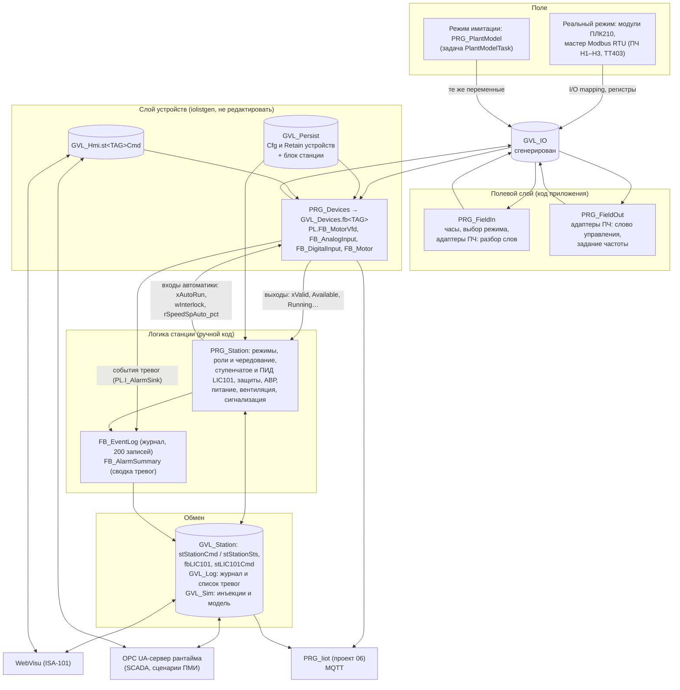
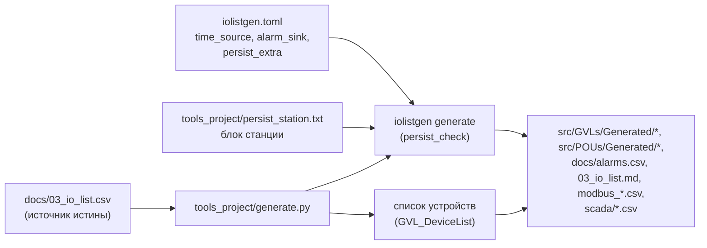
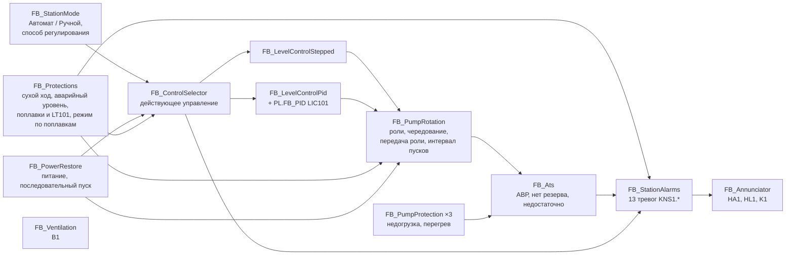
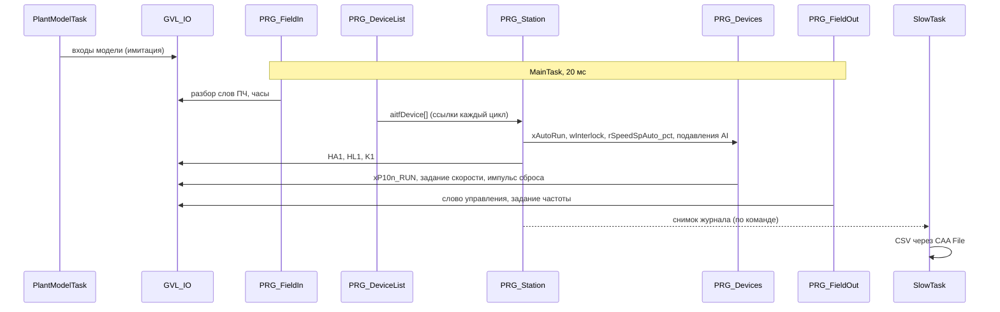
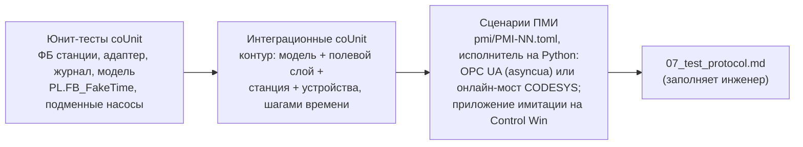

# КНС-1. Архитектура ПО

| | |
|---|---|
| Документ | `docs/ARCHITECTURE.md`, версия 0.3 (проект, до реализации), 19.10.2026 |
| Платформа | CODESYS V3.5 SP17 Patch 3 (3.5.17.30); стенд — CODESYS Control Win V3 (32 бит), целевой ПЛК — ОВЕН ПЛК210 |
| Основание | спецификация проекта 02 (флагман КНС-1), [04_algorithms.md](04_algorithms.md), перечень сигналов [03_io_list.csv](03_io_list.csv), тревоги [05_alarm_list.csv](05_alarm_list.csv), испытания [06_PMI.md](06_PMI.md), контракт plc-process-lib 1.0.0 (`docs/API.md` библиотеки, пространство имён `PL`) |
| Детали | интерфейсы ФБ, типы, план файлов, тесты и разделение работ — [DESIGN.md](DESIGN.md) |
| Правила кода | [CONTRIBUTING.md](../CONTRIBUTING.md), раскладка исходников — [LAYOUT.md](LAYOUT.md) |

> **Дисклеймер.** Защиты КНС-1 (сухой ход, аварийный уровень, блокировки насосов) — демонстрация
> логики управления, а не система ПАЗ. На реальном объекте защиты насосов в местном режиме и
> аварийное отключение выполняются аппаратно ([04_algorithms.md](04_algorithms.md), раздел 10.7).

Документ фиксирует, **из каких слоёв состоит ПО, кто пишет каждую переменную и в каком порядке
выполняется цикл**. Алгоритмы (что делает станция) описаны в `04_algorithms.md`; здесь — как они
разложены по программам, задачам и данным. Слова «проверено на стенде» относятся только к зондам
раздела 14 (16 и 19.10.2026). Отличия версии 0.2: сторожевой таймер ПЧ по 04 §12 (раздел 12),
исполнитель сценариев «онлайн CODESYS» через проверенный мост (раздел 13, зонд Z7), проверка
выдержек по журналу во времени контура (решение D-14), повторные прогоны зондов Z3–Z6. Версия 0.3 —
согласование с 01–08 и DESIGN v0.3: инструменты проекта в `tools_project/`, решения D-01…D-14
перенесены в [ASSUMPTIONS.md](ASSUMPTIONS.md).

## 1. Назначение и границы

ПО ПЛК КНС-1 управляет тремя погружными насосами с ПЧ (два рабочих, один резервный) по уровню в
приёмном резервуаре, защищает насосы, выполняет АВР и последовательный пуск после пропадания
питания, ведёт журнал событий и отдаёт данные HMI (WebVisu), SCADA (OPC UA) и IIoT-стеку
(проект 06, MQTT). Без железа ПО работает на CODESYS Control Win V3 с моделью объекта.

| Входит | Не входит (ручные шаги или другие проекты) |
|---|---|
| исходники ST в `src/` и `tests/` (раскладка шаблона) | графика WebVisu — собирает инженер по [08_hmi_spec.md](08_hmi_spec.md) |
| сгенерированный слой устройств (iolistgen по `03_io_list.csv`) | дерево устройств ПЛК210, модули ввода-вывода, мастер Modbus RTU |
| модель объекта и инъекция отказов (режим имитации) | настройки самих ПЧ (адрес, скорость, сторожевой таймер связи) |
| журнал событий, выгрузка в CSV (CAA File) | сертификат OPC UA-сервера рантайма |
| автоматические сценарии ПМИ (Python, OPC UA) | MQTT-клиент и стек Telegraf/InfluxDB/Grafana (проект 06) |

## 2. Слои и потоки данных

| Слой | Объекты | Кто пишет | Кто читает | Правило |
|---|---|---|---|---|
| Поле | дерево устройств ПЛК210 или `PRG_PlantModel` | рантайм (I/O mapping, Modbus) или модель | `GVL_IO` | в коде нет адресов `%I/%Q`; каналы привязываются «Map to existing variable» |
| `GVL_IO` | сгенерирован iolistgen | входы — поле; выходы — `PRG_Devices` и `PRG_Station` (сигналы `AUX`); переменные адаптеров ПЧ — `PRG_FieldIn/Out` | все слои | **единственная** точка обмена с полем: реальный режим и имитация отличаются только тем, кто пишет входы |
| Полевой слой | `PRG_FieldIn`, `PRG_FieldOut`, `FB_VfdAdapter_Cond` | ручной код | — | разбор и сборка слов ПЧ по условной карте; модель пишет те же регистры, что и мастер Modbus |
| Слой устройств | `GVL_Devices`, `PRG_Devices`, `GVL_Hmi`, `GVL_Persist`, `GVL_CfgProject`, `GVL_DevIdx`, `PRG_ApplyProjectCfg` | генератор | все | правка руками запрещена: меняется перечень, `iolistgen.toml` или шаблон (раздел 3) |
| Логика станции | `PRG_Station` и ФБ `src/POUs/Station/` | ручной код | — | пишет только входы автоматики устройств (правило R5 контракта); к переменным `VAR` устройств не обращается (R6) |
| Журнал и тревоги | `FB_EventLog`, `FB_AlarmSummary`, `FB_EventLogCsv` | ручной код | HMI, SCADA | приёмник `PL.GVL_Lib.itfAlarmSink` присваивается каждый цикл |
| Обмен | `GVL_Station`, `GVL_Log`, `GVL_Sim`, `GVL_Hmi`, `GVL_Devices.fb<TAG>.stSts` | см. раздел 6 | HMI, OPC UA, IIoT | команды и состояния — структурами `ST_<Dev>Cmd` / `ST_<Dev>Sts` (CONTRIBUTING.md) |

## 3. Сгенерированный слой устройств

### 3.1 Конвейер генерации

`tools_project/generate.py` (одна команда) запускает iolistgen по `docs/03_io_list.csv` с настройками
`iolistgen.toml` из корня репозитория (сверку нового `GVL_Persist` с прежним делает сам генератор,
`persist_check`) и дописывает файлы проекта (список устройств). В CI тот же скрипт запускается в режиме
проверки (`--check`, с `--strict`): если сгенерированные файлы не совпадают с перечнем — ошибка («дрейф»
генерации); `tools_project/test_generate.py` — та же побайтная сверка в pytest.

| Файл | Генератор | Что в нём |
|---|---|---|
| `src/GVLs/Generated/GVL_IO.gvl.st` | iolistgen | каналы модулей, регистры Modbus, переменные адаптеров ПЧ, состояние обмена со слейвами (`xMbOk_RS485_1_S1`…) |
| `GVL_Devices.gvl.st` | iolistgen | 29 экземпляров `PL.FB_*` (`fbP101`…`fbHS502`) |
| `GVL_Hmi.gvl.st` | iolistgen | `st<TAG>Cmd` всех устройств и импульс `xApplyProjectCfg` |
| `GVL_Persist.pvl.st` | iolistgen (`persist_extra`) | Persistent Variables: `st<TAG>Cfg`, `st<TAG>Retain` и **блок станции** `stStationCfg`, `stStationRetain`, `stLIC101Cfg`, `stLIC101Retain` (раздел 10) |
| `GVL_CfgProject.gvl.st`, `PRG_ApplyProjectCfg` | iolistgen | уставки проекта и команда «применить уставки проекта» |
| `GVL_DevIdx.gvl.st` | iolistgen | номера устройств `dev_no` |
| `PRG_Devices` | iolistgen | вызовы устройств; `itfTime := GVL_Time.fbClockMain`, `PL.GVL_Lib.itfAlarmSink := GVL_Log.fbEventLog` (опции `time_source`, `alarm_sink`) |
| `GVL_DeviceList.gvl.st`, `PRG_DeviceList` | `tools_project/generate.py` | `aitfDevice : ARRAY OF PL.I_Device` (присваивается каждый цикл), теги, `dev_no` и типы устройств для общего сброса, сводки тревог и кодов в CSV |
| `docs/alarms.csv`, `docs/03_io_list.md`, `docs/modbus_*.csv`, `docs/modbus_map.md`, `scada/*.csv` | iolistgen | документы и импорт SCADA (`docs/03_io_list.md` и `docs/alarms.csv` уже в репозитории: по ним сверяются 05 и документы) |

Опции `time_source`, `alarm_sink` проверены прогоном iolistgen 0.1.0 (раздел 14), `persist_extra` —
генерацией 0.2.0 и сборкой в CODESYS (0 ошибок, 0 предупреждений, 19.10.2026).

### 3.2 Почему блок станции — в `GVL_Persist`

В приложении CODESYS может быть **только один** объект Persistent Variables (проверено на стенде:
второй объект скриптом не создаётся, раздел 14). Уставки станции, состояние чередования и регулятор
LIC101 должны переживать загрузку программы, поэтому они живут в том же `GVL_Persist`. iolistgen 0.2.0
дописывает их после переменных устройств из файла проекта `tools_project/persist_station.txt` (опция
`persist_extra`, запрос раздела 19 выполнен) и сверяет с прежним списком так же, как устройства
(`persist_check`: тип не меняется, удаление, перестановка — предупреждение, с `--strict` — ошибка).
Перекрытие шаблона и собственная сверка проекта больше не нужны.

### 3.3 Правила

- Файлы в `Generated/` руками не правятся: правка пропадёт при следующей генерации.
- Новое устройство — строка перечня с `dev_no` больше прежних (контракт 18.3, правило 1).
- Блок станции — только в `tools_project/persist_station.txt`, новые переменные — в его конец.

## 4. Абстракция ввода-вывода: реальный режим и имитация

Логика станции и устройства не знают, откуда пришли значения: они читают `GVL_IO` и выходы
устройств. Режим определяется признаком `GVL_Sim.xSimulation`.

| Группа `GVL_IO` | Реальный режим (ПЛК210) | Имитация (Control Win) |
|---|---|---|
| входы модулей AI/DI (`rLT101_mA`, `xLS102`…) | драйвер модулей (I/O mapping) | `PRG_PlantModel`: ток 4–20 мА, контакты НЗ/НО как у поля, инъекции отказов |
| регистры чтения ПЧ (`wP10n_STW`, `uiP10n_FACT`, `uiIT1n1`, `uiP10n_FCODE`) и `rTT403` | мастер Modbus RTU | модель ПЧ (`FB_VfdSim`) пишет те же регистры |
| состояние обмена `xMbOk_*` | `PRG_FieldBusIn_Plc210` (только сборка ПЛК210, `targets/plc210/`): `NOT <слейв>.xError` диагностики слейвов `IoDrvModbus` | модель (инъекция «потеря связи») |
| регистры записи ПЧ (`wP10n_CTW`, `uiP10n_FREF`) | `PRG_FieldOut` → мастер Modbus | `PRG_FieldOut` → модель ПЧ читает их |
| выходы DO (`xP10n_RUN`, `xV1_RUN`, `xHA1`, `xHL1`, `xK1`) | `PRG_Devices`, `PRG_Station` → модули | те же программы → модель |
| переменные адаптеров ПЧ (`xP10n_CommOk`, `xP10n_Vfd*`, `rP10n_Speed*`) | `PRG_FieldIn/Out` | то же |

Правила режима имитации:

1. Признак вычисляется один раз, в первом цикле `PRG_FieldIn`, и до перезапуска приложения не
   меняется: `xSimulation := xSimulationReq AND` «таргет — CODESYS Control Win». На ПЛК210 имитация
   включиться не может, даже если запрос оставлен в TRUE. Способ определения таргета (функции
   библиотеки SysTarget) — зонд в начале реализации; запасной вариант — константа сборки
   ([DESIGN.md](DESIGN.md), раздел 8.1).
2. В имитации `PRG_PlantModel` пишет **только входы** `GVL_IO` и **только читает** выходы.
3. Признак виден на HMI и в `stStationSts.wState` (бит 11), тревога `KNS1.SIM` (Low).
4. Инъекции отказов (`GVL_Sim.stFaultInj`) действуют только в имитации; в реальном режиме модель не
   вызывается.

## 5. Логика станции

- Один экземпляр каждого ФБ живёт в `PRG_Station`; данные обмена — в `GVL_Station` (раздел 6).
- ФБ станции не обращаются к глобальным переменным: насосы приходят массивом интерфейсов
  `ARRAY[1..3] OF PL.I_MotorVfd`, уставки — параметрами, время — `itfTime : PL.I_TimeSource`, события —
  интерфейсом `I_StationEventSink`. Поэтому каждый ФБ проверяется юнит-тестами с `PL.FB_FakeTime` и
  подменными насосами без модели и без устройств.
- `PRG_Station` — единственное место, где логика связана с `GVL_Devices`, `GVL_Hmi`, `GVL_Persist`:
  она читает выходы устройств, вызывает ФБ в фиксированном порядке и пишет входы автоматики
  (`xAutoRun`, `wInterlock`, `rSpeedSpAuto_pct`) через ссылки `REFERENCE TO PL.FB_MotorVfd`,
  которые присваиваются каждый цикл.
- Станция видит выходы устройств предыдущего цикла (задержка 20 мс); импульсы `stCmd` устройств
  (например, «Сброс» насоса) она читает до того, как их сбросит `PRG_Devices`.
- Регулятор LIC101 (`PL.FB_PID`) — экземпляр `GVL_Station.fbLIC101`, вызывается из `PRG_Station`;
  задание — внешнее, из энергонезависимой `stStationCfg.rLevelSp_m` (`stCmd` у `FB_PID` не
  энергонезависим).

Порядок вызовов в цикле и интерфейсы — [DESIGN.md](DESIGN.md), разделы 6–7.

## 6. Обмен с HMI и SCADA

Все внешние клиенты (WebVisu, OPC UA, IIoT) работают с одними и теми же структурами.

| Что | Путь | Тип | Доступ клиента |
|---|---|---|---|
| команды станции | `GVL_Station.stStationCmd` | `ST_StationCmd` | запись (импульсы сбрасывает `PRG_Station`) |
| состояние станции | `GVL_Station.stStationSts` | `ST_StationSts` (только 16- и 32-битные поля, 72 байта) | чтение |
| регулятор LIC101 | `GVL_Station.fbLIC101.stSts`, `GVL_Station.stLIC101Cmd` | `PL.ST_PidSts`, `PL.ST_PidCmd` | чтение; команды — запись |
| устройства | `GVL_Devices.fb<TAG>.stSts`, `GVL_Hmi.st<TAG>Cmd` | `PL.ST_<Dev>Sts`, `PL.ST_<Dev>Cmd` | чтение; команды — запись |
| уставки | `GVL_Persist.st<TAG>Cfg`, `GVL_Persist.stStationCfg`, `GVL_Persist.stLIC101Cfg` | Cfg | WebVisu — запись под ролью «Наладчик»; OPC UA — чтение (в сборке имитации — запись для сценариев) |
| журнал | `GVL_Log.stEventView` (страница HMI), `GVL_Log.stEventFeed` (курсор внешнего клиента), `GVL_Log.fbEventLog` (счётчики) | `ST_EventView`, `ST_EventFeed` | чтение; номер страницы и курсор — запись |
| время контура | `GVL_Time.lrMainNow_s` | `LREAL`, с | чтение (сценарии отмечают моменты своих действий) |
| список активных тревог (баннер, таблица) | `GVL_Log.stAlarmView` | `ST_AlarmView` | чтение |
| имитация | `GVL_Sim.stFaultInj`, `GVL_Sim.stSimCmd`, `GVL_Sim.stSimCfg`, `GVL_Sim.stSimSts` | `ST_FaultInjection`, `ST_SimCmd`, `ST_SimCfg`, `ST_SimSts` | запись (кроме `stSimSts`); только в сборке имитации |

Правила:

- Команда — импульс в структуре команд или значение; результат — `eCmdResult` и `uiCmdSeq` в
  состоянии (как у устройств, контракт 2.1). Шлюз MQTT проекта 06 подтверждает команды станции так
  же, как команды устройств.
- Символьная конфигурация (OPC UA) создаётся скриптом `tools/codesys/symbol_config.py` после импорта,
  по правилам из `tools/codesys/config.json` (API проверен в проекте 06: `create_symbol_config`,
  `configured_access`); правила доступа — [DESIGN.md](DESIGN.md), раздел 13. Структуры команд —
  чтение и запись, остальное — чтение, `GVL_Const`, программы и локальные переменные не выгружаются.
- Узлы OPC UA: `ns=<индекс IecVarAccess>;s=|var|<устройство>.Application.<GVL>.<путь>`. Имя
  устройства в узле и индекс пространства имён сценарии находят обзором сервера, а не задают
  константой.

## 7. Тревоги и журнал событий

| Источник | Номера (`udiId`) | Код | Где формируется |
|---|---|---|---|
| устройства перечня | `dev_no · 10 + слот` (110…4050 у КНС-1) | `<TAG>.<SUFFIX>` (`P101.FTS`) | `PL.FB_Alarm` внутри устройств |
| станция | `100000 + slot`, slot 1…13 | `KNS1.<SUFFIX>` (`KNS1.ATS`) | `FB_StationAlarms` ([04_algorithms.md](04_algorithms.md), раздел 15) |
| регулятор LIC101 | `100100` (слот 0) | `LIC101.PVF` (приоритет `None`) | `PL.FB_PID` |
| события станции (не тревоги) | `101000 + код` (101001…) | `KNS1.E<код>` | `FB_EventLog.LogEvent` ([04_algorithms.md](04_algorithms.md), раздел 16) |

- `FB_EventLog IMPLEMENTS PL.I_AlarmSink, I_StationEventSink` — кольцевой буфер на 200 записей
  `ST_EventRecord` в ОЗУ; при переполнении затирается самая старая запись, счётчик затёртых виден
  на HMI. Метки времени — UTC от `SysTimeRtcHighResGet` (мс) и время контура `lrMono_s` (с, часы
  `GVL_Time.fbClockMain`): по нему проверяются выдержки при любом ускорении (D-14). Внешние клиенты
  читают журнал курсором `GVL_Log.stEventFeed` (номер «с какой записи»), не мешая странице HMI.
- Ссылка на журнал присваивается `PL.GVL_Lib.itfAlarmSink` каждый цикл: в начале `PRG_Station`
  (до вызова тревог станции) и в `PRG_Devices` (опция генератора `alarm_sink`).
- `FB_AlarmSummary` обходит все источники `PL.I_AlarmSource` (29 устройств, LIC101, станция) и
  собирает счётчики по приоритетам, высший неквитированный приоритет (баннер) и список активных
  тревог для WebVisu (`GVL_Log.stAlarmView`, 50 строк, обновление раз в 500 мс).
- **Выгрузка в CSV — через CAA File: проверено на стенде** (компиляция и запуск на Control Win:
  создание, дозапись, чтение назад; раздел 14). Выгрузку выполняет `FB_EventLogCsv` в задаче
  `SlowTask` по снимку буфера, который `PRG_Station` делает в `MainTask` по команде
  `stStationCmd.xExportLog`. Файл — ASCII (`;`, CRLF): номер, время UTC, вид, номер тревоги или
  события, код (`P101.FTS`), приоритет, состояния, причина, значение. Русские тексты подставляет
  инструмент хоста `tools_project/eventlog_decode.py` по `05_alarm_list.csv`: перекодировка
  `WSTRING` → UTF-8 в ПЛК не нужна. На ПЛК210 наличие CAA File в таргете и каталог файлов —
  сверить с РЭ ОВЕН (ручной шаг).

## 8. Совместимость с IIoT-стеком (проект 06)

Проект `plc-iiot-stack` собран против заглушки флагмана (`src/*/KnsShim`) с именами генератора.

| Что | Совместимо сейчас |
|---|---|
| `GVL_Devices.fb<TAG>`, `GVL_Hmi.st<TAG>Cmd`, `GVL_IO.uiP10n_FCODE`, `xHA1`, `xHL1`, `xK1` | да: имена — из того же перечня (SHA-256 06336d13c4b2) и того же генератора |
| поля `stSts` устройств, перечисления, коды `MOT_FLT_*`, `MOT_WRN_*` | да: контракт plc-process-lib 1.0 |
| вызов `PRG_Iiot` после `PRG_Devices` в той же задаче | да: место в `MainTask` зарезервировано (раздел 9) |
| библиотека SysTimeRtc | да: флагман подключает её для журнала |

Что должен изменить проект 06 при встраивании (подробно — [DESIGN.md](DESIGN.md), раздел 17):

1. Удалить заглушку `KnsShim` и её тесты; типы — `PL.*`.
2. Перенести свои константы в раздел «IIoT» `GVL_Const` флагмана; проверить пересечения имён.
3. Добавить «устройство» `KNS1`: метрики из `GVL_Station.stStationSts`, команды из
   `ST_StationCmd` (подтверждение по `eCmdResult`/`uiCmdSeq`), тревоги 100001…100013 из
   `05_alarm_list.csv` (`source = station`; бит слова тревог = slot − 1, а не slot, как у устройств).
4. Добавить `LIC101`: метрики `fbLIC101.stSts`, команды режима через `stLIC101Cmd`; задание уровня
   по MQTT не передаётся (оно в `stStationCfg`).
5. Строить таблицу тревог из `05_alarm_list.csv`, а не только из `scada_alarms.csv` генератора.
6. Учесть, что `K1` под напряжением в норме: `xK1 = FALSE` — общая авария.
7. Символьная конфигурация — общий скрипт флагмана (правила 06 переносятся в `config.json`).
8. Имя устройства в узлах OPC UA (`|var|<устройство>.Application…`) — сверить обзором сервера.

## 9. Задачи и время цикла

| Задача | Период | Приоритет | Программы по порядку | Зачем |
|---|---:|---:|---|---|
| `MainTask` | 20 мс | 1 | `PRG_FieldIn`, `PRG_DeviceList`, `PRG_Station`, `PRG_Devices`, `PRG_FieldOut` (+ `PRG_Iiot` после встраивания 06) | логика и устройства |
| `PlantModelTask` | 20 мс | 2 | `PRG_PlantModel` (в реальном режиме сразу выходит) | модель объекта |
| `SlowTask` | 200 мс | 20 | `PRG_Slow`: выгрузка журнала в CSV | файловые операции не задерживают `MainTask` |
| `VISU_TASK` | 200 мс | 31 | создаёт WebVisu | HMI |
| `TestTask` (только проект тестов) | 10 мс | 1 | `PRG_Tests` | coUnit |

Правила между задачами:

- Устройство и его методы вызываются из одной задачи (`MainTask`, правило R3 контракта): общий
  сброс, квитирование и опрос режимов устройств — только в `PRG_Station`.
- Модель и логика обмениваются только через `GVL_IO` и `GVL_Sim`; каждая переменная — 32 бит и
  меньше, запись атомарна. Возможная рассинхронизация входов внутри одного цикла логики в
  имитации допустима: на реальном ПЛК входы тоже обновляются асинхронно (мастер Modbus).
- Журнал и CSV: снимок буфера делает `MainTask`, файл пишет `SlowTask`; согласование — флаг запроса
  и состояние выгрузки в `GVL_Log` (одна сторона пишет каждый флаг).
- Бюджет `MainTask` на Control Win — не больше 2 мс при 20 мс периоде (измерить на стенде и
  записать в `TEST_REPORT.md`); на ПЛК210 — сверить при наладке.

## 10. Энергонезависимые данные и старт

| Данные | Где | Переживает загрузку программы | Кто пишет |
|---|---|---|---|
| Cfg и Retain устройств (уставки, режим, вывод из работы, моточасы, пуски) | `GVL_Persist.st<TAG>Cfg`, `st<TAG>Retain` | да | наладчик (HMI), ФБ |
| уставки станции | `GVL_Persist.stStationCfg : ST_StationCfg` | да | наладчик (HMI) |
| режим станции, способ регулирования, следующий ведущий (`Cyclic`) | `GVL_Persist.stStationRetain : ST_StationRetain` | да | `PRG_Station` |
| регулятор LIC101 | `GVL_Persist.stLIC101Cfg`, `stLIC101Retain` | да | наладчик, ФБ |
| команды (`GVL_Hmi`, `stStationCmd`), журнал, модель | обычные переменные | нет | — |

- Объект Persistent Variables создаётся при импорте **скриптом через PLCopenXML** (проверено на
  стенде: создание и сборка, раздел 14); ручной шаг в IDE остаётся запасным вариантом. Проверку
  сохранения значений на Control Win (перезапуск рантайма, тёплый и холодный сброс, загрузка, новое
  устройство в перечне) выполняет PMI-35.
- В проекте тестов `GVL_Persist` создаётся как обычная GVL с тем же текстом (заменитель, как в
  `cds.py check`): юнит- и интеграционным тестам энергонезависимость не нужна.
- «Применить уставки проекта» (`GVL_Hmi.xApplyProjectCfg`): Cfg устройств копирует
  `PRG_ApplyProjectCfg` (генератор), Cfg станции и LIC101 — `PRG_Station` из констант
  `GVL_StationDefaults` (станция видит импульс раньше `PRG_Devices`, который его сбрасывает).
- Уставки станции проверяются в каждом цикле (`F_StationCfgCheck`); неверная уставка не
  применяется, станция работает по последней корректной копии (принцип LKG библиотеки), биты ошибок —
  `stStationSts.wCfgErr`.

Старт приложения ([04_algorithms.md](04_algorithms.md), раздел 13.3):

1. Persistent-данные восстановлены; режим станции и способ — из `stStationRetain` (пустой retain —
   «Ручной», как у устройств библиотеки).
2. Первый цикл: признак имитации, часы, ссылки; станция ставит `axPumpRun[i] := GVL_IO.xP10n_RFB` —
   работающий насос подхватывается без `UncommandedRun`.
3. Последовательный пуск как после восстановления питания, с задержкой `tPlcStart` (10 с): AI и DI
   успевают пройти фильтры, мастер Modbus — первый опрос.
4. ПИД начинает с фактического задания ведущего (`rOutAct_pct`), журнал пишет событие 101015.

## 11. Время и ускорение имитации

- Все ФБ станции и устройств берут время из `I_TimeSource`. В приложении это `GVL_Time.fbClockMain`
  (задача логики) и `GVL_Time.fbClockModel` (задача модели) — экземпляры `FB_ScaledClock`.
- Реальный режим: коэффициент 1, часы равны `LTIME()`.
- Имитация: `Now() = база + k · (LTIME() − база_реальная)`, `k = GVL_Sim.stSimCfg.rTimeScale`
  (1…50). Смена `k` применяется в начале цикла задачи с перебазированием — время монотонно.
  Ускоряется весь замкнутый контур: модель, таймеры устройств и станции, ПИД, тревоги. Так сутки
  притока с ливнями проходят за полчаса, а сценарии ПМИ укладываются в двухчасовой демо-режим
  рантайма.
- Предел `k · T_MainTask ≤ 1 с` (при 20 мс — `k ≤ 50`): шаг времени ПИД меньше `tDtMax` (2 с),
  шаг счётчиков наработки — меньше `DT_ACCUM_MAX` (10 с), задержки DI в 1 с ещё различимы.
- Проверки качества регулирования — при k ≤ 20: шаг времени за цикл (≤ 0,4 с) меньше периода
  расчёта ПИД `tSample` = 0,5 с (06 §5.3).
- Моточасы и пуски в имитации растут в `k` раз быстрее — это данные стенда, не объекта.
- Все времена в ПМИ — время контура; для внешних клиентов оно выставлено как
  `GVL_Time.lrMainNow_s`, а записи журнала несут его же в `lrMono_s`. Выдержки сценарии проверяют
  по журналу (D-14), а не по настенным часам хоста. WebVisu, тренды и UTC-метки журнала идут по
  настенному времени — на демонстрации с ускорением это нужно помнить.
- Юнит-тесты передают в ФБ `PL.FB_FakeTime`; интеграционные тесты переводят `FB_ScaledClock` в
  ручной режим (`SetManual`, `AdvanceL`) и прогоняют контур шагами без реального времени.

## 12. ПЧ по Modbus RTU

Карта регистров — **условная** (не карта реального производителя), из примера перечня iolistgen:
линия `RS485-1`, ПЛК — master, ПЧ Н1–Н3 — слейвы 1–3, 19 200 бит/с 8E1 (условно).

| Адрес | Функция | Переменная `GVL_IO` | Назначение |
|---:|---|---|---|
| 0 | FC16 | `wP10n_CTW` | слово управления: бит 2 — сброс аварии по фронту; пуск — проводом |
| 1 | FC16 | `uiP10n_FREF` | задание частоты, 0,01 Гц (5000 = 50,00 Гц = 100 %) |
| 100 | FC3 | `wP10n_STW` | слово состояния: бит 0 готов, 1 в работе, 2 авария, 3 предупреждение, 4 управление от клемм |
| 101 | FC3 | `uiP10n_FACT` | фактическая частота, 0,01 Гц |
| 102 | FC3 | `uiIT1n1` | ток двигателя, 0,1 А (`FB_AnalogInput`, `Raw`) |
| 103 | FC3 | `uiP10n_FCODE` | код последней аварии (на HMI) |

- Схема управления — по рекомендации библиотеки: пуск, ОС «в работе» и авария ПЧ — проводами, по
  Modbus — задание и диагностика (`xFbFromComm = FALSE`, `xCommLossIsFault = FALSE`).
- `FB_VfdAdapter_Cond` (по экземпляру на ПЧ): `Decode` в `PRG_FieldIn` разбирает слово состояния и
  частоту в `xP10n_VfdReady/VfdRun/VfdFault`, `rP10n_SpeedAct_pct`, `xP10n_CommOk := xMbOk_RS485_1_Sn`;
  `Encode` в `PRG_FieldOut` собирает слово управления (бит сброса, пока `xQReset`) и задание частоты.
  Другая модель ПЧ — другой адаптер с теми же выводами.
- Потеря связи (поведение библиотеки): через `tCommLoss` (3 с) — предупреждение `MOT_WRN_COMM_LOSS`,
  тревога `P10n.COM` (Medium), NE 107 «вне спецификации»; насос управляется проводами дальше,
  задание удерживается (передать его нельзя). Частоту задаёт сторожевой таймер связи в самом ПЧ:
  5 с без запросов → предустановленные 50 Гц (ручной шаг настройки ПЧ; вариант «продолжать с
  последним заданием» отвергнут — у стоявшего насоса последнее задание 0 %, 04 §12, решение D-13).
  Модель ПЧ в имитации делает то же. Станция переводит ПИД в слежение, назначает ведущим насос со
  связью, без связи у всех — ступенчатое управление и `KNS1.STEP` ([04_algorithms.md](04_algorithms.md),
  раздел 12).
- Дерево устройств ПЛК210 (порт, мастер, слейвы, каналы FC16 0…1 и FC3 100…103, привязка к `GVL_IO`,
  диагностика слейвов) настраивается вручную — шаги в [DESIGN.md](DESIGN.md), раздел 16.

## 13. Стратегия испытаний

| Уровень | Что проверяет | Где | Как запускается |
|---|---|---|---|
| юнит | каждый ФБ: границы, отказы, переходы, безударность; без модели | `tests/POUs/<Область>/FB_*_Test` | `cds.py test` |
| интеграция | замкнутый контур в детерминированном времени: сутки притока, АВР, поплавки, питание | `tests/POUs/Integration/` (`TEST_ORDERED`) | `cds.py test` |
| сценарии ПМИ | приложение имитации целиком через внешний интерфейс: инъекция → ожидание → проверка (39 пунктов 06) | `scenarios/` (pytest), сценарии `pmi/PMI-NN.toml` | `sim.py start`, затем `PMI_LIVE=1 pytest scenarios/test_pmi.py -m plc` |
| без CODESYS | файлы сценариев (пути, доступ, номера ПМИ), генерация без дрейфа, инструменты Python | CI | `pytest`, `st_lint`, iec_checker |

- Сценарий = пункт ПМИ: файл `PMI-NN.toml` с тем же номером, что в [06_PMI.md](06_PMI.md) (приложение
  А: инъекции, k); офлайн-тест сверяет оба списка, пути переменных (по объявлениям `src/`) и права
  записи по символьной конфигурации.
- Один исполнитель TOML на CPython 3.12 и два транспорта к ПЛК за общим протоколом клиента
  (`read`/`write`/`reset`): **OPC UA** (asyncua, Basic256Sha256 Sign&Encrypt, имя и пароль) — нужен
  сертификат сервера (ручной шаг, зонд Z5); **онлайн CODESYS** — мост `tools/codesys/online_bridge.py`
  (IronPython в CODESYS `--noUI`: вход, загрузка, `read_values`, `set_prepared_value` +
  `write_prepared_values`, TCP только на `127.0.0.1` с токеном), не требует ни сертификата, ни
  символьной конфигурации (зонд Z7). Учётные данные рантайма — из
  `~/.local/plc-tools/cds-runtime/credentials.json` (как у `tools/codesys`), в репозиторий не попадают
  и не печатаются.
- Время в сценариях — время контура (06 §5.3): таймауты делятся на k; интервалы между событиями ПЛК
  берутся из журнала (`lrMono_s`, курсор `stEventFeed`) с точностью до цикла задачи, интервалы от
  действия сценария — от `GVL_Time.lrMainNow_s` с допуском «период опроса × k» для нижней границы
  (метка читается после записи и только запаздывает; D-14, DESIGN 14.3). Мост читает
  пакет переменных за ≈ 200 мс (Z7), поэтому опрос — не чаще 4 раз в секунду.
- Схема файла сценария, ключи шагов, протокол моста, И0 и отчёт — [DESIGN.md](DESIGN.md), раздел 14.3.

## 14. Проверено на стенде (16 и 19.10.2026)

CODESYS 3.5.17.30 (32 бит, сборка ОВЕН), CODESYS Control Win V3 в пользовательском процессе, зонды в
отдельных временных проектах (в репозиторий не входят; повторяются тестами реализации).

| № | Что | Результат | Дата |
|---|---|---|---|
| Z1 | CAA File: ссылка `CAA File, * (CAA Technical Workgroup)` (в репозитории библиотек — 3.5.17.0), `FILE.Open` (`MWRITE`, `MAPPD`, `MREAD`), `FILE.Write`, `FILE.Read`, `FILE.Close` в многоцикловом тесте coUnit | сборка — 0 ошибок, 0 предупреждений; тест пройден: файл создан, дозаписан и прочитан назад, длина и байты совпали. Относительное имя файла — рабочий каталог рантайма; у пользовательского процесса это `%LOCALAPPDATA%\VirtualStore\Program Files (x86)\CODESYS 3.5.17.30\GatewayPLC\` (виртуализация UAC) | 16.10 |
| Z2 | `SysTimeRtcHighResGet` и `DT_TO_STRING(ULINT_TO_DT(мс / 1000))` | результат функции 0, строка вида `DT#2026-10-…` (тот же тест coUnit) | 16.10 |
| Z3 | Persistent Variables скриптом: `app.import_xml(...)` с `<globalVars name="GVL_Persist" persistent="true" retain="true">` и текстом объявления (`InterfaceAsPlainText`) | создан объект с GUID типа Persistent Variables (`261bd6e6-…`); `textual_declaration.replace` меняет текст; сборка — 0 ошибок, 0 предупреждений. Сохранение значений таким объектом при перезапуске — не проверялось | 16.10, повтор 19.10 |
| Z4 | Второй объект Persistent Variables тем же способом | исключения нет, объект не создан: в приложении один список Persistent Variables | 16.10, повтор 19.10 |
| Z5 | OPC UA-сервер рантайма (клиент asyncua 2.1.0) | слушает 4840; обе конечные точки — политика `None` без способов входа; вход по имени и паролю из `credentials.json` и анонимный — `BadIdentityTokenInvalid`. Нужен сертификат сервера (ручной шаг) или исполнитель «онлайн CODESYS» | 16.10, повтор 19.10 |
| Z6 | iolistgen 0.1.0: `time_source`, `alarm_sink`, `template_dir` с перекрытием `st/GVL_Persist.pvl.st.j2` | в `PRG_Devices` — `itfTime := GVL_Time.fbClockMain` во всех 29 вызовах и `PL.GVL_Lib.itfAlarmSink := GVL_Log.fbEventLog`; блок станции вставлен в конец `GVL_Persist`; встроенный `persist_check` на повторной генерации выдаёт ложное «удалена» для четырёх переменных станции — поэтому он выключен и заменён `check_persist.py` (D-03) | 16.10, повтор 19.10 |
| Z7 | Онлайн-мост: скрипт CODESYS `--noUI` входит в рантайм, загружает приложение, `read_value`/`read_values`, `set_prepared_value` + `write_prepared_values`, TCP-сервер IronPython на `127.0.0.1` и запрос с хоста | запись BOOL, REAL, элемента массива и импульса — значения в ПЛК через 300 мс, список подготовленных значений пуст; `read_value` ≈ 200 мс на вызов, `read_values` на 7 переменных ≈ 204 мс; запрос хоста (2 чтения) — 336 мс; блокировка рантайма соблюдена | 19.10 |

Из стабов Scripting API (не запускалось): у `ScriptOnlineApplication` есть `reset(ResetOption.Warm/Cold)`,
у `ScriptOnlineDevice` — `upload_file` (забрать CSV с рантайма); API создания сертификатов в стабах нет
(сертификат OPC UA-сервера — ручной шаг). В библиотеке StringUtils 3.5.17.0 есть `ConvertUTF16toUTF8`
(имя в репозитории библиотек; сигнатура не проверялась) — флагману не нужна.

## 15. Решения

Решения перенесены в [ASSUMPTIONS.md](ASSUMPTIONS.md) (раздел «Проектные решения ПО КНС-1»); здесь —
полный текст с отвергнутыми вариантами.

| № | Решение | Почему | Отвергнуто |
|---|---|---|---|
| D-01 | `GVL_IO` — единственная граница с полем; модель пишет те же переменные, что и драйверы | логика и устройства одинаковы в обоих режимах, испытания на модели переносимы на объект | отдельные «симуляционные» входы ФБ; переключатели в каждом ФБ |
| D-02 | имитация включается только на Control Win, признак фиксируется при старте | нельзя случайно подменить входы на действующем объекте | переключатель с HMI в работе |
| D-03 | блок станции — в `GVL_Persist` через перекрытие шаблона iolistgen | один список Persistent Variables (Z4); уставки должны переживать загрузку | `VAR_GLOBAL RETAIN` (теряется при загрузке); второй список (невозможен); правка сгенерированного файла |
| D-04 | LIC101 — в коде станции (`GVL_Station.fbLIC101`), номера тревог 100100 | у регулятора нет сигналов перечня, iolistgen не знает тип `Pid` | фиктивная строка перечня |
| D-05 | ФБ станции получают насосы интерфейсами `PL.I_MotorVfd`, время — `I_TimeSource`, события — `I_StationEventSink` | юнит-тесты без устройств и модели; подменные насосы | обращение ФБ к `GVL_Devices` |
| D-06 | входы автоматики насосов пишет только `PRG_Station`, через ссылки, присваиваемые каждый цикл | одна точка записи; ссылки переживают онлайн-изменение (L12 контракта) | запись из нескольких ФБ |
| D-07 | ускорение — общими часами `FB_ScaledClock` для всего контура, `k ≤ 50` | замкнутый контур остаётся согласованным; длинные сценарии укладываются в демо-режим | ускорять только модель (рвёт соответствие времени модели и логики) |
| D-08 | журнал — в ОЗУ, CSV — ASCII, тексты — инструментом хоста | 200 записей × 40 байт (8 КБ) не нагружают persistent-память; кириллица в `STRING` 3.5.17 невозможна | тексты тревог `WSTRING` в ПЛК и перекодировка в UTF-8 |
| D-09 | CSV пишет `SlowTask` по снимку `MainTask` | файловые операции не влияют на цикл логики; снимок не рвёт записи | запись файла из `MainTask` |
| D-10 | сценарии ПМИ — декларативные файлы TOML, один исполнитель на Python и два транспорта: OPC UA и онлайн-мост CODESYS (Z7) | один источник шагов; OPC UA зависит от ручной настройки сертификатов (Z5), мост работает сразу; офлайн-проверка путей и прав | сценарии кодом Python только для OPC UA; весь сценарий внутри IronPython (два интерпретатора, нет pytest) |
| D-11 | список устройств `aitfDevice` генерирует скрипт проекта из того же перечня | общий сброс, квитирование, сводка тревог и коды CSV без ручного списка из 29 строк | ручной список в `PRG_Station` |
| D-12 | Persistent Variables создаются при импорте через PLCopenXML (Z3), в проекте тестов — заменитель GVL | убирает ручной шаг из каждой сборки; тесты не зависят от энергонезависимости | ручной шаг после каждого нового `.project` |
| D-13 | потеря связи с ПЧ: сторожевой таймер ПЧ — 5 с, затем предустановленные 50 Гц; модель повторяет | у стоявшего насоса последнее задание 0 %: пущенный проводом насос почти не подавал бы (04 §12) | «продолжать с последним заданием»; «стоп» (при обрыве линии теряется откачка) |
| D-14 | выдержки в сценариях — по журналу во времени контура (`lrMono_s`), моменты действий — по `GVL_Time.lrMainNow_s` | при ускорении опрос (≈ 200 мс у моста) даёт погрешность «период × k», журнал — цикл задачи | только опрос по настенному времени (при k = 20 — до 8–10 с ошибки) |

## 16. Риски и открытые вопросы

| № | Риск или вопрос | Что делаем |
|---|---|---|
| R-01 | Сохранность persistent-данных у объекта, созданного через PLCopenXML, и при вставке устройств перед блоком станции | PMI-35 на Control Win; при сбое — ручное создание объекта (MANUAL_STEPS) |
| R-02 | Control Win сохраняет persistent-данные при штатной остановке; `Stop-Process` может их потерять | PMI-35 — только штатная остановка или `reset(Warm)` |
| R-03 | OPC UA требует сертификат сервера и доверие клиенту (Z5) | ручной шаг; до него — исполнитель «онлайн CODESYS» (Z7) |
| R-04 | `FB_DigitalInput` 1.0 не умеет подавлять тревогу состояния: в режиме по поплавкам `LS102.ALM`/`LS103.ALM` повторяются каждый цикл откачки | запрос в библиотеку 1.1 (`xSuppressAlarm`), до тех пор — пометка в HMI и журнале |
| R-05 | Имена экземпляров диагностики слейвов Modbus в дереве ПЛК210 | закрыт 20.10.2026: имена слейвов задаёт `targets/plc210/hardware.json`, `PRG_FieldBusIn_Plc210` читает `P101.xError` … — сборка без ошибок |
| R-06 | Функция определения таргета для блокировки имитации | зонд в начале реализации; запасной вариант — константа сборки |
| R-07 | Типы `WORD`/`UINT` при привязке каналов Modbus к переменным `GVL_IO` | при несовпадении типов — промежуточные `WORD` в полевом слое |
| R-08 | Нагрузка `FB_AlarmSummary` (≈ 260 слотов тревог за цикл) | список тревог обновляется раз в 500 мс; измерить время цикла |
| R-09 | Двухчасовой предел демо-режима Control Win | перезапуск рантайма перед серией сценариев; ускорение времени |
| R-10 | Шаблон-перекрытие `GVL_Persist` расходится с шаблоном новой версии iolistgen | тест сравнения шаблонов; запрос на доработку генератора (раздел 19) |
| R-11 | Мост читает ≈ 200 мс на пакет (Z7): при k = 20 опрос грубый | выдержки — по журналу (D-14); пакетное чтение; проверки регулирования — k ≤ 20 (06 §5.3) |
| R-12 | `reset(Warm/Cold)` и `upload_file` из моста не проверены | зонды этапа 0; при неудаче шаг сброса PMI-10, PMI-35 и выгрузка CSV в PMI-37 — вручную |
| R-13 | Запас модели до порогов мал: ток сухого хода ≈ 10,8 А при пороге 12 А, засора ≈ 34,3 А при HH 34 А (PMI-15) | эталон `tools_project/plant_reference.py` сверяет оба числа; подстройка `rLossShare` и множителя засора |

## 17. Ручные шаги (план `docs/MANUAL_STEPS.md`)

Полные шаги — [DESIGN.md](DESIGN.md), раздел 16. Разделы шаблона 1–8 (установка, coUnit, рантайм,
импорт, экспорт, релиз) сохраняются; добавляются:

1. Библиотека plc-process-lib 1.0: `cds.py deps` (сборка из соседнего репозитория).
2. Генерация слоя устройств: `python tools_project/generate.py` (не ручной, но первый шаг).
3. Persistent Variables: проверка, что объект создан импортом; запасной путь в IDE.
4. Символьная конфигурация: скрипт; запасной путь в IDE.
5. Сертификат OPC UA-сервера рантайма, доверие клиенту сценариев и права пользователя на объект
   `OPCUAServer` (только для исполнителя `opcua`).
6. WebVisu по [08_hmi_spec.md](08_hmi_spec.md): экраны, текстовые списки `TL_Alarm`, `TL_Reason`,
   `TL_Event` (CSV готовит `tools_project/gen_textlists.py`), пользователи и роли.
7. Дерево устройств ПЛК210: модули и привязка каналов, Modbus RTU (порт, мастер, слейвы, каналы),
   диагностика слейвов, отключение имитации.
8. Настройка ПЧ: адрес, скорость, пуск от клемм, задание по сети, **сторожевой таймер 5 с →
   предустановленные 50 Гц** (D-13), недогрузка ПЧ — первичная защита от сухого хода.
9. Проверка энергонезависимых данных на Control Win (PMI-35).
10. Запись видео демонстрации (5 минут имитации с ускорением, сценарий съёмки).

## 18. Ответы на открытые вопросы `04_algorithms.md` (раздел 20)

| № | Вопрос | Решение архитектуры |
|---|---|---|
| 1 | Где энергонезависимые данные станции | в `GVL_Persist` (блок станции через шаблон генератора, D-03); второй список Persistent Variables невозможен (Z4) |
| 2 | LIC101 вне перечня | в коде станции (D-04); тексты и коды — в `05_alarm_list.csv` (`source = station`), строки SCADA добавляет `gen_textlists.py`; тип `Pid` в iolistgen — запрос в проект 07 |
| 3 | Общий сброс и квитирование всех устройств | `GVL_DeviceList.aitfDevice` (генерирует скрипт проекта, D-11); `PRG_Station` вызывает `Reset()`/`AckAll()` |
| 4 | Подавление тревог поплавков | библиотека 1.0.0 не умеет (R-04): запрос `xSuppressAlarm` для `FB_DigitalInput` 1.1 — **открыт** |
| 5 | Список тревог для WebVisu | `FB_AlarmSummary` → `GVL_Log.stAlarmView` (50 строк, все тревоги не в `Normal`) и квитирование по номеру `stStationCmd.udiAckId` |
| 6 | CSV через CAA File, UTF-8 | CAA File работает на Control Win (Z1); CSV — ASCII, тексты — на хосте (D-08); ПЛК210 — сверить |
| 7 | События станции в журнале | метод `I_StationEventSink.LogEvent(eEvent, rValue)`, запись того же типа `ST_EventRecord`, номер `101000 + код` |
| 8 | Тексты причин блокировок `TL_Reason` | таблица битов `KNS_ILK_*` в [DESIGN.md](DESIGN.md) (раздел 2) — источник для `gen_textlists.py` |
| 9 | Поведение ПЧ при потере связи | архитектура приведена к 04 §12: сторожевой таймер ПЧ 5 с → 50 Гц, модель `FB_VfdSim` так же (D-13; DESIGN 8.2, 11.2, раздел 16 п. 8) — **закрыт** |
| 10 | Нет ОС вентилятора В1 в инъекциях | в `ST_FaultInjection` добавлено `xFanNoFeedback`: `V1.FTS` и `V1.FBL` проверяются на имитаторе в PMI-38 — **закрыт** |

Документы 04 v0.3, 06 v0.3 и 08 v0.2 используют имена этого документа и DESIGN v0.3 (`GVL_Persist`,
`GVL_Log.fbEventLog`, `GVL_Station.fbAlarms`, поля `ST_StationCmd`/`ST_StationSts`, события
101018…101023). Согласованность документов 01–08 с архитектурой проверяет
`tools_project/check_docs_consistency.py` (CI).

## 19. Запросы к другим проектам

| Проект | Запрос |
|---|---|
| 07 iolistgen | (а) переменные приложения в `GVL_Persist` из файла-вставки с учётом в `persist_check` и (б) тип устройства `Pid` — выполнено в 0.2.0 (`persist_extra`, блок станции — `tools_project/persist_station.txt`); (в) генерация `GVL_DeviceList` (массив `PL.I_Device`, теги, типы; пока — `tools_project/generate.py`); (г) тексты `TL_Reason` для битов блокировок, заданных проектом; (д) значение `none` опции `templates` в `iolistgen.toml` (сейчас читается как путь) |
| 01 plc-process-lib | вход подавления тревоги состояния у `FB_DigitalInput` (1.1); имя `I_Alarm.AlarmPriority` уже закреплено в контракте 1.0.0 (F-17) |
| 06 plc-iiot-stack | изменения раздела 8 |
| шаблон `plc-repo-template` | создание Persistent Variables импортом через PLCopenXML (Z3, Z4), заменитель GVL в проекте тестов, онлайн-мост `online_bridge.py` (Z7) |

## Документы

- [DESIGN.md](DESIGN.md) — интерфейсы ФБ, типы, план файлов, тесты, разделение работ
- [04_algorithms.md](04_algorithms.md) — алгоритмы станции; [05_alarm_list.csv](05_alarm_list.csv) — тревоги
- [03_io_list.csv](03_io_list.csv) — перечень сигналов (источник генерации)
- [06_PMI.md](06_PMI.md) — испытания; [08_hmi_spec.md](08_hmi_spec.md) — HMI
- [LAYOUT.md](LAYOUT.md) — раскладка исходников; [MANUAL_STEPS.md](MANUAL_STEPS.md) — ручные шаги
- Контроль кода без CODESYS (линтер, iec_checker, RuSTy) и с CODESYS (`cds.py`) — [tools/README.md](../tools/README.md)
