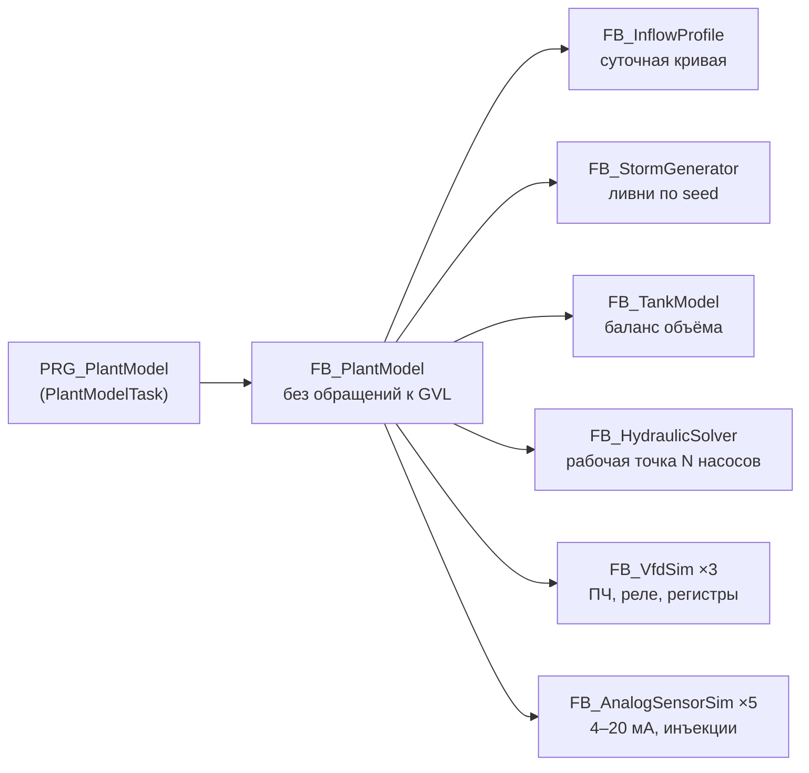
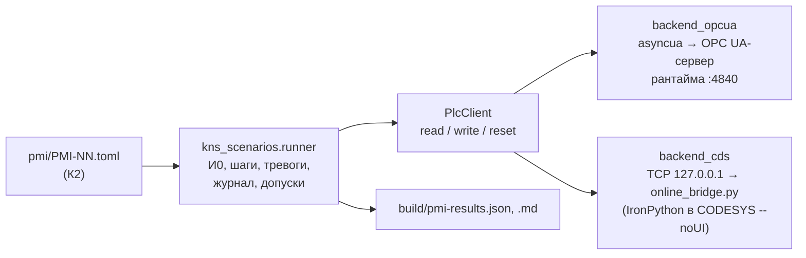

# КНС-1. Проект ПО: модули, интерфейсы, тесты, разделение работ

| | |
|---|---|
| Документ | `docs/DESIGN.md`, версия 0.3 (проект, до реализации), 19.10.2026 |
| Основание | [ARCHITECTURE.md](ARCHITECTURE.md) (слои, задачи, решения D-xx), [04_algorithms.md](04_algorithms.md) v0.3 (алгоритмы, уставки — раздел 18), [05_alarm_list.csv](05_alarm_list.csv), [06_PMI.md](06_PMI.md) v0.3 (39 проверок), контракт plc-process-lib 1.0.0 |
| Согласованность | `python tools_project/check_docs_consistency.py` сверяет объявления этого документа с 01–08, перечнем сигналов, выводом iolistgen и контрактом библиотеки (CI) |
| Для кого | три команды реализации (раздел 15): интерфейсы этого документа — **контракт** между ними |
| Изменения | интерфейс, отмеченный «заморожен», меняется только правкой этого документа до правки кода |

Ссылки вида «04 §7.2» — разделы `04_algorithms.md`; «06 §5.2» — разделы `06_PMI.md`; «API 17.3» —
разделы контракта библиотеки (редакция 1.0.0). Отличия версии 0.2 от 0.1: сторожевой таймер ПЧ —
по 04 §12 (50 Гц через 5 с, вопрос 9 раздела 20 документа 04); исключение LT101 по противоречию с
поплавком (04 §10.5) — в `FB_Protections`; инъекция `xFanNoFeedback` (04 §20, вопрос 10); исполнитель
`cds` — через онлайн-мост (зонд Z7), сценарии — с повторами, перечислениями и проверкой задержек по
журналу (раздел 14.3); курсор журнала `stEventFeed` и время процесса `lrMono_s`/`lrMainNow_s`;
каталог сценариев — по приложению А 06 v0.2. Имена `GVL_Sim`, на которые ссылаются 04 §19.4 и
06 §5.4, не менялись.

Отличия версии 0.3 (согласование документов 01–08): типы `ST_StationCfg`, `ST_SimCfg`, `ST_SimSts`,
`ST_PumpModelCfg`, `ST_EventView`, `ST_EventFeed`, `ST_AlarmView` и списки `GVL_Time`,
`GVL_StationDefaults` записаны объявлениями ST (их проверяет `check_docs_consistency.py`); в
`ST_StationCmd` — откладывание тревоги по номеру (`udiShelveId`, `udiUnshelveId`) и откат уставок
(`xRevertCfg`) — вопросы 1 и 2 раздела 14 документа 08; в `GVL_Log` — `fbDeviceAudit`, в `GVL_Const` —
`SIM_ALLOWED`; инструменты проекта — в `tools_project/` (раздел 1); правки 04, 06, 08 из раздела 17
версии 0.2 внесены.

## 0. Соглашения

- Имена и префиксы — CONTRIBUTING.md и `tools/check/st_lint.toml`: массивы — `a` + префикс элемента
  (`axPumpRun`, `aitfPump`, `arefPump`), физические величины — с единицами (`rLevel_m`,
  `rSpeed_pct`, `rCurrent_A`, `rFlow_m3h`). Имена методов тестов — PascalCase без подчёркиваний.
- Числа в логике — только 0, 1, 2; всё остальное — `GVL_Const` (раздел 2). Границы массивов —
  константы `GVL_Const`; если iec_checker 0.4 не разберёт границу-константу в секции переменных,
  поступать как библиотека (F-07): число и тест соответствия константе.
- Время — только `PL.FB_Delay` и `I_TimeSource` (вход `itfTime`, 0 — системное время). `TON`/`TOF`
  в коде станции и модели не используются: иначе юнит-тест не управляет временем.
- Уставки — `VAR_IN_OUT CONSTANT stCfg : ST_StationCfg` (последняя корректная копия, которую ведёт
  `PRG_Station`). Методы ФБ к `VAR_IN_OUT` не обращаются (правило R2 контракта).
- События журнала — через `itfEvents : I_StationEventSink` (0 — без журнала).
- Насосы — `ARRAY[1..GVL_Const.STN_PUMP_COUNT] OF PL.I_MotorVfd`; индекс 1…3 = Н1…Н3 (`P101`…`P103`).
- Входы автоматики устройств пишет только `PRG_Station` (D-06).
- Каждый POU начинается с заголовка (назначение, автор, версия, документ) — правило STL001.

## 1. План файлов и владельцы

Владельцы: **К1** — логика станции; **К2** — модель, имитация, время, интеграционные тесты и
сценарии ПМИ; **К3** — генерация, полевой слой, журнал и тревоги, инструменты, символьная
конфигурация, исполнители сценариев. Файл правит только владелец; остальные — через запрос владельцу.

```
iolistgen.toml                                   К3  настройки генератора (time_source, alarm_sink, template_dir)
docs/03_io_list.csv                              —   перечень сигналов (источник истины; меняется по согласованию)
docs/{03_io_list.md,alarms.csv,modbus_*.csv,modbus_map.md}, scada/*.csv   генератор (К3 запускает)
src/
  DUTs/
    Station/   E_StationMode, E_ControlMethod, E_ControlAct, E_PumpRole, E_RotationMode,
               E_StationAlarm, ST_StationCmd, ST_StationSts, ST_StationCfg, ST_StationRetain      К1
    Log/       E_EventKind, E_StationEvent, E_LogExportState, ST_EventRecord, ST_EventView,
               ST_EventFeed, ST_AlarmViewRow, ST_AlarmView                                        К3
    Sim/       E_SimAiFault, E_SimFloatStuck, ST_FaultInjection, ST_SimCmd, ST_SimCfg, ST_SimSts,
               ST_PumpModelCfg, ST_StormEvent, ST_PlantIo                                         К2
  GVLs/
    GVL_Const.gvl.st                             общий файл, разделы: «Инфраструктура» К3, «Станция» К1, «Модель» К2
    Generated/  GVL_IO, GVL_DevIdx, GVL_Hmi, GVL_Persist.pvl, GVL_CfgProject, GVL_Devices,
                GVL_DeviceList                                                  генератор (К3)
    Station/    GVL_Station, GVL_StationDefaults                                К1
    Log/        GVL_Log                                                         К3
    Sim/        GVL_Sim, GVL_Time                                               К2
  Interfaces/
    I_StationEventSink/                                                         К3 (заморожен)
  POUs/
    Generated/  PRG_Devices, PRG_ApplyProjectCfg, PRG_DeviceList                генератор (К3)
    Field/      PRG_FieldIn, PRG_FieldOut, FB_VfdAdapter_Cond                    К3
    Station/    PRG_Station, FB_StationMode, FB_ControlSelector, FB_LevelControlStepped,
                FB_LevelControlPid, FB_PumpRotation, FB_Ats, FB_Protections, FB_PumpProtection,
                FB_PowerRestore, FB_Ventilation, FB_StationAlarms, FB_Annunciator,
                F_StationCfgCheck                                                К1
    Log/        FB_EventLog, FB_EventLogCsv, FB_AlarmSummary, FB_DeviceAudit, F_AlarmCode,
                F_UtcToIso, PRG_Slow                                             К3
    Time/       FB_ScaledClock                                                   К2
    Model/      PRG_PlantModel, FB_PlantModel, FB_InflowProfile, FB_StormGenerator, F_Xorshift32,
                FB_TankModel, FB_HydraulicSolver, FB_VfdSim, FB_AnalogSensorSim, F_FloatContact,
                F_PumpCurrent, F_FaultInjEqual                                   К2
targets/plc210/                                  К3  сборка ПЛК210: PRG_ModbusDiag, привязки каналов, README
tests/
  GVLs/  GVL_TestsStation (К1), GVL_TestsModel (К2), GVL_TestsInfra (К3) — экземпляры наборов, {attribute 'linkalways'}
  POUs/
    PRG_Tests                                    К3  только coUnit.RUN() и признак завершения
    Fakes/       FB_FakeMotorVfd, FB_FakeEventSink                              К1
    Station/     FB_<ФБ>_Test для каждого ФБ станции                             К1
    Field/, Log/ FB_VfdAdapter_Cond_Test, FB_EventLog_Test, FB_EventLogCsv_Test,
                 FB_AlarmSummary_Test, F_AlarmCode_Test                          К3
    Model/       FB_ScaledClock_Test, FB_InflowProfile_Test, FB_StormGenerator_Test,
                 FB_HydraulicSolver_Test, FB_VfdSim_Test, FB_TankModel_Test      К2
    Integration/ FB_SimRunner, FB_ClosedLoop_Test                                К2
  scenarios/
    kns_scenarios/  __init__.py, values.py, enums.py (генерируется), client.py, backend_opcua.py,
                    backend_cds.py, runner.py, alarms.py, journal.py, report.py  К3 (обвязка, раздел 14.3)
    conftest.py, test_pmi.py, test_scenario_files.py (без ПЛК, в CI)             К3
    pmi/PMI-NN.toml — 39 файлов по 06, приложение А                              К2 (сценарии ПМИ)
tools_project/                                   инструменты проекта (Python 3.11+, ruff, mypy strict, pytest в CI)
  check_docs_consistency.py, test_check_docs_consistency.py, data/plc_process_lib.json   К3 (есть с этапа документов)
  generate.py, check_persist.py, gen_textlists.py, gen_enums.py, eventlog_decode.py, demo.py         К3
  iolistgen_templates/st/  GVL_Persist.pvl.st.j2, GVL_Persist.station.st.j2      К3 (текст блока — раздел 4.7, заморожен)
  plant_reference.py, test_plant_reference.py                                    К2 (эталон модели, раздел 11.3)
tools/                                           шаблон plc-repo-template (общие инструменты, синхронизируются из шаблона)
  codesys/   + symbol_config.py, online_bridge.py, импорт Persistent Variables через PLCopenXML, команды
             cds.py scenarios и cds.py sim — доработки шаблона (запрос, раздел 17)                    К3
```

Каталог `tools/` принадлежит шаблону: его файлы обновляются синхронизацией с plc-repo-template, и правка
в проекте пропала бы. Поэтому инструменты проекта лежат в `tools_project/` (как в проектах 06, 09 и 10
портфолио), а доработки `tools/codesys` делаются в шаблоне; до выпуска шаблона К3 держит их прототипы
в `tools_project/codesys/` и вызывает общие модули шаблона.

Пример шаблона (`FB_Example`, `ST_Example*`, `F_Clamp`, их тесты, константы `EXAMPLE_*`, `PRG_Main`)
удаляет К3 в первом этапе.

## 2. Константы `GVL_Const`

Один файл (правило CONTRIBUTING.md), три раздела с владельцами. Добавлять — только в свой раздел.

```st
{attribute 'qualified_only'}
VAR_GLOBAL CONSTANT
    // ===== Инфраструктура (К3) =====
    LOG_CAPACITY : UINT := 200;              // записей в кольце журнала (спецификация 02)
    LOG_VIEW_ROWS : UINT := 20;              // строк на странице журнала HMI
    LOG_FEED_ROWS : UINT := 32;              // строк курсора журнала для внешних клиентов (сценарии ПМИ, SCADA)
    ALM_VIEW_ROWS : UINT := 50;              // строк списка активных тревог
    ALM_SOURCE_MAX : UINT := 40;             // источников тревог: устройства + LIC101 + станция (с запасом)
    ALM_VIEW_PERIOD : TIME := T#500MS;       // обновление списка тревог
    ALM_PRIO_COUNT : UINT := 4;              // приоритеты Low…Critical (индексы auiUnack)
    TAG_LEN : INT := 24;                     // длина тега (как max_device_length iolistgen)
    LOG_CODE_LEN : INT := 32;                // длина кода в CSV
    LOG_CSV_FILE : STRING := 'kns_events.csv';
    LOG_CSV_LINES_PER_WRITE : UINT := 10;    // строк за одну операцию FILE.Write
    VFD_FREQ_NOM_HZ : REAL := 50.0;          // 100 % задания
    VFD_COUNTS_PER_PCT : REAL := 50.0;       // 0,01 Гц: 5000 отсчётов = 100 %
    VFD_STW_READY : WORD := 16#0001;         // условная карта ПЧ (ARCHITECTURE, раздел 12)
    VFD_STW_RUNNING : WORD := 16#0002;
    VFD_STW_FAULT : WORD := 16#0004;
    VFD_STW_WARNING : WORD := 16#0008;
    VFD_STW_REMOTE : WORD := 16#0010;
    VFD_CTW_RESET : WORD := 16#0004;         // сброс аварии по фронту
    // ===== Станция (К1) =====
    STN_PUMP_COUNT : UINT := 3;
    STN_DUTY_MAX : UINT := 2;                // «два рабочих + один резервный», предел uiDutyMax
    STN_ALARM_COUNT : UINT := 13;            // 04 §15
    STN_ALARM_ID_BASE : UDINT := 100000;     // номер = база + slot (API 20.5)
    STN_EVENT_ID_BASE : UDINT := 101000;     // номер события = база + код E_StationEvent (04 §16)
    LIC101_ALARM_ID_BASE : UDINT := 100100;  // слот 0 PVF
    KNS_ILK_DRY_RUN : WORD := 16#0001;       // wInterlock насоса, бит 0: сухой ход станции (04 §10.6)
    KNS_ILK_UNDERLOAD : WORD := 16#0002;     // бит 1: недогрузка по току, фиксируется до сброса насоса
    KNS_ILK_OVERHEAT : WORD := 16#0004;      // бит 2: перегрев обмотки, пока сигнал активен
    V1_ILK_FIRE : WORD := 16#0001;           // fbV1.wInterlock, бит 0: пожар (04 §17)
    STN_LS102_MARK_M : REAL := 4.20;         // отметка поплавка (перечень) — для проверки порядка уставок
    STN_LS103_MARK_M : REAL := 0.40;
    STN_PID_RECOVER : TIME := T#30S;         // связь с ПЧ восстановлена → ПИД снова готов (04 §12)
    STN_HANDOVER_RETRY : TIME := T#10M;      // повтор передачи роли (04 §8.2)
    STN_SEQ_START_TIMEOUT : TIME := T#30S;   // шаг последовательного пуска: пуск не подтвердился → следующий
    STN_ATS_WINDOW : TIME := T#10S;          // окно поиска насоса, введённого АВР (событие 101006)
    STN_LAMP_HALF_PERIOD : TIME := T#500MS;  // HL1 мигает 1 Гц
    STN_FULL_SPEED_PCT : REAL := 100.0;      // аварийный режим и по поплавкам
    STN_FLOW_SETTLE : TIME := T#20S;         // насос работает дольше — тревоги L/LL PT201 и L FT202 не подавляются (условно)
    // биты stStationSts.wState (04 §19.3)
    STN_ST_DRY_RUN : WORD := 16#0001;
    STN_ST_EMERGENCY : WORD := 16#0002;
    STN_ST_FLOAT : WORD := 16#0004;
    STN_ST_STEP_FALLBACK : WORD := 16#0008;
    STN_ST_POWER_LOST : WORD := 16#0010;
    STN_ST_RESTART : WORD := 16#0020;
    STN_ST_ATS : WORD := 16#0040;
    STN_ST_NO_RESERVE : WORD := 16#0080;
    STN_ST_LACK : WORD := 16#0100;
    STN_ST_LS102_MASKED : WORD := 16#0200;
    STN_ST_LS103_MASKED : WORD := 16#0400;
    STN_ST_SIMULATION : WORD := 16#0800;
    STN_ST_HORN : WORD := 16#1000;
    STN_ST_COMMON_ALARM : WORD := 16#2000;   // K1 обесточено
    STN_ST_UNACK : WORD := 16#4000;
    STN_ST_LT_MASKED : WORD := 16#8000;      // LT101 исключён по противоречию с поплавком (04 §10.5)
    // биты stStationSts.wCfgErr (F_StationCfgCheck, 04 §18.3)
    STN_CFG_LEVEL_ORDER : WORD := 16#0001;   // нарушен порядок отметок 04 §1
    STN_CFG_LEVEL_RANGE : WORD := 16#0002;   // уровень вне диапазона 04 §18.2
    STN_CFG_SPEED : WORD := 16#0004;         // rStepSpeed_pct
    STN_CFG_PID_STAGING : WORD := 16#0008;   // rAssistOn_pct, rAssistOff_pct, выдержки
    STN_CFG_DUTY : WORD := 16#0010;          // uiDutyMax
    STN_CFG_ROTATION : WORD := 16#0020;      // eRotation, tMaxContRun, tOverlap, tStagger
    STN_CFG_TIMES : WORD := 16#0040;         // питание, tDryRelease, tLtRecover, tLvlConfirm
    STN_CFG_FLOAT_CHECK : WORD := 16#0080;   // rLdev*, tLdev
    STN_CFG_UNDERLOAD : WORD := 16#0100;
    STN_CFG_ALARM : WORD := 16#0200;         // приоритет тревоги вне перечисления
    STN_CFG_SETPOINT : WORD := 16#0400;      // rLevelSp_m вне rSpMin_eu…rSpMax_eu LIC101
    // диапазоны параметров 04 §18.2 — константы STN_<ПАРАМЕТР>_MIN / _MAX (полный список — при реализации)
    // ===== Модель (К2) =====
    SIM_TIME_SCALE_MAX : REAL := 50.0;       // k · T_MainTask ≤ 1 с (ARCHITECTURE, раздел 11)
    SIM_DT_SUBSTEP : LTIME := LTIME#200MS;   // шаг интегрирования резервуара
    SIM_AI_COUNT : UINT := 5;                // индексы aeAiFault/arAiForced_mA
    SIM_AI_LT101 : UINT := 1;
    SIM_AI_PT201 : UINT := 2;
    SIM_AI_FT202 : UINT := 3;
    SIM_AI_AT401 : UINT := 4;
    SIM_AI_AT402 : UINT := 5;
    SIM_MA_FAIL_LOW : REAL := 3.0;           // токи инъекций (NE 43: ≤ 3,6 — отказ)
    SIM_MA_UNDER_RANGE : REAL := 3.7;
    SIM_MA_OVER_RANGE : REAL := 20.8;
    SIM_MA_FAIL_HIGH : REAL := 22.0;
    SIM_GRAVITY_MPS2 : REAL := 9.81;
    SIM_RHO_KGM3 : REAL := 1000.0;
    SIM_HOURS_PER_DAY : REAL := 24.0;
    SIM_PROFILE_POINTS : UINT := 24;
    SIM_STORMS_MAX : UINT := 4;              // ливней в сутки, предел генератора
    SIM_PUMP_INTAKE_M : REAL := 0.30;        // ниже — насос подсасывает воздух (подача 0)
    SIM_VFD_FCODE_EXT : UINT := 11;          // условные коды аварии ПЧ (06 §5.4)
    SIM_VFD_FCODE_OVERHEAT : UINT := 12;
    SIM_VFD_FCODE_UNDERVOLT : UINT := 13;
    SIM_VFD_WATCHDOG : TIME := T#5S;         // сторожевой таймер связи ПЧ (04 §12)
    SIM_VFD_WATCHDOG_FREQ_HZ : REAL := 50.0; // предустановленная частота после срабатывания сторожевого таймера
    SIM_VFD_LOCAL_FREQ_HZ : REAL := 50.0;    // частота местного поста ПЧ (в «Местном» задание по сети не ведётся)
    SIM_BUTTON_PULSE : TIME := T#500MS;      // длительность нажатия кнопки шкафа в модели
    SIM_V1_FB_DELAY : TIME := T#1S;          // ОС вентилятора после команды
    SIM_ALLOWED : BOOL := TRUE;              // имитация разрешена сборкой; в targets/plc210 файл-наложение даёт FALSE (раздел 8.1)
    SIM_DT_MAX : LTIME := LTIME#2S;          // больший шаг времени за вызов модели обрезается (пауза задачи, отладка)
    SIM_DAY_MAX : UDINT := 100000;           // предел счёта суток модели (≈ 270 лет): защита LREAL → UDINT
    SIM_VFD_COUNTS_PER_HZ : REAL := 100.0;   // FREF и FACT ПЧ: 0,01 Гц (= VFD_COUNTS_PER_PCT · 100 % / VFD_FREQ_NOM_HZ)
    SIM_IT_COUNTS_PER_A : REAL := 10.0;      // регистр тока ПЧ: 0,1 А (перечень, IT1n1: 0…600 отсчётов = 0…60 А)
    SIM_S_PER_H : REAL := 3600.0;            // с в часе: м³/ч ↔ м³/с
    SIM_PA_PER_BAR : REAL := 100000.0;
    SIM_W_PER_KW : REAL := 1000.0;
    SIM_SOLVER_ITERATIONS : UINT := 30;      // бисекция рабочей точки насосов (раздел 11.2)
    SIM_CLOG_K_FACTOR : REAL := 6.25;        // засор: крутизна характеристики ×6,25 — подача −60 % при том же напоре
    SIM_CLOG_I_FACTOR : REAL := 1.3;         // засор: ток ×1,3 к току того же насоса без засора
    SIM_STORM_RISE_SHARE : REAL := 0.15;     // трапеция ливня: рост 15 % длительности
    SIM_STORM_FALL_SHARE : REAL := 0.35;     // спад 35 % (полка — остальные 50 %)
    SIM_SEED_DAY_MUL : UDINT := 16#9E3779B9; // x0 = udiSeed XOR (сутки · 16#9E3779B9)
    SIM_XS_ZERO_STATE : DWORD := 16#2545F491; // замена нулевого состояния xorshift (из нуля генератор не выходит)
    SIM_XS_SHIFT_A : UINT := 13;             // F_Xorshift32: x ^= x << 13; x ^= x >> 17; x ^= x << 5
    SIM_XS_SHIFT_B : UINT := 17;
    SIM_XS_SHIFT_C : UINT := 5;
    SIM_U24_MASK : DWORD := 16#00FFFFFF;     // равномерное u = (x AND маска) / 2^24, точно в REAL
    SIM_U24_SCALE : REAL := 16777216.0;
    SIM_LT101_RANGE_M : REAL := 5.0;         // шкалы датчиков 4–20 мА (перечень сигналов), нижняя граница — 0
    SIM_PT201_RANGE_BAR : REAL := 10.0;
    SIM_FT202_RANGE_M3H : REAL := 500.0;
    SIM_AT401_RANGE_MGM3 : REAL := 40.0;
    SIM_AT402_RANGE_PCTLEL : REAL := 100.0;
END_VAR
```

Поплавки модели срабатывают на отметках `STN_LS102_MARK_M` и `STN_LS103_MARK_M` раздела «Станция» (одна
отметка поплавка на проект: и для проверки порядка уставок, и для контакта в модели).

Тексты причин блокировок для `TL_Reason` (источник для `gen_textlists.py`): `P10n.ILK.0` —
«Сухой ход станции (LS103 или LL уровнемера)», `P10n.ILK.1` — «Сухой ход насоса (недогрузка по
току), сброс на фейсплейте», `P10n.ILK.2` — «Перегрев обмотки (TS1n2)», `V1.ILK.0` — «Пожар (YS405)».

## 3. Типы

Все DUT — `{attribute 'qualified_only'}`; перечисления состояний и режимов — ещё `{attribute 'strict'}`
и базовый тип `INT` с явными значениями; перечисления-индексы (`E_StationAlarm`, `E_StationEvent`) —
без `strict`, `UINT` (так ими индексируются массивы, API 2.7). Все типы раздела 3.1 **заморожены**.

### 3.1 Станция (`src/DUTs/Station/`, К1)

| Тип | Значения |
|---|---|
| `E_StationMode` | `Auto := 1`, `Manual := 2`; другое значение в retain → `Manual` (санитизация сравнениями) |
| `E_ControlMethod` | `Stepped := 1`, `LevelPid := 2`; другое → `Stepped` |
| `E_ControlAct` | `Manual := 0`, `Stepped := 1`, `LevelPid := 2`, `Float := 3`, `Emergency := 4`, `DryRunStop := 5`, `PowerLost := 6`, `Restart := 7` |
| `E_PumpRole` | `None := 0`, `Lead := 1`, `Assist := 2`, `Standby := 3` |
| `E_RotationMode` | `RunHours := 1`, `Cyclic := 2`, `Fixed := 3` |
| `E_StationAlarm` (`UINT`) | `EHL := 1`, `DRY := 2`, `LACK := 3`, `NORES := 4`, `ATS := 5`, `FLOAT := 6`, `LDEV := 7`, `STEP := 8`, `NOAUTO := 9`, `UL1 := 10`, `UL2 := 11`, `UL3 := 12`, `SIM := 13` |

```st
TYPE ST_StationCmd :                // GVL_Station.stStationCmd — пишут HMI, OPC UA, MQTT
STRUCT
    xSetAuto     : BOOL;            // импульс: станция в «Автомат» (04 §19.2)
    xSetManual   : BOOL;            // импульс: в «Ручной»; старше xSetAuto
    xSetStepped  : BOOL;            // импульс: способ «ступенчатое»; старше xSetLevelPid
    xSetLevelPid : BOOL;            // импульс: способ «ПИД уровня»
    xAckAll      : BOOL;            // импульс: квитировать все тревоги станции, LIC101 и устройств
    xResetAll    : BOOL;            // импульс: общий сброс (как HS501)
    xSilence     : BOOL;            // импульс: выключить сирену (как HS502)
    xExportLog   : BOOL;            // импульс: выгрузить журнал в CSV (04 §19.2)
    xRevertCfg   : BOOL;            // импульс: откатить записанные уставки станции к действующей копии (08 §14, вопрос 2)
    wAckReq      : WORD;            // маска: квитировать тревоги станции, бит slot − 1
    wShelveReq   : WORD;            // маска: отложить на astAlarm[slot].tShelveMax
    wUnshelveReq : WORD;            // маска: вернуть отложенные
    udiAckId     : UDINT;           // квитировать тревогу по номеру (таблица HMI); 0 — нет; сбрасывается в 0
    udiShelveId  : UDINT;           // отложить тревогу любого источника по номеру на её tShelveMax; 0 — нет (08 §14, вопрос 1)
    udiUnshelveId : UDINT;          // вернуть отложенную тревогу по номеру; 0 — нет
END_STRUCT
END_TYPE
```

```st
TYPE ST_StationSts :                // GVL_Station.stStationSts — только 16/32 бит, 72 байта (тест размера)
STRUCT
    eMode           : E_StationMode;
    eMethod         : E_ControlMethod;
    eControlAct     : E_ControlAct;
    eNe107          : PL.E_Ne107Status;   // F — LACK; S — FLOAT, STEP, LDEV, NORES; C — «Ручной», имитация, wCfgErr; M — ТО насоса
    wState          : WORD;               // биты STN_ST_*
    wCfgErr         : WORD;               // биты STN_CFG_*
    aeRole          : ARRAY[1..3] OF E_PumpRole;
    uiPumpsRequired : UINT;
    uiPumpsRunning  : UINT;
    uiPumpsAvailable: UINT;
    uiLeadPump      : UINT;               // 0 — нет
    uiSeqRemain_s   : UINT;
    eCmdResult      : PL.E_CmdResult;     // результат последней команды станции
    uiCmdSeq        : UINT;               // +1 на каждую обработанную команду
    wAlmActive      : WORD;               // тревоги станции, бит slot − 1
    wAlmUnack       : WORD;
    wAlmShelved     : WORD;               // дополнение: Shelved, SuppressedByDesign, OutOfService
    ePrioUnack      : PL.E_AlarmPriority; // высший неквитированный по всем источникам (баннер)
    auiUnack        : ARRAY[1..4] OF UINT;// неквитированных Low…Critical
    eLogExport      : E_LogExportState;   // дополнение: состояние выгрузки CSV
    wReserve        : WORD;               // выравнивание: дальше 32-битные поля
    rLevel_m        : REAL;               // уровень, по которому работает станция
    rLevelSp_m      : REAL;               // действующее задание уровня
    rSpeedSp_pct    : REAL;               // общее задание частоты насосам
    udiEventSeq     : UDINT;              // номер последней записи журнала
    udiLogOverwritten : UDINT;            // затёрто записей журнала
END_STRUCT
END_TYPE
```

`ST_StationCfg` (в `GVL_Persist.stStationCfg`) — параметры 04 §18.2 № 2–31 под теми же именами и с
теми же значениями по умолчанию, затем тревоги и резерв. Тип лежит в Persistent Variables и заморожен
целиком: новые параметры 1.x — в элементах резерва без переименования (L10 контракта).

```st
TYPE ST_StationCfg :                // GVL_Persist.stStationCfg — уставки станции (04 §18.2, № 2–31)
STRUCT
    // уровни (№ 2–6)
    rLvlStop_m          : REAL := 1.00;
    rLvlStartLead_m     : REAL := 1.60;
    rLvlStopAssist_m    : REAL := 1.40;
    rLvlStartAssist_m   : REAL := 2.40;
    tLvlConfirm         : TIME := T#5S;
    // ступенчатое (№ 7)
    rStepSpeed_pct      : REAL := 100.0;
    // ПИД (№ 8–12)
    rLevelSp_m          : REAL := 1.40;
    rAssistOn_pct       : REAL := 98.0;
    tAssistOn           : TIME := T#30S;
    rAssistOff_pct      : REAL := 75.0;
    tAssistOff          : TIME := T#60S;
    // роли (№ 13–17)
    uiDutyMax           : UINT := 2;
    eRotation           : E_RotationMode := E_RotationMode.RunHours;
    tMaxContRun         : TIME := T#4H;
    tOverlap            : TIME := T#10S;
    tStagger            : TIME := T#5S;
    // питание (№ 18–20)
    tPwrRestart         : TIME := T#10S;
    tSeqStep            : TIME := T#15S;
    tPlcStart           : TIME := T#10S;
    // защиты (№ 21–27)
    tDryRelease         : TIME := T#60S;
    rLdev102On_m        : REAL := 3.50;
    rLdev102Off_m       : REAL := 4.40;
    rLdev103On_m        : REAL := 0.80;
    rLdev103Off_m       : REAL := 0.20;
    tLdev               : TIME := T#30S;
    tLtRecover          : TIME := T#30S;
    // недогрузка (№ 28–30)
    rUnderload_A        : REAL := 12.0;
    rUnderloadSpeed_pct : REAL := 80.0;
    tUnderload          : TIME := T#15S;
    // вентиляция (№ 31)
    tV1Overrun          : TIME := T#10M;
    // тревоги KNS1.* по 05_alarm_list.csv (source = station), индекс — E_StationAlarm. Задержка появления
    // в 05 = tOnDelay + выдержка логики (LDEV — tLdev, UL1…UL3 — tUnderload). Инициализатор — весь
    // массив целиком (правило 3 API 18.3)
    astAlarm            : ARRAY[1..GVL_Const.STN_ALARM_COUNT] OF PL.ST_AlarmCfg := [
        (ePriority := PL.E_AlarmPriority.Critical, tShelveMax := T#0S),   // 1 EHL: откладывать нельзя
        (ePriority := PL.E_AlarmPriority.High),                          // 2 DRY
        (ePriority := PL.E_AlarmPriority.High, tOnDelay := T#10S),       // 3 LACK
        (ePriority := PL.E_AlarmPriority.High, tOnDelay := T#10S),       // 4 NORES
        (ePriority := PL.E_AlarmPriority.Medium),                        // 5 ATS
        (ePriority := PL.E_AlarmPriority.Medium),                        // 6 FLOAT
        (ePriority := PL.E_AlarmPriority.Medium),                        // 7 LDEV
        (ePriority := PL.E_AlarmPriority.Low),                           // 8 STEP
        (ePriority := PL.E_AlarmPriority.Low, tOnDelay := T#10M),        // 9 NOAUTO
        (ePriority := PL.E_AlarmPriority.Medium),                        // 10 UL1
        (ePriority := PL.E_AlarmPriority.Medium),                        // 11 UL2
        (ePriority := PL.E_AlarmPriority.Medium),                        // 12 UL3
        (ePriority := PL.E_AlarmPriority.Low)];                          // 13 SIM
    // резерв: новые параметры 1.x без смены типа; смысл элемента записывается в этом разделе
    arReserve           : ARRAY[0..7] OF REAL;
    atReserve           : ARRAY[0..3] OF TIME;
    auiReserve          : ARRAY[0..3] OF UINT;
END_STRUCT
END_TYPE
```

```st
TYPE ST_StationRetain :             // GVL_Persist.stStationRetain
STRUCT
    eMode       : E_StationMode := E_StationMode.Manual;      // пустой retain — «Ручной» (04 §3.2)
    eMethod     : E_ControlMethod := E_ControlMethod.Stepped;
    uiNextLead  : UINT := 1;                                  // Cyclic: следующий ведущий
    uiReserve   : UINT;
    audiReserve : ARRAY[0..7] OF UDINT;
END_STRUCT
END_TYPE
```

### 3.2 Журнал и тревоги (`src/DUTs/Log/`, К3)

| Тип | Значения |
|---|---|
| `E_EventKind` | `Alarm := 1` (событие `PL.FB_Alarm`), `Station := 2` (событие станции) |
| `E_LogExportState` | `Idle := 0`, `Snapshot := 1`, `Writing := 2`, `Done := 3`, `Error := 4` |
| `E_StationEvent` (`UINT`, номер = 101000 + код) | 04 §16: `StationAuto := 1`, `StationManual := 2`, `MethodStepped := 3`, `MethodLevelPid := 4`, `LeadChanged := 5`, `AtsPumpIn := 6`, `ContRunHandover := 7`, `PowerLost := 8`, `RestartBegin := 9`, `RestartDone := 10`, `FloatMasked := 11`, `FloatUnmasked := 12`, `FloatModeOn := 13`, `FloatModeOff := 14`, `PlcStart := 15`, `ResetAll := 16`, `CfgChanged := 17`, `DeviceModeChanged := 18` (значение `dev_no · 10 + режим`), `LogExported := 19` (строк), `LogExportFailed := 20` (код ошибки CAA), `SimFaultChanged := 21` (номер поля инъекции), `AckAll := 22`, `Silence := 23` |

```st
TYPE ST_EventRecord :               // 40 байт
STRUCT
    udiSeq    : UDINT;              // сквозной номер с запуска приложения
    eKind     : E_EventKind;
    ePriority : PL.E_AlarmPriority; // события станции — None
    udiId     : UDINT;              // номер тревоги или 101000 + код события
    eOldState : PL.E_AlarmState;    // события станции — Normal
    eNewState : PL.E_AlarmState;
    eReason   : PL.E_AlarmEventReason;  // события станции — None
    wReserve  : WORD;
    rValue    : REAL;               // значение процесса или аргумент события
    uliUtc_ms : ULINT;              // UTC, мс от 1970 (SysTimeRtcHighResGet); 0 — часы недоступны
    lrMono_s  : LREAL;              // время процесса, с от старта приложения (I_TimeSource журнала = fbClockMain)
END_STRUCT
END_TYPE
```

`lrMono_s` — время процесса, а не настенное: при ускорении имитации разность меток двух записей
равна интервалу процесса, поэтому сценарии ПМИ проверяют выдержки по журналу, а не по опросу
(раздел 14.3). Перевод `LTIME` → `LREAL` — как в библиотеке (`PL.GVL_Const.NS_PER_S`, зонд P2
контракта). `LREAL`, а не `LTIME`: клиенты OPC UA и мост CODESYS получают обычное число.

```st
TYPE ST_EventView :                 // GVL_Log.stEventView — страница журнала для HMI (новые сверху)
STRUCT
    uiPage      : UINT;             // пишет HMI: 0 — новые
    uiPageCount : UINT;
    uiCount     : UINT;             // записей в журнале
    wReserve    : WORD;
    astRow      : ARRAY[1..GVL_Const.LOG_VIEW_ROWS] OF ST_EventRecord;
END_STRUCT
END_TYPE

TYPE ST_EventFeed :                 // GVL_Log.stEventFeed — курсор журнала для внешних клиентов (от старой к новой)
STRUCT
    udiFromSeq  : UDINT;            // пишет клиент: первый нужный номер
    udiSeqFirst : UDINT;            // самая старая запись в кольце
    udiSeqLast  : UDINT;
    uiCount     : UINT;             // строк в astRow
    wReserve    : WORD;
    astRow      : ARRAY[1..GVL_Const.LOG_FEED_ROWS] OF ST_EventRecord;
END_STRUCT
END_TYPE

TYPE ST_AlarmViewRow :              // строка списка тревог (баннер, экран «Тревоги», сценарии ПМИ)
STRUCT
    udiId          : UDINT;
    ePriority      : PL.E_AlarmPriority;
    eState         : PL.E_AlarmState;
    uiSource       : UINT;          // индекс источника в FB_AlarmSummary (устройства — индекс GVL_DeviceList)
    uiSlot         : UINT;
    uliSinceUtc_ms : ULINT;         // время последнего перехода, замеченного сводкой
END_STRUCT
END_TYPE

TYPE ST_AlarmView :                 // GVL_Log.stAlarmView
STRUCT
    uiCount       : UINT;           // строк в astRow
    uiActiveTotal : UINT;           // настоящее число тревог не в Normal (может быть больше ALM_VIEW_ROWS)
    udiRevision   : UDINT;          // +1 при каждом пересчёте
    astRow        : ARRAY[1..GVL_Const.ALM_VIEW_ROWS] OF ST_AlarmViewRow;
END_STRUCT
END_TYPE
```

- `ST_EventFeed` — курсор для внешних клиентов (сценарии ПМИ, SCADA), отдельно от страницы HMI, чтобы
  клиенты не мешали друг другу. `astRow` заполняется начиная с `MAX(udiFromSeq, udiSeqFirst)`. Клиент
  читает, сдвигает `udiFromSeq` на последний прочитанный номер + 1 и повторяет; `udiFromSeq < udiSeqFirst` —
  записи затёрты (клиент видит пропуск). Один клиент одновременно — правило стенда.
- `ST_AlarmView.astRow` — все тревоги в состоянии, отличном от `Normal` (в том числе `Shelved`,
  `SuppressedByDesign`, `OutOfService`: их видят экран «Тревоги» и сценарии ПМИ); порядок: неквитированные
  выше, затем активные по приоритету, затем подавленные и отложенные, внутри группы — новые выше.
  Переполнение — `uiCount = ALM_VIEW_ROWS`, `uiActiveTotal` показывает настоящее число.

### 3.3 Имитация (`src/DUTs/Sim/`, К2)

Отказы — `GVL_Sim.stFaultInj : ST_FaultInjection`, команды модели — `GVL_Sim.stSimCmd : ST_SimCmd`,
параметры модели и ускорение — `GVL_Sim.stSimCfg : ST_SimCfg`. Эти имена использует таблица средств
имитации 06 §5.4 (сокращения `Inj`, `SimCmd`, `SimCfg`) и экран «Имитация» 08_hmi_spec: поле
переименовывается только вместе с ними.

| Тип | Значения |
|---|---|
| `E_SimAiFault` | `None := 0`, `WireBreak := 1` (0 мА), `FailLow := 2` (3,0 мА), `FailHigh := 3` (22 мА), `UnderRange := 4` (3,7 мА), `OverRange := 5` (20,8 мА), `Freeze := 6` (последнее значение), `Forced := 7` (ток `arAiForced_mA`) |
| `E_SimFloatStuck` | `None := 0`, `StuckNormal := 1` (контакт не срабатывает), `StuckTripped := 2` (сработал и не возвращается; то же — обрыв цепи НЗ-контакта) |

```st
TYPE ST_FaultInjection :            // GVL_Sim.stFaultInj — пишут HMI (экран «Имитация») и сценарии; действует только при xSimulation
STRUCT
    axVfdFault      : ARRAY[1..GVL_Const.STN_PUMP_COUNT] OF BOOL;  // авария ПЧ: реле FLT, бит STW.2, код SIM_VFD_FCODE_EXT; снимается сбросом ПЧ после снятия инъекции
    axNoFeedback    : ARRAY[1..GVL_Const.STN_PUMP_COUNT] OF BOOL;  // реле «Работа» не замыкается (ПЧ работает) → FailToStart / FeedbackLost
    axFeedbackStuck : ARRAY[1..GVL_Const.STN_PUMP_COUNT] OF BOOL;  // реле «Работа» залипло в TRUE → FailToStop / UncommandedRun
    axAirLock       : ARRAY[1..GVL_Const.STN_PUMP_COUNT] OF BOOL;  // сухой ход насоса: подача 0, ток мал → недогрузка
    axClog          : ARRAY[1..GVL_Const.STN_PUMP_COUNT] OF BOOL;  // засор: подача −60 %, ток ×1,3 к току без засора
    axOverheat      : ARRAY[1..GVL_Const.STN_PUMP_COUNT] OF BOOL;  // TS1n2 размыкается и разрывает цепь аварии ПЧ
    axLeak          : ARRAY[1..GVL_Const.STN_PUMP_COUNT] OF BOOL;  // MS1n3
    axVfdCommLoss   : ARRAY[1..GVL_Const.STN_PUMP_COUNT] OF BOOL;  // нет ответа ПЧ: регистры замирают, xMbOk = FALSE; через SIM_VFD_WATCHDOG — 50 Гц (04 §12); все три — потеря линии RS485-1
    axLocal         : ARRAY[1..GVL_Const.STN_PUMP_COUNT] OF BOOL;  // переключатель HS1n4 в «Местное»
    axLocalRun      : ARRAY[1..GVL_Const.STN_PUMP_COUNT] OF BOOL;  // пуск с местного поста (в «Местном»)
    aeAiFault       : ARRAY[1..GVL_Const.SIM_AI_COUNT] OF E_SimAiFault;   // индексы SIM_AI_*: LT101, PT201, FT202, AT401, AT402
    arAiForced_mA   : ARRAY[1..GVL_Const.SIM_AI_COUNT] OF REAL;  // ток при Forced
    eLs102Stuck     : E_SimFloatStuck;
    eLs103Stuck     : E_SimFloatStuck;
    xPowerLoss      : BOOL;                 // нет напряжения на вводе: ES301 = 0, ПЧ обесточены, ИБП на батареях (YS302)
    xUpsFault       : BOOL;                 // YS303
    xTempCommLoss   : BOOL;                 // TT403 (RS485-2) не отвечает
    xFanFault       : BOOL;                 // V1_FLT
    xFanNoFeedback  : BOOL;                 // V1_RFB не приходит при работающем вентиляторе (04 §20, вопрос 10: делает V1.FTS и V1.FBL проверяемыми)
    xValveChamberFlood : BOOL;              // LS203
    xFire           : BOOL;                 // YS405
    rH2S_mgm3       : REAL := -1.0;         // концентрации газов (вместо фоновых из stSimCfg), < 0 — фон
    rCh4_pctLel     : REAL := -1.0;         // (по умолчанию и после xClearFaults — фон)
END_STRUCT
END_TYPE
```

```st
TYPE ST_SimCmd :                    // GVL_Sim.stSimCmd — команды модели; импульсы сбрасывает FB_PlantModel
STRUCT
    xResetPlant      : BOOL;        // импульс: уровень := stSimCfg.rLevelInit_m, перелив 0, ливни сняты, ПЧ готовы
    xClearFaults     : BOOL;        // импульс: обнулить stFaultInj (ускорение и приток не меняются)
    xSetLevel        : BOOL;        // импульс: уровень := rSetLevel_m
    rSetLevel_m      : REAL;
    xInflowOverride  : BOOL;        // уровень: приток := rInflowOverride_m3h (без профиля и ливней)
    rInflowOverride_m3h : REAL;
    xStormNow        : BOOL;        // импульс: ливень сейчас (при xInflowOverride = FALSE)
    rStormPeak_m3h   : REAL;
    tStormDuration   : TIME;
    xSetTimeOfDay    : BOOL;        // импульс: время суток модели := rTimeOfDay_h
    rTimeOfDay_h     : REAL;
    xPressReset      : BOOL;        // импульс: нажать HS501 на SIM_BUTTON_PULSE
    xPressSilence    : BOOL;        // импульс: нажать HS502
    xDoorOpen        : BOOL;        // уровень: дверь павильона открыта (ZS404)
END_STRUCT
END_TYPE
```

Параметры и состояние модели (начальные значения — раздел 11.3, условные):

```st
TYPE ST_PumpModelCfg :              // характеристика насоса и сети (законы подобия, раздел 11.2)
STRUCT
    rH0_m      : REAL := 34.5;      // напор при нулевой подаче на 50 Гц
    rK_mh2     : REAL := 6.06E-4;   // крутизна характеристики, м/(м³/ч)²
    rHgeo_m    : REAL := 12.0;      // геометрический напор от дна резервуара
    rR_mh2     : REAL := 4.60E-4;   // сопротивление трубопровода, м/(м³/ч)²
    rEta       : REAL := 0.62;      // КПД агрегата
    rPnom_kW   : REAL := 15.0;
    rInom_A    : REAL := 28.0;
    rImagShare : REAL := 0.30;      // доля намагничивающего тока
    rLossShare : REAL := 0.12;      // потери без подачи, доля Pnom
END_STRUCT
END_TYPE

TYPE ST_SimCfg :                    // GVL_Sim.stSimCfg
STRUCT
    rTimeScale        : REAL := 1.0;        // 1…SIM_TIME_SCALE_MAX: ускорение всего контура (ARCHITECTURE, раздел 11)
    rTankArea_m2      : REAL := 12.0;
    rLevelOverflow_m  : REAL := 4.60;
    rLevelInit_m      : REAL := 1.20;
    rInflowAvg_m3h    : REAL := 70.0;
    arDailyProfile    : ARRAY[0..GVL_Const.SIM_PROFILE_POINTS - 1] OF REAL := [0.55, 0.45, 0.40, 0.38, 0.40, 0.55, 0.92, 1.35, 1.60, 1.50, 1.30,
                            1.15, 1.10, 1.05, 1.00, 1.00, 1.00, 1.15, 1.35, 1.50, 1.45, 1.20, 0.95, 0.70];
    udiSeed           : UDINT := 20261016;  // генератор ливней (одинаковый seed — одинаковые ливни)
    uiStormsPerDayMax : UINT := 2;          // не больше SIM_STORMS_MAX
    rStormPeakMin_m3h : REAL := 100.0;
    rStormPeakMax_m3h : REAL := 250.0;
    tStormMin         : TIME := T#20M;
    tStormMax         : TIME := T#90M;
    rStartTimeOfDay_h : REAL := 0.0;        // время суток модели при старте; демонстрация задаёт его командой
    stPump            : ST_PumpModelCfg;
    tVfdAccel         : TIME := T#10S;      // разгон ПЧ 0 → 50 Гц
    tVfdBoot          : TIME := T#5S;       // готовность ПЧ после подачи питания
    rH2SBase_mgm3     : REAL := 0.6;        // фон газов и температура павильона (условно)
    rCh4Base_pctLel   : REAL := 1.5;
    rAirTemp_C        : REAL := 18.0;
END_STRUCT
END_TYPE

TYPE ST_SimSts :                    // GVL_Sim.stSimSts — только чтение
STRUCT
    rLevel_m         : REAL;        // истинный уровень
    rInflow_m3h      : REAL;
    rOutflow_m3h     : REAL;
    arPumpFlow_m3h   : ARRAY[1..GVL_Const.STN_PUMP_COUNT] OF REAL;
    rHead_m          : REAL;
    arFreq_Hz        : ARRAY[1..GVL_Const.STN_PUMP_COUNT] OF REAL;
    arCurrent_A      : ARRAY[1..GVL_Const.STN_PUMP_COUNT] OF REAL;
    rTimeOfDay_h     : REAL;
    udiDay           : UDINT;
    xStormActive     : BOOL;
    rStormInflow_m3h : REAL;
    udiOverflow_s    : UDINT;       // время перелива (время контура)
    rTimeScaleAct    : REAL;
    lrSimTime_s      : LREAL;
    xRunning         : BOOL;        // модель работает
    udiFaultSeq      : UDINT;       // +1 при каждом изменении stFaultInj; по нему PRG_Station пишет событие 101021
END_STRUCT
END_TYPE

TYPE ST_StormEvent :                // ливень генератора (раздел 11.2)
STRUCT
    rStart_h  : REAL;
    tDuration : TIME;
    rPeak_m3h : REAL;
END_STRUCT
END_TYPE
```

`ST_PlantIo` — все сигналы модели для `GVL_IO` (раздел 11.1): входы модулей, регистры чтения ПЧ и
`TT403`, состояние обмена `xMbOk_*`; поля называются так же, как переменные `GVL_IO`.

## 4. Глобальные списки

### 4.1 `GVL_Station` (К1)

```st
{attribute 'qualified_only'}
VAR_GLOBAL
    stStationCmd    : ST_StationCmd;     // команды (ReadWrite в символах)
    stStationSts    : ST_StationSts;     // состояние (Read)
    fbLIC101        : PL.FB_PID;         // регулятор уровня; HMI и SCADA читают fbLIC101.stSts
    stLIC101Cmd     : PL.ST_PidCmd;      // команды фейсплейта LIC101 (ReadWrite)
    fbAlarms        : FB_StationAlarms;  // тревоги KNS1.* (источник для сводки)
    // диагностика для HMI и OPC UA (пишет только PRG_Station)
    axPumpRun       : ARRAY[1..GVL_Const.STN_PUMP_COUNT] OF BOOL;   // → fbP10n.xAutoRun
    awPumpInterlock : ARRAY[1..GVL_Const.STN_PUMP_COUNT] OF WORD;   // → fbP10n.wInterlock
    rSpeedSp_pct    : REAL;                                         // → fbP10n.rSpeedSpAuto_pct
    stCfgLkg        : ST_StationCfg;     // последняя корректная копия уставок (Read)
END_VAR
```

`aitfPump` и `itfLeadPump` из 04 §19.1 — локальные переменные `PRG_Station` (интерфейсные ссылки
клиентам не нужны и присваиваются каждый цикл).

### 4.2 `GVL_StationDefaults` (К1)

```st
// GVL_StationDefaults — уставки станции и LIC101 по умолчанию (команда «Применить уставки проекта»)
{attribute 'qualified_only'}
VAR_GLOBAL CONSTANT
    stStationCfg : ST_StationCfg;           // умолчания типа (раздел 3.1)
    stLIC101Cfg  : PL.ST_PidCfg := (...);   // тот же инициализатор, что в блоке станции GVL_Persist (раздел 4.7)
END_VAR
```

Используются командой «Применить уставки проекта». Имена — как у переменных `GVL_Persist`
(подавление `// lint:allow STL007` с причиной, как в `GVL_CfgProject`). Если
инициализатор `GVL_Persist` сможет ссылаться на константу (`:= GVL_StationDefaults.stLIC101Cfg`) —
проверить компиляцией; иначе тест `StationDefaultsMatchPersistInit` сверяет оба текста.

### 4.3 `GVL_Log` (К3)

```st
{attribute 'qualified_only'}
VAR_GLOBAL
    fbEventLog      : FB_EventLog;       // приёмник PL.I_AlarmSink и I_StationEventSink
    fbAlarmSummary  : FB_AlarmSummary;
    fbDeviceAudit   : FB_DeviceAudit;    // смена режимов устройств → событие 101018 (раздел 9.3)
    stEventView     : ST_EventView;      // страница журнала HMI (uiPage — ReadWrite)
    stEventFeed     : ST_EventFeed;      // курсор журнала внешнего клиента (udiFromSeq — ReadWrite)
    stAlarmView     : ST_AlarmView;      // тревоги не в Normal: баннер, таблица, сценарии (Read)
    xExportReq      : BOOL;              // MainTask → SlowTask: снимок готов, писать файл
    eExportState    : E_LogExportState;  // SlowTask → MainTask
    udiExportError  : UDINT;             // код ошибки FILE.* последней выгрузки
    uiExportLines   : UINT;
END_VAR
```

### 4.4 `GVL_Sim` и `GVL_Time` (К2)

```st
{attribute 'qualified_only'}
VAR_GLOBAL
    xSimulationReq  : BOOL := TRUE;      // запрос имитации (меняется только из IDE; в символах — Read)
    xSimulation     : BOOL;              // действующий признак (PRG_FieldIn, первый цикл; Read)
    stSimCfg        : ST_SimCfg;         // параметры модели (ReadWrite в сборке имитации)
    stSimCmd        : ST_SimCmd;         // команды модели (ReadWrite в сборке имитации)
    stFaultInj      : ST_FaultInjection; // отказы (ReadWrite в сборке имитации)
    stSimSts        : ST_SimSts;         // Read
END_VAR
```

```st
// GVL_Time — часы контура (раздел 10)
{attribute 'qualified_only'}
VAR_GLOBAL
    fbClockMain  : FB_ScaledClock;      // MainTask: устройства (time_source iolistgen), станция, журнал
    fbClockModel : FB_ScaledClock;      // PlantModelTask
    lrMainNow_s  : LREAL;               // время процесса MainTask, с (Read): пишет PRG_FieldIn после Update
END_VAR
```

`lrMainNow_s` — та же шкала, что `ST_EventRecord.lrMono_s`: сценарии ПМИ отмечают по нему моменты
своих действий. Оба экземпляра стартуют с системного
времени (при k = 1 `Now() = LTIME()`, раздел 10) и перебазируются при смене `rTimeScale` в начале
цикла своей задачи; расхождение между ними — порядка одного цикла задачи в шкале процесса (при
k = 50 и 20 мс — до 1 с), для модели и логики это допустимо.

### 4.5 `GVL_DeviceList` и `PRG_DeviceList` (генерирует `tools_project/generate.py`)

```st
// AUTO-GENERATED by tools_project/generate.py — не редактировать; источник: docs/03_io_list.csv
{attribute 'qualified_only'}
VAR_GLOBAL CONSTANT
    DEVICE_COUNT : UINT := 29;
    asTag     : ARRAY[1..29] OF STRING(GVL_Const.TAG_LEN) := ['P101', 'P102', ...];   // по возрастанию dev_no
    auiDevNo  : ARRAY[1..29] OF UINT := [11, 12, ...];
    aeDevType : ARRAY[1..29] OF PL.E_DeviceType := [PL.E_DeviceType.MotorVfd, ...];
END_VAR
VAR_GLOBAL
    aitfDevice : ARRAY[1..29] OF PL.I_Device;     // присваивает PRG_DeviceList каждый цикл
END_VAR
```

`PRG_DeviceList` (тело): `GVL_DeviceList.aitfDevice[1] := GVL_Devices.fbP101;` … для всех устройств.
Вызывается в `MainTask` до `PRG_Station`.

### 4.6 Сгенерированные списки iolistgen

Как в выводе генератора 0.1.0 (ARCHITECTURE, раздел 3); `iolistgen.toml`:

```toml
[generators.st-codesys]
time_source = "GVL_Time.fbClockMain"
alarm_sink = "GVL_Log.fbEventLog"
template_dir = "tools_project/iolistgen_templates"
persist_check = false        # заменён tools_project/check_persist.py (блок станции)
doc = "docs/03_io_list.md"   # документ в заголовках POU (правило STL001)

[generators.docs-table]
filename = "docs/03_io_list.md"
title = "КНС-1. Перечень сигналов"
```

Остальные генераторы (`modbus-map`, `scada-csv`, `alarm-list`) — с умолчаниями: `docs/modbus_*.csv`,
`docs/modbus_map.md`, `scada/*.csv`, `docs/alarms.csv`. `docs/03_io_list.md` и `docs/alarms.csv` уже в
репозитории (этап документов): по `docs/alarms.csv` сверяется перечень тревог 05 (проверка C03
`check_docs_consistency.py`); первый запуск `generate.py` должен дать те же файлы.

### 4.7 Блок станции в `GVL_Persist` (заморожен)

Файл `tools_project/iolistgen_templates/st/GVL_Persist.station.st.j2`, вставляется перед `END_VAR`:

```st
    // --- станция (не из перечня сигналов): docs/DESIGN.md, раздел 4.7 ---
    stStationCfg : ST_StationCfg;                     // уставки станции (04 §18.2, № 2–31)
    stStationRetain : ST_StationRetain;               // режим, способ, следующий ведущий
    stLIC101Cfg : PL.ST_PidCfg := (                   // LIC101 (04 §18.2, № 32–43)
        eAction := PL.E_PidAction.Direct, rKp := 6.0, rTi_s := 600.0, rTd_s := 0.0,
        rPvMin_eu := 0.0, rPvMax_eu := 5.0, rSpMin_eu := 1.2, rSpMax_eu := 2.2,
        rOutMin_pct := 0.0, rOutMax_pct := 100.0, tSample := T#500MS,
        ePvFailAction := PL.E_PidPvFailAction.Hold, rSafeOut_pct := 100.0, xUseOutAct := TRUE,
        udiAlarmIdBase := 100100,
        astAlarm := [(ePriority := PL.E_AlarmPriority.None), (ePriority := PL.E_AlarmPriority.None),
                     (ePriority := PL.E_AlarmPriority.None), (ePriority := PL.E_AlarmPriority.None),
                     (ePriority := PL.E_AlarmPriority.None), (ePriority := PL.E_AlarmPriority.None),
                     (ePriority := PL.E_AlarmPriority.None), (ePriority := PL.E_AlarmPriority.None)]);
    stLIC101Retain : PL.ST_DeviceRetain;              // режим регулятора
```

`tools_project/check_persist.py` сравнивает все объявления `имя : тип` нового `GVL_Persist` с
версией `git show HEAD:src/GVLs/Generated/GVL_Persist.pvl.st`: смена типа — ошибка, удаление —
предупреждение (с `--strict` — ошибка), переименование переменной станции — ошибка.

## 5. Интерфейс `I_StationEventSink` (К3, заморожен)

```st
INTERFACE I_StationEventSink
METHOD LogEvent : BOOL              // TRUE — записано
VAR_INPUT
    eEvent : E_StationEvent;        // номер записи = STN_EVENT_ID_BASE + eEvent
    rValue : REAL;                  // аргумент (номер насоса, параметра, строк…)
END_VAR
```

Объявлен без базового `__System.IQueryInterface` (как интерфейсы библиотеки). Реализации:
`FB_EventLog` (приложение), `FB_FakeEventSink` (тесты: последние 16 событий и счётчик).

## 6. ФБ логики станции (К1)

Для каждого ФБ: объявление (заморожено), поведение со ссылкой на 04, обязательные тесты. Время
отсчитывается `PL.FB_Delay` с `itfTime`.

### 6.1 `FB_StationMode` — режим станции и способ регулирования (04 §3)

```st
FUNCTION_BLOCK FB_StationMode
VAR_INPUT
    xSetAuto     : BOOL;
    xSetManual   : BOOL;
    xSetStepped  : BOOL;
    xSetLevelPid : BOOL;
    aitfPump     : ARRAY[1..GVL_Const.STN_PUMP_COUNT] OF PL.I_MotorVfd;
    itfEvents    : I_StationEventSink;
END_VAR
VAR_IN_OUT
    stRetain : ST_StationRetain;            // eMode, eMethod
END_VAR
VAR_OUTPUT
    eMode          : E_StationMode;
    eMethod        : E_ControlMethod;
    xEnteredAuto   : BOOL;                  // один вызов: переход в «Автомат» и первый вызов в «Автомате»
    xEnteredManual : BOOL;
    xMethodChanged : BOOL;
    uiCmdCount     : UINT;                  // обработано команд в этом вызове
    eCmdResult     : PL.E_CmdResult;        // результат последней (Accepted)
END_VAR
```

- Санитизация retain сравнениями (L4 контракта): `eMode` вне {Auto, Manual} → Manual, `eMethod` вне
  {Stepped, LevelPid} → Stepped, с записью обратно.
- Ручной → Автомат: `RequestMode(Auto)` всем насосам в `Manual` и `Local` (у `Local` меняется
  запомненный режим, API 2.2), кроме `OutOfService`; `xEnteredAuto` — `PRG_Station` в том же цикле
  принимает работающие насосы (`FB_PumpRotation.xAdopt`) до вызова устройств: переход без рывка
  (04 §3.2). Автомат → Ручной: `RequestMode(Manual)` насосам в `Auto` и `Local`.
- Команда того же режима — `Accepted` без действий. `xSetManual` старше `xSetAuto`, `xSetStepped` —
  старше `xSetLevelPid` (безопасный вариант).
- События 101001…101004.

Тесты (`FB_StationMode_Test`): `EmptyRetainStartsManual`, `GarbageRetainSanitized`,
`ManualToAutoRequestsAutoExceptOos`, `AutoToManualRequestsManual`, `LocalPumpGetsRememberedMode`,
`ManualWinsOverAutoSameCall`, `MethodSwitchLoggedAndRetained`, `EnteredAutoPulsesOnFirstCallInAuto`,
`SameModeCommandAcceptedNoRequests`.

### 6.2 `FB_ControlSelector` — действующее управление (04 §4)

```st
FUNCTION_BLOCK FB_ControlSelector
VAR_INPUT
    eMode      : E_StationMode;
    eMethod    : E_ControlMethod;
    xPowerLost : BOOL;              // FB_PowerRestore
    xRestart   : BOOL;
    xDryRun    : BOOL;              // FB_Protections
    xFloatMode : BOOL;
    xEmergency : BOOL;
    xPidReady  : BOOL;              // FB_LevelControlPid
END_VAR
VAR_OUTPUT
    eControlAct   : E_ControlAct;
    xStepFallback : BOOL;           // Auto, выбран ПИД, ПИД не готов (условие KNS1.STEP)
    xChanged      : BOOL;           // eControlAct сменилось в этом вызове
END_VAR
```

Старшинство в «Автомате» (04 §4): `PowerLost` > `Restart` > `DryRunStop` > `Float` > `Emergency` >
`LevelPid` (выбран и готов) > `Stepped`. В «Ручном» — `Manual`.

Тесты: `PrecedenceTable` (все пары условий), `ManualModeAlwaysManual`, `PidNotReadyFallsBackToStepped`,
`ChangedPulsesOnce`.

### 6.3 `FB_LevelControlStepped` — ступенчатое регулирование (04 §6)

```st
FUNCTION_BLOCK FB_LevelControlStepped
VAR_INPUT
    xEnable     : BOOL;             // eControlAct = Stepped
    rLevel_m    : REAL;             // fbLT101.rValue_eu
    xLevelValid : BOOL;             // fbLT101.xValid
    xInit       : BOOL;             // импульс: число насосов := uiInitPumps (вход без рывка)
    uiInitPumps : UINT;             // работающие насосы станции
    itfTime     : PL.I_TimeSource;
END_VAR
VAR_IN_OUT CONSTANT
    stCfg : ST_StationCfg;          // rLvl*_m, tLvlConfirm, rStepSpeed_pct, uiDutyMax
END_VAR
VAR_OUTPUT
    uiRequired  : UINT;             // 0…MIN(2, uiDutyMax)
    rSpeed_pct  : REAL;             // stCfg.rStepSpeed_pct
    xConfirming : BOOL;             // идёт выдержка tLvlConfirm
END_VAR
```

Автомат 0/1/2 насоса по диаграмме 04 §6; каждое пересечение подтверждается `tLvlConfirm`; при
`xLevelValid = FALSE` состояние держится; при `xEnable = FALSE` — `uiRequired := 0`, состояние
восстанавливается следующим `xInit`. `uiInitPumps` ограничивается `MIN(2, uiDutyMax)`.

Тесты: `StartsLeadAtStartLevelAfterConfirm`, `NoStartIfLevelDropsDuringConfirm`, `StopsAllAtStopLevel`,
`AssistOnAndOffWithHysteresis`, `TwoToZeroAtStopLevel`, `DutyMaxOneLimitsToOne`,
`InitFromRunningPumpsNoStop`, `InvalidLevelHoldsState`, `BoundaryLevelsInclusive`.

### 6.4 `FB_LevelControlPid` — поддержание уровня и подключение по нагрузке (04 §7, §12)

```st
FUNCTION_BLOCK FB_LevelControlPid
VAR_INPUT
    xEnable     : BOOL;             // eControlAct = LevelPid
    rLevel_m    : REAL;
    xLevelValid : BOOL;
    rPidOut_pct : REAL;             // GVL_Station.fbLIC101.rOut_pct (прошлый цикл)
    ePidMode    : PL.E_DeviceMode;  // GVL_Station.fbLIC101.Mode
    aitfPump    : ARRAY[1..GVL_Const.STN_PUMP_COUNT] OF PL.I_MotorVfd;
    axCommOk    : ARRAY[1..GVL_Const.STN_PUMP_COUNT] OF BOOL;   // нет MOT_WRN_COMM_LOSS
    uiLead      : UINT;             // ведущий (FB_PumpRotation, прошлый цикл); 0 — нет
    xInit       : BOOL;
    uiInitPumps : UINT;
    itfTime     : PL.I_TimeSource;
END_VAR
VAR_IN_OUT CONSTANT
    stCfg : ST_StationCfg;          // rLvlStop_m, rLvlStartLead_m, rLvlStartAssist_m, tLvlConfirm,
                                    // rAssistOn_pct, tAssistOn, rAssistOff_pct, tAssistOff, uiDutyMax
END_VAR
VAR_OUTPUT
    uiRequired   : UINT;
    xPidReady    : BOOL;            // 04 §7.4; после восстановления связи — через STN_PID_RECOVER
    xPidControls : BOOL;            // xEnable AND ведущий SpeedAutoActive AND связь ведущего есть
    xTrack       : BOOL;            // → fbLIC101.xTrack (= NOT xPidControls)
    rTrack_pct   : REAL;            // → fbLIC101.rTrack_pct и rOutAct_pct: SpeedRef ведущего (0 — нет)
END_VAR
```

- Число насосов — таблица 04 §7.2: 0 → 1 при уровне ≥ `rLvlStartLead_m` (`tLvlConfirm`);
  1 → 2 при `rPidOut_pct ≥ rAssistOn_pct` дольше `tAssistOn` **или** уровне ≥ `rLvlStartAssist_m`
  (`tLvlConfirm`); 2 → 1 при `rPidOut_pct ≤ rAssistOff_pct` дольше `tAssistOff` и уровне
  < `rLvlStartAssist_m`; любое → 0 при уровне ≤ `rLvlStop_m` (`tLvlConfirm`). Не больше `uiDutyMax`.
- Готовность ПИД (04 §7.4): `ePidMode = Auto`, `xLevelValid`, и есть насос со связью — среди
  работающих, а если насосы стоят — среди готовых к пуску (`ReadyToStart`).
- Задание ПИД ФБ не считает: оно внешнее (`stCfgLkg.rLevelSp_m`, раздел 7).

Тесты: `StartsLeadAtStartLevel`, `AssistOnOutputHighForTAssistOn`, `AssistOnLevelAboveAssistStart`,
`AssistOffOutputLowForTAssistOff`, `AssistNotOffAboveAssistStartLevel`, `StopAllAtStopLevel`,
`TrackWhenLeadNotSpeedAuto`, `TrackWhenLeadCommLost`, `NotReadyWithoutCommPump`,
`ReadyAfterCommRecoverDelay`, `NotReadyWhenPidManual`, `InitFromRunningPumps`.

### 6.5 `FB_PumpRotation` — роли, чередование, передача роли (04 §5, §8)

```st
FUNCTION_BLOCK FB_PumpRotation
VAR_INPUT
    xEnable          : BOOL;        // станция в «Автомате» (иначе запросов нет, роли считаются)
    uiRequired       : UINT;        // от действующего управления, 0…STN_PUMP_COUNT
    uiRequestLimit   : UINT;        // FB_PowerRestore: сколько запросов можно выдать
    xRequireComm     : BOOL;        // eControlAct = LevelPid: ведущий — только со связью
    xHandoverAllowed : BOOL;        // не Emergency, Float, Restart
    xAdopt           : BOOL;        // импульс: роли получают работающие насосы (вход в «Автомат», смена управления)
    axAdoptRun       : ARRAY[1..GVL_Const.STN_PUMP_COUNT] OF BOOL;  // «работает» для xAdopt (старт ПЛК: GVL_IO.xP10n_RFB)
    aitfPump         : ARRAY[1..GVL_Const.STN_PUMP_COUNT] OF PL.I_MotorVfd;
    axCommOk         : ARRAY[1..GVL_Const.STN_PUMP_COUNT] OF BOOL;
    itfTime          : PL.I_TimeSource;
    itfEvents        : I_StationEventSink;
END_VAR
VAR_IN_OUT CONSTANT
    stCfg : ST_StationCfg;          // eRotation, uiDutyMax, tMaxContRun, tOverlap, tStagger
END_VAR
VAR_IN_OUT
    stRetain : ST_StationRetain;    // uiNextLead (Cyclic)
END_VAR
VAR_OUTPUT
    axRun              : ARRAY[1..GVL_Const.STN_PUMP_COUNT] OF BOOL;   // → fbP10n.xAutoRun
    aeRole             : ARRAY[1..GVL_Const.STN_PUMP_COUNT] OF E_PumpRole;
    uiLead             : UINT;
    uiAvailable        : UINT;      // Available
    uiRunning          : UINT;      // Running в любом режиме
    uiForeign          : UINT;      // работают не в Auto (сторонние, 04 §5.1)
    uiRequests         : UINT;      // MIN(MAX(0, uiRequired − uiForeign), uiRequestLimit)
    uiRunningRequested : UINT;      // запрошены и работают по ОС (для FB_PowerRestore)
    xHandover          : BOOL;      // идёт передача роли (перекрытие)
    xStaggerWait       : BOOL;      // новый запрос ждёт tStagger
END_VAR
```

- Роли работающих по запросу насосов сохраняются; недостающая роль — 04 §5.2: сначала
  `ReadyToStart`, затем доступные в паузе; внутри группы — по `eRotation` (`RunHours`: меньше
  `RunSeconds`, затем меньше `Starts`, затем меньший номер; `Cyclic`: следующий после
  `stRetain.uiNextLead`; `Fixed`: Н1, Н2, Н3). При `xRequireComm` ведущим назначается насос с
  `axCommOk`; смена ведущего между двумя работающими — без пуска и останова (событие 101005).
- Снятие роли при уменьшении числа: `RunHours` — останавливается насос с большей наработкой,
  `Cyclic`/`Fixed` — подпорный.
- Новый запрос не раньше `tStagger` после предыдущего нового запроса (несколько пусков сразу).
- Передача роли (04 §8.2): насос с запросом и `CurrentRunSeconds ≥ tMaxContRun`, есть готовый
  резервный, `xHandoverAllowed` → запрос резервному, после его `Running` и `tOverlap` — снятие
  запроса с прежнего (событие 101007); нет резерва или пуск не удался — повтор через
  `STN_HANDOVER_RETRY`. `tMaxContRun = T#0S` — выключено.
- Отказавший насос теряет запрос сразу (у него `Available = FALSE`); после сброса становится
  резервным (АВР — 04 §9).

Тесты (`FB_PumpRotation_Test`, подменные насосы): `RunHoursPicksLeastHours`, `TieBreakStartsThenIndex`,
`CyclicAdvancesNextLeadRetained`, `FixedOrder`, `ReadyBeforeInhibited`, `RunningKeepRoles`,
`ForeignRunningReducesRequests`, `RequestLimitCapsRequests`, `StaggerDelaysSecondStart`,
`StopMoreHoursWhenFewerNeeded`, `CyclicStopsAssist`, `RequireCommPicksCommPumpAsLead`,
`LeadSwapWithoutStartStop`, `HandoverAfterTMaxContRunWithOverlap`, `HandoverRetryWhenNoStandby`,
`HandoverDisabledInEmergency`, `FaultedPumpLosesRequestImmediately`, `ResetPumpBecomesStandby`,
`AdoptKeepsRunningPumpsOnAutoEntry`, `AdoptAtPlcStartFromFeedback`, `EmergencyRequiresAllThree`.

### 6.6 `FB_Ats` — АВР, нет резерва, недостаточно насосов (04 §9)

```st
FUNCTION_BLOCK FB_Ats
VAR_INPUT
    xEnable     : BOOL;             // станция в «Автомате»
    aitfPump    : ARRAY[1..GVL_Const.STN_PUMP_COUNT] OF PL.I_MotorVfd;
    axRun       : ARRAY[1..GVL_Const.STN_PUMP_COUNT] OF BOOL;   // запросы этого цикла (FB_PumpRotation)
    axTrip      : ARRAY[1..GVL_Const.STN_PUMP_COUNT] OF BOOL;   // фиксация станции: недогрузка (FB_PumpProtection)
    uiRequired  : UINT;
    uiAvailable : UINT;
    uiForeign   : UINT;
    itfTime     : PL.I_TimeSource;
    itfEvents   : I_StationEventSink;
END_VAR
VAR_IN_OUT CONSTANT
    stCfg : ST_StationCfg;          // uiDutyMax
END_VAR
VAR_OUTPUT
    xAtsActive : BOOL;              // есть насос, снятый АВР и ещё недоступный (KNS1.ATS)
    axRemoved  : ARRAY[1..GVL_Const.STN_PUMP_COUNT] OF BOOL;
    xLack      : BOOL;              // uiRequired > uiAvailable + uiForeign (KNS1.LACK; задержка — в Cfg тревоги)
    xNoReserve : BOOL;              // uiAvailable < uiDutyMax + 1 (KNS1.NORES; подавления — в PRG_Station)
    udiAtsCount : UDINT;            // АВР с запуска (HMI)
END_VAR
```

- Отказ насоса, у которого был запрос в прошлом цикле: `Fault` или `axTrip` (04 §9.1: нет ОС,
  авария ПЧ, пропадание ОС, недогрузка, перегрев через аварию ПЧ). Смена режима оператором,
  пропадание напряжения и сухой ход станции — не АВР.
- `axRemoved[i]` держится, пока насос снова не станет `Available`. Событие 101006 со значением —
  номер насоса, получившего новый запрос в окне `STN_ATS_WINDOW`.

Тесты: `RequestedPumpFaultRaisesAts`, `ModeChangeIsNotAts`, `PowerLossIsNotAts`, `UnderloadTripIsAts`,
`AtsClearsWhenPumpAvailableAgain`, `EventNamesReplacementPump`, `LackWhenRequiredExceedsAvailable`,
`NoReserveWhenOnePumpUnavailable`, `ForeignRunningCountsAgainstLack`.

### 6.7 `FB_Protections` — сухой ход, аварийный уровень, поплавки, режим по поплавкам (04 §10.1, 10.2, 10.5, 11)

```st
FUNCTION_BLOCK FB_Protections
VAR_INPUT
    rLevel_m    : REAL;             // fbLT101.rValue_eu
    xLevelValid : BOOL;             // fbLT101.xValid (NE 43, не OOS)
    eLevelNe107 : PL.E_Ne107Status; // fbLT101.stSts.stCommon.eNe107: OutOfSpecification — ток вне диапазона (LT101.OOR)
    xLevelL     : BOOL;             // fbLT101.xL, xLL, xH, xHH
    xLevelLL    : BOOL;
    xLevelH     : BOOL;
    xLevelHH    : BOOL;
    xFloatHigh  : BOOL;             // fbLS102.xValue (НЗ, обрыв = срабатывание)
    xFloatDry   : BOOL;             // fbLS103.xValue (eFailValue = ForceTrue)
    uiRunning   : UINT;             // работающие насосы (вход в режим по поплавкам)
    itfTime     : PL.I_TimeSource;
    itfEvents   : I_StationEventSink;
END_VAR
VAR_IN_OUT CONSTANT
    stCfg : ST_StationCfg;          // tDryRelease, rLdev*, tLdev, tLtRecover
END_VAR
VAR_OUTPUT
    xLevelUsable    : BOOL;         // xLevelValid AND NOT xLtMasked — по нему работают ступенчатое, ПИД и LIC101.xPvValid
    xLtMasked       : BOOL;         // 04 §10.5: LT101 вне диапазона и противоречит поплавку дольше tLdev → уровнемер исключён
    xDryRun         : BOOL;         // 04 §10.1 → KNS_ILK_DRY_RUN всем насосам; KNS1.DRY
    xEmergency      : BOOL;         // 04 §10.2 (взвод LS102 или HH; снятие ниже H)
    xFloatMode      : BOOL;         // 04 §11: NOT xLevelUsable; выход — tLtRecover годного сигнала
    uiFloatRequired : UINT;         // 0 — ожидание LS102; STN_PUMP_COUNT — откачка до LS103
    xLs102Masked    : BOOL;         // 04 §10.5
    xLs103Masked    : BOOL;
    xLdev           : BOOL;         // любое противоречие дольше tLdev (KNS1.LDEV)
    wLdev           : WORD;         // бит 0 LS102 ложно, 1 LS102 не сработал, 2 LS103 ложно, 3 LS103 не сработал, 4 LT101 исключён
END_VAR
```

Формулы взвода и снятия — 04 §10.1, §10.2 и таблица §10.5 без изменений, во всех формулах вместо
`fbLT101.xValid` — `xLevelUsable`. Кому доверять (04 §10.5): при `eLevelNe107 = Good` виноват
поплавок (маска поплавка), при `OutOfSpecification` и противоречии с любым поплавком дольше `tLdev`
исключается уровнемер (`xLtMasked`, бит `STN_ST_LT_MASKED`); маска уровнемера снимается, когда сигнал
вернулся в норму (`Good`) и противоречия нет дольше `tLtRecover`. Маски поплавков снимаются сами,
когда поплавок вернулся, и сразу при `xLevelUsable = FALSE`. Режим по поплавкам — диаграмма 04 §11:
вход при работающих насосах — сразу «откачка». События 101011…101014 (101011/101012 — значение
102 или 103; исключение уровнемера отмечается событием 101013).

Тесты: `DryRunByFloat`, `DryRunByLtLl`, `DryRunReleaseAboveL`, `DryRunReleaseWithoutLtAfterTDryRelease`,
`EmergencyByFloatAndByHh`, `EmergencyReleaseBelowH`, `FalseLs103MaskedAfterTLdev`,
`FalseLs102MaskedAfterTLdev`, `Ls102NotTrippedAboveOffMark`, `MaskReleasedWhenFloatReturns`,
`MaskReleasedWhenLtInvalid`, `OorLtContradictingFloatMaskedAfterTLdev`, `GoodLtContradictingFloatMasksFloat`,
`LtMaskReleasedAfterTLtRecover`, `FloatModeStartsAllOnLs102StopsOnLs103`,
`FloatModeEntryWhilePumpingKeepsPumping`, `FloatModeExitAfterTLtRecover`, `DryRunAndEmergencyBothDryRunWins`.

### 6.8 `FB_PumpProtection` — недогрузка и перегрев одного насоса (04 §10.3, 10.4)

```st
FUNCTION_BLOCK FB_PumpProtection
VAR_INPUT
    xRunning      : BOOL;           // aitfPump[i].Running
    rSpeedAct_pct : REAL;           // aitfPump[i].SpeedAct
    rCurrent_A    : REAL;           // fbIT1n1.rValue_eu
    xCurrentValid : BOOL;           // fbIT1n1.xValid (нет связи — контроля нет)
    xOverheat     : BOOL;           // fbTS1n2.xValue
    xReset        : BOOL;           // импульс: GVL_Hmi.stP10nCmd.stCommon.xReset, HS501, xResetAll
    itfTime       : PL.I_TimeSource;
END_VAR
VAR_IN_OUT CONSTANT
    stCfg : ST_StationCfg;          // rUnderload_A (0 — выкл.), rUnderloadSpeed_pct, tUnderload
END_VAR
VAR_OUTPUT
    wInterlock       : WORD;        // KNS_ILK_UNDERLOAD (фиксация) OR KNS_ILK_OVERHEAT (пока сигнал)
    xUnderloadTrip   : BOOL;        // KNS1.ULn
    xUnderloadTiming : BOOL;
END_VAR
```

Тесты: `UnderloadTripsAfterTUnderload`, `NoUnderloadBelowMinSpeed`, `NoUnderloadWhenCurrentInvalid`,
`UnderloadLatchedUntilReset`, `ResetClearsLatch`, `DisabledWhenThresholdZero`, `OverheatInterlockWhileActive`.

### 6.9 `FB_PowerRestore` — питание и последовательный пуск (04 §13)

```st
FUNCTION_BLOCK FB_PowerRestore
VAR_INPUT
    xPowerOk           : BOOL;      // fbES301.xValue (подтверждение 3 с — задержка DI)
    uiRequired         : UINT;      // от действующего управления
    uiRunningRequested : UINT;      // FB_PumpRotation: запрошены и работают
    itfTime            : PL.I_TimeSource;
    itfEvents          : I_StationEventSink;
END_VAR
VAR_IN_OUT CONSTANT
    stCfg : ST_StationCfg;          // tPwrRestart, tSeqStep, tPlcStart
END_VAR
VAR_OUTPUT
    xPowerLost     : BOOL;
    xRestart       : BOOL;          // задержка после восстановления (старта) или последовательный пуск
    uiRequestLimit : UINT;          // 0 — нет запросов; k — шаг k; STN_PUMP_COUNT — без ограничения
    uiSeqRemain_s  : UINT;          // до следующего шага, с (вверх)
END_VAR
```

Автомат 04 §13.2: первый вызов — «задержка» `tPlcStart`; `xPowerOk` ↓ — «нет напряжения»
(`uiRequestLimit := 0`, событие 101008); ↑ — «задержка» `tPwrRestart` (событие 101009); затем шаги:
`uiRequestLimit := k`, следующий шаг — через `tSeqStep` после `uiRunningRequested ≥ k` или через
`STN_SEQ_START_TIMEOUT`, если пуск не подтвердился (АВР уже назначил замену); конец — когда
`uiRequestLimit ≥ uiRequired` (событие 101010, значение — число пущенных).

Тесты: `PlcStartDelaysAllRequests`, `PowerLossBlocksRequests`, `RestoreWaitsTPwrRestart`,
`SequenceOnePumpPerStep`, `StepAdvancesOnTimeoutIfStartFails`, `PowerLossDuringSequenceRestarts`,
`NothingRequiredFinishesImmediately`, `SeqRemainCountsDown`.

### 6.10 `FB_Ventilation` — вентилятор В1 (04 §17)

```st
FUNCTION_BLOCK FB_Ventilation
VAR_INPUT
    xGasHigh  : BOOL;               // fbAT401.xH OR fbAT402.xH
    xDoorOpen : BOOL;               // fbZS404.xValue
    xTempHigh : BOOL;               // fbTT403.xH
    xFire     : BOOL;               // fbYS405.xValue
    itfTime   : PL.I_TimeSource;
END_VAR
VAR_IN_OUT CONSTANT
    stCfg : ST_StationCfg;          // tV1Overrun
END_VAR
VAR_OUTPUT
    xRun       : BOOL;              // → fbV1.xAutoRun
    wInterlock : WORD;              // → fbV1.wInterlock (V1_ILK_FIRE)
END_VAR
```

Тесты: `RunsOnGasDoorTemp`, `OverrunAfterConditionsClear`, `FireInterlocksAndStops`.

### 6.11 `FB_StationAlarms IMPLEMENTS PL.I_AlarmSource` — тревоги KNS1.* (04 §15)

```st
FUNCTION_BLOCK FB_StationAlarms IMPLEMENTS PL.I_AlarmSource
VAR_INPUT
    axCond       : ARRAY[1..GVL_Const.STN_ALARM_COUNT] OF BOOL;   // индекс — E_StationAlarm
    axSuppress   : ARRAY[1..GVL_Const.STN_ALARM_COUNT] OF BOOL;   // SuppressedByDesign
    arValue      : ARRAY[1..GVL_Const.STN_ALARM_COUNT] OF REAL;
    wAckReq      : WORD;            // маски stStationCmd, бит slot − 1
    wShelveReq   : WORD;
    wUnshelveReq : WORD;
    xAckAll      : BOOL;
    itfTime      : PL.I_TimeSource;
END_VAR
VAR_IN_OUT CONSTANT
    stCfg : ST_StationCfg;          // astAlarm[1..13]
END_VAR
VAR_OUTPUT
    wAlmActive  : WORD;
    wAlmUnack   : WORD;
    wAlmShelved : WORD;
    ePrioUnack  : PL.E_AlarmPriority;
END_VAR
VAR
    afbAlarm : ARRAY[1..GVL_Const.STN_ALARM_COUNT] OF PL.FB_Alarm;   // udiId = STN_ALARM_ID_BASE + slot
END_VAR
// AckAll : BOOL; GetAlarm(uiIndex) : PL.I_Alarm (индекс 0 → slot 1); AlarmCount : UINT = 13
```

Условия и подавления (04 §15) задаёт `PRG_Station`: EHL — `xEmergency`, подавление `xFloatMode`;
DRY — `xDryRun`, подавление `xFloatMode`; LACK — `xLack`, подавление `xPowerLost` или «Ручной»;
NORES — `xNoReserve`, подавление LACK активна, `xPowerLost`, «Ручной»; ATS — `xAtsActive`,
подавление `xPowerLost`; FLOAT — `xFloatMode`; LDEV — `xLdev`; STEP — `xStepFallback`, подавление при
`eControlAct` ∈ {Emergency, Float, DryRunStop, PowerLost}; NOAUTO — `eMode = Manual` (задержка 600 с в
Cfg); UL1…UL3 — `xUnderloadTrip`; SIM — `GVL_Sim.xSimulation`.

Тесты: `IdsAreBasePlusSlot`, `SuppressionPutsSuppressedByDesign`, `AckMaskAcksSlot`, `AckAllViaInterface`,
`GetAlarmIndexOutOfRangeReturnsZero`, `WordsAndPrioUnack`, `ShelveRejectedForEhl` (`tShelveMax = 0`).

### 6.12 `FB_Annunciator` — HA1, HL1, K1 (04 §14)

```st
FUNCTION_BLOCK FB_Annunciator
VAR_INPUT
    auiUnack      : ARRAY[1..GVL_Const.ALM_PRIO_COUNT] OF UINT;   // Low…Critical (FB_AlarmSummary)
    auiActive     : ARRAY[1..GVL_Const.ALM_PRIO_COUNT] OF UINT;
    udiNewHighSeq : UDINT;          // растёт на каждую новую неквитированную High/Critical
    xSilence      : BOOL;           // импульс: фронт HS502 OR stStationCmd.xSilence
    itfTime       : PL.I_TimeSource;
END_VAR
VAR_OUTPUT
    xHorn        : BOOL;            // → GVL_IO.xHA1
    xLamp        : BOOL;            // → GVL_IO.xHL1: мигает 1 Гц при неквитированных Medium+, горит при активных
    xK1Energized : BOOL;            // → GVL_IO.xK1: TRUE — норма, FALSE — активна High/Critical
END_VAR
```

Тесты: `HornOnNewHighUnack`, `SilenceStopsHornUntilNextNew`, `HornOffWhenAllAcked`, `LampBlinksAt1Hz`,
`LampSteadyWhenActiveAcked`, `K1DeenergizedOnActiveHigh`.

### 6.13 `F_StationCfgCheck : WORD` (04 §18.3)

```st
FUNCTION F_StationCfgCheck : WORD   // биты STN_CFG_*; 0 — уставки корректны
VAR_IN_OUT CONSTANT
    stCfg    : ST_StationCfg;
    stPidCfg : PL.ST_PidCfg;        // rSpMin_eu, rSpMax_eu — пределы задания
END_VAR
VAR_INPUT
    rLvlL_m  : REAL;                // GVL_Persist.stLT101Cfg.astLimit[L].rSetpoint_eu
    rLvlH_m  : REAL;                // … [H]
END_VAR
```

Проверки: порядок `0,4 < LL < L < rLvlStop_m < rLvlStopAssist_m < rLvlStartLead_m < rLvlStartAssist_m < H
< HH < 4,2` (04 §1, с учётом `rLvlStopAssist_m` между остановом и пуском ведущего), диапазоны и
зазоры 04 §18.2, `rAssistOff_pct < rAssistOn_pct − 10`, приоритеты `astAlarm` в перечислении,
`rLevelSp_m` в пределах задания LIC101, все REAL конечны (`PL.F_IsFinite`).

Тесты: `DefaultsPass`, по тесту на каждый бит, `NanRejected`.

### 6.14 Подменные объекты тестов (`tests/POUs/Fakes/`, К1)

- `FB_FakeMotorVfd IMPLEMENTS PL.I_MotorVfd`: поля `xAvailable`, `xRunning`, `xReady`, `eMode`, `xFault`,
  `udiRunSeconds`, `udiCurrentRunSeconds`, `udiStarts`, `rSpeedRef`, `rSpeedAct`, `xSpeedAuto` — задаёт
  тест; методы `RequestMode`, `Reset`, `AckAll` считают вызовы и запоминают последний режим; `GetAlarm` → 0.
- `FB_FakeEventSink IMPLEMENTS I_StationEventSink`: кольцо 16 последних `(eEvent, rValue)`, счётчик,
  метод `Has(eEvent) : BOOL`.

## 7. `PRG_Station` — порядок цикла (К1)

`PRG_Station` вызывается в `MainTask` после `PRG_DeviceList` и до `PRG_Devices`. Экземпляры ФБ
раздела 6 — в его `VAR`; `aitfPump`, `arefPump : ARRAY[1..3] OF REFERENCE TO PL.FB_MotorVfd`,
`itfTime := GVL_Time.fbClockMain`, `itfEvents := GVL_Log.fbEventLog` присваиваются в начале каждого
цикла.

1. **Ссылки и приёмник:** `PL.GVL_Lib.itfAlarmSink := GVL_Log.fbEventLog`,
   `GVL_Log.fbEventLog.itfTime := GVL_Time.fbClockMain`; `aitfPump[i]`, `arefPump[i]`
   (`REF=` `GVL_Devices.fbP101…fbP103`).
2. **Уставки (LKG):** `GVL_Hmi.xApplyProjectCfg` → `GVL_Persist.stStationCfg := GVL_StationDefaults.stStationCfg`,
   то же для `stLIC101Cfg`, событие 101017 (флаг не сбрасывать — его сбросит `PRG_Devices`).
   `wCfgErr := F_StationCfgCheck(...)`; при 0 — `GVL_Station.stCfgLkg := GVL_Persist.stStationCfg`;
   изменение корректной уставки — событие 101017.
3. **Команды:** импульсы `stStationCmd` и кнопки (фронты `fbHS501.xValue`, `fbHS502.xValue`):
   сброс — `Reset()` всех `GVL_DeviceList.aitfDevice`, `fbLIC101.Reset()`, `xReset` для
   `FB_PumpProtection`, `fbAlarms.AckAll()` (событие 101016); квитирование — `AckAll()` всех
   источников (101022); `udiAckId` → `GVL_Log.fbAlarmSummary.AckById`; `udiShelveId`, `udiUnshelveId` →
   `GVL_Log.fbAlarmSummary.ShelveById` (номер сбрасывается в 0, результат — `eCmdResult`); `xRevertCfg` →
   `GVL_Persist.stStationCfg := GVL_Station.stCfgLkg` (событие 101017, значение 0); `xExportLog` →
   `GVL_Log.fbEventLog.TakeSnapshot()`, `GVL_Log.xExportReq := TRUE`. Импульсы сбрасываются,
   `uiCmdSeq` растёт на каждую команду. «Звук» (фронт `HS502` или `xSilence`) — событие 101023
   (значение 1 — кнопка, 2 — HMI).
4. **Входы:** уровень, флаги и `stSts.stCommon.eNe107` `fbLT101`, поплавки, `fbES301.xValue`, по насосам — `Running`,
   `Available`, `SpeedAct`, `axCommOk[i] := (arefPump[i].stSts.stCommon.wWarning AND PL.GVL_Const.MOT_WRN_COMM_LOSS) = 0`,
   ток `fbIT1n1`, перегрев `fbTS1n2`, импульс сброса `GVL_Hmi.stP10nCmd.stCommon.xReset`
   (до того, как его сбросит устройство).
5. `fbMode` (6.1) → `fbPower` (6.9, `uiRequired` прошлого цикла) → `fbProt` (6.7) → `afbPumpProt[i]` (6.8).
   Дальше уровень считается годным по `fbProt.xLevelUsable` (а не по `fbLT101.xValid`): исключённый
   по противоречию уровнемер (04 §10.5) не управляет ни ступенчатым, ни ПИД.
6. `fbSelect` (6.2, `xPidReady` прошлого цикла); при `xChanged` или `fbMode.xEnteredAuto` —
   `xInit` уровням и `xAdopt` чередованию (вход без рывка).
7. `fbStepped` (6.3) и `fbPidCtl` (6.4) вызываются всегда (таймеры непрерывны), `xEnable` — по
   `eControlAct`, `xLevelValid := fbProt.xLevelUsable`. Требуемое число `uiRequired`: `Stepped`/`LevelPid` — от ФБ; `Emergency` —
   `STN_PUMP_COUNT`; `Float` — `fbProt.uiFloatRequired`; `DryRunStop`, `PowerLost`, `Manual` — 0;
   `Restart` — от выбранного способа (ограничение даёт `uiRequestLimit`).
8. `fbRotation` (6.5): `xEnable := eMode = Auto`, первый цикл — `xAdopt` с `axAdoptRun[i] := GVL_IO.xP10n_RFB`.
9. `fbAts` (6.6).
10. **LIC101:** `GVL_Station.fbLIC101(rPv_eu := fbLT101.rValue_eu, xPvValid := fbProt.xLevelUsable,
    xSpExt := TRUE, rSpExt_eu := stCfgLkg.rLevelSp_m, xTrack := fbPidCtl.xTrack,
    rTrack_pct := fbPidCtl.rTrack_pct, rOutAct_pct := fbPidCtl.rTrack_pct, itfTime := …,
    stCmd := GVL_Station.stLIC101Cmd, stCfg := GVL_Persist.stLIC101Cfg, stRetain := GVL_Persist.stLIC101Retain)`.
11. **Задание частоты:** `LevelPid` — `fbLIC101.rOut_pct`; `Stepped`, `Restart` — `rStepSpeed_pct`
    (в `Restart` при выбранном ПИД — тоже, ПИД в слежении); `Emergency`, `Float` — `STN_FULL_SPEED_PCT`.
12. **Входы автоматики (R5):** `arefPump[i].xAutoRun := fbRotation.axRun[i]`,
    `arefPump[i].rSpeedSpAuto_pct := rSpeedSp_pct`,
    `arefPump[i].wInterlock := SEL(fbProt.xDryRun, 0, KNS_ILK_DRY_RUN) OR afbPumpProt[i].wInterlock`;
    `fbPT201.xSuppressLimitAlarms` и `fbFT202.xSuppressLimitAlarms := NOT` (хотя бы один насос
    работает дольше `STN_FLOW_SETTLE` — давление и расход набраны); `fbV1.xAutoRun`, `fbV1.wInterlock` от `fbVent`.
    Копии — в `GVL_Station.axPumpRun`, `awPumpInterlock`, `rSpeedSp_pct`.
13. **Тревоги:** `GVL_Station.fbAlarms(...)` с условиями раздела 6.11;
    `GVL_Log.fbAlarmSummary(aitfSource := устройства + fbLIC101 + fbAlarms)`;
    `fbAnnunciator` → `GVL_IO.xHA1`, `xHL1`, `xK1`.
14. **Журнал:** `GVL_Log.fbDeviceAudit` (смена режимов устройств, событие 101018); переход
    `GVL_Log.eExportState` в `Done`/`Error` — события 101019/101020; первый цикл — 101015; рост
    `GVL_Sim.stSimSts.udiFaultSeq` — событие 101021 (модель в другой задаче журнал не вызывает,
    правило R3); `GVL_Log.fbEventLog.FillView(GVL_Log.stEventView)` и
    `FillFeed(GVL_Log.stEventFeed)` — после всех событий цикла.
15. **Состояние:** заполнить `GVL_Station.stStationSts` (поля раздела 3.1, `eNe107` по 04 §19.3).

Тест размера: `StationStsSizeIs72`.

## 8. Полевой слой (К3)

### 8.1 `PRG_FieldIn`

1. `GVL_Time.fbClockMain.Update(rTimeScale := SEL(GVL_Sim.xSimulation, 1.0, GVL_Sim.stSimCfg.rTimeScale))`;
   `GVL_Time.lrMainNow_s` — `fbClockMain.Now()` в секундах (перевод `LTIME` → `LREAL` как в
   библиотеке, `PL.GVL_Const.NS_PER_S`).
2. Первый цикл: `GVL_Sim.xSimulation := GVL_Sim.xSimulationReq AND xHostIsControlWin`. Определение
   таргета — зонд в первом этапе: функции SysTarget (имя устройства, производитель) в 3.5.17;
   если в таргете ПЛК210 их нет — константа сборки `GVL_Const.SIM_ALLOWED` в файле-наложении
   `targets/plc210/` (FALSE).
3. Адаптеры ПЧ: `afbVfd[i].Decode(wStw := GVL_IO.wP10n_STW, uiFact := GVL_IO.uiP10n_FACT,
   xSlaveOk := GVL_IO.xMbOk_RS485_1_Sn)`, затем `GVL_IO.xP10n_CommOk`, `xP10n_VfdReady`,
   `xP10n_VfdRun`, `xP10n_VfdFault`, `rP10n_SpeedAct_pct` из выходов адаптера (три явных блока: имена
   `GVL_IO` у каждого насоса свои).

### 8.2 `FB_VfdAdapter_Cond` — условная карта ПЧ, потеря связи (04 §12; заморожен)

```st
FUNCTION_BLOCK FB_VfdAdapter_Cond
VAR_OUTPUT
    xCommOk       : BOOL;           // xSlaveOk последнего Decode
    xReady        : BOOL;           // STW.0 (при связи; без связи — FALSE)
    xRunning      : BOOL;           // STW.1
    xFault        : BOOL;           // STW.2
    xWarning      : BOOL;           // STW.3 (HMI)
    xRemote       : BOOL;           // STW.4 (HMI)
    rSpeedAct_pct : REAL;           // FACT / VFD_COUNTS_PER_PCT; без связи — последнее значение
    wCtw          : WORD;           // слово управления (Encode)
    uiFref        : UINT;           // задание частоты, 0,01 Гц (Encode)
END_VAR
// METHOD Decode : VAR_INPUT wStw : WORD; uiFact : UINT; xSlaveOk : BOOL; END_VAR
// METHOD Encode : VAR_INPUT xQReset : BOOL; rSpeedRef_pct : REAL; END_VAR
//   wCtw := SEL(xQReset, 0, VFD_CTW_RESET); uiFref := округление LIMIT(0, rSpeedRef_pct, 100) · VFD_COUNTS_PER_PCT; NaN → 0
```

Пуск ПЧ — проводом (`xP10n_RUN`), бит 0 слова управления — 0. Переменную `GVL_IO.xP10n_VfdQRun`
генератор заполняет (`:= fbP10n.xQRun`), но условная карта её не использует: адаптер другой модели
ПЧ с пуском по сети возьмёт её в `Encode`. Импульс сброса формирует библиотека (`xQReset`,
`tResetPulse` 1 с) — он длиннее цикла записи Modbus (100 мс), ПЧ видит фронт.

Связь (поведение 04 §12 и библиотеки, API 14.4): `xCommOk := xSlaveOk`; без связи слово состояния
недостоверно — `xReady`, `xRunning`, `xFault` в FALSE (библиотека и так берёт их только при
`xCommOk`), скорость — последняя принятая; `FB_MotorVfd` через `tCommLoss` (3 с) выдаёт
`MOT_WRN_COMM_LOSS` и тревогу `P10n.COM`, насос управляется проводами. Частоту без связи задаёт
сторожевой таймер самого ПЧ (5 с без запросов → предустановленные 50 Гц; ручной шаг, раздел 16):
адаптер её не знает, на HMI фактическая частота помечается недостоверной по `MOT_WRN_COMM_LOSS`.

Тесты: `DecodeBits`, `DecodeScale5000Is100Pct`, `NoCommForcesStatusFalseHoldsSpeed`,
`EncodeResetBitWhileQReset`, `EncodeScaleAndClamp`, `EncodeNanIsZero`.

### 8.3 `PRG_FieldOut`

`afbVfd[i].Encode(xQReset := GVL_IO.xP10n_VfdQReset, rSpeedRef_pct := GVL_IO.rP10n_SpeedRef_pct)`,
затем `GVL_IO.wP10n_CTW`, `GVL_IO.uiP10n_FREF`.

### 8.4 Сборка ПЛК210 (`targets/plc210/`)

`PRG_ModbusDiag` (вызывается первой в `MainTask` только в этой сборке) пишет
`GVL_IO.xMbOk_RS485_1_S1…S3`, `xMbOk_RS485_2_S10` по диагностике слейвов Modbus дерева устройств
(имена экземпляров и полей — сверить в IDE на вкладке «Объект МЭК» слейва) и собирает `GVL_IO.rTT403`
из двух регистров FC4 (порядок слов HL, через `PL.U_RealBits` или своё объединение; неконечное
значение библиотека отбросит сама, API 2.4); привязки каналов модулей и регистров — таблица в
`targets/plc210/README.md` (из `03_io_list.csv`, `docs/modbus_master_map.csv`). В сборке
`targets/plc210` нет `PRG_PlantModel`, `GVL_Sim.xSimulationReq = FALSE`, константа
`GVL_Const.SIM_ALLOWED = FALSE` (раздел 8.1).

## 9. Журнал, сводка тревог, CSV (К3)

### 9.1 `FB_EventLog IMPLEMENTS PL.I_AlarmSink, I_StationEventSink` (04 §16)

```st
FUNCTION_BLOCK FB_EventLog IMPLEMENTS PL.I_AlarmSink, I_StationEventSink
VAR_INPUT
    itfTime : PL.I_TimeSource;      // GVL_Time.fbClockMain
END_VAR
VAR_OUTPUT
    uiCount        : UINT;          // 0…LOG_CAPACITY
    udiSeqLast     : UDINT;
    udiOverwritten : UDINT;
    xClockValid    : BOOL;          // RTC ответил и время правдоподобно
END_VAR
VAR
    astRing     : ARRAY[0..GVL_Const.LOG_CAPACITY - 1] OF ST_EventRecord;
    uiHead      : UINT;
    astSnapshot : ARRAY[0..GVL_Const.LOG_CAPACITY - 1] OF ST_EventRecord;
    uiSnapCount : UINT;
END_VAR
// OnAlarmEvent(stEvent : VAR_IN_OUT CONSTANT PL.ST_AlarmEvent) : BOOL — запись Alarm; всегда TRUE (кольцо)
// LogEvent(eEvent, rValue) : BOOL — запись Station
// GetRecord(uiAge : UINT (0 — новая); VAR_OUTPUT stRecord) : BOOL
// FillView(VAR_IN_OUT stView : ST_EventView) — страница stView.uiPage, новые сверху
// FillFeed(VAR_IN_OUT stFeed : ST_EventFeed) — до LOG_FEED_ROWS записей с номера stFeed.udiFromSeq, от старой к новой
// TakeSnapshot() : BOOL — копия кольца (MainTask) для CSV
// GetSnapshotRecord(uiIndex; VAR_OUTPUT stRecord) : BOOL — от старой к новой (SlowTask)
```

Тело пустое: запись выполняют методы в момент события (вызовы из `MainTask`). Вход `itfTime`
присваивает `PRG_Station` на шаге 1 каждого цикла (до `PRG_Devices`, где устройства вызывают
`OnAlarmEvent`). `lrMono_s` — из `itfTime`, `uliUtc_ms` — `SysTimeRtcHighResGet` (при ошибке 0,
`xClockValid := FALSE`).

Тесты: `AlarmEventStored`, `StationEventIdIsBasePlusCode`, `RingOverwritesOldestAndCounts`,
`GetRecordNewestFirst`, `ViewPagination`, `FeedFromSeqOldestFirst`, `FeedReportsOverwrittenGap`,
`MonoTimeIsProcessTime`, `SnapshotIndependentOfLaterEvents`.

### 9.2 `FB_EventLogCsv` (вызывает `PRG_Slow` в `SlowTask`)

Входы: `xExecute` (фронт; `PRG_Slow` подаёт `GVL_Log.xExportReq`), `sFileName` (`LOG_CSV_FILE`).
Выходы: `eState : E_LogExportState`, `uiLines`, `udiError` (код `FILE.ERROR`), `xDone`, `xError`.
Шаги: `FILE.Open` (`MWRITE`) → заголовок → строки снимка по `LOG_CSV_LINES_PER_WRITE` за `FILE.Write` →
`FILE.Close`; по завершении `PRG_Slow` пишет `GVL_Log.eExportState`, `uiExportLines`,
`udiExportError` и сбрасывает `xExportReq`.

Формат (ASCII, `;`, CRLF; заголовок — первая строка):

```
seq;time_utc;kind;id;code;priority;old_state;new_state;reason;value
1532;2026-10-16T07:41:05.120Z;alarm;110;P101.FTS;2;0;1;1;0
1533;2026-10-16T07:41:05.140Z;station;101006;KNS1.E6;0;0;0;0;3
```

`code` — `F_AlarmCode(udiId)`: устройство — `asTag[dev_no] + '.' + суффикс` (таблица API 19 по
`aeDevType` и слоту), станция — `KNS1.<SUFFIX>`, LIC101 — `LIC101.PVF`, событие — `KNS1.E<код>`.
`time_utc` — `F_UtcToIso(uliUtc_ms)` (через `DT_TO_STRING`, проверено зондом Z2); 0 — пусто.
Русский текст подставляет `tools_project/eventlog_decode.py` по `05_alarm_list.csv` и таблице
событий 04 §16 (`events_ru.csv`, UTF-8).

Тесты (многоцикловые, на рантайме): `WritesHeaderAndAllLines`, `ReadBackMatchesSnapshot` (как зонд Z1),
`ErrorOnBadPathReported`.

### 9.3 `FB_AlarmSummary` и `FB_DeviceAudit`

```st
FUNCTION_BLOCK FB_AlarmSummary
VAR_INPUT
    aitfSource    : ARRAY[1..GVL_Const.ALM_SOURCE_MAX] OF PL.I_AlarmSource;
    uiSourceCount : UINT;
    itfTime       : PL.I_TimeSource;
END_VAR
VAR_OUTPUT
    auiActive     : ARRAY[1..GVL_Const.ALM_PRIO_COUNT] OF UINT;
    auiUnack      : ARRAY[1..GVL_Const.ALM_PRIO_COUNT] OF UINT;
    ePrioUnack    : PL.E_AlarmPriority;
    udiNewHighSeq : UDINT;          // +1 на каждый переход High/Critical в ActiveUnack
END_VAR
VAR_IN_OUT
    stView : ST_AlarmView;          // GVL_Log.stAlarmView, пересчёт раз в ALM_VIEW_PERIOD
END_VAR
// AckById(udiId : UDINT) : BOOL — найти источник и слот по номеру, I_Alarm.Ack()
// ShelveById(udiId : UDINT; xShelve : BOOL) : BOOL — I_Alarm.Shelve(T#0S) (срок — tShelveMax тревоги) или Unshelve()
```

Счётчики — каждый цикл (`AlarmCount`, `GetAlarm(i).State`, `.AlarmPriority`, `.Unacked`; имя свойства
приоритета `AlarmPriority` закреплено в контракте 1.0.0, запись F-17). Время перехода строки списка —
по изменению `I_Alarm.Seq`, отметка RTC.

```st
FUNCTION_BLOCK FB_DeviceAudit       // GVL_Log.fbDeviceAudit: смена режимов устройств → событие 101018
VAR_INPUT
    aitfDevice : ARRAY[1..GVL_DeviceList.DEVICE_COUNT] OF PL.I_Device;   // GVL_DeviceList.aitfDevice
    auiDevNo   : ARRAY[1..GVL_DeviceList.DEVICE_COUNT] OF UINT;          // GVL_DeviceList.auiDevNo
    itfEvents  : I_StationEventSink;
END_VAR
```

При смене `Mode` устройства — событие 101018 со значением `dev_no · 10 + режим`.

Тесты: `CountsByPriority`, `PrioUnackHighest`, `NewHighSeqOnlyOnTransition`, `ViewSortedUnackFirst`,
`ViewLimitedToRows`, `AckByIdDeviceStationPid`, `ShelveByIdRespectsTShelveMax`, `UnshelveById`,
`AuditLogsModeChange`.

## 10. Время: `FB_ScaledClock IMPLEMENTS PL.I_TimeSource` (К2, заморожен)

```st
FUNCTION_BLOCK FB_ScaledClock IMPLEMENTS PL.I_TimeSource
VAR
    lrScaleAct   : LREAL := 1.0;
    ltBaseScaled : LTIME;
    ltBaseReal   : LTIME;
    xManual      : BOOL;
    ltManual     : LTIME := LTIME#1H;   // старт не с нуля (как FB_FakeTime)
    xInit        : BOOL;
END_VAR
// Now() : LTIME — xManual: ltManual; иначе ltBaseScaled + (LTIME() − ltBaseReal) · lrScaleAct
// Update(rTimeScale : REAL) — начало цикла задачи: LIMIT(1, rTimeScale, SIM_TIME_SCALE_MAX), не конечное → 1;
//   при смене — перебазирование (ltBaseScaled := Now(); ltBaseReal := LTIME())
// SetManual(xOn : BOOL; ltStart : LTIME) — интеграционные тесты; AdvanceL(ltStep : LTIME)
// PROPERTY Scale : REAL
```

Первый вызов `Update`: `ltBaseReal := LTIME()`, `ltBaseScaled := ltBaseReal` — при k = 1 часы
совпадают с системным временем. Разность `LTIME() − ltBaseReal` — только после проверки «не
меньше» (L7 контракта). Тесты: `ScaleOneEqualsSystem`, `ScaleChangeIsMonotonic`,
`ScaleClampedToMax`, `NanScaleIsOne`, `ManualAdvance`.

## 11. Модель объекта (К2)

### 11.1 Состав



`PRG_PlantModel`: если `NOT GVL_Sim.xSimulation` — `stSimSts.xRunning := FALSE` и выход. Иначе
`GVL_Time.fbClockModel.Update(GVL_Sim.stSimCfg.rTimeScale)`; читает выходы `GVL_IO` (`xP10n_RUN`,
`wP10n_CTW`, `uiP10n_FREF`, `xV1_RUN`); вызывает `fbPlant` (входы `itfTime := GVL_Time.fbClockModel`,
`axRun`, `awCtw`, `auiFref`, `xV1Run`, `rTimeScaleAct := GVL_Time.fbClockModel.Scale`; `stCfg`, `stCmd`,
`stFault` — `GVL_Sim.stSimCfg`, `stSimCmd`, `stFaultInj`); копирует `fbPlant.stIo` (`ST_PlantIo`) в
одноимённые входы `GVL_IO` и `fbPlant.stSts` в `GVL_Sim.stSimSts`. Команды модели выполняет сам
`FB_PlantModel` (так их проверяют юнит-тесты без глобальных переменных): `xClearFaults` обнуляет `stFault`
(значения по умолчанию типа), импульсы `stCmd` сбрасываются после выполнения, изменение `stFault`
(сравнение с копией прошлого вызова, `F_FaultInjEqual`) — `udiFaultSeq + 1`; событие 101021 по
`stSimSts.udiFaultSeq` пишет `PRG_Station` (журнал вызывается только из `MainTask`).

`FB_PlantModel` не обращается к глобальным переменным: интеграционные тесты вызывают его так же,
как программа. Шаг времени за вызов — от `itfTime`, не больше `SIM_DT_MAX` (пауза задачи или отладчик не
заставляют модель догонять время); «время назад» — шаг 0. За вызов: команды → ПЧ (`FB_VfdSim`, частота
этого вызова) → подшаги не длиннее `SIM_DT_SUBSTEP` (часы модели, приток, рабочая точка насосов по уровню
начала подшага, баланс резервуара — явный Эйлер) → датчики, контакты, регистры, состояние. Ток в
регистре ПЧ — по гидравлике прошлого вызова (запаздывание на один цикл модели).

### 11.2 Уравнения

- **Время суток:** `tod = rStartTimeOfDay_h + t_model / 3600` по модулю 24; `udiDay` — счёт суток.
  `xSetTimeOfDay` меняет время в тех же сутках и снимает уже идущие ливни (скачок времени).
- **Приток:** `Qin = rInflowAvg_m3h · f(tod) + Q_storm(t)`; `f` — линейная интерполяция
  `arDailyProfile` (24 точки, среднее 1,0, раздел 11.3); при `xInflowOverride` —
  `rInflowOverride_m3h` (без профиля и ливней); `xStormNow` — внеочередной ливень с пиком
  `rStormPeak_m3h` и длительностью `tStormDuration` той же трапециевидной формы.
- **Ливни:** на каждые сутки модели `x0 = udiSeed XOR (day · 16#9E3779B9)`, генератор
  `F_Xorshift32` (`x ^= x << 13; x ^= x >> 17; x ^= x << 5`), равномерное `u = (x AND 16#00FFFFFF) / 2^24`.
  Число ливней `0…uiStormsPerDayMax`, начало — равномерно в сутках, длительность — между
  `tStormMin` и `tStormMax`, пик — между `rStormPeakMin_m3h` и `rStormPeakMax_m3h`; форма —
  трапеция: рост 15 %, полка 50 %, спад 35 % длительности. Одинаковый `udiSeed` — одинаковые ливни
  при любом ускорении. Все `u` считаются в `LREAL` точно (24 бита), порядок выборок — число, затем для
  каждого ливня начало, длительность, пик (как в эталоне). Нулевое начальное состояние (seed 0 в сутки 0)
  заменяется `SIM_XS_ZERO_STATE`. Ливень, начавшийся до полуночи, продолжается в следующих сутках.
  `xResetPlant` снимает ливни, начавшиеся раньше (и внеочередной); ливни, которые начнутся позже, идут.
- **Резервуар:** `dV = (Qin − Qout) · dt / 3600`, `h = V / rTankArea_m2`, шаги не длиннее
  `SIM_DT_SUBSTEP`. Выше `rLevelOverflow_m` — перелив (уровень ограничен, `udiOverflow_s` растёт: целые
  секунды, перелив короче секунды — 1 с; `xResetPlant` обнуляет — проверки ПМИ «перелива нет» не зависят
  от прошлых); ниже `SIM_PUMP_INTAKE_M` — насосы подсасывают воздух (подача 0). Признак «приёмок осушен»
  для гидравлики и баланса — один (`FB_TankModel.xIntakeDry` по уровню `LREAL`; `SetLevel` обновляет его
  сразу): иначе на отметке уровень `REAL` и `LREAL` давали бы подачу FT202, которую резервуар не откачивает.
- **Насосы (законы подобия):** скорость `s = f / 50 Гц`; напор насоса `H_i = H0 · s_i² − k · q_i²`;
  сеть `H = (Hgeo − h) + R · Q²`, `Q = Σ q_i`; обратные клапаны — `q_i = 0` при `H0 · s_i² ≤ H`.
  Рабочая точка — бисекция по `H` на `[Hgeo − h, max(H0 · s_i²)]` (30 итераций), так решаются и
  разные частоты насосов. Сухой ход насоса — `q_i = 0`; засор — `k_i · 6,25` (подача −60 %).
- **Давление PT201** (у дна, условно): в работе `p = ρ · g · (H + h) / 10⁵` бар, насосы стоят —
  столб за обратными клапанами `ρ · g · Hgeo / 10⁵`.
- **Ток (`F_PumpCurrent`):** `P_hyd = ρ · g · (q_i / 3600) · H / 1000` кВт;
  `P = max(P_hyd / η, rLossShare · Pnom · s³)` — потребляемая мощность не меньше потерь без подачи, ток
  непрерывен при закрытии обратного клапана (числа раздела 11.3 те же);
  `I = rImagShare · Inom · s + (1 − rImagShare) · Inom · P / Pnom`; засор — ×1,3 к току того же насоса в
  сети без засора при тех же частотах и уровне (второе решение рабочей точки; 06 §5.4: на 100 % — выше
  34 А); сухой ход и осушенный приёмок — по той же формуле при `q_i = 0` (на 100 % ≈ 11 А, меньше
  порога 12 А), и с засором тоже — множитель засора только у насоса, который может подавать. Регистр —
  `I · 10` (0,1 А), пока выход ПЧ активен; иначе 0.
- **ПЧ (`FB_VfdSim`):** частота идёт к заданию `FREF / 100` Гц с ускорением `50 Гц / tVfdAccel`, пока
  есть «Пуск» (`xP10n_RUN`; в «Местном» — `axLocalRun` с частотой местного поста `SIM_VFD_LOCAL_FREQ_HZ`:
  `FB_MotorVfd` в Local задание по сети не ведёт, а следит за фактом, у стоящего насоса — 0 %), иначе тормозит; реле «Работа» — пока выход
  инвертора активен; авария (инъекция или перегрев) — выбег до 0, реле FLT, бит STW.2, код;
  сбрасывается фронтом бита CTW.2 после снятия причины; код — последней аварии (не сбрасывается).
  Пропадание питания — ПЧ обесточен (регистры 0, связи нет; на ходу — код
  `SIM_VFD_FCODE_UNDERVOLT`, зафиксированная авария теряется: если причина осталась, она снова
  появится после загрузки), после восстановления — `tVfdBoot` до готовности. `xResetPlant` («ПЧ
  готовы») снимает аварию без фронта CTW.2, если причины уже нет. Бит STW.3 модель не формирует,
  STW.4 — «не местное». Потеря связи
  (`axVfdCommLoss[i]`) — регистры чтения замирают, `xMbOk_RS485_1_Sn = FALSE`, записи
  не доходят; через `SIM_VFD_WATCHDOG` (5 с) без запросов сторожевой таймер ПЧ переводит задание на
  `SIM_VFD_WATCHDOG_FREQ_HZ` (50 Гц), пуск и стоп — по-прежнему проводом (04 §12); после
  восстановления связи ПЧ снова следует `FREF`. ОС «Работа» при `axNoFeedback` — FALSE при
  вращении, при `axFeedbackStuck` — TRUE всегда.
- **Датчики (`FB_AnalogSensorSim`):** ток, мА, `= 4 + 16 · (x − min) / (max − min)` с насыщением
  преобразователя на границах измерения NE 43 (3,8…20,5 мА, константы библиотеки; шкалы — `SIM_*_RANGE_*`
  по перечню), затем инъекция `E_SimAiFault` (токи
  `SIM_MA_*`, `Forced` — `arAiForced_mA`); FT202 — `Q`; LT101 — истинный уровень; газы — фон или
  значение инъекции; TT403 — `rAirTemp_C` по RS485-2 (`xTempCommLoss` — регистр замирает,
  `xMbOk_RS485_2_S10 = FALSE`).
- **Контакты:** поплавки НЗ (`TRUE` — норма): `xLS102 := NOT (h ≥ 4,2)`, `xLS103 := NOT (h ≤ 0,4)`,
  затем `E_SimFloatStuck`; `TS1n2`, `MS1n3` — по инъекциям; `ES301` — `NOT xPowerLoss`; `YS302` —
  `xPowerLoss`; `HS1n4` — `axLocal`; кнопки HS501/HS502 — импульс `SIM_BUTTON_PULSE`; `V1_RFB` —
  следует `xV1_RUN` через `SIM_V1_FB_DELAY` при включении и отключении (катушка пускателя — от силовой
  сети: при `xPowerLoss` — FALSE; при `xFanNoFeedback` — FALSE), `V1_FLT` — `xFanFault`.

### 11.3 Параметры по умолчанию (условные, согласованы с 04 §7.2)

| Параметр | Значение | Комментарий |
|---|---|---|
| `rTankArea_m2`, `rLevelOverflow_m`, `rLevelInit_m` | 12 м², 4,60 м, 1,20 м | 04 §1 |
| `rInflowAvg_m3h` | 70 м³/ч | 04 §6, §11 |
| `arDailyProfile` (0…23 ч) | 0,55 0,45 0,40 0,38 0,40 0,55 0,92 1,35 1,60 1,50 1,30 1,15 1,10 1,05 1,00 1,00 1,00 1,15 1,35 1,50 1,45 1,20 0,95 0,70 | среднее 1,00; пик 112 м³/ч, минимум 27 м³/ч (06 §5.4) |
| ливни | до 2 в сутки, 20…90 мин, пик 100…250 м³/ч, `udiSeed` 20261016 | PMI-39 (сутки при k = 50); перелив при неудачном совпадении ливня с утренним пиком возможен — эталон сообщает его для seed по умолчанию: в сутки 0 (ливни в 2,76 ч и 4,53 ч, пики 134 и 194 м³/ч) упрощённая станция «ступенчатое + аварийный режим» перелива не даёт, максимум уровня ≈ 3,2 м (сценарий `pmi39.day0_stepped`) |
| насос | `rH0_m` 34,5 м, `rK_mh2` 6,06·10⁻⁴, `rHgeo_m` 12 м, `rR_mh2` 4,60·10⁻⁴ | подбор: один насос 100 % — 150 м³/ч, 60 % — 41 м³/ч, два по 75 % — 120 м³/ч, один 87 % — 120 м³/ч (при уровне 1,4 м) |
| двигатель | `rPnom_kW` 15, `rInom_A` 28, `rEta` 0,62, `rImagShare` 0,30, `rLossShare` 0,12 | один насос на 100 % — ≈ 26,4 А; сухой ход на 100 % — ≈ 10,8 А (< 12 А, порог 04 §10.3); засор на 100 % — ≈ 34,3 А (> HH 34 А); запас до порогов мал — эталон проверяет оба числа, при расхождении правится `rLossShare` |
| ПЧ | `tVfdAccel` 10 с, `tVfdBoot` 5 с; сторожевой таймер 5 с → 50 Гц | |
| `rTimeScale` | 1 (проверки ПМИ — по 06, приложение А: 1, 10, 20, 50; демонстрация — 20…50) | |

Эталон `tools_project/plant_reference.py` (Python) повторяет уравнения; тесты ST сверяют числа с эталоном
(строка `// ref: <сценарий>.<ключ>` перед ассертом, как в библиотеке). `python tools_project/plant_reference.py`
печатает все значения; `test_plant_reference.py` (pytest, CI) сверяет их с числами документов (подачи и
токи этого раздела, давления ASSUMPTIONS T8, T9, время PMI-20/24 раздела 14.4) и с решением в замкнутой форме.

Тесты: `FB_InflowProfile_Test` (`InterpolatesBetweenHours`, `WrapsAtMidnight`, `MeanIsAverage`),
`FB_StormGenerator_Test` (`SameSeedSameStorms`, `DifferentDaysDiffer`, `TrapezoidShape`),
`FB_HydraulicSolver_Test` (`SinglePumpMatchesReference`, `ParallelPumpsMatchReference`,
`UnequalSpeedsCheckValveClosed`, `NoFlowBelowStaticHead`), `FB_TankModel_Test` (`VolumeBalance`,
`OverflowCounts`, `IntakeDryNoFlow`), `FB_VfdSim_Test` (`RampToReference`, `FaultCoastAndResetEdge`,
`CommLossFreezesRegisters`, `CommLossWatchdogGoesTo50HzAfter5s`, `CommRestoredFollowsFref`,
`PowerLossAndBoot`, `NoFeedbackInjection`, `FeedbackStuckInjection`, `LocalRun`), `FB_PlantModel_Test`
(`ClearFaultsZeroesFaultsOnly`, `StormNowTrapezoid`, `AiFaultCurrents`, `FloatStuckNormalTripped`,
`FanNoFeedback`, `FaultSeqCountsChanges`). Сверх списка: уставки по умолчанию и «время назад» у каждого ФБ
(раздел 14.1), `F_Xorshift32` по известным значениям, ливень через полночь, снятие ливней, предел числа
ливней, нулевое состояние генератора, приток не зависит от шага вызова; сухой ход, засор и осушенный
приёмок; ток ПЧ в регистре, сброс ПЧ командой модели; установившийся режим против эталона
(`SteadyStateOnePump87`), баланс массы, согласованность при разном шаге (`TimeAccelerationConsistency`:
шаг 100 мс и 1 с), инъекции насосов и станции, кнопки, время суток, предел шага `SIM_DT_MAX`. По итогам
проверки модели (ASSUMPTIONS M14–M19) и мутационного тестирования: пуск по месту на частоте местного поста
(`LocalRunAtLocalPreset`), время перелива — обнуление в И0, короткий перелив, нет перелива при равных
притоке и откачке, разрешение подшагами (`ResetPlantClearsOverflowTime`, `ShortOverflowCounted`,
`NoOverflowWhenBalanced`, `OverflowTimeResolvedBySubsteps`), засор без подачи
(`ClogWithDryIntakeKeepsDryCurrent`), NaN в инъекциях (`NanInjectionCountedOnce`), одна граница приёмка
(`IntakeEdgeOutflowMatchesTank`), баланс массы двух насосов и FT202 (`MassBalanceTwoPumps`), входы ПЛК
каждого насоса только от своих инъекций и своего ПЧ (`PerPumpSignalsIsolated`). Наборы регистрирует
`tests/GVLs/GVL_TestsModel.gvl.st` (`linkalways`).

## 12. Задачи и библиотеки (`tools/codesys/config.json`, К3)

```json
"modes": {
  "normal": {
    "tasks": [
      {"name": "MainTask", "interval_ms": 20, "priority": 1,
       "pous": ["PRG_FieldIn", "PRG_DeviceList", "PRG_Station", "PRG_Devices", "PRG_FieldOut"]},
      {"name": "PlantModelTask", "interval_ms": 20, "priority": 2, "pous": ["PRG_PlantModel"]},
      {"name": "SlowTask", "interval_ms": 200, "priority": 20, "pous": ["PRG_Slow"]}
    ],
    "libraries": ["plc-process-lib", "caa_file", "systimertc"]
  },
  "test": {
    "tasks": [{"name": "TestTask", "interval_ms": 10, "priority": 1, "pous": ["PRG_Tests"]}],
    "libraries": ["counit", "plc-process-lib", "caa_file", "systimertc"]
  }
}
```

Библиотеки: `plc-process-lib` (`namespace` `PL`, `title_contains` `plc-process-lib`, версия 1.0.0.0,
`build_from_repo` `../plc-process-lib`), `caa_file` (`title` `CAA File`, `company`
`CAA Technical Workgroup`, `version` `*`, `namespace` `FILE` — так в зонде Z1), `systimertc`
(плейсхолдер `SysTimeRtc`, как в проекте 06), `standard`. Сторожевой таймер задач (`watchdog`) —
дополнить `import_sources.py` по API `ScriptTaskObject.watchdog` или ручной шаг (MainTask: 100 мс).
`TestTask` — с запасом по времени цикла: интеграционные тесты выполняют много шагов за цикл.

## 13. Символьная конфигурация (К3)

`tools/codesys/symbol_config.py` (IronPython; основа — проверенный скрипт раздела 10.2 MANUAL_STEPS
проекта 06: `application.create_symbol_config(False, True, <OptimizedClientSideLayout>)`, доступ —
`configured_access` переменных из `get_all_signatures(True)`) запускается после импорта; правила —
`config.json`, раздел `symbol_config`, с ключом сборки `sim` (Control Win, имитация) или `site`
(ПЛК210):

| GVL | Переменные | Доступ | Сборка |
|---|---|---|---|
| `GVL_Devices` | все `fb<TAG>` | Read | все |
| `GVL_Hmi` | `st<TAG>Cmd` | ReadWrite | все |
| `GVL_Hmi` | `xApplyProjectCfg` | ReadWrite (команда И0, 06 §5.2) | все |
| `GVL_IO` | все | Read | все |
| `GVL_Station` | `stStationCmd`, `stLIC101Cmd` | ReadWrite | все |
| `GVL_Station` | `stStationSts`, `fbLIC101`, `fbAlarms`, `axPumpRun`, `awPumpInterlock`, `rSpeedSp_pct`, `stCfgLkg` | Read | все |
| `GVL_Log` | `stEventView` (номер страницы HMI), `stEventFeed` (курсор клиента) | ReadWrite | все |
| `GVL_Log` | `stAlarmView`, `eExportState`, `uiExportLines`, `udiExportError` | Read | все |
| `GVL_Persist` | `st*Cfg` | Read (`site`), ReadWrite (`sim`: сценарии меняют уставки) | по сборке |
| `GVL_Persist` | `st*Retain` | Read (`site`), ReadWrite (`sim`: наработка насосов в И0, 06 §5.2, п. 8) | по сборке |
| `GVL_Sim` | `stSimCmd`, `stFaultInj`, `stSimCfg` | ReadWrite | только `sim` |
| `GVL_Sim` | `xSimulation`, `xSimulationReq`, `stSimSts` | Read | все |
| `GVL_Time` | `lrMainNow_s` | Read | все |
| `GVL_Iiot` | по атрибутам проекта 06 | — | после встраивания |
| `GVL_Const`, `GVL_DeviceList`, программы, локальные | — | не выгружаются | — |

Скрипт идемпотентен (`configured_access` меняется, только если отличается); после `import --force`
или нового `.project` выполняется снова автоматически. Результат проверяется по файлу символов
`<проект>.Device.Application.xml`, который пишет генерация кода (так проверено в проекте 06): тест
`symbol_config` сверяет число переменных каждого доступа с правилами. Запись в Cfg и Retain по OPC UA
в сборке `site` закрыта и на уровне символов, и правами группы пользователей рантайма (MANUAL_STEPS).

## 14. Тесты

### 14.1 Модульные (coUnit 1.2.0.0)

Наборы и обязательные тесты — в разделах 6, 8–11. Правила: тест проходит за один вызов (кроме
файловых и интеграционных), время — `PL.FB_FakeTime`, насосы — `FB_FakeMotorVfd`, события —
`FB_FakeEventSink`; у каждого ФБ — тест уставок по умолчанию и тест «время назад». Регистрация
наборов — экземпляры в `GVL_Tests<Команда>` с `{attribute 'linkalways'}` (решение F-01 библиотеки),
`PRG_Tests` только вызывает `coUnit.RUN()`: команды не правят общий файл.

### 14.2 Интеграционные (замкнутый контур, К2)

`FB_SimRunner` (тестовый помощник): `Reset()` — модель (`xResetPlant`, `xClearFaults`), режимы
насосов `RequestMode(Auto)` и `Reset()`, обнуление `GVL_Persist.st*Retain` насосов и
`stStationRetain`, уставки по умолчанию; `Step(uiSteps, ltStep)` — за каждый шаг
`GVL_Time.fbClockMain/fbClockModel.AdvanceL(ltStep)`, затем `PRG_PlantModel`, `PRG_FieldIn`,
`PRG_DeviceList`, `PRG_Station`, `PRG_Devices`, `PRG_FieldOut` — тот же порядок, что в задачах.

`FB_ClosedLoop_Test` (`TEST_ORDERED`, общие глобальные): шаг 100 мс модели, до 50 шагов за цикл
`TestTask`:

| Тест | Сценарий | Проверка |
|---|---|---|
| `DailyProfileSteppedSixHours` | 6 ч профиля, ступенчатое | нет перелива и сухого хода, пусков на насос ≤ 10/ч, наработка распределена |
| `DailyProfilePidSixHours` | 6 ч, ПИД | уровень в ±0,15 м от задания при притоке выше мин. подачи |
| `StormStartsAssistThenAll` | ливень 250 м³/ч | подпорный, затем аварийный режим, затем возврат |
| `VfdFaultOnLeadAtsStartsStandby` | авария ПЧ ведущего | резервный в работе ≤ 15 с, `KNS1.ATS` |
| `AirLockUnderloadTripsAndAts` | сухой ход насоса | `KNS1.ULn`, блокировка, АВР |
| `LevelWireBreakSwitchesToFloats` | обрыв LT101 | `Float`, пуск по LS102, останов по LS103 |
| `PowerLossRestoreSequential` | пропадание и восстановление | пуски по одному с `tSeqStep` |
| `CommLossAllFallsBackToStepped` | `axVfdCommLoss[1..3]` | `Stepped`, `KNS1.STEP`, частота ПЧ 50 Гц через 5 с |
| `StuckDryFloatMasked` | `eLs103Stuck = StuckTripped` | останов на `tLdev`, маска, работа по LT101 |
| `OorLevelMaskedFloatsTakeOver` | `aeAiFault[1] = UnderRange` | LL и сухой ход, через `tLdev` LT101 исключён, `Float`, снятие блокировки через `tDryRelease` |
| `HighInflowReachesEmergency` | приток 250 м³/ч | `Emergency` выше 4,0 м, три насоса, возврат после снижения притока |

Энергонезависимость в проекте тестов не нужна: `GVL_Persist` — заменитель GVL (ARCHITECTURE, раздел 10).

### 14.3 Сценарии ПМИ через внешний интерфейс (К3 — обвязка и исполнители, К2 — сценарии)

Сценарий = пункт ПМИ: файл `tests/scenarios/pmi/PMI-NN.toml` с тем же номером, что в `06_PMI.md`
(приложение А — инъекции, k, длительность). Сценарий делает те же записи, что инженер по таблицам
06 §5.6, ждёт и проверяет состояния; итог и измеренные значения уходят в отчёт для протокола 07.
Файл декларативный (`tomllib`, без внешних зависимостей): один источник шагов для двух исполнителей
и для офлайн-проверки путей.



**Файл сценария** (`PMI-13`, сокращённо):

```toml
id = "PMI-13"
title = "АВР: авария ПЧ работающего насоса, сброс"
time_scale = 20.0                 # SimCfg.rTimeScale на время сценария (06, приложение А)
timeout_s = 300                   # таймаут шага по умолчанию, секунды контура
backends = ["opcua", "cds"]       # где исполним; PMI-35 — только "cds"
manual = []                       # что отмечает инженер (вид экрана, файл) — уходит в отчёт

[setup]                           # И0 (06 §5.2) и отличия проверки
method = "Stepped"                # Cmd.xSetStepped / xSetLevelPid
level_m = 1.7                     # SimCmd.rSetLevel_m + xSetLevel
inflow_m3h = 100.0                # SimCmd.xInflowOverride + rInflowOverride_m3h
run_hours_s = [360000, 720000, 1080000]   # GVL_Persist.stP10nRetain.udiOpTime_s

[[step]]
note = "ведущий в работе"
wait = "GVL_Station.stStationSts.uiPumpsRunning >= 1"
capture = { lead = "GVL_Station.stStationSts.uiLeadPump" }

[[step]]
note = "авария ПЧ ведущего"
write = { "GVL_Sim.stFaultInj.axVfdFault[{lead}]" = true }
mark = "t_fault"                  # GVL_Time.lrMainNow_s сразу после записи

[[step]]
wait_alarm = { code = "KNS1.ATS", state = "ActiveUnack" }
timeout_s = 5
expect = [
  "GVL_Station.stStationSts.uiLeadPump <> {lead}",
  "GVL_Devices.fbP10{lead}.stSts.eState = E_MotorState.Fault",
  "GVL_IO.uiP10{lead}_FCODE = 11",
]
expect_delay = { from = "t_fault", alarm = "P10{lead}.EXT", state = "ActiveUnack", max_s = 0.2 }

[[step]]
note = "сброс при действующей аварии"
pulse = "GVL_Hmi.stP10{lead}Cmd.stCommon.xReset"
expect = ["GVL_Devices.fbP10{lead}.stSts.stCommon.eCmdResult = E_CmdResult.RejectedFault"]

[teardown]
clear_faults = true
```

| Ключ шага | Действие |
|---|---|
| `write` | пакет записи (один запрос); `{имя}` — значение из `capture` |
| `pulse` | записать TRUE и дождаться, что ПЛК сбросил импульс; для `stStationCmd` — ещё рост `uiCmdSeq` |
| `wait` | ждать выражение `путь оператор литерал` (`=`, `<>`, `<`, `<=`, `>`, `>=`) или `путь & маска` |
| `wait_alarm` | ждать состояние ISA-18.2 тревоги по коду `05_alarm_list.csv` (строка `GVL_Log.stAlarmView` с этим номером; нет строки — `Normal`) |
| `expect` | список проверок «здесь и сейчас»; неуспех не прерывает сценарий, отчёт собирает все |
| `expect_delay` | интервал между меткой `mark` и записью журнала или между двумя записями журнала (`from_alarm`/`from_event` → `alarm`/`event`), `min_s`/`max_s` в секундах контура |
| `capture`, `mark` | запомнить значение или время контура (`GVL_Time.lrMainNow_s`) |
| `hold_s` | выдержка в секундах контура (исполнитель делит на k) |
| `repeat` + `steps` | повтор вложенных шагов (PMI-37: 110 переключений двери) |
| `reset` | `warm` или `cold` — только исполнитель `cds`; в `opcua` шаг и зависящие проверки — «не проверялось» с причиной |

Литералы перечислений (`E_MotorState.Fault`, `E_CmdResult.RejectedFault`, `E_ControlAct.Float`) —
по таблице `kns_scenarios/enums.py`, которую генерирует `tools_project/gen_enums.py` из DUT `src/` и
DUT библиотеки (путь — `PL_REPO`): в сценариях нет «магических» чисел. Таймауты — в секундах
контура; исполнитель делит их на k и добавляет запас на задержку опроса.

**Протокол клиента** (`client.py`) — один для обоих исполнителей:

```python
class PlcClient(Protocol):
    def read(self, paths: Sequence[str]) -> list[PlcValue]: ...  # пакет путей — один запрос
    def write(self, values: Mapping[str, PlcValue]) -> None: ...  # пакет записи — один запрос
    def reset(self, kind: Literal["warm", "cold"]) -> None: ...  # только cds; opcua — NotSupportedError
    def close(self) -> None: ...
```

Пути — от имени GVL (`GVL_Station.stStationSts.uiLeadPump`); значения — `bool`, `int`, `float`;
`values.py` разбирает литералы CODESYS (`INT#5`, `REAL#1.5`, `TRUE`) так же, как
`cds_common.plc_value` инструментов.

| | `opcua` (основной по спецификации) | `cds` (запасной, без сертификатов) |
|---|---|---|
| Транспорт | asyncua (синхронный API), `opc.tcp://localhost:4840` | TCP `127.0.0.1`, JSON по строке, к мосту `tools/codesys/online_bridge.py` в процессе CODESYS `--noUI` |
| Адрес переменной | `ns=<индекс>;s=\|var\|<устройство>.Application.<путь>`; индекс — по URI пространства имён, оканчивающемуся на `IecVarAccess`, имя устройства — обзором `Objects/DeviceSet` (константой не задаются) | выражение онлайн-доступа (`GVL_…`), как в `read_value` |
| Вход | политика Basic256Sha256, Sign&Encrypt, имя и пароль из `credentials.json` (путь — `CODESYS_RUNTIME_CREDENTIALS` или `runtime.credentials` в `config.json`); сертификат клиента — `~/.local/plc-tools/opcua-client/` (создаётся при первом запуске, вне репозитория); пароль не выводится ни в лог, ни в отчёт | вход в рантайм как у `cds.py test`, учётные данные из того же файла |
| Условие | сертификат OPC UA-сервера и доверие клиенту — ручной шаг 5 раздела 16: без сертификата сервер даёт только конечную точку `None` без способов входа, вход отклоняется (зонд Z5) | ничего сверх `tools/codesys`; проверено зондом Z7 |
| Чтение | `read_values` пакетом | `read_values` пакетом: ≈ 200 мс на пакет независимо от длины (Z7) — опрос не чаще 4 раз в секунду |
| Запись | `write_value(DataValue(Variant(значение, тип)))` без меток времени; тип — из `DataType` узла, кэш | `set_prepared_value` для каждого пути и один `write_prepared_values` (Z7: 4 значения — 34 мс) |
| `reset` | нет | `ScriptOnlineApplication.reset(ResetOption.Warm/Cold)` — есть в стабах, не запускалось: зонд этапа 0 |

**Мост `online_bridge.py`** (IronPython 2.7, К3). Запускает его `cds.py scenarios --backend cds`
под глобальной блокировкой рантайма: открыть проект имитации, собрать, войти, загрузить, «Старт»;
слушать `127.0.0.1:0`, записать `build/codesys/bridge.json` (`port`, `token`, `pid`). Запросы — по
одному JSON в строке, поле `token` обязательно (другие локальные процессы не пишут в ПЛК):
`{"op": "read", "paths": [...]}` → `{"ok": true, "values": [...]}`; `{"op": "write", "values": {...}}`;
`{"op": "reset", "kind": "warm"}`; `{"op": "ping"}`; `{"op": "quit"}` — «Стоп», выход из рантайма,
завершение. Ошибка — `{"ok": false, "error": "…"}`. Сокет-сервер внутри CODESYS `--noUI`, запись
подготовленных значений (BOOL, REAL, элемент массива, импульс) и обмен с хостом проверены зондом Z7.

**Время и допуски** (06 §5.3). Ускорение действует на весь контур (ARCHITECTURE, раздел 11), поэтому
выдержки логики в секундах контура одинаковы при любом k. Интервалы между событиями ПЛК (тревога
через 10 с после пуска, пуски через 5 с, шаг последовательного пуска 15 с) исполнитель берёт из
журнала — курсор `GVL_Log.stEventFeed`, метки `lrMono_s`: погрешность — цикл задачи. Интервалы от
действия сценария — от `lrMainNow_s`, прочитанного сразу после записи: погрешность —
`(период опроса + задержка исполнителя) · k`, при k = 20 и мосте — до 8–10 с контура; поэтому
выдержки короче 30 с проверяются по журналу, а проверки «не позже» от действия сценария получают
этот допуск. Пропуск номеров в курсоре журнала (затёрто между опросами) — ошибка сценария.

**Отчёт** (`report.py`): по каждому пункту — номер, итог («соответствует» / «не соответствует» /
«не проверялось» с причиной), измеренные значения (задержки, уровни, токи), исполнитель, k,
длительность, метки `lrMono_s`, поле `manual`; `build/pmi-results.json` и `build/pmi-results.md` —
заготовка для `07_test_protocol.md` (протокол заполняет инженер).

**Без ПЛК, в CI** — `test_scenario_files.py`: схема файла; `id` есть в `06_PMI.md` и каждому пункту
06 соответствует файл (39 ↔ 39); `time_scale` совпадает с колонкой «k» приложения А; все пути `GVL_…`
(после подстановки `{имя}` диапазоном 1…3) существуют в индексе символов, построенном из объявлений
`src/` (GVL и DUT, `tools/codesys/stlayout.py`), и доступны на запись по правилам раздела 13 там, где
сценарий пишет; коды тревог есть в `05_alarm_list.csv`, литералы перечислений — в `enums.py`.

**Запуск** — `cds.py scenarios [--backend opcua|cds] [-k PMI-13]`: блокировка рантайма; перезапуск
рантайма, если до конца двухчасового демо-режима меньше, чем нужно серии (оценка — колонка
«Реально» приложения А 06); сборка и загрузка приложения имитации и символьной конфигурации; для
`cds` — мост; `pytest tests/scenarios -m plc` (`test_pmi.py` — по тесту на файл); отчёт; «Стоп»,
выход, снятие блокировки. Серия ≈ 2 ч (06, приложение А) делится на две части с перезапуском рантайма.

### 14.4 Каталог сценариев

Источник истины — `06_PMI.md`, приложение А: 39 пунктов, для каждого — инъекции и команды модели,
k, время контура и реальное. Здесь — только то, что влияет на проект ПО:

| Что | Пункты | Решение |
|---|---|---|
| Исполнитель | все, кроме двух | оба исполнителя; PMI-10 (тёплый сброс) и PMI-35 (сбросы, загрузка, перезапуск) — шаги `reset` только в `cds`; перезапуск процесса рантайма в PMI-35 — вручную (риск R-02 архитектуры) |
| Части для инженера (`manual`) | PMI-01, 08, 36, 37 | вид экранов, права ролей, баннер; файл CSV журнала — забрать `ScriptOnlineDevice.upload_file` (стаб, зонд этапа 0) или вручную, тексты — `eventlog_decode.py` |
| Ускорение | все | по колонке «k»; проверки регулирования PMI-04, 05, 07, 11 — k ≤ 20 (шаг времени за цикл ≤ 0,4 с меньше `tSample` = 0,5 с); PMI-39 — k = 50 (сутки за ≈ 29 мин) |
| Модель для PMI-15 | `axAirLock`, `axClog` | ток сухого хода на 100 % ≈ 10,8 А (< 12 А), засора ≈ 34,3 А (> HH 34 А) — запас мал, эталон `plant.py` сверяет оба числа (раздел 11.3) |
| Модель для PMI-20, 24 | приток 250 м³/ч | три насоса на 4,0 м подают ≈ 224 м³/ч, уровень продолжает расти: от И0 HH через ≈ 33 мин контура, 4,20 м — ≈ 38 мин, 4,40 м — ≈ 44 мин, перелив 4,60 м — ≈ 50 мин (расчёт по модели раздела 11). Сценарий снижает приток до 100 м³/ч после нужной проверки и до 50-й минуты |
| Модель для PMI-03, 05, 06, 21 | приток 180, 180, 30, 230 м³/ч | 180 > подачи одного насоса (150) → второй насос на 2,40 м и насыщение ПИД; 30 < подачи на минимуме (41 при 60 %) → останов на 1,00 м; 230 > трёх насосов на 4,0 м (≈ 224) → в режиме по поплавкам уровень медленно растёт до снижения притока |
| Модель для PMI-28, 29 | `axVfdCommLoss` | через 5 с без запросов ПЧ модели переходит на 50 Гц (`FB_VfdSim`, раздел 11.2) — как требует 04 §12 |
| Журнал PMI-37 | `SimCmd.xDoorOpen` × 110 | 220 записей за серию → кольцо 200, `udiLogOverwritten` ≥ 20; курсор `stEventFeed` (32 строки) читает быстрее, чем пишутся события при k = 20 |

`stAlarmView` содержит все тревоги в состоянии, отличном от `Normal` (раздел 3.2), поэтому сценарии
видят и `SuppressedByDesign`, `Shelved`, `OutOfService`, а не только активные.

## 15. Разделение работ

### 15.1 Владение и границы

| Команда | Отвечает за | Читает (не правит) |
|---|---|---|
| **К1 — логика станции** | `src/DUTs/Station`, `src/GVLs/Station`, `src/POUs/Station`, раздел «Станция» `GVL_Const`, `tests/POUs/{Fakes,Station}`, `GVL_TestsStation` | интерфейсы К3 (`I_StationEventSink`, `FB_EventLog`, `FB_AlarmSummary`), `GVL_DeviceList`, `GVL_Time` |
| **К2 — модель, имитация, инъекции** | `src/DUTs/Sim`, `src/GVLs/Sim`, `src/POUs/{Model,Time}`, раздел «Модель» `GVL_Const`, `tests/POUs/{Model,Integration}`, `tests/scenarios/pmi/*.toml` (39 сценариев), `tools_project/plant_reference.py` | всё остальное для интеграции; ожидаемые результаты сценариев согласует с К1 |
| **К3 — сгенерированный слой, адаптер ПЧ, журнал, символы, обвязка сценариев** | `iolistgen.toml`, `tools_project` (генерация, сверки, расшифровка журнала, шаблоны iolistgen), доработки `tools/codesys` через шаблон (импорт PVL, `symbol_config.py`, `online_bridge.py`, команды `scenarios`, `sim`), `src/*/Generated` (генерацией), `src/*/Log`, `src/Interfaces`, `src/POUs/Field`, `targets/plc210`, `tests/POUs/{Field,Log}`, `PRG_Tests`, `tests/scenarios/{kns_scenarios,conftest.py,test_pmi.py,test_scenario_files.py}`, CI, раздел «Инфраструктура» `GVL_Const`, `docs/MANUAL_STEPS.md`, `docs/TEST_REPORT.md` | типы К1 для блока `GVL_Persist` |

Общие правила: замороженные интерфейсы (разделы 3, 4.7, 5, 6 — объявления, 8.2, 10) меняются через
этот документ; `GVL_Const` — только свой раздел; `docs/03_io_list.csv` меняется по согласованию всех
трёх (генерация меняет `GVL_IO`).

### 15.2 Этапы

| Этап | К1 | К2 | К3 |
|---|---|---|---|
| 0. Каркас (сначала К3, затем все) | DUT станции (раздел 3.1), пустые ФБ с объявлениями | DUT имитации, `FB_ScaledClock`, `GVL_Sim`, `GVL_Time` | config.json, `iolistgen.toml`, шаблон `GVL_Persist`, `generate.py`, сгенерированный слой, `GVL_DeviceList`, `I_StationEventSink`, DUT журнала, пустой `FB_EventLog`, `PRG_Tests`, удаление примера; импорт Persistent Variables через PLCopenXML; зонды этапа 0 (раздел 15.3) |
| 1. Модули | ФБ раздела 6 + тесты, подменные объекты | модель (раздел 11) + эталон + тесты | адаптер ПЧ, полевой слой, журнал (курсор, CSV), сводка, аудит, символы, обвязка сценариев и мост (офлайн-тесты: исполнитель TOML на заглушке клиента, разбор литералов, проверка файлов) |
| 2. Сборка контура | `PRG_Station` | `PRG_PlantModel`, `FB_SimRunner`, интеграционные тесты, 39 сценариев TOML | `cds.py scenarios`, прогон обоих исполнителей, `TEST_REPORT.md` |
| 3. Объект и документы | — | демонстрационный сценарий видео | `targets/plc210`, `MANUAL_STEPS.md`; `tools_project/check_docs_consistency.py` (есть с этапа документов) дополняется сверкой сценариев TOML и сгенерированного слоя |

Готовность этапа: `cds.py check --tests` — 0 ошибок и 0 предупреждений, `cds.py test` зелёный,
`st_lint --strict`, iec_checker (находки — в `STATIC_ANALYSIS.md`), `pytest`, нет дрейфа генерации.
Порядок слияния в этапе 0: К3 первым (каркас), затем К1 и К2 параллельно — их файлы не пересекаются.
Каждая команда работает в своей рабочей копии (`git worktree`, MANUAL_STEPS шаблона 7.4); рантайм
один на машину — `cds.py test` и `cds.py scenarios` берут глобальную блокировку сами.

### 15.3 Что каждая команда получает от других

| Кто ждёт | Что | От кого | Когда | Пока нет |
|---|---|---|---|---|
| К1 | объявление `I_StationEventSink`, `GVL_DeviceList`, `GVL_Time.fbClockMain` | К3, К2 | этап 0 | `PL.FB_FakeTime`, свои `FB_FakeMotorVfd` и `FB_FakeEventSink` — юнит-тесты не ждут |
| К1 | `FB_EventLog.LogEvent`, `FB_AlarmSummary` (счётчики для `FB_Annunciator`) | К3 | этап 1 | входы `FB_Annunciator` задаются тестом |
| К2 | `PRG_Station` и полевой слой для интеграционных тестов и сценариев | К1, К3 | этап 2 | `FB_PlantModel` тестируется отдельно, сценарии — офлайн-каталогом |
| К3 | DUT станции и имитации для блока `GVL_Persist` и символов | К1, К2 | этап 0 | — (блокирует генерацию) |
| К2 | исполнитель TOML и мост | К3 | этап 1 | сценарии пишутся по схеме раздела 14.3 и проверяются офлайн |

Зонды этапа 0 (К3, по образцу `_research/VERIFIED_codesys_env.md`; результат — в `TEST_REPORT.md`):
определение таргета для блокировки имитации (раздел 8.1); `ScriptOnlineApplication.reset(Warm/Cold)`
из моста; `ScriptOnlineDevice.upload_file` для CSV журнала; чтение `LREAL`, `ULINT` и элементов
массивов структур через мост (форма литералов); после ручного шага 5 — вход по OPC UA с
сертификатами, `read_values` и запись структуры команд.

## 16. План `docs/MANUAL_STEPS.md`

Разделы 1–8 шаблона (установка CODESYS и coUnit, переменные окружения, рантайм без прав
администратора, импорт, сборка, тесты, экспорт, релиз, зеркало) сохраняются. Новые разделы:

1. **plc-process-lib 1.0.** `python tools/codesys/cds.py deps` — сборка и установка из
   `../plc-process-lib` (переменная `PL_REPO`), проверка версии 1.0.0.0 в Library Manager.
2. **Генерация слоя устройств.** `python tools_project/generate.py` после любой правки
   `docs/03_io_list.csv`; `--check` — проверка без записи (как в CI).
3. **Persistent Variables.** После `cds.py import` в отчёте — «создан GVL_Persist (Persistent
   Variables)». Если объект не создан: «Application → Добавить объект → Persistent Variables», имя
   `GVL_Persist`, вставить текст `src/GVLs/Generated/GVL_Persist.pvl.st`; следующий импорт обновит
   текст. «Reorder List and Clear Gaps» не выполнять.
4. **Символьная конфигурация.** Выполняется при импорте; проверить объект «Symbol Configuration» с
   «Support OPC UA features»; запасной путь — IDE по таблице раздела 13.
5. **OPC UA: сертификаты.** Нужен только исполнителю `opcua` (исполнитель `cds` работает без них,
   зонд Z7). Онлайн → «Экран безопасности» (Security Screen) → «Устройства» → создать сертификат для
   OPC UA-сервера рантайма; перезапустить рантайм (`cds.py runtime restart`); проверить, что сервер
   предлагает конечную точку Basic256Sha256 с входом по имени и паролю (сейчас — только `None` без
   способов входа, зонд Z5); запустить `python tools/codesys/cds.py scenarios --backend opcua -k PMI-01`
   — сертификат клиента попадёт в отклонённые; перенести его в доверенные на том же экране и
   повторить. Пользователю `cdsci` (или отдельному пользователю сценариев) выдать права на объект
   `OPCUAServer`: чтение и запись переменных (проект 06, `docs/security.md`, раздел 3.2). Названия
   пунктов меню и каталог хранилища сертификатов сверить с русской IDE и справкой 3.5.17.
6. **WebVisu.** По `docs/08_hmi_spec.md`: менеджер визуализации, WebVisu, экраны «Обзор», «Насос»,
   «Тревоги», «Тренды», «Журнал», «Настройки», «Имитация»; стиль ISA-101 (серый фон, цвет — только
   отклонения); текстовые списки `TL_Alarm`, `TL_Reason`, `TL_Event` — импорт CSV из
   `build/textlists/` (готовит `tools_project/gen_textlists.py`; формат импорта сверить в IDE);
   пользователи и роли (оператор, наладчик). После сборки — экспорт `.project` для релиза и
   снимки экранов в `docs/media/`.
7. **Дерево устройств ПЛК210 и Modbus RTU** (сборка `targets/plc210`, проект без модели):
   1. Установить пакет таргета ОВЕН ПЛК210 (версия — по прошивке ПЛК, «Инструменты → Менеджер
      пакетов»), заменить устройство проекта на ПЛК210 («Обновить устройство»).
   2. Модули ввода-вывода (встроенные и расширения) — по проекту шкафа; каналы AI/DI/DO — вкладка
      «Соотнесение входов/выходов» → «Сопоставить с существующей переменной» на `GVL_IO.*` по таблице
      `targets/plc210/README.md` (генерируется из `03_io_list.csv`); «Цикл шины» — `MainTask`.
   3. RS485-1: на порт ПЛК210 (номер COM — по РЭ) добавить «Modbus COM»: 19 200 бит/с, чётность Even,
      8 бит, 1 стоп-бит (условно, как в ПЧ). Под ним — «Modbus Master, COM Port»: таймаут ответа
      (начать с 200 мс), пауза между кадрами, «Автоперезапуск обмена» включён.
   4. Под мастером — три «Modbus Slave, COM Port» с адресами 1, 2, 3 (`P101`…`P103`). У каждого на
      вкладке «Каналы Modbus Slave»: канал 1 — «Запись нескольких регистров (FC16)», смещение 0,
      длина 2, циклически 100 мс; канал 2 — «Чтение регистров хранения (FC3)», смещение 100, длина 4,
      циклически 100 мс.
   5. Вкладка «Соотнесение входов/выходов» слейва n: запись [0] → `GVL_IO.wP10n_CTW`, [1] →
      `uiP10n_FREF`; чтение [0] → `wP10n_STW`, [1] → `uiP10n_FACT`, [2] → `uiIT1n1`, [3] →
      `uiP10n_FCODE`. Если IDE не даёт сопоставить `UINT` с каналом `WORD` — промежуточные `WORD` в
      `targets/plc210` и преобразование в `PRG_ModbusDiag` (риск R-07).
   6. RS485-2: второй «Modbus COM» и мастер; слейв 10 (TT403): «Чтение входных регистров (FC4)»,
      смещение 0, длина 2, 1000 мс; два `WORD` → `REAL` порядком HL в `PRG_ModbusDiag` → `GVL_IO.rTT403`.
   7. Диагностика: на вкладке «Объект МЭК» каждого слейва посмотреть имя экземпляра и выходы ошибки
      обмена; вписать их в `PRG_ModbusDiag` → `GVL_IO.xMbOk_RS485_1_S1…S3`, `xMbOk_RS485_2_S10`
      (имена — сверить в IDE, R-05).
   8. Собрать, загрузить, проверить в онлайне: `xMbOk_*` = TRUE при подключённых ПЧ, `xP10n_CommOk`,
      частота и ток на фейсплейтах; отсоединить линию — через 3 с `P10n.COM`.
8. **ПЧ** (по руководству производителя; карта регистров в репозитории — условная): адрес 1/2/3,
   скорость и формат кадра как у мастера; пуск и стоп — от дискретного входа (провод `P10n_RUN`),
   задание частоты — по сети; релейные выходы «Работа» и «Авария»; сброс аварии по сети (бит 2
   слова управления); **сторожевой таймер связи: 5 с без запросов → предустановленная частота
   50 Гц** (04 §12: вариант «продолжать с последним заданием» не годится — у стоявшего насоса
   последнее задание 0 %); функция недогрузки ПЧ — первичная защита от сухого хода (04 §10.3).
9. **Отключение имитации на объекте.** Сборка `targets/plc210` (имитация запрещена), проверить
   `GVL_Sim.xSimulation = FALSE` и отсутствие `KNS1.SIM`.
10. **Энергонезависимые данные (PMI-35).** На Control Win: изменить уставку и режим насоса, накопить
    наработку; штатная остановка рантайма (`cds.py runtime stop`) и запуск, «Сброс тёплый», «Сброс
    холодный», загрузка изменённой программы, добавление устройства в перечень — после каждого шага
    значения на месте.
11. **Видео.** Рантайм перезапущен; `cds.py sim start` (новая команда К3: сборка имитации, загрузка,
    «Старт» без тестов); браузер `http://localhost:8080/webvisu.htm`;
    запись экрана (например, OBS Studio); `python tools_project/demo.py` — 5 минут при ×30: утренний
    пик, ливень (подпорный, аварийный режим), авария ПЧ и АВР, отказ уровнемера и режим по
    поплавкам, восстановление; ссылка на видео — первая строка README.

## 17. Запросы на изменения в других проектах и документах

| Проект или документ | Изменение | Зачем |
|---|---|---|
| 06 plc-iiot-stack | удалить `src/*/KnsShim` и `FB_KnsShim_Test`; типы `PL.*` | встраивание |
| 06 plc-iiot-stack | константы — в раздел «IIoT» `GVL_Const` флагмана; сверить пересечения (`ASCII_*`, `REAL_EXP_MASK`, `DEV_MODE_OOS`, `CMD_RESULT_*`, `MOT_FLT_COMM`, `MOT_WRN_COMM`) | один `GVL_Const` |
| 06 plc-iiot-stack | `PRG_Iiot` — в `MainTask` после `PRG_Devices` (`config.json`) | порядок цикла |
| 06 plc-iiot-stack | «устройство» `KNS1`: метрики `GVL_Station.stStationSts` (`mode`, `method`, `control`, `ne107`, `state`, `pumps_required`, `pumps_running`, `pumps_available`, `lead`, `seq_remain`, `level`, `level_sp`, `speed_sp`); команды `SetAuto`, `SetManual`, `SetStepped`, `SetLevelPid`, `AckAll`, `ResetAll`, `Silence` → `GVL_Station.stStationCmd.*`, подтверждение `eCmdResult`/`uiCmdSeq` | станция в MQTT |
| 06 plc-iiot-stack | «устройство» `LIC101`: `fbLIC101.stSts` (PV, задание, выход, режим, NE 107), команды режима `stLIC101Cmd.stCommon.*` | регулятор |
| 06 plc-iiot-stack | тревоги из `05_alarm_list.csv` (`source = station` и LIC101); слова тревог станции — `stStationSts.wAlmActive/wAlmUnack/wAlmShelved`, бит = slot − 1 | станционные тревоги |
| 06 plc-iiot-stack | `xK1 = FALSE` — общая авария (реле под напряжением в норме) | семантика метрики `K1.general_alarm` |
| 06 plc-iiot-stack | правила символов — в `config.json` флагмана; имя устройства в узлах OPC UA — обзором; узлы OPC UA доступны только после ручного шага 5 раздела 16 (Z5) | общий скрипт, рабочий OPC UA |
| 07 iolistgen | переменные приложения в `GVL_Persist` из файла-вставки и учёт их в `persist_check` (сейчас проверка выдаёт ложное «удалена» на блок станции — проверено 19.10.2026); тип устройства `Pid`; генерация `GVL_DeviceList`; тексты `TL_Reason` для битов, заданных проектом | убрать перекрытие шаблона и генератор проекта |
| 01 plc-process-lib | вход подавления тревоги состояния `FB_DigitalInput` (1.1) | режим по поплавкам без повторных тревог (R-04) |
| шаблон | создание Persistent Variables через PLCopenXML при импорте; заменитель GVL в проекте тестов; онлайн-мост `online_bridge.py` и символьная конфигурация `symbol_config.py` как общие инструменты; команды `cds.py scenarios` и `cds.py sim` | общий ручной шаг всех проектов; сценарии без OPC UA; `tools/` принадлежит шаблону (раздел 1) |
| `04_algorithms.md`, `06_PMI.md`, `08_hmi_spec.md` | правки этого раздела версии 0.2 внесены (04 v0.3, 06 v0.3, 08 v0.2); вопросы 1 и 2 раздела 14 документа 08 решены полями `ST_StationCmd` (раздел 3.1); согласованность документов проверяет `tools_project/check_docs_consistency.py` в CI | — |
