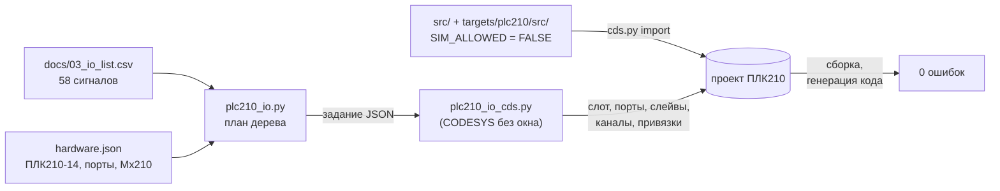

# Сборка КНС-1 для ОВЕН ПЛК210

Та же логика станции, что в имитации, — на контроллере ОВЕН ПЛК210-14 с модулями ввода-вывода Mx210 и тремя
ПЧ по Modbus RTU. Дерево устройств не настраивают руками в IDE: его строит скрипт по
[перечню сигналов](../../docs/03_io_list.csv) и описанию состава [`hardware.json`](hardware.json), а затем
собирает проект и генерирует код.

```bat
python tools_project\targets.py build plc210     :: импорт, дерево устройств, сборка, «Генерировать код»
python tools_project\targets.py check plc210     :: все объекты src/ и tests/ на устройстве ПЛК210
```

**Статус (20.10.2026): сборка — 0 ошибок, 0 предупреждений; «Генерировать код» — 0 ошибок, 0 предупреждений;
`check` — 125 объектов без ошибок.** CODESYS V3.5 SP17 Patch 3 (3.5.17.30, сборка с зеркала ОВЕН), пакет таргетов
OwenTargets 3.5.17.36 с ftp.owen.ru (описание устройства ПЛК210 3.5.17.35). В ПЛК не загружалось, модули и ПЧ не
подключались — [что не проверено](#что-не-проверено).

## Состав

| Устройство | Что | Источник данных |
|---|---|---|
| ПЛК210 `4096 / 1628 0083 / 3.5.17.35` | контроллер; по матрице ОВЕН — прошивки ПЛК210-11…15 3.7.0331.0614 и 3.8.0126.1318 | `cds_version_selector.json` ОВЕН, описание устройства |
| модуль-слот PLC210-14 `40101 / 1628 0004 / 3.5.17.3004` | левая плата: 12 DI, 4 быстрых DO; правая: 8 релейных DO (DO5…DO12), 4 универсальных AI | описания устройств LeftSide-01, RightSide-04 пакета |
| RS485-1 → «Modbus COM», COM5 | ПЧ Н1…Н3, слейвы 1…3: FC16 4x 0…1 (запись), FC3 4x 100…103 (чтение), 100 мс | номер порта — таблица портов в описании ПЛК210; регистры — перечень (условная карта ПЧ) |
| RS485-2 → «Modbus COM», COM4 | TT403, слейв 10: FC4 3x 0…1, REAL, старшее слово первым, 1000 мс | то же |
| Ethernet → Modbus TCP Master | МВ210-101 (192.168.1.20): вход 1, регистры 4000…4001; МВ210-202 (192.168.1.21): маска DI1…DI20, регистры 51…52 | РЭ МВ210-101 и МВ210-202/204 (docs.owen.ru), пример ОВЕН `Example_CodesysModbusTcpMasterMx210_3517v1` |

Устройства Modbus — штатные CODESYS («Modbus COM», «Modbus Master, COM Port», «Modbus Slave, COM Port», Modbus
TCP Master/Slave), их драйвер `IoDrvModbus` входит в пакет таргетов ОВЕН. Параметры линий (19 200 бит/с, 8E1,
таймаут 200 мс) и адреса IP — условные: уточняются по проекту шкафа в `hardware.json`.

## Как сделано



- **Каналы слейвов Modbus.** Скриптовый API CODESYS 3.5.17 добавляет устройства и меняет параметры, но каналы
  слейва не создаёт. Скрипт выгружает только что добавленный слейв в PLCopenXML, вставляет параметры каналов
  (конфигурация `CHANNEL_PACKED` и данные с привязками) и импортирует слейв обратно; затем сверяет число каналов
  и привязок. Формат параметров снят с выгрузки примеров ОВЕН `Example_CodesysModbusRtuMasterMx110_3517v1` и
  `Example_CodesysModbusTcpMasterMx210_3517v1` и закреплён тестами (`tools_project/codesys/test_plc210_io.py`).
- **Встроенный ввод-вывод.** DI и релейные DO — привязкой битов «Битовая маска входов/выходов» к переменным
  `GVL_IO`; AI — «Значение» и «Статус» каналов в массивы `PRG_FieldBusIn_Plc210`, тип датчика «4-20 mA» (11).
- **МВ210-202** — привязкой битов слова канала к `GVL_IO` (кода нет), **МВ210-101** — словами в массив и
  `F_Mx210AiToMa`.
- **Программы полевой шины** (`targets/plc210/src/`): `PRG_FieldBusIn_Plc210` — первой в `MainTask`: токи AI (NaN при ошибке
  канала или без связи с модулем), регистры ПЧ и TT403, признаки обмена `GVL_IO.xMbOk_*` := `NOT P101.xError` …
  (экземпляры диагностики слейвов `IoDrvModbus`); `PRG_FieldBusOut_Plc210` — последней: слово управления и
  задание частоты ПЧ. Функции пересчёта — в `src/POUs/Field/Owen/` флагмана, с тестами coUnit на Control Win.
- **Имитация** в этой сборке выключена (`SIM_ALLOWED`, `xSimulationReq` — FALSE), задачи модели нет;
  `OwenCloudTask` устройства сохраняется (`device.keep_tasks` в `tools/codesys/config.json`).
- Повторный запуск даёт тот же проект: порты RS-485 и Ethernet пересоздаются из задания, модуль-слот не
  трогается, если уже стоит нужный.

## Что не проверено

- **Загрузка и работа на ПЛК210**, обмен с модулями Mx210 и ПЧ — железа нет.
- **Порядок слов маски входов МВ210-202** (UINT32 в регистрах 51…52): DI1…DI16 считаются в регистре 51 — по
  аналогии с FLOAT32 в примере ОВЕН для Mx210 (младшее слово в первом регистре). В руководстве порядок слов не
  описан; на модуле — замкнуть DI1 и посмотреть бит канала.
- **Шкала встроенных AI**: при типе «4-20 mA» и границах по умолчанию (0 и 100) «Значение» считается в % диапазона
  (как у МВ210-101 по его РЭ); на ПЛК — ток 12 мА должен дать 50.
- **Значение `xError` слейва** при потере связи — по документации CODESYS на `IoDrvModbus`; компиляция
  подтверждает только, что выход есть.
- Модули Mx210 без связи: МВ210-101 даёт NaN (тревога датчика AT402), а входы МВ210-202 остаются последними
  принятыми — в перечне сигналов нет строк диагностики канала (CHF) для них.

## Привязка сигналов

Генерируется из перечня: `python tools_project/codesys/plc210_io.py table --write`; актуальность проверяет pytest
(`test_readme_table_is_current`).

<!-- plc210_io:table:begin (раздел пишет `python tools_project/codesys/plc210_io.py table --write`) -->
| Сигнал | Назначение | Канал перечня | Ресурс ПЛК210 | Переменная |
|---|---|---|---|---|
| LS102 | Поплавок «аварийно высокий уровень» (H, 4,2 м) | D1.1 | встроенный DI1 | `GVL_IO.xLS102` |
| LS103 | Поплавок «сухой ход» (L, 0,4 м) | D1.2 | встроенный DI2 | `GVL_IO.xLS103` |
| LS203 | Затопление камеры задвижек | D1.3 | встроенный DI3 | `GVL_IO.xLS203` |
| ES301 | Напряжение на вводе в норме (реле контроля фаз) | D1.4 | встроенный DI4 | `GVL_IO.xES301` |
| YS302 | ИБП шкафа управления: работа от батарей | D1.5 | встроенный DI5 | `GVL_IO.xYS302` |
| YS303 | ИБП шкафа управления: неисправность или разряд батарей | D1.6 | встроенный DI6 | `GVL_IO.xYS303` |
| ZS404 | Дверь павильона открыта | D1.7 | встроенный DI7 | `GVL_IO.xZS404` |
| YS405 | Пожар (сигнал прибора пожарной сигнализации) | D1.8 | встроенный DI8 | `GVL_IO.xYS405` |
| HS501 | Кнопка «Сброс аварий» на двери шкафа управления | D1.9 | встроенный DI9 | `GVL_IO.xHS501` |
| HS502 | Кнопка «Отключить звук» на двери шкафа управления | D1.10 | встроенный DI10 | `GVL_IO.xHS502` |
| V1_RFB | Вентилятор В1: в работе (блок-контакт пускателя) | D1.11 | встроенный DI11 | `GVL_IO.xV1_RFB` |
| V1_FLT | Вентилятор В1: авария (автомат защиты двигателя) | D1.12 | встроенный DI12 | `GVL_IO.xV1_FLT` |
| P101_RUN | Насос Н1: команда «Работа» на ПЧ | Q1.1 | встроенный DO5 (реле) | `GVL_IO.xP101_RUN` |
| P102_RUN | Насос Н2: команда «Работа» на ПЧ | Q1.2 | встроенный DO6 (реле) | `GVL_IO.xP102_RUN` |
| P103_RUN | Насос Н3: команда «Работа» на ПЧ | Q1.3 | встроенный DO7 (реле) | `GVL_IO.xP103_RUN` |
| V1_RUN | Вентилятор В1: команда «Работа» | Q1.4 | встроенный DO8 (реле) | `GVL_IO.xV1_RUN` |
| HA1 | Сирена на шкафу управления | Q1.5 | встроенный DO9 (реле) | `GVL_IO.xHA1` |
| HL1 | Лампа «Авария» на двери шкафа управления | Q1.6 | встроенный DO10 (реле) | `GVL_IO.xHL1` |
| K1 | Реле «Общая авария» (сухой контакт в диспетчерскую) | Q1.7 | встроенный DO11 (реле) | `GVL_IO.xK1` |
| LT101 | Уровень в приёмном резервуаре | A1.1 | встроенный AI1 (4–20 мА, «Значение» и «Статус») | `GVL_IO.rLT101_mA ← F_OwenAiToMa` |
| PT201 | Давление в напорном коллекторе | A1.2 | встроенный AI2 (4–20 мА, «Значение» и «Статус») | `GVL_IO.rPT201_mA ← F_OwenAiToMa` |
| FT202 | Расход в напорном коллекторе | A1.3 | встроенный AI3 (4–20 мА, «Значение» и «Статус») | `GVL_IO.rFT202_mA ← F_OwenAiToMa` |
| AT401 | Концентрация сероводорода H₂S в павильоне | A1.4 | встроенный AI4 (4–20 мА, «Значение» и «Статус») | `GVL_IO.rAT401_mA ← F_OwenAiToMa` |
| AT402 | Концентрация метана CH₄ в павильоне | A1.5 | МВ210-101 192.168.1.20, вход 1 (регистры 4000…4001) | `GVL_IO.rAT402_mA ← F_Mx210AiToMa` |
| P101_RFB | Насос Н1: ПЧ в работе (релейный выход ПЧ) | D2.1 | МВ210-202 192.168.1.21, DI1 (регистр 51, бит 0) | `GVL_IO.xP101_RFB` |
| P101_FLT | Насос Н1: авария ПЧ (релейный выход ПЧ) | D2.2 | МВ210-202 192.168.1.21, DI2 (регистр 51, бит 1) | `GVL_IO.xP101_FLT` |
| HS114 | Насос Н1: переключатель «Местное/Дистанционное» в положении «Местное» | D2.3 | МВ210-202 192.168.1.21, DI3 (регистр 51, бит 2) | `GVL_IO.xHS114` |
| TS112 | Насос Н1: перегрев обмотки (термовыключатели, реле защиты насоса) | D2.4 | МВ210-202 192.168.1.21, DI4 (регистр 51, бит 3) | `GVL_IO.xTS112` |
| MS113 | Насос Н1: протечка в камеру статора (датчик влажности, реле защиты насоса) | D2.5 | МВ210-202 192.168.1.21, DI5 (регистр 51, бит 4) | `GVL_IO.xMS113` |
| P102_RFB | Насос Н2: ПЧ в работе (релейный выход ПЧ) | D2.6 | МВ210-202 192.168.1.21, DI6 (регистр 51, бит 5) | `GVL_IO.xP102_RFB` |
| P102_FLT | Насос Н2: авария ПЧ (релейный выход ПЧ) | D2.7 | МВ210-202 192.168.1.21, DI7 (регистр 51, бит 6) | `GVL_IO.xP102_FLT` |
| HS124 | Насос Н2: переключатель «Местное/Дистанционное» в положении «Местное» | D2.8 | МВ210-202 192.168.1.21, DI8 (регистр 51, бит 7) | `GVL_IO.xHS124` |
| TS122 | Насос Н2: перегрев обмотки (термовыключатели, реле защиты насоса) | D2.9 | МВ210-202 192.168.1.21, DI9 (регистр 51, бит 8) | `GVL_IO.xTS122` |
| MS123 | Насос Н2: протечка в камеру статора (датчик влажности, реле защиты насоса) | D2.10 | МВ210-202 192.168.1.21, DI10 (регистр 51, бит 9) | `GVL_IO.xMS123` |
| P103_RFB | Насос Н3: ПЧ в работе (релейный выход ПЧ) | D2.11 | МВ210-202 192.168.1.21, DI11 (регистр 51, бит 10) | `GVL_IO.xP103_RFB` |
| P103_FLT | Насос Н3: авария ПЧ (релейный выход ПЧ) | D2.12 | МВ210-202 192.168.1.21, DI12 (регистр 51, бит 11) | `GVL_IO.xP103_FLT` |
| HS134 | Насос Н3: переключатель «Местное/Дистанционное» в положении «Местное» | D2.13 | МВ210-202 192.168.1.21, DI13 (регистр 51, бит 12) | `GVL_IO.xHS134` |
| TS132 | Насос Н3: перегрев обмотки (термовыключатели, реле защиты насоса) | D2.14 | МВ210-202 192.168.1.21, DI14 (регистр 51, бит 13) | `GVL_IO.xTS132` |
| MS133 | Насос Н3: протечка в камеру статора (датчик влажности, реле защиты насоса) | D2.15 | МВ210-202 192.168.1.21, DI15 (регистр 51, бит 14) | `GVL_IO.xMS133` |
| P101_CTW | Насос Н1: слово управления ПЧ | Modbus | RS485-1 (COM5), слейв 1, FC16 4x 0 | `GVL_IO.wP101_CTW ↔ PRG_FieldBusOut_Plc210` |
| P101_FREF | Насос Н1: задание частоты ПЧ | Modbus | RS485-1 (COM5), слейв 1, FC16 4x 1 | `GVL_IO.uiP101_FREF ↔ PRG_FieldBusOut_Plc210` |
| P101_STW | Насос Н1: слово состояния ПЧ | Modbus | RS485-1 (COM5), слейв 1, FC3 4x 100 | `GVL_IO.wP101_STW ↔ PRG_FieldBusIn_Plc210` |
| P101_FACT | Насос Н1: фактическая частота ПЧ | Modbus | RS485-1 (COM5), слейв 1, FC3 4x 101 | `GVL_IO.uiP101_FACT ↔ PRG_FieldBusIn_Plc210` |
| IT111 | Насос Н1: ток двигателя (измеряет ПЧ) | Modbus | RS485-1 (COM5), слейв 1, FC3 4x 102 | `GVL_IO.uiIT111 ↔ PRG_FieldBusIn_Plc210` |
| P101_FCODE | Насос Н1: код последней аварии ПЧ (читает адаптер ПЧ) | Modbus | RS485-1 (COM5), слейв 1, FC3 4x 103 | `GVL_IO.uiP101_FCODE ↔ PRG_FieldBusIn_Plc210` |
| P102_CTW | Насос Н2: слово управления ПЧ | Modbus | RS485-1 (COM5), слейв 2, FC16 4x 0 | `GVL_IO.wP102_CTW ↔ PRG_FieldBusOut_Plc210` |
| P102_FREF | Насос Н2: задание частоты ПЧ | Modbus | RS485-1 (COM5), слейв 2, FC16 4x 1 | `GVL_IO.uiP102_FREF ↔ PRG_FieldBusOut_Plc210` |
| P102_STW | Насос Н2: слово состояния ПЧ | Modbus | RS485-1 (COM5), слейв 2, FC3 4x 100 | `GVL_IO.wP102_STW ↔ PRG_FieldBusIn_Plc210` |
| P102_FACT | Насос Н2: фактическая частота ПЧ | Modbus | RS485-1 (COM5), слейв 2, FC3 4x 101 | `GVL_IO.uiP102_FACT ↔ PRG_FieldBusIn_Plc210` |
| IT121 | Насос Н2: ток двигателя (измеряет ПЧ) | Modbus | RS485-1 (COM5), слейв 2, FC3 4x 102 | `GVL_IO.uiIT121 ↔ PRG_FieldBusIn_Plc210` |
| P102_FCODE | Насос Н2: код последней аварии ПЧ (читает адаптер ПЧ) | Modbus | RS485-1 (COM5), слейв 2, FC3 4x 103 | `GVL_IO.uiP102_FCODE ↔ PRG_FieldBusIn_Plc210` |
| P103_CTW | Насос Н3: слово управления ПЧ | Modbus | RS485-1 (COM5), слейв 3, FC16 4x 0 | `GVL_IO.wP103_CTW ↔ PRG_FieldBusOut_Plc210` |
| P103_FREF | Насос Н3: задание частоты ПЧ | Modbus | RS485-1 (COM5), слейв 3, FC16 4x 1 | `GVL_IO.uiP103_FREF ↔ PRG_FieldBusOut_Plc210` |
| P103_STW | Насос Н3: слово состояния ПЧ | Modbus | RS485-1 (COM5), слейв 3, FC3 4x 100 | `GVL_IO.wP103_STW ↔ PRG_FieldBusIn_Plc210` |
| P103_FACT | Насос Н3: фактическая частота ПЧ | Modbus | RS485-1 (COM5), слейв 3, FC3 4x 101 | `GVL_IO.uiP103_FACT ↔ PRG_FieldBusIn_Plc210` |
| IT131 | Насос Н3: ток двигателя (измеряет ПЧ) | Modbus | RS485-1 (COM5), слейв 3, FC3 4x 102 | `GVL_IO.uiIT131 ↔ PRG_FieldBusIn_Plc210` |
| P103_FCODE | Насос Н3: код последней аварии ПЧ (читает адаптер ПЧ) | Modbus | RS485-1 (COM5), слейв 3, FC3 4x 103 | `GVL_IO.uiP103_FCODE ↔ PRG_FieldBusIn_Plc210` |
| TT403 | Температура воздуха в павильоне | Modbus | RS485-2 (COM4), слейв 10, FC4 3x 0 | `GVL_IO.rTT403 ↔ PRG_FieldBusIn_Plc210` |
<!-- plc210_io:table:end -->
